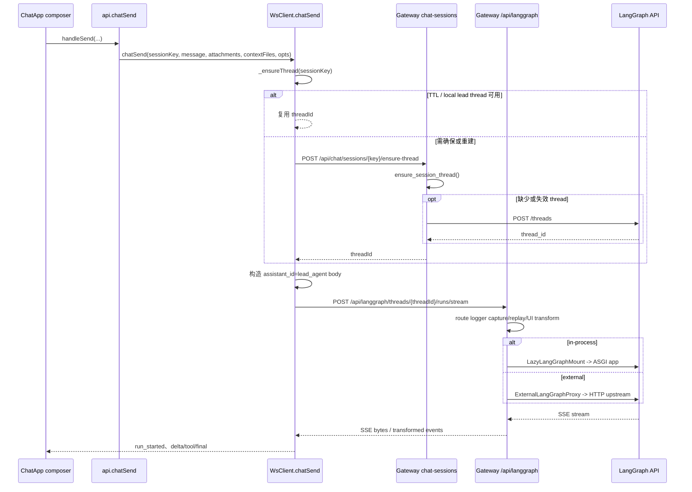

# 检查点 A：EvoPanel 普通主对话的 Run 创建入口

> **范围**：本文件只记录第二阶段 Agent Runtime 的检查点 A：从 EvoPanel 普通主对话发送到 LangGraph `POST /runs/stream` Run 创建请求的真实源码链、Gateway 承接分支、请求/流输出边界与相关测试。它**不**分析 Lead Agent graph factory、Middleware、Tool loop、LangGraph 内部 State/Node/Edge、Checkpointer、Multi-Agent、Harness 或 Memory 的完整实现；这些属于后续检查点 B–F。
>
> **术语说明**：Agent Runtime（智能体运行时）负责接收并推进一次 Agent Run（运行）；Stream（流）是 Run 的增量事件通道；Graph（计算图）由 LangGraph 调度；Gateway（网关）负责 HTTP/SSE 承接。
>
> **审核状态**：🧍‍♂️ 已完成，等待用户审核；本次未修改既有研究结论。
>
> **证据标准**：`[源码证实]` 表示已阅读本仓对应代码；`[测试已读]` 表示已检查真实断言但不代表已运行通过；`[待确认]` 表示本检查点未能从源码闭合的链路；`[外部框架边界]` 表示请求已交给锁定版本 LangGraph API/ASGI，但其内部实现不在本检查点展开。

## 1. 结论摘要

1. `[源码证实]` EvoPanel 普通主对话由 React composer 的 `handleSend()` 发起，最终经 `api.chatSend()` 调用 `wsClient.chatSend()`。  
   - `evopanel/src/react/chat-app/composer/handle-send.ts:863-880`
   - `evopanel/src/lib/tauri-api.js:2602-2604`
   - `evopanel/src/lib/ws-client.js:6305+`

2. `[源码证实]` `WsClient.chatSend()` 先确保 LangGraph thread，再创建/启动一轮 Run 并建立初始流：

   ```text
   POST /api/langgraph/threads/{threadId}/runs/stream
   ```

   - thread 确保：`evopanel/src/lib/ws-client.js:6320-6335`
   - Run POST：`evopanel/src/lib/ws-client.js:6986-7012`
   - request body：`evopanel/src/lib/ws-client.js:6877-6895`

3. `[源码证实]` 普通主对话默认传入 `assistant_id: "lead_agent"`；仅会话启用 Claude Code chat 时切换为 `claude_code_chat`。这证明默认主聊天的 Runtime graph 标识是 `lead_agent`，但 graph factory 解析留给检查点 B。  
   - `evopanel/src/lib/ws-client.js:6513-6521,6877-6879`

4. `[源码证实]` Gateway 统一 mount `/api/langgraph`。部署模式决定该路径进入延迟加载的 in-process LangGraph ASGI app，还是进入 external LangGraph HTTP proxy；前端 Run API 路径不变。  
   - `backend/app/gateway/router_registry.py:117-133`
   - `backend/app/gateway/lazy_langgraph.py:39-197,218-342`

5. `[源码证实]` `GET /api/langgraph/threads/{thread_id}/runs/{run_id}/stream` 是已有 Run 的 attach/refresh 入口，不能误判为 Run 创建。  
   - `backend/app/gateway/routers/langgraph_proxy.py:508+`
   - `backend/app/gateway/routers/langgraph_proxy.py:950-957`

## 2. 入口与出口地图

| 层 | 文件与符号 | 行号 | 输入 | 输出/下一跳 | 证据 |
|---|---|---:|---|---|---|
| UI composer | `handleSend()` | `evopanel/src/react/chat-app/composer/handle-send.ts:38-44,863-880` | 文本、附件、context files、会话状态 | 调用注入的 `send(sessionKey, ...)`，等待当前聊天流完成 | 源码证实 |
| API facade | `api.chatSend` | `evopanel/src/lib/tauri-api.js:2602-2604` | `sessionKey`、message、attachments、contextFiles、opts | `wsClient.chatSend(...)` | 源码证实 |
| 聊天 transport | `WsClient.chatSend()` | `evopanel/src/lib/ws-client.js:6305+` | 相同 payload | ensure thread、构建 Run body、POST stream、解析 SSE | 源码证实 |
| Gateway session API | `ensure_session_thread()` | `backend/app/gateway/routers/chat_sessions.py:1529-1598` | session key、可选 `force_recreate` | 调用持久化服务，返回 LangGraph thread ID | 源码证实 |
| Session service | `ensure_session_thread()` | `backend/packages/harness/evoflow/persistence/chat_session_service.py:636-816` | session key、已有持久化 thread | 信任、探测或重建 thread；必要时写回 session row | 源码证实 |
| LangGraph mount | `LazyLangGraphMount` / `ExternalLangGraphProxy` | `backend/app/gateway/lazy_langgraph.py:218-342` | `/api/langgraph/*` ASGI scope/body | 交给 in-process app 或 HTTP upstream | 源码证实 |
| Runtime execution | LangGraph API | 本检查点不进入内部实现 | `assistant_id`、`input`、`context` | graph 解析/执行 | 外部框架边界；留待 B |

### 本检查点出口

研究在以下边界停止：

```text
POST /api/langgraph/threads/{threadId}/runs/stream
  → Gateway mount / proxy
  → LangGraph API 接收 assistant_id=lead_agent
```

`assistant_id="lead_agent"` 如何解析 `backend/langgraph.json` 并调用 `make_lead_agent()`，不在检查点 A 范围内。

## 3. 已证实调用链

| # | 调用关系 | 输入/状态 | 输出/副作用 | 证据 |
|---:|---|---|---|---|
| 1 | `handleSend()` → `send()` | UI message、附件、context files、optimistic message ID | 发送并等待该轮 stream；异常时回滚 UI 状态 | `handle-send.ts:863-920` |
| 2 | `api.chatSend()` → `wsClient.chatSend()` | 相同参数 | 进入专用聊天 transport | `tauri-api.js:2602-2604` |
| 3 | `chatSend()` → `_ensureThread()` | session key | 有效 lead thread ID，否则停止发送 | `ws-client.js:6320-6335` |
| 4 | `_ensureThread()` → `_ensureThreadOnce()` | TTL、本地 session map、inflight/backoff | 优先复用本地合法 ID；需要时 POST ensure-thread | `ws-client.js:5717-5778` |
| 5 | `_ensureThreadOnce()` → `POST /api/chat/sessions/{key}/ensure-thread` | session key；可加 `force_recreate=1` | 返回、写回并通知新的 thread ID | `ws-client.js:5808-5839` |
| 6 | Gateway route → `chat_svc.ensure_session_thread()` | 已鉴权 session key、`force_recreate` | 返回 thread；强制重建时可做 V4 rehydrate | `chat_sessions.py:1529-1598` |
| 7 | `chat_svc.ensure_session_thread()` → `create_langgraph_thread()` | 缺少或失效 thread 时 | `POST threads` 创建执行 thread；重映射 session transcript 行的 thread ID | `chat_session_service.py:745-816`; `:285-321` |
| 8 | `chatSend()` 构建 body | 本轮 user message、runContext、stream 配置 | 默认 `assistant_id=lead_agent` 的 JSON request body | `ws-client.js:6849-6895` |
| 9 | `chatSend()` → `evoflowFetchStream()` | POST URL、JSON body、AbortSignal、stream callback | 浏览器 fetch 或桌面 Tauri transport | `ws-client.js:6986-7012`; helper `:1080+` |
| 10 | Gateway `/api/langgraph` mount | ASGI scope/body | in-process `lg_app` 或 external HTTP upstream | `router_registry.py:125-133`; `lazy_langgraph.py:218-342` |
| 11 | `LangGraphRouteLoggerMiddleware` | POST body、thread ID、query | 捕获/重放 body、规范交互 strategy、启用 UI SSE transform | `gateway_shell.py:41-43`; `langgraph_route_logger.py:67-129,1056-1058` |
| 12 | LangGraph API | assistant ID、input、context/config | graph 执行 | 外部框架边界；检查点 B |



## 4. Thread 准备与 Run 创建的区别

### 4.1 前端 `_ensureThread()` 策略

`_ensureThread()` 的实际逻辑为：

1. 优先复用成功 TTL（30 分钟）；
2. 再复用本地 session map 的合法 lead UUID；
3. 合并同 session 并发 ensure；
4. 必要时调用 `POST /api/chat/sessions/{key}/ensure-thread`；
5. `/runs/stream` 返回 thread/assistant missing 时，清理缓存、调用 `force_recreate=1` 并最多重试一次发送。

证据：

- TTL/inflight/backoff：`evopanel/src/lib/ws-client.js:510-524`
- 快路径/合并/失败退避：`ws-client.js:5717-5778`
- ensure request、session-map 更新：`ws-client.js:5808-5839`
- 404 后重建与重试：`ws-client.js:5799-5806,7059-7094,8390-8407`

### 4.2 后端 thread 创建

`create_langgraph_thread(session_key)` 向 LangGraph base URL 的 `threads` 资源发送 POST，并携带 session key、长运行限制、execution mode 和 source metadata。返回的 `thread_id` 供后续 Run 使用。  
证据：`backend/packages/harness/evoflow/persistence/chat_session_service.py:285-321`。

### 4.3 两类请求不能混淆

| HTTP 操作 | 目的 | 代码证据 |
|---|---|---|
| `POST /api/langgraph/threads` | 创建可执行的 LangGraph thread，本身不执行模型 | `chat_session_service.py:285-321` |
| `POST /api/langgraph/threads/{threadId}/runs/stream` | 创建/启动一次 Run，并建立初始 SSE 流 | `ws-client.js:6986-7012` |
| `GET /api/langgraph/threads/{threadId}/runs/{runId}/stream` | attach/refresh 已经存在的 Run 流 | `langgraph_proxy.py:508+` |

## 5. Run 请求载荷

### 5.1 实际 body 形状

下列结构来自 `WsClient.chatSend()` 的真实 body 构造；`runContext` 的完整字段消费不在本检查点展开。

```json
{
  "assistant_id": "lead_agent",
  "input": { "messages": ["本轮 user message"] },
  "stream_mode": ["values", "messages-tuple", "custom"],
  "streamSubgraphs": true,
  "streamResumable": true,
  "durability": "exit",
  "multitask_strategy": "interrupt",
  "config": { "recursion_limit": "LONG_RUN_RECURSION_LIMIT" },
  "context": "runContext"
}
```

证据：`evopanel/src/lib/ws-client.js:6873-6895`。

| 字段 | 本检查点确认的含义 |
|---|---|
| `assistant_id` | 普通主对话默认定位到 `lead_agent`；Claude Code 会话例外 |
| `input.messages` | 本轮 user message；含 text、可选 image URL blocks 和 additional kwargs |
| `stream_mode` | 请求 `values`、`messages-tuple`、`custom` 三类 stream 事件 |
| `durability` | 前端请求值为 `exit`；其与 Checkpointer 的精确落盘时机留待 F |
| `multitask_strategy` | 交互式主聊天请求值为 `interrupt` |
| `config` | 当前可确认显式含 `recursion_limit` |
| `context` | Run context；其字段合并和 Runtime 消费留待 B/C |

### 5.2 Transcript 与 Run input 边界

前端在创建 Run 前异步调用 transcript append，但不等待完成；Run `input.messages` 只发送当前 user message。源码注释把 `evoflow_chat_messages` 描述为模型上下文 SSOT，而输入消息是运行时内存输入与异步落库竞态兜底。该设计与 hydration/checkpoint 的完整关系留待检查点 C、D、F。  
证据：`evopanel/src/lib/ws-client.js:6817-6847,6868-6873`。

## 6. Gateway 承接与运行模式分支

### 6.1 挂载选择

`register_core_routers()` 注册 `langgraph_proxy` 的辅助路由后，根据 `is_external_langgraph_mode()` 设置 external proxy 或 in-process 标记，再 mount：

```python
app.mount("/api/langgraph", LazyLangGraphMount(app))
```

证据：`backend/app/gateway/router_registry.py:117-133`。

### 6.2 In-process 与 external 分支

| 模式 | 处理方式 | 证据 |
|---|---|---|
| Deferred in-process | `LazyLangGraphMount` 在 `app.state._lg_app` 未就绪时返回 503，已就绪后直接调用其 ASGI app | `lazy_langgraph.py:318-342` |
| In-process 初始化 | `ensure_langgraph_mounted()` 以 lock 只初始化一次，并通过 `mount_langgraph_in_process()` 获得 LangGraph app | `lazy_langgraph.py:39-197` |
| External | `ExternalLangGraphProxy` 读取 body，去掉 Gateway mount prefix，使用 `httpx` 流式转发并逐 chunk 回写 | `lazy_langgraph.py:218-301` |

```mermaid
flowchart LR
  Request[POST /api/langgraph/threads/{threadId}/runs/stream]
  Transport{客户端 transport}
  Browser[Browser fetch]
  Tauri[Rust gateway_proxy_stream]
  Gateway[Gateway /api/langgraph mount]
  Mode{部署模式}
  InProcess[LazyLangGraphMount<br/>LangGraph ASGI]
  External[ExternalLangGraphProxy<br/>HTTP upstream]
  LG[LangGraph API]

  Request --> Transport
  Transport -->|Web| Browser --> Gateway
  Transport -->|Tauri 默认优先| Tauri --> Gateway
  Gateway --> Mode
  Mode -->|in-process| InProcess --> LG
  Mode -->|external| External --> LG
```

### 6.3 Desktop transport

在 Tauri 环境中，`evoflowFetchStream()` 优先调用 Rust `gateway_proxy_stream`。它传递同一 method/path/body 的 HTTP 请求，并把 Gateway 返回的流式字节通过 `Channel<Vec<u8>>` 回到 WebView；app-server pipe 或 HTTP 是备用 transport，不改变 Run URL 或 body 语义。  
证据：

- `evopanel/src/lib/ws-client.js:833-958,1080-1220`
- `evopanel/src-tauri/src/commands/gateway.rs:293-445`

## 7. Gateway POST 处理边界

`install_pre_start_middleware()` 安装 `LangGraphRouteLoggerMiddleware`，使普通主对话 POST 进入 body 观测与 UI stream 转换范围。  
证据：`backend/app/gateway/gateway_shell.py:22-43`; `backend/app/gateway/langgraph_route_logger.py:1056-1058`。

对于 `POST .../runs/stream`，已证实 middleware 会识别 POST stream 请求、捕获和重放请求 body、准备 UI transform/stream middle layer，并在完成/取消时进行 stream 清理和观测。  
证据：`backend/app/gateway/langgraph_route_logger.py:67-129,1038-1048`。

> `[边界说明]` 本检查点只确认 Gateway 对请求/响应流的承接。LangGraph 依据 `assistant_id` 解析 graph、创建 graph state 或执行模型的内部过程不在本文件范围。

## 8. 测试证据与运行结果

### 8.1 已检查真实断言

| 测试 | 真实断言 | 覆盖结论 | 本次结果 |
|---|---|---|---|
| `backend/tests/test_traffic_lanes.py::test_stream_is_stream` | `classify_path("/api/langgraph/threads/x/runs/stream").lane == Lane.STREAM` | `/runs/stream` 属于 Gateway long-lived stream lane | 未单独运行 |
| `backend/tests/test_gateway_git_best_effort.py::test_streaming_paths_excluded_from_hang_inflight` | 参数化断言 `/api/langgraph/threads/t1/runs/stream` 被识别为 streaming | 该路径不按普通 hang inflight 处理 | 未单独运行 |
| `backend/tests/test_langgraph_runtime_env_concurrency.py` | 4 个断言验证 `n_jobs_per_worker` 默认值、环境覆盖和 `evopanel.json` 覆盖优先级 | LangGraph Runtime 并发配置；不直接验证 Run body | **4 passed** |
| `evopanel/tests/app-server-client.test.js::defaults off so chat uses Rust gateway_proxy_stream` | `shouldUseAppServerChatPipe()` 默认 `false` | 桌面 chat 默认优先 Rust stream proxy | 环境阻塞，未执行到 Vitest |
| `evopanel/tests/session-reattach.test.js::reattach history-watches without calling stream-resume` | `resumeChatStream` 未被调用，history reload 至少两次 | attach/recovery 与新 POST Run 语义区分 | 环境阻塞，未执行到 Vitest |
| `evopanel/tests/stream-resume-gate.test.js::shouldSuppressAutoReattach blocks during POST stream wire` | 标记 wire 为 `run` 时自动 reattach 为 `true` | 前端把 POST `/runs/stream` 标为活跃 stream wire | 环境阻塞，未执行到 Vitest |
| `evopanel/tests/run-turn-gate.test.js::allows run_started before active bind` | `run_started` 在 active bind 前允许，而 delta 不允许 | 对应 `chatSend()` 在 POST 前发 provisional `run_started` | 未单独运行 |

### 8.2 实际执行命令

```bash
cd /Users/main/EvoFlow
uv run --project backend pytest -q backend/tests/test_langgraph_runtime_env_concurrency.py
```

结果：

```text
4 passed in 20.38s
```

```bash
cd /Users/main/EvoFlow
pnpm --dir evopanel exec vitest run \
  tests/app-server-client.test.js \
  tests/session-reattach.test.js \
  tests/stream-resume-gate.test.js
```

结果：**未执行测试收集**。pnpm 解析依赖 `detect-libc@^2.0.3` 时访问 npm registry 发生连接重置：

```text
ERR_PNPM_BAD_CONFIG_DEP
Failed to fetch metadata from https://registry.npmjs.org/detect-libc
Connection reset by peer (os error 54)
```

该结果属于环境/网络阻塞，不表示前端测试通过或失败。

## 9. 已证实事实

1. 普通主对话最终调用 `wsClient.chatSend()`。
2. `chatSend()` 先确保存在合法 LangGraph lead thread。
3. 真实 Run 创建入口是 `POST /api/langgraph/threads/{threadId}/runs/stream`。
4. 默认 assistant ID 是 `lead_agent`。
5. 初始请求携带本轮 user input、三种 stream mode、`durability: "exit"`、`multitask_strategy: "interrupt"` 和 `context`。
6. `GET .../runs/{runId}/stream` 是 attach/refresh，不是创建。
7. `/api/langgraph` 同时支持 in-process ASGI 和 external HTTP proxy 两种承接模式。
8. Tauri 默认优先通过 Rust `gateway_proxy_stream` 传输同一个 Run POST。
9. 后端最小 LangGraph runtime 并发配置测试已运行并通过：4 passed。

## 10. 未解决问题

1. LangGraph API 收到 `assistant_id="lead_agent"` 后怎样解析 `backend/langgraph.json` 并调用 `make_lead_agent()`；这是检查点 B。
2. `runContext` 的完整来源、覆盖优先级与 Lead Agent 消费点；这是检查点 C。
3. `durability: "exit"` 与 Checkpointer 写入时机的精确关系；这是检查点 F。
4. Gateway 透明 404 remint/replay 的完整条件和它与前端 retry 的去重关系，需要在后续 stream/状态研究逐行闭合。
5. 锁定版本 LangGraph API 对 `streamSubgraphs`、`streamResumable`、各 `stream_mode` 的内部语义，需要从对应版本实际源码验证。
6. Channel、Automation、Goal、任务 worker 是否使用不同的 Run body；本检查点只研究普通 EvoPanel 主对话。
7. 三个前端 Vitest 文件因 npm registry 网络错误未运行，需在依赖可用时重试相同命令。

## 11. 检查点 A 完成判定

**完成：** 已从真实源码定位普通 EvoPanel 主对话的 Run 创建入口、thread 前置路径、POST body、Gateway 运行模式分支、desktop transport，并区分了 initial POST stream 与 existing-run attach。

**未推进：** 未分析 `make_lead_agent()`、Prompt、Middleware、Tool、StateGraph、Checkpointer 或其他核心模块；下一步必须等待人工审核，不能自动开始检查点 B。