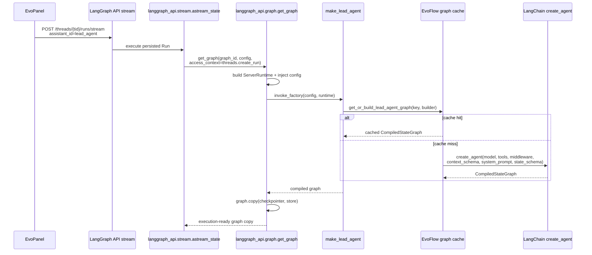
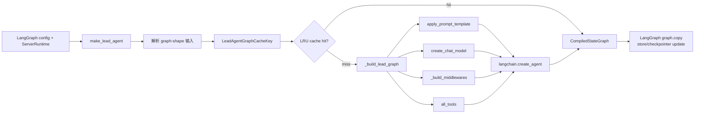

# 检查点 B：Graph 解析、Lead Agent Factory 与编译图缓存

> **范围**：本文件承接检查点 A 的普通主对话 Run 创建入口，只追踪 `assistant_id="lead_agent"` 到 graph factory、锁定版本 LangGraph API factory 调用、EvoFlow Lead Agent graph cache 与 `create_agent()` 编译产物的链路。
>
> **术语说明**：Graph Factory（图工厂）是按 Run 配置返回 Agent Graph（智能体计算图）的函数；Graph Cache（计算图缓存）复用已编译图，避免反复执行 `create_agent()`；Runtime（运行时）由 LangGraph 在执行时注入。
>
> **审核状态**：🧍‍♂️ 已完成，等待用户审核；本次未修改既有研究结论。
>
> **不在范围**：Prompt 内容、Context 字段语义、Middleware 执行顺序、Tool 生命周期、Checkpointer 写入时机与 Multi-Agent/Memory/Harness 完整实现，分别留待检查点 C–F 或其他模块。
>
> **锁定框架版本**：`langchain 1.2.3`、`langchain-core 1.2.17`、`langgraph 1.0.9`、`langgraph-api 0.7.65`、`langgraph-checkpoint 4.0.0`。版本来自 `backend/uv.lock`，并已从 `backend/.venv` 实际安装包读取源码。

## 1. 结论摘要

1. `[源码证实]` EvoFlow 将 `lead_agent` 注册为字符串 graph spec：

   ```json
   "lead_agent": "evoflow.agents.lead_agent.agent:make_lead_agent"
   ```

   证据：`backend/langgraph.json:8-13`。

2. `[源码证实 + 探针验证]` in-process Gateway 从 `langgraph.json` 读取 `graphs`，写入 `LANGSERVE_GRAPHS`；LangGraph 生命周期在启动 queue 前调用锁定版本 `collect_graphs_from_env(register=True)`，将 `lead_agent` 注册到 `langgraph_api.graph.GRAPHS`。  
   - `backend/app/gateway/lazy_langgraph.py:48-88`
   - `backend/app/gateway/background_startup.py:763-777`
   - `backend/.venv/lib/python3.12/site-packages/langgraph_api/graph.py:338-493`

3. `[源码证实 + 探针验证]` 锁定版本 `langgraph-api 0.7.65` 将 `make_lead_agent(config, runtime)` 分类为 factory。执行型请求由 `get_graph(..., access_context="threads.create_run")` 建立 `ServerRuntime`、注入 config/runtime、调用 `invoke_factory()`，即调用 `make_lead_agent(config=..., runtime=...)`。  
   - `langgraph_api/_factory_utils.py:45-145,151-184`
   - `langgraph_api/graph.py:201-260`
   - `langgraph_api/stream.py:137-175`

4. `[源码证实]` `get_graph()` 不直接复用 factory 返回的 graph 实例：factory 返回 graph 后，框架会验证类型并 `yield graph_obj.copy(update={"checkpointer": ..., "store": ...})`。因此每次执行都需要 factory 路径，但 EvoFlow factory 内部的 process-local cache 可避免重复调用 `create_agent()`。  
   证据：`langgraph_api/graph.py:214-258`。

5. `[源码证实 + 探针验证]` `make_lead_agent()` 构造 `LeadAgentGraphCacheKey`，然后调用 `get_or_build_lead_agent_graph(cache_key, _build_lead_graph)`。cache hit 返回同一个 compiled graph 对象；cache miss 运行 builder。  
   - `backend/packages/harness/evoflow/agents/lead_agent/agent.py:1816-1905`
   - `backend/packages/harness/evoflow/agents/lead_agent/graph_cache.py:20-111`

6. `[源码证实]` cache builder 使用锁定版本 `langchain.agents.create_agent()`，向它传入模型、全量 bound tools、EvoFlow middleware 列表、`LeadAgentRuntimeContext`、已组装 system prompt 和 `ThreadState`。`create_agent()` 返回 `CompiledStateGraph`。  
   - EvoFlow：`agent.py:1849-1901`
   - LangChain：`backend/.venv/lib/python3.12/site-packages/langchain/agents/factory.py:541-559,1474-1480`

## 2. 从 Run 到 Factory 的完整调用链

### 2.1 调用链

| # | 调用关系 | 输入/输出 | 证据等级 |
|---:|---|---|---|
| 1 | 普通聊天 POST → LangGraph stream | `POST /api/langgraph/threads/{threadId}/runs/stream`，body 默认 `assistant_id="lead_agent"` | 检查点 A 已证实：`evopanel/src/lib/ws-client.js:6877-6895,6994-7005` |
| 2 | Gateway mount → LangGraph ASGI/API | in-process ASGI 或 external upstream 接收同一请求路径 | 检查点 A 已证实：`router_registry.py:117-133`; `lazy_langgraph.py:218-342` |
| 3 | `astream_state()` → `get_graph()` | 从 Run `kwargs` 得到 `config`，以 `configurable["graph_id"]` 选择 graph，access context 为 `threads.create_run` | 源码证实：`langgraph_api/stream.py:137-175` |
| 4 | `get_graph()` → factory runtime injection | 找到 `GRAPHS[graph_id]`；若 factory，构造 execution runtime、注入 runtime/checkpointer/`__is_for_execution__` | 源码证实：`langgraph_api/graph.py:214-240`; `_factory_utils.py:151-170` |
| 5 | `invoke_factory()` → `make_lead_agent()` | classifier 按函数签名传 `config` 与 `runtime` kwargs | 源码证实：`_factory_utils.py:91-140,173-184` |
| 6 | `make_lead_agent()` → graph cache | 合并 runtime context/configurable，完成 graph-shape 参数计算，建立 cache key | 源码证实：`agent.py:1044-1081,1809-1847` |
| 7 | cache hit 或 builder | hit 返回缓存 compiled graph；miss 执行 `_build_lead_graph()` | 源码证实：`graph_cache.py:76-111`; `agent.py:1849-1905` |
| 8 | builder → `create_agent()` | 返回 LangChain `CompiledStateGraph` | 源码证实：`agent.py:1887-1901`; `factory.py:541-559,1474-1480` |
| 9 | LangGraph API → graph copy | 使用当前 store/checkpointer 对 graph `.copy(update=...)` 后交给 Run 执行 | 源码证实：`langgraph_api/graph.py:241-258` |



## 3. Graph 注册与 Factory 分类

### 3.1 EvoFlow 配置到环境变量

`load_langgraph_server_config()` 查找并解析 `langgraph.json`；当其中没有有效 `graphs` 时才回退到默认 `lead_agent` mapping。In-process mount 将解析到的 `graphs` JSON 写入 `LANGSERVE_GRAPHS`。  
证据：

- `backend/packages/harness/evoflow/langgraph_runtime_env.py:181-211`
- `backend/app/gateway/lazy_langgraph.py:48-58`

### 3.2 注册时机

Gateway background startup 显式要求在 queue worker 启动前注册 graph，避免 worker 领取 Run 时 `GRAPHS` 仍为空。代码会在缺少 `lead_agent` 时抛出错误。  
证据：`backend/app/gateway/background_startup.py:763-777`。

### 3.3 锁定版 LangGraph API 的注册行为

`collect_graphs_from_env(register=True)`：

1. 解析 `LANGSERVE_GRAPHS` JSON；
2. 把 `lead_agent` spec 拆成 module `evoflow.agents.lead_agent.agent` 与 variable `make_lead_agent`；
3. `_graph_from_spec()` import module 并取得 callable；
4. `register_graph()` 保存至 `GRAPHS[graph_id]`；
5. callable 触发 `classify_factory()`。

证据：

- spec 解析：`langgraph_api/graph.py:338-411`
- import/读取 variable：`langgraph_api/graph.py:533-655`
- register：`langgraph_api/graph.py:59-79`
- Python spec 循环：`langgraph_api/graph.py:485-493`

### 3.4 运行探针

使用实际已安装的锁定版包运行：

```bash
DATABASE_URI='sqlite:////tmp/evoflow-runtime-probe.db' \
REDIS_URI=fake \
LANGGRAPH_RUNTIME_EDITION=inmem \
LANGSERVE_GRAPHS='{"lead_agent":"evoflow.agents.lead_agent.agent:make_lead_agent"}' \
backend/.venv/bin/python -c '... collect_graphs_from_env(register=True) ...'
```

输出：

```text
registered= ['lead_agent']
is_factory= True
factory_kwarg_names= ['config', 'runtime']
```

因此 `make_lead_agent(config: RunnableConfig, runtime: ServerRuntime | None = None)` 的双参数签名已被锁定版 API 识别为 factory，且实际传入这两个 keyword 参数。

## 4. 执行型 `get_graph()` 与 graph copy 语义

`langgraph_api.stream.astream_state()` 在执行 Run 时：

```python
graph = await stack.enter_async_context(
    get_graph(
        configurable["graph_id"],
        config,
        store=...,
        checkpointer=...,
        access_context="threads.create_run",
    )
)
```

证据：`backend/.venv/lib/python3.12/site-packages/langgraph_api/stream.py:137-175`。

对于 factory graph，`get_graph()`：

1. 确保并合并 config/auth；
2. 建立 execution `ServerRuntime`；
3. 写入 runtime、checkpointer 与 `__is_for_execution__` 到 configurable config；
4. 调用 `invoke_factory(value, graph_id, config, server_runtime)`；
5. 将 factory 结果变成 graph object；若结果是 `StateGraph`，先编译；
6. 对结果调用 `.copy(update={"checkpointer": ..., "store": ...})`，再 yield 给本次 Run。

证据：`langgraph_api/graph.py:201-260`。

**重要边界：** factory 会在每个 `get_graph()` 执行路径被调用；但是 `make_lead_agent()` 内部可命中 EvoFlow cache，因此“每次 Run 都重新编译 LangChain graph”不是事实。

## 5. Lead Agent Factory 与缓存

### 5.1 Factory 输入合并

`make_lead_agent()` 先从 `runtime` 提取用户 context，并将其覆盖合并到 `config["configurable"]`：

```python
rt_ctx = _user_context_from_server_runtime(runtime)
base_conf = dict(config.get("configurable") or {})
cfg = {**base_conf, **rt_ctx}
effective_config = {**config, "configurable": cfg}
```

证据：`backend/packages/harness/evoflow/agents/lead_agent/agent.py:1044-1054`。

本检查点只确认合并发生及其调用位置；具体字段优先级、prompt/context 消费留待检查点 C。

### 5.2 Cache key

`LeadAgentGraphCacheKey` 包含会影响 graph 结构的维度，例如：模型、agent、thinking、session/plan mode、工具模式/白名单、MCP/Skills 指纹、自定义 prompt hash、上下文压缩开关、能力版本、凭据指纹和 schema version。  
定义：`graph_cache.py:32-73`；实际赋值：`agent.py:1816-1847`。

特别地：

- `mcp_tools_fp` 防止冷启动时以空 MCP 工具集构建的图在 MCP warm 后继续复用；
- `credentials_fp` 用于 API key/base URL 变化；
- `capability_fp` 追踪 agent tools/MCP/skills 的跨进程编辑；
- `is_bootstrap=True` 直接绕过 cache。

证据：`graph_cache.py:60-67,81-111`; `agent.py:1831-1846`。

### 5.3 Cache 行为

`get_or_build_lead_agent_graph()`：

- `EVOFLOW_LEAD_AGENT_GRAPH_CACHE=0/false/no/off` 时禁用；默认启用；
- 默认最多 12 项，可用 `EVOFLOW_LEAD_AGENT_GRAPH_CACHE_SIZE` 调整；
- `_CACHE` 是带锁的 `OrderedDict`，hit 时移到末尾；
- miss 后 builder 执行，超容量时淘汰最旧项；
- `clear_lead_agent_graph_cache()` 会清空并触发已注册 callback。

证据：`graph_cache.py:15-29,76-140`。

无模型探针：清 cache 后，用同一 key 两次调用 cache API，输出：

```text
same_object= True
first_hit= False
second_hit= True
builder_calls= 1
```

### 5.4 Builder 与 `create_agent()` 边界

cache miss 时 `_build_lead_graph()`：

1. 调用 `apply_prompt_template(...)` 生成 system prompt；
2. 调用 `create_chat_model(...)`；
3. 调用 `_build_middlewares(...)`；
4. 将 `all_tools`、middleware、`LeadAgentRuntimeContext`、`ThreadState` 与 system prompt 传入 `create_agent(...)`。

证据：`agent.py:1849-1901`。

锁定版 `langchain.agents.create_agent()` 的返回注解是 `CompiledStateGraph`，末尾调用 `graph.compile(...)`。  
证据：`backend/.venv/lib/python3.12/site-packages/langchain/agents/factory.py:541-559,1474-1480`。

> 本文只记录 builder 的依赖边界；Prompt、Middleware 和 Tool 的内部装配将由后续检查点分别分析。



## 6. 预热与失效

### 6.1 预热

Gateway in-process startup 在 mount 后可启动后台 warm thread；另有 post-ready warmup，按常见 Panel variants 调用 `make_lead_agent()`。预热不会直接作为 Run 执行，但会填充相同进程的 graph cache。  
证据：

- `backend/app/gateway/background_startup.py:500-523`
- `background_startup.py:867-925`
- `backend/packages/harness/evoflow/agents/lead_agent/warm.py:25-67`

### 6.2 能力变更失效

Agent capability 变更路径调用 `clear_lead_agent_graph_cache()`；cache key 也含 `capability_fp`，从而使能力版本变化生成不同 key。  
证据：

- 失效调用测试：`backend/tests/test_employee_capability_live_refresh.py:46-71`
- `capability_fp` key 测试：`test_employee_capability_live_refresh.py:215-242`

## 7. 测试与探针结果

| 证据 | 实际断言/输出 | 结果 |
|---|---|---|
| `test_refresh_agent_runtime_invalidates_and_clears` | mock 记录 `graph_clear`，并断言 capability refresh 调用 graph cache clear | passed |
| `test_lead_agent_graph_cache_key_includes_capability_fp` | 相同 base key、不同 `capability_fp` 的 `as_tuple()` 必须不同 | passed |
| `test_langgraph_runtime_env_concurrency.py` | 4 个断言验证 LangGraph runtime 并发配置默认与覆盖 | 4 passed |
| Framework registration probe | `registered=['lead_agent']`、`is_factory=True`、factory kwargs 为 `config`/`runtime` | passed |
| Cache behavior probe | 同 key 两次调用：first miss、second hit、builder 仅一次、对象相同 | passed |

实际命令：

```bash
cd /Users/main/EvoFlow
uv run --project backend pytest -q \
  backend/tests/test_employee_capability_live_refresh.py \
  -k 'refresh_agent_runtime_invalidates_and_clears or lead_agent_graph_cache_key_includes_capability_fp'

uv run --project backend pytest -q \
  backend/tests/test_langgraph_runtime_env_concurrency.py
```

实际输出：

```text
2 passed, 7 deselected in 2.12s
4 passed in 1.81s
```

## 8. 已证实事实

1. `lead_agent` 由 `backend/langgraph.json` 映射到 `make_lead_agent`。
2. Gateway in-process 启动会注册 `lead_agent` graph，且在 queue 启动前验证其存在。
3. 锁定版本 `langgraph-api 0.7.65` 识别 `make_lead_agent(config, runtime)` 为 factory，并以 `config` 与 `runtime` keyword 调用它。
4. 执行型 Run 使用 `access_context="threads.create_run"` 建立 execution runtime。
5. 每次 `get_graph()` factory 路径都会调用 factory，随后返回带当前 store/checkpointer 的 graph copy。
6. `make_lead_agent()` 使用 EvoFlow process-local LRU cache，避免相同 graph-shape key 重复调用 `create_agent()`。
7. cache miss builder 把 model、tools、middleware、prompt、context schema、state schema 交给 LangChain `create_agent()`。
8. cache capability fingerprint 和显式 clear 都支持能力编辑后重建图。

## 9. 未决问题

1. `assistant_id` 如何在 Run persistence 层具体映射为 `configurable["graph_id"]`；`astream_state()` 已消费该字段，但本检查点未逐层追踪 Run record 创建和 assistant resolution。
2. `make_lead_agent()` 中 model/tool/prompt/middleware 的具体选择规则；留给 C、D、E。
3. `graph.copy(update={checkpointer, store})` 是否深拷贝或共享哪些内部结构；需要锁定版本 `Pregel.copy` 源码和无模型探针，留给 F/框架边界补充。
4. external LangGraph 模式是否使用相同的 graph registration timing；in-process 路径已证实，external server 的自身启动过程未在本检查点启动验证。
5. 预热 graph key 与真实首轮 key 的命中比例；源码注释说明可能不同，未进行生产配置实测。

## 10. 检查点 B 完成判定

**完成：** 已从锁定版本实际源码与本地探针证明 `lead_agent` 的注册、factory 分类、execution runtime 注入、factory 调用、EvoFlow graph cache、LangChain compiled graph 生成和 graph copy 边界。

**未推进：** 未分析 Prompt、Context、Middleware、Tool、Checkpointer 内部机制；下一步需等待人工审核，不能自动进入检查点 C。