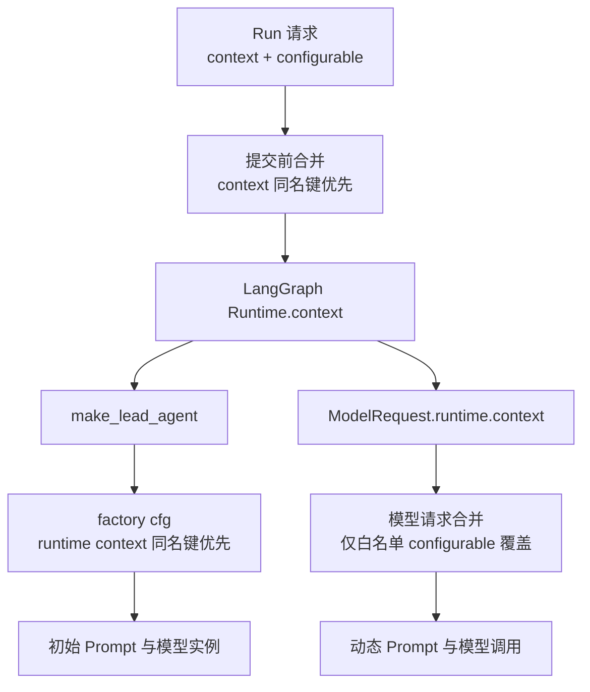
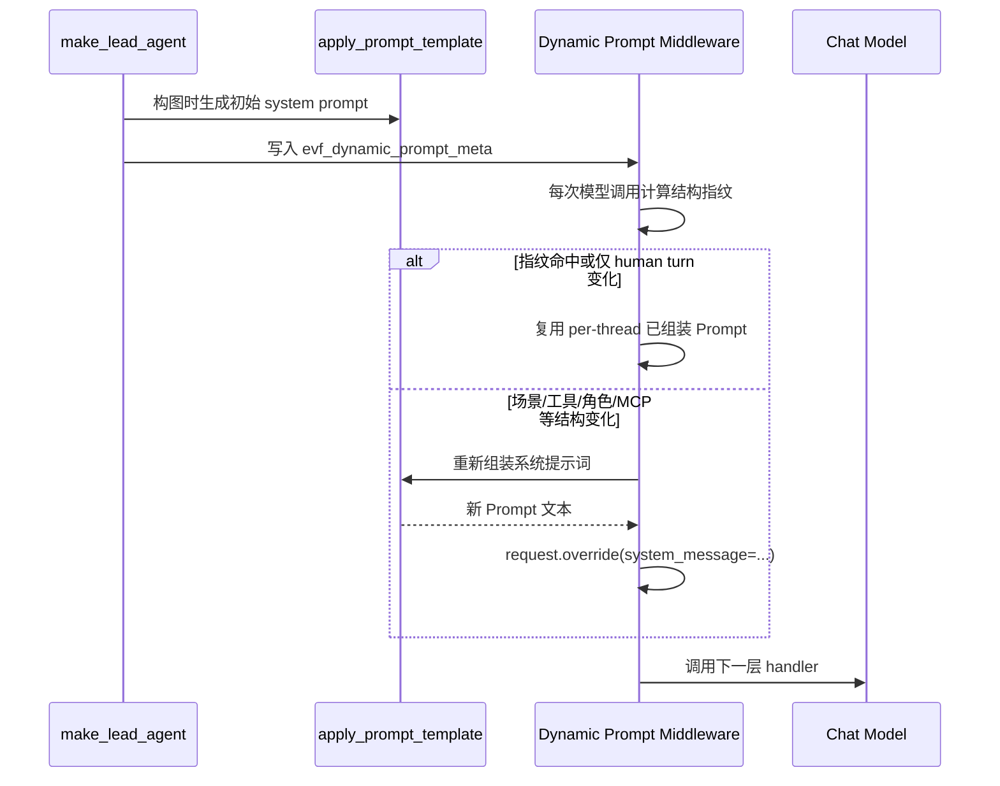
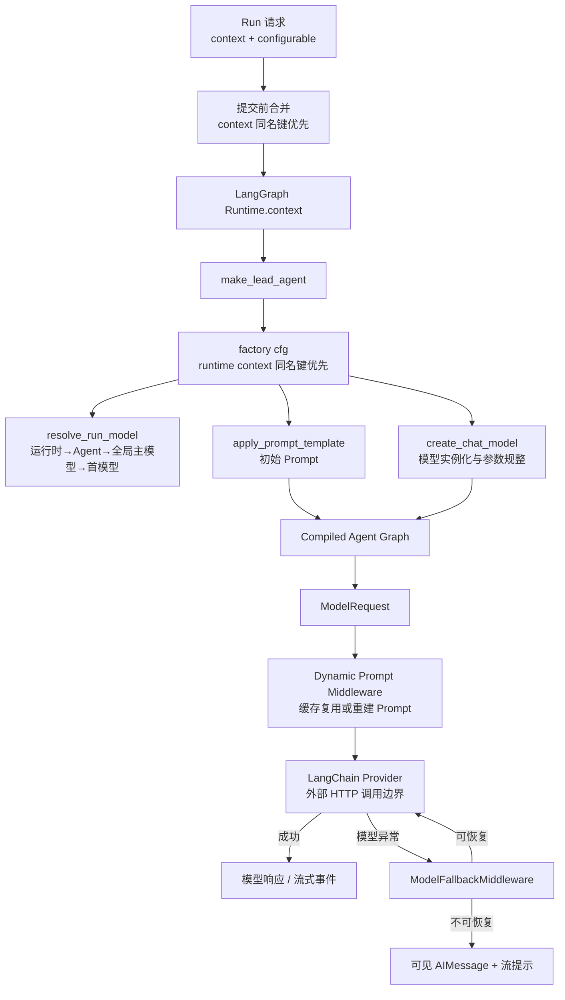

# 检查点 C：Context、Prompt 与模型调用

> **阶段**：第二阶段 · Agent Runtime（智能体运行时）深度研究。  
> **研究状态**：🧍‍♂️ 已完成，等待审核。  
> **审核状态**：🧍‍♂️ 尚未获得用户明确审核通过。  
> **范围边界**：本文只研究 Runtime Context（运行上下文）、Prompt（提示词）组装、模型选择、模型实例化和模型调用错误处理。Middleware（中间件）的完整注册/Hook/Wrap 顺序属于检查点 D；Tool（工具）生命周期属于检查点 E；Checkpoint（检查点/状态快照）和完整 Stream（流）完成路径属于检查点 F。

## 1. 本文研究目标

1. 追踪一次主聊天 Run 中 Runtime Context 如何从请求进入 Lead Agent，再到模型请求。
2. 区分 `context`、`config.configurable`、Session（会话）、Thread（线程）和 Run（运行）上下文的职责及覆盖规则。
3. 解释 Prompt 如何先在 `make_lead_agent()` 中静态组装、再在模型调用前按实际状态动态重建。
4. 解释模型名称的选择阶梯、`create_chat_model()` 的参数归一化边界，以及模型 API 失败如何变成用户可见输出。

## 2. 核心结论

1. `[源码证实]` Run 提交层不能同时向 LangGraph Agent Server 发送 `context` 与 `config.configurable`。EvoFlow 通过 `merge_configurable_into_context()` 把 configurable 合入 context；同名键以原有 `run_context` 为准。  
   `backend/packages/harness/evoflow/langgraph_run_config.py:85-110`。

2. `[源码证实]` Lead Agent factory 再次合并上下文时，`runtime.context` 覆盖 factory 输入中的 `config.configurable`：`cfg = {**base_conf, **rt_ctx}`。  
   `backend/packages/harness/evoflow/agents/lead_agent/agent.py:1044-1054`。

3. `[源码证实]` 到模型调用前，`merge_model_request_runtime_context()` 先复制 `request.runtime.context`，再只用 `MODEL_REQUEST_CONTEXT_KEYS` 中的非空 configurable 值覆盖，并单独携带 `evf_dynamic_prompt_meta`。  
   `backend/packages/harness/evoflow/agents/lead_agent/runtime_context.py:198-221`。

4. `[源码证实]` `LeadAgentRuntimeContext` 是 LangGraph context schema，显式声明 session、thread、agent、model、thinking、channel、身份、Skill/Plugin 等字段。  
   `runtime_context.py:17-86`。  
   `[测试证实]` `test_im_channel_prompt_gate.py::test_channel_survives_langgraph_context_coerce` 验证 `channel`、`channel_chat_id` 在 context coercion 后保留，见 `backend/tests/test_im_channel_prompt_gate.py:13-30`。

5. `[源码证实]` Prompt 有两层：构图时 `apply_prompt_template()` 生成初始 system prompt；每次模型调用时 `DynamicSystemPromptOnScenarioMiddleware` 根据场景、可见工具、角色、MCP、渠道和能力 scope 指纹复用或重建 system prompt。  
   `agent.py:1784-1807,1855-1901`；`dynamic_system_prompt_middleware.py:451-728`。

6. `[源码证实]` 模型名称遵循统一四级阶梯：运行时覆盖 → Agent 配置 → 全局主模型 → 第一个已配置模型。无效运行时模型名会回退；完全无模型才抛 `NoChatModelConfiguredError`。  
   `backend/packages/harness/evoflow/models/resolver.py:8-20,63-114,211-246`。

7. `[源码证实]` `create_chat_model()` 只实例化 provider 模型，不直接发送厂商 HTTP；它负责参数清理、凭据池、thinking/reasoning、token 预算、provider 差异和观测元数据。  
   `backend/packages/harness/evoflow/models/factory.py:845-1136`。  
   `[外部依赖边界]` 真实 HTTP 位于 LangChain provider 的 `_generate` / `_stream`。

8. `[源码证实]` `ModelFallbackMiddleware` 对模型 API 异常按压缩、限流、服务端错误、凭据轮换/模型 fallback 的顺序尝试恢复；不可恢复时返回用户可见 `AIMessage` 并写入流提示。  
   `backend/packages/harness/evoflow/agents/middlewares/model_fallback_middleware.py:1106-1134,1812-2010`。

## 3. 相关源码文件地图

| 文件 | 关键符号 | 中文职责说明 |
|---|---|---|
| `evoflow/langgraph_run_config.py` | `merge_configurable_into_context()` | 提交 Run 前消除 `context` 与 `configurable` 的 API 冲突。 |
| `agents/lead_agent/runtime_context.py` | `LeadAgentRuntimeContext`、`runtime_context_mapping()`、`merge_model_request_runtime_context()` | 定义、归一化并按模型请求规则合并运行上下文。 |
| `agents/lead_agent/agent.py` | `_user_context_from_server_runtime()`、`make_lead_agent()` | 把 factory config、runtime context、Agent 配置、模型选择和 Prompt 元数据连起来。 |
| `agents/lead_agent/prompt.py` | `apply_prompt_template()`、`_assemble_system_prompt()` | 生成初始系统提示词。 |
| `agents/lead_agent/dynamic_prompt_run.py` | `bind_dynamic_prompt_meta()` | 用 `ContextVar` 保存动态 Prompt 元数据。 |
| `agents/middlewares/dynamic_system_prompt_middleware.py` | `DynamicSystemPromptOnScenarioMiddleware` | 模型调用前缓存/重建 system prompt。 |
| `models/resolver.py` | `resolve_run_model()` | 统一模型名称选择。 |
| `models/factory.py` | `create_chat_model()` | 将 `ModelConfig` 与运行参数变为 provider 模型实例。 |
| `agents/middlewares/model_fallback_middleware.py` | `ModelFallbackMiddleware` | 重试、fallback 与用户可见模型错误。 |

## 4. Runtime Context（运行上下文）实际调用链

### 4.1 提交前：`configurable` 合入 `context`

`merge_configurable_into_context()` 复制 `run_config` 并移除 `configurable`，然后执行：

```python
merged = {**user_conf, **ctx}
```

因此同名字段由原有 `run_context` 覆盖。函数随后尝试补充 `principal_id`、`owner_scope_id` 等身份字段。  
`[源码证实]` `langgraph_run_config.py:85-110`。

**设计原因：** 用户/会话字段作为 LangGraph Runtime Context 传递；递归限制、tags 等控制项仍留在 `config`。这样既满足 Agent Server 请求约束，又避免把运行控制项混入业务上下文。

### 4.2 Schema 与归一化

`LeadAgentRuntimeContext` 声明以下主要字段族：

- 会话/线程：`thread_id`、`parent_thread_id`、`session_key`；
- Agent/岗位：`agent_id`、`agent_name`、`position_code`；
- 模型：`model_name`、`primary_model_name`、`thinking_enabled`、`reasoning_effort`；
- 执行模式：`session_mode`、`is_plan_mode`、`subagent_enabled`、`tools_mode`；
- 输入来源：`channel`、`channel_chat_id`、`prompt_source`、`evf_user_question`；
- 身份与权限：`principal_id`、`created_by`、`owner_scope_id`、`org_id`；
- 偏好：`preferred_skills`、`preferred_plugins`。

`runtime_context_mapping()` 将 Runtime 中的 dict、dataclass 或 Pydantic 对象归一为普通 dict，供 Prompt、模型、工具和中间件读取。  
`[源码证实]` `runtime_context.py:17-86,265-290`。

### 4.3 Factory 阶段与模型请求阶段的不同优先级

`make_lead_agent()` 读取 runtime context 后执行：

```python
rt_ctx = _user_context_from_server_runtime(runtime)
base_conf = dict(config.get("configurable") or {})
cfg = {**base_conf, **rt_ctx}
```

所以在 **factory 阶段**，`runtime.context` 的同名字段优先。  
`[源码证实]` `agent.py:1044-1054`。

但 `merge_model_request_runtime_context()` 在 **模型请求阶段** 使用更窄的覆盖规则：先复制 runtime context，再仅让 `MODEL_REQUEST_CONTEXT_KEYS` 中的非空 configurable 字段覆盖。  
`[源码证实]` `runtime_context.py:198-221`。

这不是矛盾，而是两层目标不同：factory 需要完整配置以确定图形状；模型调用只允许白名单字段影响当轮请求，减少任意 configurable 数据污染模型上下文。



## 5. Prompt（提示词）组装与动态重建

### 5.1 初始 Prompt

`make_lead_agent()` 写入 `evf_dynamic_prompt_meta`，其中包含工具名、MCP servers、子 Agent 参数、workspace、Agent 名、自定义 system prompt、Skill allowlist 和语言，然后调用 `bind_dynamic_prompt_meta()`。构建 Lead Graph 时，`apply_prompt_template()` 生成初始 system prompt。  
`[源码证实]` `agent.py:1784-1807,1855-1901`。

`apply_prompt_template()` 的已证实职责：

1. 根据场景选择紧凑 chat 形式；
2. 生成 Skill 注入段；
3. 根据 memory 开关决定静态 memory/asset 段；
4. 生成运行环境、协作、计划和工具目录等段；
5. 调用 `_assemble_system_prompt()` 组合 identity、soul、自定义 system prompt、memory、工具、Skill、runtime 与渠道信息；
6. 追加 capability profile，并处理本机路径替换。

`[源码证实]` `prompt.py:2204-2289,2405-2471`。

> **范围边界**：Memory 的提取/召回算法不在本文研究范围；本文只记录其作为 Prompt 输入段的开关和注入位置。

### 5.2 Dynamic Prompt（动态提示词）

同一会话中，场景、可见工具、角色文件、MCP、协作阶段、IM 渠道或能力 scope 可能变化。`DynamicSystemPromptOnScenarioMiddleware` 在每次 `wrap_model_call` / `awrap_model_call` 前调用 `_maybe_rebuild_system_message()`。

指纹包含 thread、场景、工具名、角色修订、协作状态、场景工具结果、当前 human turn、MCP、IM channel 和 platform scope。  
`[源码证实]` `dynamic_system_prompt_middleware.py:361-385,451-553,720-728`。

缓存行为：

- 指纹未变化：复用缓存 system prompt；
- 仅新 user message、结构未变化：复用缓存完整 Prompt；
- 同一轮仅场景变化：可跳过完整重建；
- 场景、工具、角色、协作、MCP 等结构变化：重新调用 `apply_prompt_template()`；
- 缓存超过 256 个 thread 时淘汰最早条目；
- 角色 Prompt/SOUL 修改后，`invalidate_dynamic_system_prompt_cache()` 清空缓存。

`[源码证实]` `dynamic_system_prompt_middleware.py:555-602,625-728,736-746`。  
`[测试证实]` `test_dynamic_prompt_role_revision.py:8-33`。



## 6. 模型解析、实例化与调用边界

### 6.1 模型选择

`resolve_run_model()` 的四级阶梯：

1. `cfg.model_name` 或 `cfg.model`；
2. `AgentConfig.model`；
3. `AppConfig.primary_model`；
4. `AppConfig.models[0].name`。

无效运行时模型名会回退而非中断聊天；没有任何模型才抛 `NoChatModelConfiguredError`。  
`[源码证实]` `models/resolver.py:8-20,63-114,167-246`。

`[测试证实]`：`test_model_resolver.py` 验证 runtime 优先和无效模型回退；`test_model_resolver_e2e.py` 验证四级阶梯与 Runtime Context fallback。

### 6.2 `create_chat_model()`

该函数：

1. 读取 `ModelConfig` 并用 `use` 路径解析 provider class；
2. 清除 EvoFlow 内部字段，避免 session/plan/runtime 控制字段泄漏到厂商 SDK；
3. 允许 credential pool 覆盖 `api_key` 与 `base_url`；
4. 根据模型能力和 session 设置处理 `thinking`、`reasoning_effort`、最大输出 token；
5. 处理 OpenAI-compatible、Anthropic、Ollama/本地 endpoint 等差异；
6. 实例化 provider model，挂载 fallback、credential 和 tracing 元数据。

`[源码证实]` `models/factory.py:845-1136`。

`create_chat_model()` 不直接发送 HTTP；厂商调用发生在 LangChain provider 的 `_generate` / `_stream`。  
`[源码证实]` `models/factory.py:853-858`。  
`[外部依赖边界]` LangChain provider 和厂商 SDK 的网络调用。

## 7. 模型错误、响应与流式可见性

`ModelFallbackMiddleware` 在模型调用结果边界执行以下行为：

1. 调用下一层 `handler(request)`；
2. 非模型 API 异常继续抛出；
3. 模型 API 异常按压缩重试、限流重试、服务端错误重试、凭据轮换/模型 fallback 的顺序处理；
4. billing 或耗尽的 rate limit 不继续轮换密钥/切模型；
5. 不可恢复时 `_handle_model_error()` 生成可见 `AIMessage` 并写流提示；
6. 对“HTTP 200 但正文表示错误”和空 AI 响应继续处理；空响应最多使用截断 context 重试一次。

`[源码证实]` `model_fallback_middleware.py:1106-1134,1812-2010`。

`[测试证实]` `test_model_error_shows_as_ai_reply.py:28-174` 验证错误以 `delta`/`block_close` 输出、异常返回 `AIMessage`、存在 writer 时优先写 `model_error` payload，以及 billing 不 fallback。

## 8. 输入、输出和数据流

| 阶段 | 主要输入 | 主要输出 | 副作用 |
|---|---|---|---|
| Run 提交 | `config.configurable`、`context` | 合并后的 `context` | configurable 从 config 移除；补身份字段 |
| Factory | `runtime.context`、factory config | `cfg`、初始 Prompt 元数据、模型名 | Runtime context 覆盖 factory configurable |
| Prompt 构图 | Agent 配置、Skill、工具、路径、场景、memory 开关 | 初始 `system_prompt` | 绑定 `evf_dynamic_prompt_meta` |
| ModelRequest | runtime context、白名单 configurable、当前工具/消息 | 更新后的 `system_message` | 动态 Prompt 缓存/重建 |
| Model factory | 模型名、ModelConfig、thinking/runtime kwargs | LangChain `BaseChatModel` 实例 | 清理内部字段、注入 provider/trace 元数据 |
| 调用失败 | provider exception 或异常内容/空响应 | retry/fallback 或可见 `AIMessage` | 写入流提示、登记失败状态 |

## 9. 中文执行流程图



## 10. 测试证据

实际运行：

```bash
cd /Users/main/EvoFlow
uv run --project backend pytest -q \
  backend/tests/test_dynamic_prompt_role_revision.py \
  backend/tests/test_im_channel_prompt_gate.py \
  backend/tests/test_model_resolver.py \
  backend/tests/test_model_error_shows_as_ai_reply.py \
  backend/tests/test_model_request_budget.py \
  backend/tests/test_uploads_middleware.py \
  backend/tests/test_identity_prompt_dedupe.py \
  backend/tests/test_employee_chat_prompt_layers.py
```

结果：

```text
56 passed in 1.90s
```

| 测试文件 | 代表性真实断言 | 支持的结论 |
|---|---|---|
| `test_im_channel_prompt_gate.py` | context coercion 后 `channel`、`channel_chat_id` 保留；IM Prompt 含 `<im_channel>` 且不含 `<artifact_display>` | schema 字段与渠道 Prompt gate |
| `test_dynamic_prompt_role_revision.py` | cache invalidation 清空 per-thread cache；角色签名含 DB revision | 动态 Prompt 失效机制 |
| `test_model_resolver.py` | runtime override 优先；未知 runtime 名称回退；无模型抛异常 | 模型选择阶梯 |
| `test_model_error_shows_as_ai_reply.py` | 错误写为 delta/body text；异常返回 `AIMessage`；billing 不 fallback | 可见错误与恢复边界 |
| `test_uploads_middleware.py` | 文档文本/图片路径在模型调用前注入；图片保留 vision blocks | 模型请求输入预处理边界 |
| `test_identity_prompt_dedupe.py` | soul/system prompt 近重复时只注入一层 | Prompt 去重 |
| `test_employee_chat_prompt_layers.py` | system prompt、soul、session、memory assets 的相对顺序 | Prompt 层次 |
| `test_model_request_budget.py` | timeout/retry 被上限约束；最坏 stall budget ≤ 600 秒 | 模型请求预算 |

## 11. 异常处理

- 无模型：`resolve_run_model()` 抛 `NoChatModelConfiguredError`；`create_chat_model()` 转为可读 `ValueError`。  
  `[源码证实]` `resolver.py:108-114`; `factory.py:835-874`。
- 无效运行时模型：记录后回退，而不是让 stale UI cache 中断聊天。  
  `[源码证实]` `resolver.py:211-246`。
- Prompt 重建失败：动态 Prompt Middleware 返回原 request，保留已有 Prompt。  
  `[源码证实]` `dynamic_system_prompt_middleware.py:653-707`。
- provider 异常：最终输出可见 AIMessage；完整 wrapper 嵌套顺序留给 D。  
  `[源码证实]` `model_fallback_middleware.py:1812-2010`; `[待确认]` D。

## 12. 设计原因与优缺点

### 设计原因

1. 分层 Context 合并：提交层解决 API 约束，factory 层确定图参数，模型请求层以白名单控制覆盖。
2. 静态 Prompt + Dynamic Prompt：图缓存降低构图成本，结构变化时重建可防止长会话 Prompt 漂移。
3. Model Resolver 与 Model Factory 分离：前者选模型名，后者构造 provider 参数，避免入口复制逻辑。
4. 错误可见化：把异常转为聊天可见 `AIMessage`，避免用户只看到流中断。

### 优点

- 可在运行时表达模型、渠道、Agent、Skill 和工具变化；
- 长会话复用 Prompt，减少重复组装；
- provider 差异集中在模型工厂；
- 错误恢复和用户反馈不依赖前端猜测。

### 限制

- 三层 Context 优先级不同，维护者必须清楚当前阶段；
- Dynamic Prompt 使用进程内 per-thread cache，重启后需重新组装；
- provider HTTP 内部实现属于外部依赖边界；
- Memory/协作内容虽可进入 Prompt，但其完整生产逻辑不在本文范围。

## 13. EvoFlow 与第三方框架的职责边界

| 层 | EvoFlow 负责 | 第三方框架负责 |
|---|---|---|
| LangGraph | 提交前 Context 合并、factory 输入准备、schema 字段定义 | Runtime context 传递、Agent graph 调度 |
| LangChain Agent | Prompt 元数据、模型实例、错误策略 | `ModelRequest`、agent/model 调用协议、provider 调度 |
| Provider SDK | `ModelConfig` 参数清理、thinking/reasoning 映射、观测元数据 | 真正 HTTP 请求、token stream、厂商响应对象 |

## 14. 尚未确认的问题

1. `MODEL_REQUEST_CONTEXT_KEYS` 的完整列表及每个键为何允许覆盖 Runtime Context，待后续 Context 专题审计。
2. Dynamic Prompt Middleware 相对所有其他 `wrap_model_call` Middleware 的完整嵌套顺序，属于检查点 D。
3. provider `_generate` / `_stream` 内部重试、序列化和 token 处理属于锁定版 LangChain/provider 外部依赖边界。
4. Memory、workspace memory、person memory 的生产/刷新机制不在本文范围。
5. `streamSubgraphs`、`streamResumable` 到 Gateway/UI 的完整转换链属于检查点 F。

## 15. 对独立仿写的参考价值

1. 定义强类型 `RunContext`，集中声明会话、线程、模型、身份和渠道字段。
2. 明确区分提交前合并、factory 合并和模型调用前白名单覆盖。
3. 将 `ModelResolver` 与 `ModelFactory` 分离：前者选名称，后者构造 provider。
4. 初始 Prompt 可缓存，但必须以结构变化指纹触发重建。
5. 将模型错误转为用户可见结构化消息与流事件。
6. 保留 provider HTTP 抽象边界，避免 Runtime 绑定单一厂商 SDK。

## 16. 检查点 C 完成判定

**研究完成：** 已追踪 Runtime Context 的三层合并、Prompt 初始/动态组装、模型选择、模型实例化、模型异常与流式可见化；已阅读真实源码并运行 56 项相关测试。  
**审核状态：** 🧍‍♂️ 等待用户审核。  
**未推进：** 未执行检查点 D、E、F；未进入 Multi-Agent、Harness、Memory 的完整实现研究。