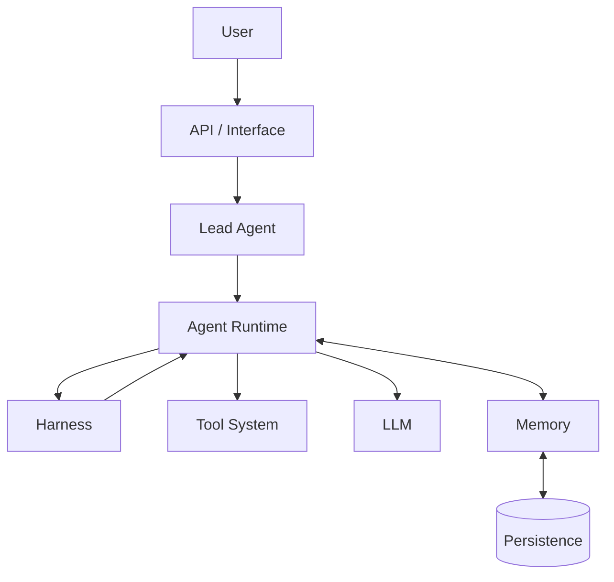
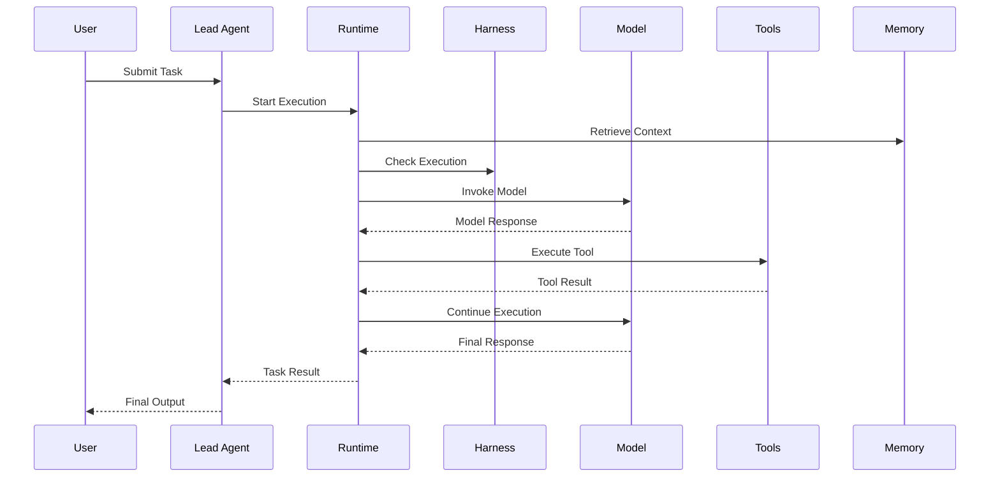
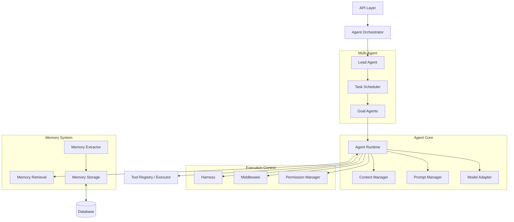

请先完整阅读：

`docs/knowledge/MASTER-PLAN.md`

这是 EvoFlow 深度研究与独立仿写工程的总需求文档。

后续所有研究必须遵循其中的六阶段规划、目录结构、研究规范和审核机制。

现在执行总规划中的当前任务：

1. 检查第一阶段已有成果。
2. 不重复生成已有文档。
3. 检查 EvoFlow 真实源码。
4. 制定第二阶段 Agent Runtime 的详细源码研究计划。
5. 使用 Plan Mode。
6. 暂时不要修改业务代码或创建正式研究报告。
7. 输出计划，等待我审核。

不要擅自进入下一阶段。


# EvoFlow 深度研究与仿写工程总计划

# EvoFlow Research Project

**源码研究 · 架构分析 · 工程实现 · 独立仿写**

| 项目 | 规划 |
|---|---|
| 研究阶段 | 6 个阶段 |
| 核心模块 | 4 个模块 |
| 最终目标 | 1 个独立 Agent 系统 |
| 研究方式 | 真实源码追踪、架构分析、测试验证 |
| 研究工具 | Cline、Plan Mode |
| 项目路径 | `/Users/main/EvoFlow` |

## 项目总体路线

1. **第一阶段：系统全景研究**

   搞清楚 EvoFlow 有什么、整体如何组织。

2. **第二阶段：核心 Runtime 深度研究**

   深入研究 Agent Runtime、Multi-Agent、Harness、Memory。

3. **第三阶段：跨模块架构研究**

   搞清楚四个模块如何连接、协作和传递数据。

4. **第四阶段：关键工程机制研究**

   深入研究上下文、工具、状态、持久化、异常和可靠性。

5. **第五阶段：独立架构设计与仿写**

   不依赖 EvoFlow 源码，自己设计类似的 Agent 系统。

6. **第六阶段：实现验证与差异分析**

   通过测试验证仿写系统，并与 EvoFlow 对照。

---

# 一、最终知识库目录结构

所有研究成果集中在：

`/Users/main/EvoFlow/docs/knowledge/`

最终目录：

```text
EvoFlow/
│
├── docs/
│   ├── EvoFlow-Research-Plan.md
│   │
│   └── knowledge/
│       │
│       ├── README.md
│       ├── MASTER-PLAN.md
│       ├── RESEARCH-PROGRESS.md
│       │
│       ├── 01-system-overview/
│       │   ├── architecture-map系统架构图.md
│       │   ├── repository-structure仓库结构.md
│       │   ├── module-inventory模块清单.md
│       │   ├── dependency-map依赖地图.md
│       │   └── technology-stack技术栈.md
│       │
│       ├── 02-core-runtime/
│       │   ├── agent-runtime智能体运行时.md
│       │   ├── multi-agent多智能体.md
│       │   ├── harness.md
│       │   └── memory记忆层.md
│       │
│       ├── 03-system-integration/
│       │   ├── module-interaction模块交互.md
│       │   ├── execution-dataflow执行数据流.md
│       │   ├── state-management状态管理.md
│       │   ├── event-and-message-flow事件消息流.md
│       │   └── lifecycle-management生命周期管理.md
│       │
│       ├── 04-engineering-mechanisms/
│       │   ├── context-management上下文管理.md
│       │   ├── prompt-engineering提示词工程.md
│       │   ├── tool-system工具系统.md
│       │   ├── middleware-system中间件系统.md
│       │   ├── checkpoint-and-persistence检查点持久化.md
│       │   ├── error-and-retry错误重试.md
│       │   ├── permission-and-security权限安全.md
│       │   └── observability可观测性.md
│       │
│       ├── 05-independent-implementation/
│       │   ├── implementation-roadmap实现路线图.md
│       │   ├── target-architecture目标架构.md
│       │   ├── module-specifications/
│       │   │   ├── agent-runtime智能体运行时.md
│       │   │   ├── multi-agent多智能体.md
│       │   │   ├── harness.md
│       │   │   └── memory记忆层.md
│       │   ├── database-design数据库设计.md
│       │   ├── api-design接口设计.md
│       │   └── technology-decisions技术决策.md
│       │
│       ├── 06-validation/
│       │   ├── test-strategy测试策略.md
│       │   ├── feature-comparison功能对照.md
│       │   ├── architecture-differences架构差异.md
│       │   ├── performance-evaluation性能评估.md
│       │   └── final-assessment最终评估.md
│       │
│       ├── diagrams/
│       │   ├── system-architecture.mmd
│       │   ├── agent-runtime.mmd
│       │   ├── multi-agent.mmd
│       │   ├── harness.mmd
│       │   ├── memory.mmd
│       │   └── system-integration.mmd
│       │
│       └── references/
│           ├── source-index源码索引.md
│           ├── test-index测试索引.md
│           └── unresolved-questions未决问题.md
│
└── ...
```

注意：

- `docs/EvoFlow-Research-Plan.md` 是整个工程的总规划。
- `docs/knowledge/` 是实际研究成果的知识库。
- 不要求 Cline 一次创建所有目录和空文件。
- 每个阶段只创建当前阶段需要的文件。
- 已有文件优先检查、复用，不得随意覆盖。

---

# 二、六个阶段具体研究任务

## 第一阶段：系统全景研究

**目标：建立对 EvoFlow 的整体认知。**

这一阶段主要回答：

EvoFlow 是什么？有哪些模块？整体如何组织？核心功能是否完整开源？

### 研究内容

| 研究项目 | 具体内容 |
|---|---|
| 仓库结构 | 项目目录、核心源码、配置文件 |
| 模块识别 | 所有核心模块及其职责 |
| 技术栈 | 框架、模型、数据库、第三方依赖 |
| 架构关系 | 模块之间的依赖和调用关系 |
| 入口分析 | 应用入口、Agent 入口、API 入口 |
| 测试结构 | 测试目录、测试覆盖范围 |
| 开源完整性 | 核心实现是否完整、是否依赖外部服务 |

### 产出文件

```text
01-system-overview/
├── architecture-map系统架构图.md
├── repository-structure仓库结构.md
├── module-inventory模块清单.md
├── dependency-map依赖地图.md
└── technology-stack技术栈.md
```

### 完成标准

能够回答：

1. EvoFlow 是什么架构？
2. 核心模块有哪些？
3. 每个模块负责什么？
4. 模块之间如何依赖？
5. 哪些核心功能已经开源？
6. 哪些功能存在外部依赖或代码缺失？

这一阶段只建立地图，不深入拆解内部实现。

---

## 第二阶段：核心 Runtime 深度研究

**目标：真正搞懂 EvoFlow 的四个核心模块内部如何运行。**

这是整个研究工程最重要的阶段。

必须按照以下顺序执行，不允许四个模块同时研究。

### 2.1 Agent Runtime：执行引擎

<mark>第一优先级</mark>

研究 Agent 如何初始化、接收任务、构建上下文、调用模型、执行工具、处理结果、结束任务。

| 研究方向 | 必须研究的内容 |
|---|---|
| 初始化 | Agent 创建、配置加载、依赖注入 |
| 任务入口 | 用户输入、任务接收、执行入口 |
| Prompt | System Prompt、动态 Prompt、消息构建 |
| Context | 上下文组装、裁剪、传递 |
| Model | 模型选择、调用、响应解析 |
| Middleware | 中间件注册、执行顺序、拦截机制 |
| Tool | 工具注册、选择、执行、返回 |
| State | LangGraph State、状态更新 |
| Graph | Node、Edge、执行循环 |
| Checkpointer | 状态保存、恢复、持久化 |
| Lifecycle | 开始、运行、结束、异常退出 |

必须产出：

1. 完整执行架构图。
2. Agent 初始化调用链。
3. Agent 单次任务完整调用链。
4. 模型调用流程。
5. Tool Execution 流程。
6. State 与 Checkpointer 关系。
7. 核心类和函数索引。
8. 相关测试证据。
9. 尚未确认的问题。
10. 独立仿写实现指南。

输出文件：

`02-core-runtime/agent-runtime智能体运行时.md`

### 2.2 Multi-Agent：多智能体协作

研究多个 Agent 如何协同完成任务。

重点：

1. Lead Agent 的初始化和运行机制。
2. Goal Agent 的创建和管理。
3. Lead Agent 如何拆分任务。
4. 如何委派子任务。
5. 如何传递上下文和状态。
6. 多个 Agent 如何并发或串行执行。
7. 如何收集子 Agent 的结果。
8. 如何处理超时、失败和重试。
9. 子 Agent 生命周期如何管理。
10. 最终结果如何汇总。

特别要求：

区分普通 Agent Runtime 和 Multi-Agent 调度层。

输出文件：

`02-core-runtime/multi-agent多智能体.md`

### 2.3 Harness：Agent 控制系统

研究模型外部的运行控制机制。

| 方向 | 研究内容 |
|---|---|
| Execution Loop | 执行循环和终止条件 |
| Context Control | 上下文限制和压缩 |
| Tool Control | 工具权限和调用限制 |
| Retry | 重试和失败恢复 |
| Timeout | 超时控制 |
| Isolation | 执行隔离 |
| Approval | 人工审批 |
| Resource | 资源限制 |
| Safety | 安全约束 |
| Observability | 日志、追踪和执行记录 |

必须回答：

Harness 是独立模块、分散在 Runtime 中，还是由多个机制共同构成？

不能预设它一定存在一个名为 Harness 的目录或类。

输出文件：

`02-core-runtime/harness.md`

### 2.4 Memory：记忆系统

研究记忆的完整生命周期。

重点：

1. 记忆数据结构。
2. 记忆提取机制。
3. 记忆分类和组织。
4. SQLite 数据库结构（如果存在）。
5. 向量索引和检索机制（如果存在）。
6. 记忆存储。
7. 记忆更新。
8. 记忆删除。
9. 记忆检索和上下文注入。
10. 长期记忆和短期记忆的关系。
11. 记忆持久化及恢复。
12. 记忆相关测试。

输出文件：

`02-core-runtime/memory记忆层.md`

### 第二阶段完成标准

四个模块都必须有真实源码证据。

必须能够：

- 从入口追踪到核心执行过程。
- 解释每个模块内部如何运行。
- 识别模块之间的接口边界。
- 找到对应测试。
- 说明设计优点和限制。
- 独立描述如何实现类似模块。

---

## 第三阶段：跨模块架构研究

**目标：不再单独看模块，而是研究整个系统如何运转。**

第二阶段搞清楚了四个模块内部，第三阶段要把它们连接起来。

### 研究任务

| 研究主题 | 需要回答的问题 |
|---|---|
| 模块交互 | Runtime 如何调用 Harness、Memory、Multi-Agent？ |
| 数据流 | 用户输入如何变成最终输出？ |
| 状态管理 | 不同 Agent 如何共享或隔离状态？ |
| 消息传递 | Lead Agent 和 Goal Agent 如何通信？ |
| 生命周期 | 整个任务从开始到结束经过哪些组件？ |
| 持久化 | 哪些状态和数据会被保存？ |
| 事件机制 | 是否存在事件总线、回调或消息队列？ |
| 依赖关系 | 哪些模块强依赖，哪些可以独立替换？ |

### 必须绘制三张关键图

#### 图一：全系统架构图

以下仅为研究时使用的概念草图，最终必须根据源码修正。



#### 图二：完整任务执行时序图



#### 图三：系统状态流转图

需要展示任务、Agent、工具执行和持久化状态的变化。

### 产出文件

```text
03-system-integration/
├── module-interaction模块交互.md
├── execution-dataflow执行数据流.md
├── state-management状态管理.md
├── event-and-message-flow事件消息流.md
└── lifecycle-management生命周期管理.md
```

完成标准：

能够解释一次完整任务如何穿过整个系统，哪些模块参与、如何传递数据、如何保存状态，以及出现异常时如何恢复。

---

## 第四阶段：关键工程机制研究

**目标：研究真正决定 Agent 系统稳定性和扩展性的工程技术。**

这一阶段不再按照模块划分，而是按照工程能力划分。

| 研究专题 | 研究内容 |
|---|---|
| Context Management | Token 预算、上下文裁剪、压缩、恢复 |
| Prompt Engineering | Prompt 模板、动态组装、注入机制 |
| Tool System | 工具协议、Schema、注册、执行器 |
| Middleware | 中间件链、执行顺序、拦截和扩展 |
| Checkpoint | 快照、恢复、状态持久化 |
| Error Handling | 异常分类、错误传播、恢复 |
| Retry | 重试策略、退避机制、失败限制 |
| Permission | 工具权限、Agent 权限、访问控制 |
| Security | 沙箱、输入安全、执行隔离 |
| Observability | 日志、Tracing、执行事件、指标 |

### 每项研究必须回答

1. EvoFlow 如何实现？
2. 为什么这样设计？
3. 解决了什么问题？
4. 存在哪些限制？
5. 有没有更好的实现方式？
6. 自己实现应该怎么设计？

### 产出文件

```text
04-engineering-mechanisms/
├── context-management上下文管理.md
├── prompt-engineering提示词工程.md
├── tool-system工具系统.md
├── middleware-system中间件系统.md
├── checkpoint-and-persistence检查点持久化.md
├── error-and-retry错误重试.md
├── permission-and-security权限安全.md
└── observability可观测性.md
```

---

## 第五阶段：独立架构设计与仿写

**目标：脱离 EvoFlow，自己设计一套 Agent 系统。**

这是整个项目的关键转折点。

前四个阶段是学习 EvoFlow。

第五阶段是脱离 EvoFlow，自己设计一套 Agent 系统。

要求：

不能直接复制 EvoFlow 的代码结构，而是提取其设计思想，形成独立实现。

### 5.1 设计自己的目标架构

以下是目标设计草图，最终模块边界必须在前四阶段研究完成后确定。



### 5.2 制定独立实现规范

必须形成：

- 系统架构设计。
- 模块职责定义。
- 核心接口规范。
- 数据库设计。
- 数据结构设计。
- Agent 生命周期设计。
- 工具执行协议。
- 多 Agent 通信协议。
- Memory API。
- 错误处理规范。
- 测试策略。

### 5.3 制定开发顺序

建议：

1. Agent Runtime。
2. Model Adapter。
3. Context Manager。
4. Tool System。
5. Harness。
6. Checkpoint。
7. Memory。
8. Multi-Agent。
9. API 和管理界面。
10. 日志、监控与安全。

### 产出文件

```text
05-independent-implementation/
├── implementation-roadmap实现路线图.md
├── target-architecture目标架构.md
├── module-specifications/
│   ├── agent-runtime智能体运行时.md
│   ├── multi-agent多智能体.md
│   ├── harness.md
│   └── memory记忆层.md
├── database-design数据库设计.md
├── api-design接口设计.md
└── technology-decisions技术决策.md
```

---

## 第六阶段：实现验证与差异分析

**目标：确认自己写出来的系统是真正可运行的，而不只是架构设计。**

### 验证项目

| 验证项目 | 通过标准 |
|---|---|
| Agent Runtime | 可以接收任务并执行完整循环 |
| Model | 可以切换模型供应商 |
| Context | 能够管理上下文 |
| Tools | 能够注册和调用工具 |
| Harness | 能控制执行过程 |
| Checkpoint | 能够保存并恢复任务 |
| Multi-Agent | 能够委派并汇总子任务 |
| Memory | 能够存储、检索和更新记忆 |
| Error Handling | 能够处理异常 |
| Persistence | 重启后能恢复需要保留的数据 |

### 最终对照 EvoFlow

1. 哪些能力实现一致？
2. 哪些设计不同？
3. 哪些功能尚未实现？
4. 哪些实现比 EvoFlow 简单？
5. 哪些地方有改进？
6. 哪些设计不值得模仿？

### 产出文件

```text
06-validation/
├── test-strategy测试策略.md
├── feature-comparison功能对照.md
├── architecture-differences架构差异.md
├── performance-evaluation性能评估.md
└── final-assessment最终评估.md
```

必须用测试结果和代码证据说明完成情况，不允许只用文字声称功能已经实现。

---

# 三、每个核心模块统一使用的源码研究模板

无论研究 Runtime、Multi-Agent、Harness 还是 Memory，都必须使用同一套报告结构。

这样后面才能横向比较。

| 序号 | 内容 | 具体要求 |
|---|---|---|
| 01 | 模块职责 | 解决什么问题 |
| 02 | 架构图 | Mermaid 模块架构图 |
| 03 | 文件地图 | 真实文件路径 |
| 04 | 入口分析 | 从哪里开始执行 |
| 05 | 调用链 | 从入口到出口 |
| 06 | 数据流 | 输入、状态变化、输出 |
| 07 | 核心类 | 类的职责和关系 |
| 08 | 核心函数 | 参数、返回值、调用关系 |
| 09 | 关键机制 | 内部实现原理 |
| 10 | 配置项 | 配置来源和实际用途 |
| 11 | 外部依赖 | 框架和第三方库 |
| 12 | 测试证据 | 对应测试及测试结果 |
| 13 | 异常处理 | 失败、重试和恢复 |
| 14 | 设计分析 | 为什么这样实现 |
| 15 | 实现限制 | 缺陷和未解决问题 |
| 16 | 仿写指南 | 如何独立实现 |
| 17 | 待确认问题 | 尚未找到证据的内容 |

## 证据分类规范

每个重要结论必须标记：

- **源码证实**：有真实代码证据。
- **测试证实**：有测试验证。
- **待确认**：尚未找到充分证据。
- **设计推断**：根据代码结构得出的推断。

不允许把设计推断写成已经实现的功能。

## 源码引用规范

每项重要结论尽可能注明：

- 文件路径。
- 类名。
- 函数名。
- 源码行号。
- 对应测试文件。

例如：

```text
源码位置：
src/agent/runtime.py

核心类：
AgentRuntime

核心函数：
async def run(...)

测试位置：
tests/agent/test_runtime.py
```

以上仅为引用格式示例，不代表 EvoFlow 实际存在这些文件和函数。

## Mermaid 图规范

每个核心模块至少包含：

1. 模块架构图。
2. 函数调用流程图。
3. 数据流图。

涉及多模块协作时，还需要时序图。

所有图必须以真实代码为依据。

---

# 四、阶段审核机制

每完成一个阶段，必须执行以下审核：

1. 检查文档是否完整。
2. 检查引用路径是否真实存在。
3. 检查函数和类是否真实存在。
4. 检查 Mermaid 图是否与源码一致。
5. 检查是否有缺乏证据的结论。
6. 更新 RESEARCH-PROGRESS.md。
7. 列出尚未解决的问题。
8. 输出阶段完成报告。
9. 等待人工审核。

**没有获得审核通过，不得自动进入下一个阶段。**

每个阶段的完成状态：

- NOT_STARTED：未开始。
- PLANNING：计划制定中。
- IN_PROGRESS：研究中。
- REVIEW：等待审核。
- APPROVED：审核通过。
- BLOCKED：存在阻塞问题。

---

# 五、实际执行时的操作流程

不要把六个阶段一次性全部交给 Cline 直接执行。

使用下面的工作流程。

## 第一次：制定研究计划

在 Cline 中切换到 Plan Mode。

让它：

1. 阅读本总规划文件。
2. 检查项目现有目录。
3. 检查已有架构文档。
4. 判断第一阶段已经完成的内容。
5. 找出第一阶段尚未完成的内容。
6. 制定 Agent Runtime 详细源码研究计划。
7. 列出准备检查的文件、入口、调用链和测试。
8. 输出研究计划，等待审核。

暂时不写正式研究报告。

## 第二次：审核计划

人工检查：

- 文件路径是否合理。
- 入口分析是否完整。
- 调用链探索顺序是否合理。
- 是否覆盖 Middleware。
- 是否覆盖 Tool Execution。
- 是否覆盖 LangGraph State 和 Checkpointer。
- 测试范围是否合理。
- 是否存在研究范围过大的问题。

审核通过后才进入正式研究。

## 第三次：正式研究 Agent Runtime

切换到执行模式。

要求 Cline：

- 阅读真实源码。
- 逐层追踪函数调用。
- 记录文件路径和行号。
- 检查对应测试。
- 生成 Mermaid 图。
- 完成 `agent-runtime智能体运行时.md`。
- 更新研究进度。

## 第四次：审核研究报告

检查：

- 调用链是否真实。
- 源码路径是否准确。
- 函数是否真实存在。
- 测试是否能够支持结论。
- 架构图是否与源码一致。
- 是否遗漏关键执行机制。
- 仿写指南是否具有实际操作价值。

## 第五次：进入下一个模块

Agent Runtime 审核通过后，依次研究：

1. Multi-Agent。
2. Harness。
3. Memory。

四个模块全部完成后，才能进入第三阶段。

---

# 六、给 Cline 的总执行指令

以下内容作为 Cline 的统一执行要求。

## 项目目标

项目路径：

`/Users/main/EvoFlow`

总规划文件：

`docs/EvoFlow-Research-Plan.md`

知识库路径：

`docs/knowledge/`

本项目的目标不是生成普通的项目介绍，而是通过真实源码研究，彻底理解 EvoFlow 的核心架构、内部执行机制、模块协作方式，并最终形成一套可以指导独立开发 Agent 系统的工程知识库。

## 必须遵守的执行规则

1. 所有研究必须以真实源码为依据。
2. 不允许只阅读 README 或现有 Markdown 文档就得出结论。
3. 关键结论必须标注真实文件路径。
4. 尽可能标注函数、类及源码行号。
5. 重要执行流程必须从入口追踪到出口。
6. 必须检查对应测试文件。
7. 区分源码事实、测试事实、设计推断和待确认问题。
8. 不允许虚构不存在的类、函数、文件和功能。
9. 不允许修改 EvoFlow 业务源码。
10. 不允许为了让架构图完整而臆造模块关系。
11. 不允许一次性研究所有模块。
12. 每个阶段完成后必须生成报告并等待人工审核。
13. 发现代码缺失、外部依赖或无法确认的实现时，必须明确记录。
14. 不要重复生成已经完成的系统概览。
15. 所有 Mermaid 图必须尽可能反映真实源码关系。

## 当前执行任务

现在只执行：

**第一阶段成果检查 + 第二阶段 Agent Runtime 研究计划制定。**

具体要求：

1. 完整阅读本总规划文件。
2. 检查项目目录和现有知识文档。
3. 判断第一阶段已经完成的内容。
4. 找出第一阶段尚未完成的内容。
5. 不要重复生成已有文档。
6. 检查 EvoFlow 真实源码。
7. 制定 Agent Runtime 的详细源码探索计划。
8. 列出准备检查的文件、入口、调用链和测试。
9. 列出每项研究任务的预期产出。
10. 列出预计存在的技术难点和待确认问题。
11. 不修改任何业务源码。
12. 不创建或修改 Agent Runtime 正式报告。

**当前处于 Plan Mode，只输出研究计划，等待用户审核。**

审核通过后，再进入 Agent Runtime 的正式源码研究。

一次只研究一个模块，不得跳阶段，不得擅自扩大研究范围。

---

# 七、最终项目完成标准

整个 EvoFlow 研究与仿写工程完成时，必须达到以下目标：

## 研究能力

- 能解释 EvoFlow 的整体架构。
- 能解释 Agent Runtime 的完整执行过程。
- 能解释 Multi-Agent 的任务协作过程。
- 能解释 Harness 的控制机制。
- 能解释 Memory 的完整生命周期。
- 能解释四个模块如何协作。
- 能够定位核心源码和测试。

## 工程能力

- 能独立设计 Agent Runtime。
- 能独立实现工具调用系统。
- 能独立设计 Harness。
- 能独立实现 Checkpoint。
- 能独立实现 Memory。
- 能独立设计 Multi-Agent。
- 能设计完整 Agent 系统的接口和数据结构。

## 验证能力

- 有完整测试策略。
- 有可运行的独立实现。
- 有功能对照报告。
- 有架构差异报告。
- 有性能评估。
- 有最终工程总结。

**最终目标不是看懂 EvoFlow，而是通过研究 EvoFlow，掌握独立设计、开发和扩展一套完整 Agent Framework 的能力。**