# EvoFlow 项目架构知识图谱

> **范围与快照**：本图谱根据当前仓库的源码、构建配置、部署编排与 CI 定义整理，快照提交为 `f22af53910a470ddba633be35e25878214c2984ec`（2026-11-13，版本 `1.3.22`）。它描述代码中可验证的结构，不替代接口契约、运行配置或安全审查。
>
> **阅读方式**：实线为已验证的默认关系；虚线为可选/部署可配置关系。路径均相对仓库根目录。

## 1. 系统定位与仓库边界

EvoFlow 是面向长任务的 Agent Runtime 与控制平面单仓库：Python 部分提供 LangGraph Agent Runtime 和 FastAPI Gateway，EvoPanel 以 Vite 前端加 Tauri v2 原生壳提供桌面/Web 管理面；Skills、文档、Docker 与 CI 同仓维护。

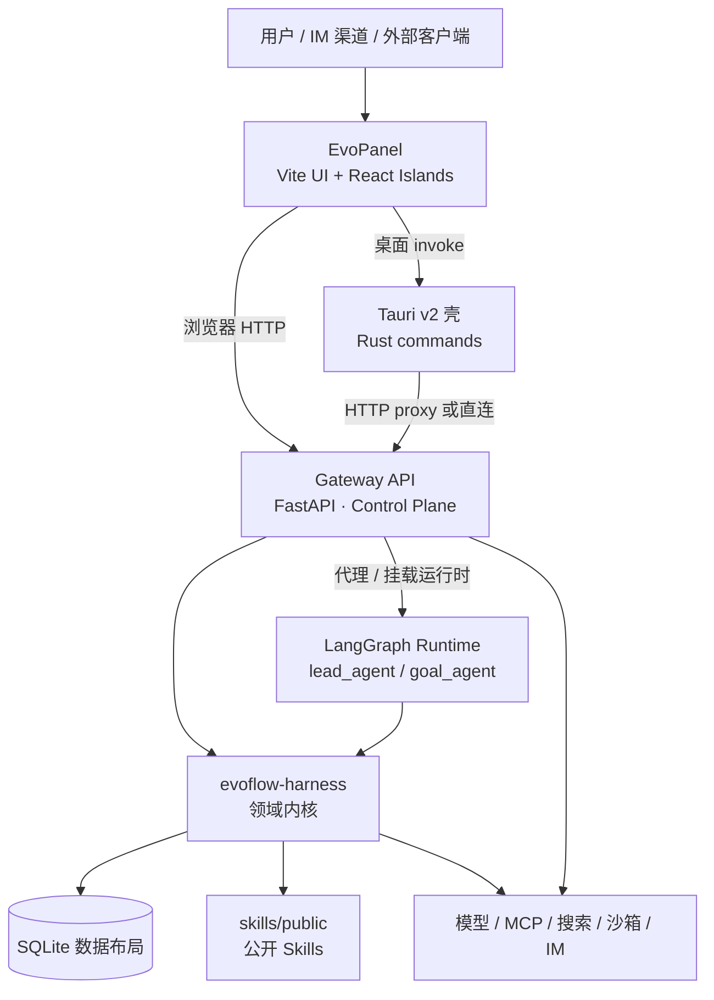

**仓库一级职责**

| 路径 | 职责 | 关键入口 |
|---|---|---|
| `backend/app/` | 应用层：Gateway、HTTP/SSE、渠道集成、启动编排 | `app/gateway/app.py` |
| `backend/packages/harness/evoflow/` | 内核：Agent、工具、持久化、知识、协作、运行时端口 | `agents/lead_agent/agent.py` |
| `evopanel/src/` | 前端 UI、路由、API 客户端、React/ZCode 工作区 | `main.js`、`lib/tauri-api.js` |
| `evopanel/src-tauri/` | Tauri 原生壳、sidecar 生命周期、系统能力与更新 | `src/lib.rs`、`src/commands/` |
| `skills/public/` | 可公开分发的 Skills | Skill 文件目录 |
| `docs/` | 用户文档与贡献指南；本目录为非公开工程知识 | `mkdocs.yml` |
| `docker/`、`scripts/` | Docker 编排、开发启动、运维/发布辅助 | `docker/docker-compose.yaml`、`scripts/serve.sh` |
| `.github/workflows/` | 单测、廉价架构守卫、文档及发版自动化 | `backend-unit-tests.yml`、`lint-check.yml` |

**证据入口**：`README.md`、`docs/contribute/repo-map.md`、`backend/ARCHITECTURE.md`、`evopanel/CONTRIBUTING.md`。

---

## 2. 分层与依赖规则

Python 后端严格区分应用层与内核：`app` 可以依赖 `evoflow`，而 `evoflow` 不得引入 `app.*`。内核需要使用 Gateway 能力时，以 `evoflow.runtime.ports` 声明端口，Gateway 启动时注册适配器。这是防止核心逻辑与 HTTP/渠道实现耦合的主边界。

```mermaid
flowchart LR
  subgraph Application[应用层：backend/app]
    GW[Gateway / middleware / routers]
    CH[IM channels]
    AD[app.gateway.runtime_adapters]
  end
  subgraph Kernel[内核：backend/packages/harness/evoflow]
    Ports[runtime.ports<br/>抽象端口]
    Domain[Agent / Tool / Memory / DB<br/>领域与基础设施]
  end

  GW --> Domain
  CH --> Domain
  AD -->|register(name, implementation)| Ports
  Domain -->|get(name)| Ports
  Ports -.禁止直接 import app.* .-> Application
```

| 规则 | 含义 | 自动/人工守卫 |
|---|---|---|
| R1 | `packages/harness/evoflow/` 不得新增 `app.*` 依赖 | `backend/scripts/arch_ban_app_imports.py`；`lint-check.yml` |
| R2 | 新增顶级/二级 `evoflow` 包需登记职责 | `backend/ARCHITECTURE.md` 评审约定 |
| R3/R4 | 控制包体规模，按领域扩展既有概念根 | 架构评审约定 |
| 端口桥接 | 应用层适配器在 Gateway 启动期一次性注册；独立 LangGraph/测试可降级为空实现 | `app/gateway/runtime_adapters.py` |

**证据入口**：`backend/ARCHITECTURE.md`、`backend/app/gateway/runtime_adapters.py`、`.github/workflows/lint-check.yml`。

---

## 3. 三种可验证运行拓扑

### 3.1 本地开发（默认脚本）

`make dev` 调用 `scripts/serve.sh`，分别启动 LangGraph Server（默认 `:2024`）与 Gateway（默认 `:8012`）。该开发模式是两个 Python 进程。

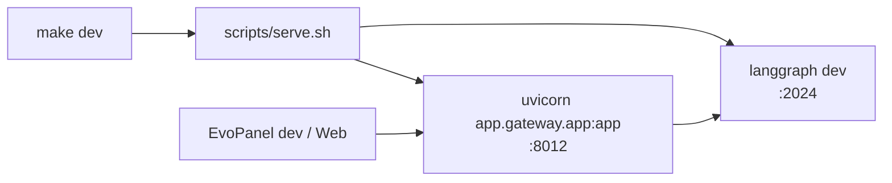

### 3.2 Docker 部署

生产 Compose 创建 `gateway` 与 `langgraph` 两服务（并可选 `provisioner`）。Gateway 对外绑定 `127.0.0.1:8001`，LangGraph 对外绑定 `127.0.0.1:2024`；二者共享配置、运行时数据、Skills 与 Docker socket（Docker-outside-of-Docker 沙箱模式）。

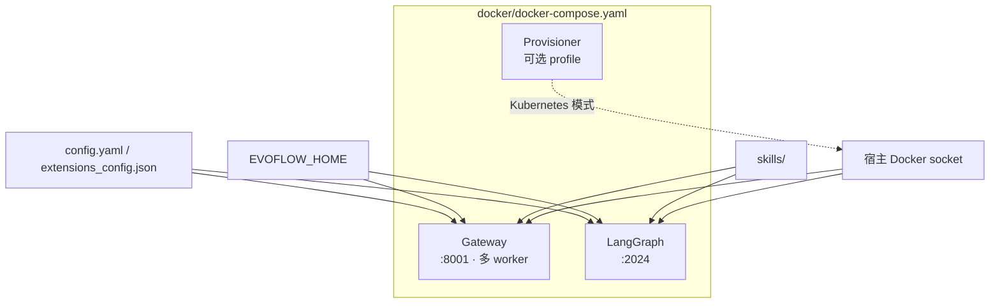

### 3.3 桌面安装包

Tauri 壳打包 Gateway sidecar；默认偏好把控制平面 Gateway 与 Agent Runtime/LangGraph 分为两个子进程，可用 `EVOFLOW_LANGGRAPH_INPROCESS=1` 回退到进程内模式。前端 API 层会在桌面环境选择 Tauri `invoke`、Rust HTTP proxy 或直接请求 Gateway；Web 开发模式使用 HTTP/Vite 代理。

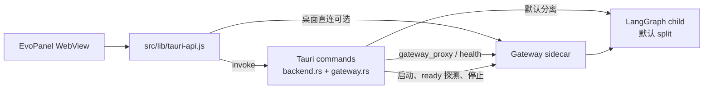

**证据入口**：`scripts/serve.sh`、`docker/docker-compose.yaml`、`evopanel/src-tauri/src/commands/backend.rs`、`evopanel/src-tauri/src/commands/gateway.rs`、`evopanel/src/lib/tauri-api.js`。

---

## 4. Gateway：启动、路由与可用性隔离

### 4.1 启动生命周期

Gateway 使用延迟单例和异步 lifespan：先暴露健康检查与早期就绪能力，再在后台完成路由、LangGraph 生命周期、MCP 预热、调度器、数据维护等较重初始化。路由注册区分核心和扩展两批，扩展路由的单项失败会被记录，但不会阻断整套服务启动。

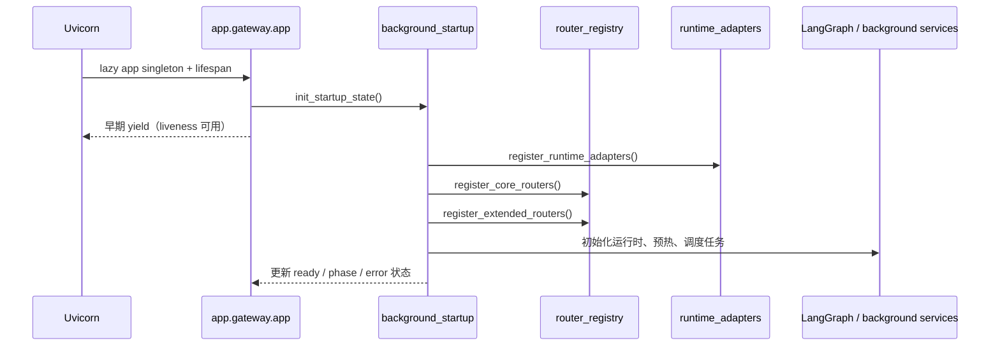

### 4.2 HTTP 领域面

Gateway 的路由大致按以下业务面切分；不应把此表理解为完整 OpenAPI 清单，精确接口应由 `docs/generated/openapi-gateway.json` 或运行时 OpenAPI 导出确认。

| 业务面 | 路由/模块例子 | 主要内核依赖 |
|---|---|---|
| 会话与执行 | `chat_sessions`、`threads`、`runs`、`langgraph_proxy`、`v4.routes` | `session_execution`、`agents`、`persistence` |
| 模型与工具 | `models`、`mcp`、`tools`、`skills` | `models`、`mcp`、`tools`、`skills` |
| 组织与协作 | `agents`、`collab`、`meetings`、`goal`、`proactive` | `agents`、`collab`、`a2a`、`proactive` |
| 资产、记忆与知识 | `assets`、`memory`、`knowledge`、`knowledge_owned` | `assets`、`memory`、`knowledge` |
| 工作区与产物 | `workspaces`、`uploads`、`artifacts`、`media_assets` | `tools`、`uploads`、`persistence` |
| 管理与治理 | `auth`、`organizations`、`license`、`platform_config`、`audit` | `authz`、`license`、`config`、`persistence` |
| 可观测与诊断 | `observability`、`diagnostics`、`events`、`client_trace` | `observability`、`runtime` |
| 渠道和自动化 | `channels`、`automation_scheduler`、`speech` | `channels`（应用层）、`proactive`、`scheduler` |

### 4.3 Traffic lanes

Gateway 对请求进行 **Control / Data / Best-effort / Stream** 分类。未知 `/api/*` 路径默认落到 Data，避免新慢接口误进入 Control；过载时 Best-effort 优先以 503 软降级，Data 受并发约束，Control 与长流不被这套 REST 预算切断。

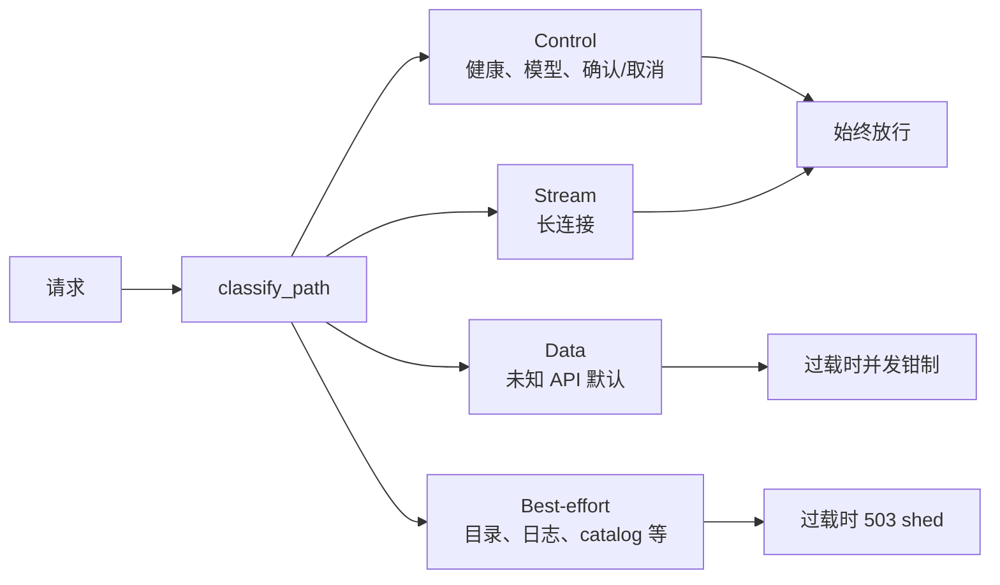

**证据入口**：`backend/app/gateway/app.py`、`background_startup.py`、`router_registry.py`、`traffic_lanes.py`。

---

## 5. Agent Runtime 知识图谱

`backend/langgraph.json` 是 Agent Runtime 的部署清单，注册两个图入口：`lead_agent` 与 `goal_agent`，并配置异步 checkpointer。Gateway 与 LangGraph 都依赖同一个 `evoflow-harness` workspace 包。

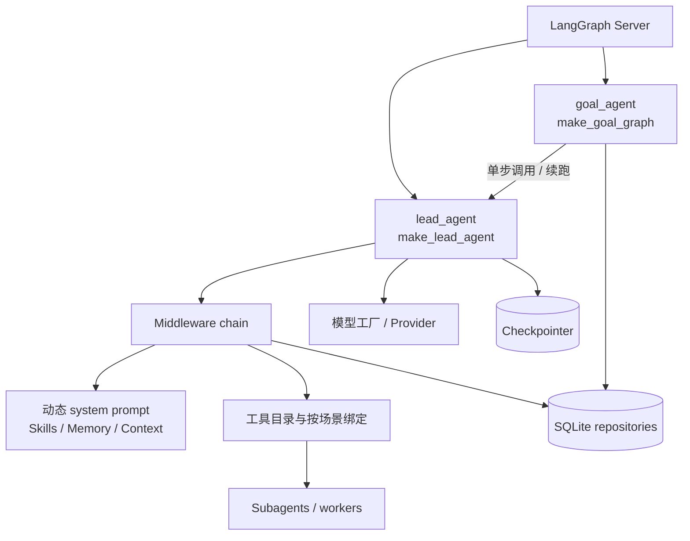

### 5.1 Lead Agent 装配

`make_lead_agent` 使用 LangChain `create_agent` 组装：

1. 从运行上下文、场景与配置解析模型、提示词和需要预绑定的工具；
2. 构建/缓存图（`graph_cache`）；
3. 按明确顺序添加中间件；
4. 将工具、子 Agent、内存、计划防护、确认机制和可观测信息织入一次会话执行。

中间件覆盖的横切关注点包括：上传文件、沙箱、上下文摘要、Todo/计划阶段、记忆写入与实时记忆页脚、动态提示词、工作区/只读保护、工具审批与恢复、循环检测、预算限制、目标续跑、协作状态与运行追踪等。**中间件顺序具有语义，修改时必须以 `agent.py` 的实际 append 顺序为准。**

### 5.2 Goal Agent

`goal_agent` 是 `StateGraph(GoalState)`：入口根据状态选择 `main_agent` 或 `goal_controller`；`main_agent` 将上下文投影后流式执行 Lead Agent 的一步，随后根据回复和 SQLite 中的目标状态进行解释、完成判定或继续控制。它不是另一个独立工具栈，而是对 Lead Agent 的目标导向编排。

### 5.3 内核领域包

| 领域 | 核心包 | 职责摘要 |
|---|---|---|
| Agent 与目标 | `agents/`、`a2a/`、`subagents/` | 主 Agent、目标图、会议/卡片协议、子 Agent 执行 |
| 协作与工作流 | `collab/`、`workflows/`、`plans/` | 任务账本、应用运行、协作流、计划投影 |
| 工具与执行 | `tools/`、`sandbox/`、`mcp/`、`session_tool_binding/` | 内置/宿主工具、沙箱、MCP、会话级工具绑定 |
| 知识与记忆 | `knowledge/`、`memory/`、`exploration_graph/` | RAG、向量/嵌入、记忆抽取、思维图谱 |
| 资产与主动运行 | `assets/`、`proactive/`、`scheduler/` | 资产沉淀、员工值班/心跳、后台调度 |
| 基础设施 | `config/`、`models/`、`persistence/`、`observability/`、`authz/` | 配置、模型提供商、SQLite、追踪与权限 |
| 运行时边界 | `runtime/`、`session_execution/` | 应用层端口、会话生命周期、取消与镜像 |

**证据入口**：`backend/langgraph.json`、`backend/packages/harness/evoflow/agents/lead_agent/agent.py`、`agents/goal/goal_graph.py`、`backend/ARCHITECTURE.md`。

---

## 6. 端到端交互与流式路径

### 6.1 常规控制/数据请求

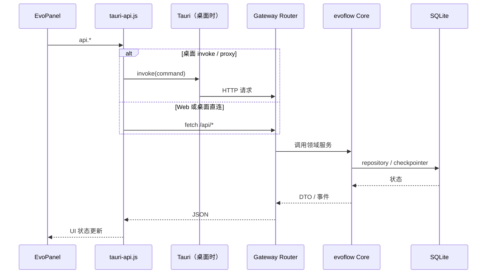

### 6.2 长运行与流式响应

聊天/执行流经 Gateway 对 LangGraph 的代理或挂载运行时；桌面端 Rust `gateway_proxy` 对长连接禁用普通全请求超时，并将到达的字节流按小窗口合并后通过 Tauri Channel 发给前端。Gateway 的 Stream lane 被独立处理，避免与普通 REST 并发预算互相阻塞。

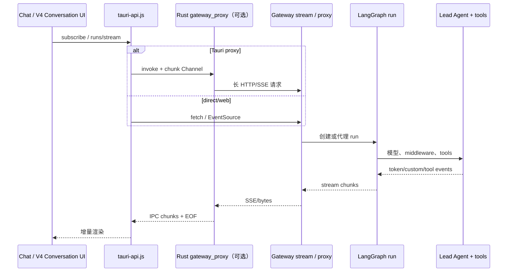

**注意**：V4 会话/对话路径是生产主聊天流式链路的一部分；`router_registry.py` 显示可通过 `EVOFLOW_V4_ROUTES=0` 关闭。因此文档和测试修改流式行为时，应同时核对传统 LangGraph stream 与 `/api/v4/conversation/*` 投影路径。

**证据入口**：`evopanel/src/lib/tauri-api.js`、`evopanel/src-tauri/src/commands/gateway.rs`、`backend/app/gateway/router_registry.py`、`backend/app/gateway/traffic_lanes.py`。

---

## 7. 数据、配置与扩展边界

### 7.1 SQLite 与运行时数据

持久化层是 SQLite 的唯一所有者。`persistence/db.py` 使用进程级共享连接、`RLock`、WAL、schema 初始化和重试/事务辅助，以降低 FastAPI 线程与 `asyncio.to_thread` 并发写导致的锁冲突。除主 `evoflow.db` 外，数据路径体系还可涉及 checkpointer 与可观测数据库。

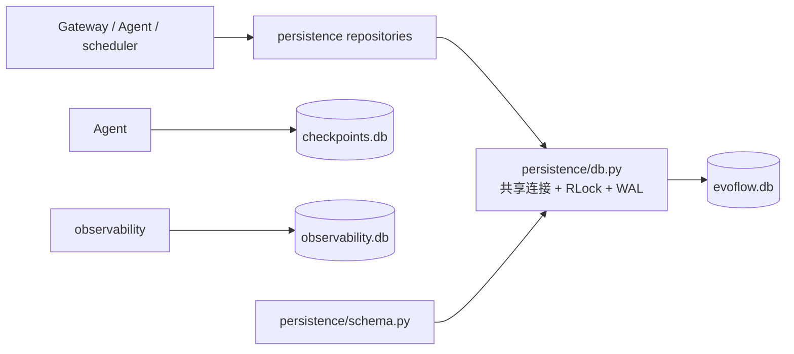

**约束**：业务代码优先调用 repository 或持久化层的公开辅助，而不是在 `app/` 或 Agent 逻辑内另开 SQLite 连接并自行改 schema。

### 7.2 配置优先级与来源

`evoflow.config.app_config` 负责加载 YAML、环境变量与 `.env`，并按领域组装 Pydantic 配置（模型、工具、沙箱、技能、内存、可观测、执行安全、代码索引等）。典型外部路径：

| 输入 | 用途 |
|---|---|
| `config.yaml` / `EVOFLOW_CONFIG_PATH` | 主运行配置 |
| `extensions_config.json` / `EVOFLOW_EXTENSIONS_CONFIG_PATH` | 扩展/MCP 等配置 |
| `.env` | API Key、部署环境变量、运行开关 |
| `EVOFLOW_HOME` | 运行时数据根目录（Docker/桌面重点） |
| `skills/` | Skills 只读挂载/加载源 |

### 7.3 外部能力

- **模型**：`models/` 经 LangChain provider 包适配；模型配置可被面板/API 更新并持久化。
- **工具与 MCP**：`tools/` 提供内置、宿主直连和 ZCode 兼容能力；`mcp/` 管理 MCP 初始化/缓存。
- **沙箱**：`sandbox/` 结合 `agent-sandbox`；Docker 部署可使用宿主 Docker socket；Kubernetes provisioner 是可选 profile。
- **知识/嵌入**：`knowledge/` 支持 SQLite-vec 与本地/远程 embedding；启动阶段刻意先做配置/DB 判断，避免不必要导入重型本地 embedding 依赖。
- **渠道**：`app/channels/` 是应用层集成，涵盖飞书、Slack、Telegram、钉钉、企微/微信等，并通过运行时端口向内核暴露必要能力。

**证据入口**：`persistence/db.py`、`config/app_config.py`、`backend/packages/harness/pyproject.toml`、`docker/docker-compose.yaml`、`app/gateway/background_startup.py`。

---

## 8. EvoPanel 架构知识图谱

EvoPanel 不是纯 React 单页应用：主入口为原生 ES 模块路由与页面渲染，同时承载 React islands 和较大的 `zcode-*` 工作区模块。UI 对后端访问应集中通过 `src/lib/tauri-api.js`，以保持 Web 模式与桌面模式一致。

```mermaid
flowchart TB
  Main[src/main.js<br/>启动、路由、shell]
  Router[src/router.js]
  Pages[src/pages/*<br/>render() 页面]
  React[src/react/*<br/>React islands]
  ZUI[src/zcode-ui/*<br/>工作区/聊天 UI]
  Lib[src/lib/*<br/>状态、认证、主题、transport]
  API[lib/tauri-api.js]
  Web[Web：fetch / Vite proxy]
  Invoke[Desktop：Tauri invoke]
  Rust[src-tauri commands]

  Main --> Router
  Router --> Pages
  Pages --> Lib
  Main --> React
  React --> ZUI
  Lib --> API
  API --> Web
  API --> Invoke
  Invoke --> Rust
```

| 层 | 主要职责 | 改动规则 |
|---|---|---|
| `src/main.js` / `router.js` | 启动、路由注册、全局 shell、健康状态 | 新页面注册路由并同步导航 |
| `src/pages/` | 多数为 DOM `render()` 页面 | 先返回 DOM，再异步加载数据，不阻塞整页渲染 |
| `src/react/`、`src/zcode-ui/` | 聊天、工作区、流式/轨迹等高交互 UI | 遵循既有 React/状态管理模式 |
| `src/lib/tauri-api.js` | 统一 API facade、环境分支、缓存、健康探测 | 页面避免直接 `fetch` |
| `src-tauri/src/commands/` | sidecar、文件/系统能力、Gateway proxy、更新、嵌入浏览器等 | 新命令须注册于 `lib.rs`，并同步 JS wrapper 与 Web handler（如适用） |
| `src-tauri/tauri.conf.json` | Dev URL、前端构建产物、sidecar 资源、平台打包与更新端点 | 修改要考虑桌面安装包与安全 scope |

**证据入口**：`evopanel/CONTRIBUTING.md`、`evopanel/src/main.js`、`evopanel/src/lib/tauri-api.js`、`evopanel/src-tauri/src/lib.rs`、`evopanel/src-tauri/tauri.conf.json`。

---

## 9. 构建、测试与质量门禁

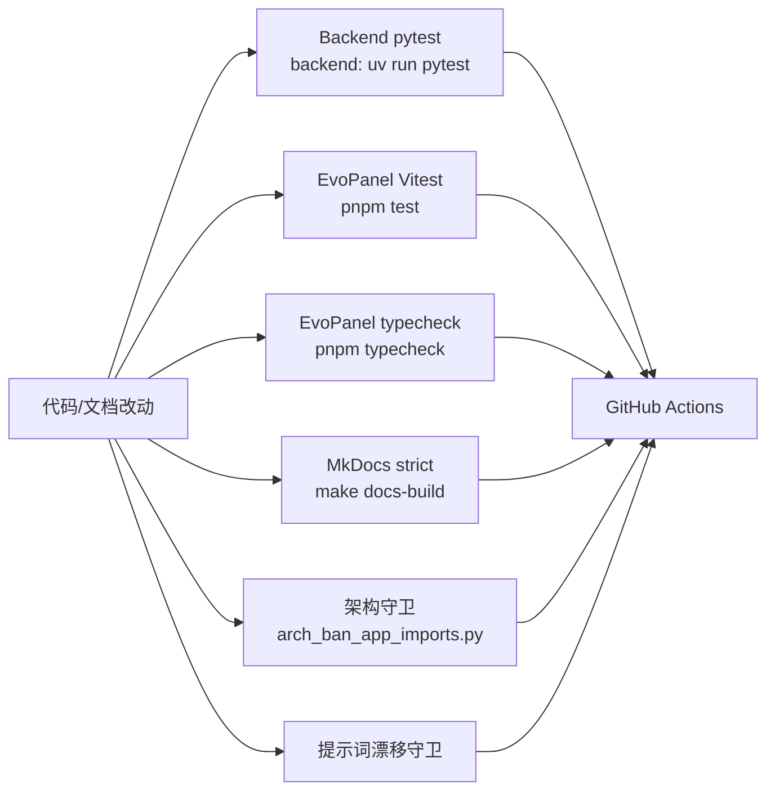

| 面 | 本地命令 | CI/说明 |
|---|---|---|
| 后端测试 | `cd backend && uv run pytest` | `backend-unit-tests.yml` 使用 `uv sync --group dev` 后运行 `make test` |
| 前端类型与测试 | `cd evopanel && pnpm typecheck && pnpm test` | `lint-check.yml` 的手动完整 EvoPanel lane 同时构建 |
| 文档 | `make docs-build` | `mkdocs build --strict`；工作流还会导出 Gateway OpenAPI |
| 内核→应用边界 | `python backend/scripts/arch_ban_app_imports.py` | `lint-check.yml` 主分支廉价强制检查 |
| 提示词资产 | `python backend/scripts/prompt_drift_guard.py` | CI cheap lane |
| 统一本地检查 | `make ci-local` | 可传 `CI_LOCAL_ARGS=--no-docs` 跳过文档 |

当前测试库存量（此快照）为 Python 测试文件约 **329** 个、EvoPanel Vitest/Spec 文件约 **253** 个；这是导航信号而非覆盖率声明。

**证据入口**：`Makefile`、`.github/workflows/backend-unit-tests.yml`、`.github/workflows/lint-check.yml`、`.github/workflows/docs.yml`。

---

## 10. 变更导航（从需求到落点）

| 需求 | 首选落点 | 必须同步检查 |
|---|---|---|
| 新增/修改 Gateway API | `backend/app/gateway/routers/` 与 `router_registry.py` | traffic lane；核心/扩展注册时机；相关 pytest；OpenAPI 导出 |
| 修改 Agent 行为、提示词、工具或子 Agent | `backend/packages/harness/evoflow/agents/`、`tools/`、`subagents/` | 不得反向 import `app.*`；中间件顺序；相关运行时/单测 |
| 内核需要 SSE、渠道、流注入等 Gateway 能力 | `evoflow/runtime/` 定义/读取端口；`app/gateway/runtime_adapters.py` 注册 | 独立运行时的无适配器降级路径 |
| 改模型、MCP、沙箱、Skills | `models/`、`mcp/`、`sandbox/`、`skills/` 和相应配置 | `config.example.yaml` / 运行时配置兼容；安全边界 |
| 改 SQLite schema/数据 | `persistence/schema.py`、对应 repositories | schema 演进、WAL/锁、迁移相关测试；禁止应用层绕过持久化边界 |
| 改聊天流式体验 | 前端调用点 + `tauri-api.js` + Rust `gateway.rs` + Gateway stream/v4 | 长流超时、EOF/heartbeat、V4 与传统流路径、Stream lane |
| 新面板页面/命令 | `evopanel/src/pages` / `src/lib` / `src-tauri/src/commands` | 路由/导航；统一 API facade；Rust 注册；Web 降级；typecheck/test |
| 改桌面启动/sidecar | `src-tauri/src/commands/backend.rs` | ready/liveness、split/in-process 模式、每 profile 锁、跨平台打包 |
| 改部署 | `docker/`、`scripts/serve.sh`、根 `Makefile` | 配置挂载、端口、运行时数据、Skills、沙箱 socket |
| 改公开用户文档 | `docs/user/`、`docs/contribute/`、`mkdocs.yml` | `make docs-build`；公开导航；避免把本内部图谱加入公开导航 |

---

## 11. 图谱维护清单

在以下情形更新本文件：

1. 新增/删除 LangGraph 图入口，或 Lead/Goal 调用关系变化；
2. 修改 `app` 与 `evoflow` 的依赖方向、运行时端口或架构守卫；
3. 新增 Gateway 启动阶段、核心业务面、流式协议或 traffic lane 规则；
4. 桌面 sidecar 拆分策略、前端 transport 选择或 Tauri command 边界变化；
5. 替换主数据库/持久化策略、配置来源或部署拓扑；
6. 新增跨领域顶级 `evoflow` 包（先同步 `backend/ARCHITECTURE.md` 的领域表）。

建议复核顺序：`docs/contribute/repo-map.md` → 启动入口（`scripts/serve.sh`、`app.py`、`langgraph.json`、`main.js`、`lib.rs`）→ 依赖边界（`ARCHITECTURE.md`、`runtime_adapters.py`）→ 编排/CI（Compose、Makefile、workflows）。