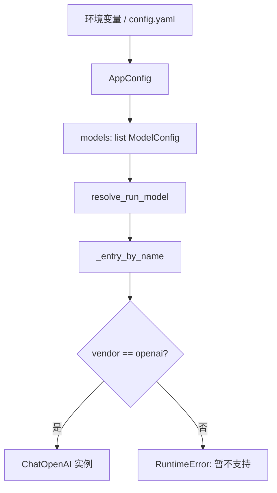

# 第 01.1 章　配置与模型调用

> 状态：✅ 正文按六节写完；配置解析、模型解析与工厂已接进 `/api/chat`，6 个配置测试通过。
> 所属：第 01 篇　最小可运行 Agent

## 1. 功能与知识点

### 功能

把「一个模型」从配置变成可调用的 chat model，并且在没有模型时明确失败：

1. **配置来源**：环境变量 `MYAGENTFLOW_CONFIG_PATH` → 当前目录 `config.yaml`；没有 YAML 时用环境变量拼出一条模型。
2. **两种 models 写法**：扁平列表，或 `providers: {网关: {..., models: [...]}}` 嵌套写法，解析时摊平成同一种列表。
3. **模型解析**：运行时覆盖 `cfg["model"]` → `primary_model` → `models[0].name`，都没有就抛 `NoChatModelConfiguredError`。
4. **模型工厂**：按条目名找到配置，按 `vendor` 实例化 provider；只实现 `openai`，其它 vendor 明确报错。

入口是 `/api/chat` 里的 `create_chat_model()`；它不传参数，走解析规则。

### 知识点如何体现

| 知识点 | 在本功能里体现为 | 可观察证据 |
|---|---|---|
| 配置分层 | 显式参数 > 环境变量 `MYAGENTFLOW_CONFIG_PATH` > `./config.yaml` | 改 `MYAGENTFLOW_CONFIG_PATH` 后解析结果跟着变 |
| 条目名 ≠ 模型 ID | `ModelConfig.name` 是条目名，`ModelConfig.model` 才是发给厂商的 ID | 请求体里用 `entry.model`，`primary_model` 引用 `name` |
| 空值要归一 | 空字符串 `base_url` 转成 `None`，不把请求打到空地址 | `test_blank_base_url_is_none` |
| 缺模型必须显式失败 | 一个模型都没配时抛 `NoChatModelConfiguredError` | `test_no_model_raises` |
| 配置改了自动重读 | 按文件 mtime 判断缓存，不重启也能生效 | `get_app_config()` 里的 mtime 比较 |
| 不支持的 vendor 不静默降级 | `raise RuntimeError(...)`，不造一个假模型 | 工厂末尾的分支 |

**最小验收**：只配环境变量也能建出模型；一个都没配时报错而不是空跑。

## 2. 最小调用链



### 2.1 路径优先级

```python
@classmethod
def resolve_config_path(cls, config_path: str | None = None) -> Path:
    if config_path:
        return Path(config_path).expanduser()
    env_path = os.getenv(CONFIG_PATH_ENV, "").strip()
    if env_path:
        return Path(env_path).expanduser()
    return Path.cwd() / "config.yaml"
```

显式参数只给测试和 CLI 用；线上靠环境变量，避免「配置在哪」靠猜。

### 2.2 没有模型时的行为

```python
if require_configured and not name:
    raise NoChatModelConfiguredError("没有配置任何聊天模型")
```

这里刻意不返回 `None`：空模型一路传到图里，报错会变成 `AttributeError`，定位成本高得多。

### 2.3 失败点

- YAML 语法错：配置加载失败，走默认值 → 最终由「没有模型」这一步报错。
- `yaml` 未安装：`_read_config_data()` 退化为「只有默认值」，不抛 ImportError。
- `vendor` 写了 `azure`/`anthropic`：工厂直接报「暂不支持」，不猜参数。

## 3. 代码创建

| 顺序 | 文件 | 本章职责 | 关键符号 |
|---|---|---|---|
| 1 | `config/app_config.py` | 根配置 + mtime 缓存 | `AppConfig`、`get_app_config`、`reload_app_config` |
| 2 | `config/model_config.py` | 单条模型配置 | `ModelConfig`、`resolve_model_max_output_tokens` |
| 3 | `config/models_yaml.py` | providers 嵌套摊平、vendor 推断 | `flatten_providers_dict`、`infer_vendor_from_connection` |
| 4 | `models/resolver.py` | 选「这一轮用哪个模型」 | `resolve_run_model`、`NoChatModelConfiguredError` |
| 5 | `models/factory.py` | 条目名 → 实例 | `create_chat_model` |
| 6 | `tests/chapters/test_ch01_01_config.py` | 配置行为 | 6 个用例 |

### 3.1 models 两种写法摊平

```python
def flatten_providers_dict(providers: dict[str, Any]) -> list[dict[str, Any]]:
    out = []
    for gateway, section in providers.items():
        for m in section.get("models") or []:
            entry = dict(m)
            entry.setdefault("base_url", section.get("base_url"))
            entry.setdefault("api_key", section.get("api_key"))
            out.append(entry)
    return out
```

网关级的 `base_url`/`api_key` 下发到每个模型条目：写一次网关配置，不用每条模型重复填。

### 3.2 工厂只做实例化

```python
if entry.vendor == "openai":
    model_kwargs = {
        "model": entry.model,
        "base_url": entry.base_url,
        "api_key": entry.api_key,
    }
    if entry.temperature is not None:
        model_kwargs["temperature"] = entry.temperature
    return ChatOpenAI(**model_kwargs)
```

`temperature=None` 时不传：显式传 `None` 会被部分 provider 拒绝。同理 `timeout`、`max_retries` 都只在配了才传。

### 3.3 上游对照

EvoFlow 的模型层还包含：多 vendor（openai/anthropic/google）、thinking 开关、按 agent 与任务类型选模型、`max_tokens` 归一。本章只复刻「单 vendor + 两层次序 + 归一」的最小链，其余在 01.6 与第 09 篇展开。

## 4. 测试

### 4.1 覆盖矩阵

| 类型 | 用例 | 验证什么 |
|---|---|---|
| 正常 | `test_env_model_becomes_primary` | 只配环境变量也能建模型，第一个即 primary |
| 边界 | `test_blank_base_url_is_none` | 空字符串归一成 `None` |
| 失败 | `test_no_model_raises` | 无模型抛 `NoChatModelConfiguredError` |
| 正常 | `test_yaml_config_defines_models` | YAML 的 log_level/primary_model/模型条目都被读到 |
| 接线 | `test_config_path_env_override` | 改环境变量后解析结果跟着变，没有旧缓存 |
| 正常 | `test_providers_layout_is_flattened` | providers 嵌套被摊平且顺序保持 |

### 4.2 运行

```bash
cd /Users/main/my-agent-flow/backend
uv run pytest tests/chapters/test_ch01_01_config.py -q
```

当前结果：`6 passed`。

## 5. 完整化

1. **多 vendor**：anthropic/google/azure 各自一个分支，参数映射写成表，不写 if 堆。
2. **thinking 开关**：`thinking_enabled` 现在只占位；接 provider 的 reasoning 参数后再打开。
3. **按 agent/任务选模型**：`resolve_run_model(agent_code=...)` 已留参数，但还没有 agent 维度配置。
4. **真实 provider 行为测试**：现在只测配置与解析，不发 HTTP；补一个 mock transport 验证请求体字段。
5. **模型回退**：primary 不可用时按 `fallback_models` 顺序试，失败原因进审计。
6. **配置热更新事件**：reload 后发事件，前端能提示「模型已切换」，而不是静默换模型。

每项都要有独立测试；没有测试的扩展不算完成。

## 6. 边界与验收

### 本章不做什么

- 不发任何真实模型请求；「能建实例」不等于「能调通」。
- 不做多 vendor、thinking、按 agent 选模型。
- 不做配置校验 UI；配置错只能在启动/调用时暴露。
- `max_tokens` 归一函数存在，但本章不负责把它传进请求（在 01.6 接）。

### 验收

```bash
cd /Users/main/my-agent-flow/backend
uv run pytest tests/chapters/test_ch01_01_config.py -q
```

预期：`6 passed`。失败时先查：`MYAGENTFLOW_CONFIG_PATH` 是否指向旧文件、`primary_model` 是否写成了模型 ID 而不是条目名、`models` 是否被 `providers` 写法漏掉。

### 下一章依赖

01.2 要把消息与会话落库；它复用本章的「环境变量覆盖配置」思路，但库是另一套（`MYAF_DB_PATH`）。
