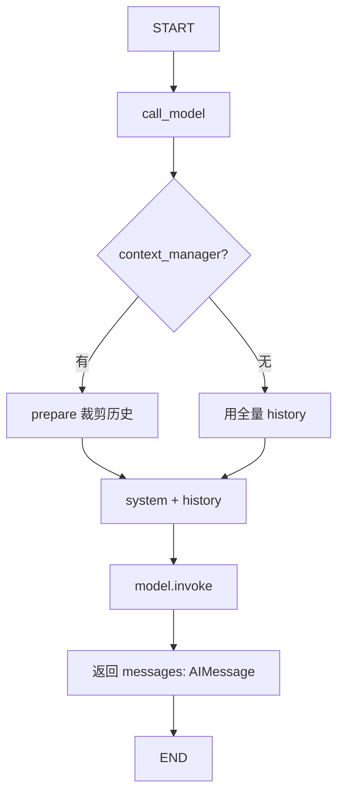

# 第 01.4 章　单轮 Agent 图

> 状态：✅ 正文按六节写完；`build_graph()` 的 START → call_model → END 已接 HTTP，两轮历史由 checkpointer 累积。
> 所属：第 01 篇　最小可运行 Agent

## 1. 功能与知识点

### 功能

最小 Agent 图只有两个节点边界：入口 `START` 和一个模型节点 `call_model`，出边直接 `END`。

1. **无工具也能跑**：不传 `tools` 时不建 `tools` 节点，图只有一段。
2. **有记忆**：传 `checkpointer` 时同 `thread_id` 的第二轮能看到第一轮消息。
3. **有 system**：传 `system_prompt` 时每轮临时插在最前面。
4. **有上下文策略**：传 `context_manager` 时先裁剪历史再调模型。

`/api/chat` 用的就是这个图：`build_graph(model, get_checkpointer(), tools=..., ...)`。

### 知识点如何体现

| 知识点 | 在本功能里体现为 | 可观察证据 |
|---|---|---|
| 图只负责编排 | 节点里只做「裁历史 → 拼 system → 调模型」 | `call_model` 的全部逻辑 |
| 状态是消息列表 | `MessagesState` 的 `messages` 通道 | 节点返回 `{"messages": [reply]}` |
| 历史由 checkpointer 管 | 不传则无状态单轮 | `test_single_turn` 的消息只有 2 条 |
| system 不落历史 | 拼在局部变量 `messages`，不回写状态 | 第二轮 messages 里没有 system 累积 |
| 上下文策略可失败降级 | `except Exception` 后回退全量历史 | 裁失败不打断回答 |

**最小验收**：`graph.invoke({"messages":[HumanMessage("你好")]})` 返回新 `AIMessage`；同 thread 再 invoke 一次，模型看到 4 条消息。

## 2. 最小调用链



### 2.1 节点函数

```python
def call_model(state: MessagesState):
    history = list(state["messages"])
    if context_manager is not None:
        try:
            history = context_manager.prepare(
                history, reserved_tokens=estimate_tokens(system_prompt or "")
            ).messages
        except Exception:
            history = list(state["messages"])
    messages = list(history)
    if system_prompt:
        messages = [SystemMessage(content=system_prompt), *messages]
    bound = model.bind_tools(tools.schemas()) if tools is not None else model
    reply = bound.invoke(messages)
    return {"messages": [reply]}
```

这里没有「读文件、查数据库、写日志」等副作用；副作用都在中间件、工具和路由层。节点越纯，测试越好写。

### 2.2 无工具与有工具的分叉

```python
if tools is not None:
    graph.add_node("tools", call_tools)
    graph.add_conditional_edges("call_model", route_after_model, {"tools": "tools", END: END})
    graph.add_edge("tools", "call_model")
else:
    graph.add_edge("call_model", END)
```

单轮图不是「工具图的简化参数版」，而是编译时就不加节点：少一个节点就少一条边，路由逻辑不存在。

### 2.3 失败点

- 模型抛异常：图不吞异常，交给 `stream_graph` 转 error 事件。
- 空回复：`AIMessage(content="")` 照常入状态；是否算失败由路由层的 `_safe_append` 决定（空文本不写库）。
- checkpointer 打不开：图编译阶段失败，`/health` 也会报 degraded。

## 3. 代码创建

| 顺序 | 文件 | 本章职责 | 关键符号 |
|---|---|---|---|
| 1 | `agents/lead_agent/graph.py` | 建图与模型节点 | `build_graph`、`call_model` |
| 2 | `runtime/streaming.py` | 把图事件转 SSE | `stream_graph` |
| 3 | `app/gateway/routers/chat.py` | 装配 checkpointer/system/context | `build_graph(...)` 调用处 |
| 4 | `tests/chapters/test_ch01_02_graph.py` | 单轮与同线程历史 | `test_single_turn`、`test_same_thread_keeps_history` |
| 5 | `tests/chapters/test_ch01_02_r0_e2e.py` | HTTP 到图的端到端 | `StreamingE2EModel` |

### 3.1 为什么用 `MessagesState` 而不是自定义状态

`MessagesState` 的 `messages` 通道带 `add_messages` reducer：节点返回一条 `AIMessage`，会被追加而不是覆盖。自定义状态要自己实现 reducer，容易写成「覆盖历史」。

### 3.2 编译时注入 checkpointer

```python
return graph.compile(checkpointer=checkpointer)
```

`checkpointer=None` 也能编译：LangGraph 允许无状态图。这个口子很重要——单元测试不该被迫建 SQLite 文件。

### 3.3 上游对照

EvoFlow 的图在 `call_model` 前后还有：预算裁剪、工具路由、审批、记忆检索、事件发射。本章只保留「裁剪 + system + 调用」，其余按章节逐步加节点或中间件。

## 4. 测试

### 4.1 覆盖矩阵

| 类型 | 用例 | 验证什么 |
|---|---|---|
| 正常 | `test_single_turn` | 一轮 invoke 输入输出契约 |
| 接线 | `test_same_thread_keeps_history` | 同 thread 第二轮带上前一轮，共 4 条 |
| 端到端 | `test_http_chat_streams_and_second_turn_sees_history` | HTTP → SSE → 第二轮历史 → 消息表四条 |

### 4.2 运行

```bash
cd /Users/main/my-agent-flow/backend
uv run pytest tests/chapters/test_ch01_02_graph.py tests/chapters/test_ch01_02_r0_e2e.py -q
```

当前结果：图 2 个用例 + HTTP 端到端 1 个用例，全部通过。

## 5. 完整化

1. **错误/空回复策略**：空回复现在照常进状态；应区分「模型说完了」和「模型返回空」。
2. **多节点编排**：单轮图是基线；01.5 加工具节点，04.3 加事件与取消。
3. **图级超时**：整轮超时应在图外（路由/流）控制，节点内部不自设 timeout。
4. **状态快照 API**：`read_thread_state` 只给最小快照，前端要「图跑到哪一步」还需要节点级事件。
5. **并行工具**：`call_tools` 现在顺序执行，独立工具可并发。
6. **子图**：为后续多 Agent 预留 `subgraph` 入口，本章不做。

每项都要有独立测试；当前只完成最小单轮。

## 6. 边界与验收

### 本章不做什么

- 不做工具循环（01.5 的 `tools` 节点才是）。
- 不做错误分类与重试；异常原样抛给流层。
- 不做图级超时、不做并行工具。
- 不做「消息表 → 图状态」重建。

### 验收

```bash
cd /Users/main/my-agent-flow/backend
uv run pytest tests/chapters/test_ch01_02_graph.py -q
```

预期：`2 passed`。失败时先查：`checkpointer` 是否传了同一个实例（换实例等于换库）、`thread_id` 是否一致、模型替身是否实现了 `invoke`。

### 下一章依赖

01.5 会在 `call_model` 与 `END` 之间插 `tools` 节点；`route_after_model` 的判断必须只看最后一条 `AIMessage` 的 `tool_calls`，不能看历史里有没有工具调用。
