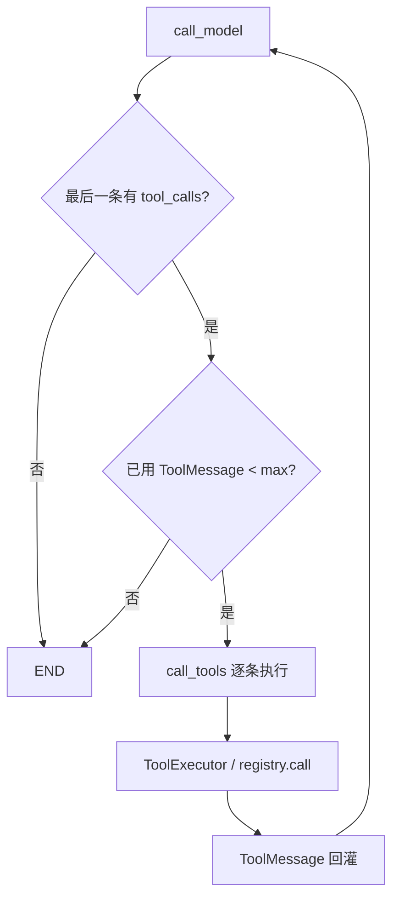

# 第 01.5 章　工具调用循环

> 状态：✅ 正文按六节写完；模型 ↔ 工具循环已接 `/api/chat`（统一走 `ToolExecutor` 中间件链），3 个循环用例通过。
> 所属：第 01 篇　最小可运行 Agent

## 1. 功能与知识点

### 功能

模型不会自己执行工具，它只发 `tool_calls`；图负责执行并回灌：

1. **模型发工具请求**：`AIMessage(tool_calls=[{name, args, id}])`。
2. **图执行工具**：逐条调到 `ToolExecutor`（有中间件）或 `registry.call`（无中间件）。
3. **结果回灌**：每条结果成为一个 `ToolMessage(content, tool_call_id)`，回到模型。
4. **路由判停**：还有 `tool_calls` 且未超轮次 → 回 `tools`；否则 → `END`。

`max_tool_rounds` 默认 4，按 `ToolMessage` 数量计已用轮次。

### 知识点如何体现

| 知识点 | 在本功能里体现为 | 可观察证据 |
|---|---|---|
| 工具结果必须带 call_id | `ToolMessage(tool_call_id=call_id)` | 模型能对上「哪个请求的结果」 |
| 工具失败也要回灌 | 异常转 `ERROR: Type: msg` 字符串 | `test_tool_error_is_fed_back` |
| 轮次上限防死循环 | `used < max_tool_rounds` | 超限后直接 END |
| 批内逐条执行 | 一个 `for` 遍历全部 `tool_calls` | 多个调用各有自己的结果 |
| 执行器是唯一边界 | 有 `tool_executor` 就不再直接 `registry.call` | 审计/策略只在一处生效 |

**最小验收**：模型第一轮要求调 `echo`，第二轮看到 `ToolMessage` 后给最终回答；`model.calls == 2`。

## 2. 最小调用链



### 2.1 执行与回灌

```python
for call in getattr(last, "tool_calls", None) or []:
    name, args, call_id = call.get("name"), call.get("args") or {}, call.get("id") or ""
    try:
        output = tool_executor.execute(name, args, tool_call_id=call_id,
                                       thread_id=thread_id, run_id=run_id)
        content = str(output)
    except Exception as exc:
        content = f"ERROR: {type(exc).__name__}: {exc}"
    results.append(ToolMessage(content=content, tool_call_id=call_id))
```

一个工具挂了，不影响同批其它调用；错误本身也是模型可读的内容。

### 2.2 路由

```python
def route_after_model(state):
    last = state["messages"][-1]
    if not getattr(last, "tool_calls", None):
        return END
    used = sum(isinstance(m, ToolMessage) for m in state["messages"])
    return "tools" if used < max_tool_rounds else END
```

只看「最后一条 AI 消息」有没有工具请求。如果看整个历史，第一轮调过工具后，即使用户问的是纯文本，也会被误判成要继续调工具。

### 2.3 失败点

- 未知工具：`KeyError` 被捕获，回灌 `ERROR: KeyError`；模型下一轮通常会换工具或说明。
- 参数不合法：工具函数自己抛错，同样回灌。
- 模型反复调同一个工具：靠 `max_tool_rounds` 兜底，不靠 prompt 自觉。

## 3. 代码创建

| 顺序 | 文件 | 本章职责 | 关键符号 |
|---|---|---|---|
| 1 | `agents/lead_agent/graph.py` | 加 `tools` 节点与条件边 | `call_tools`、`route_after_model` |
| 2 | `tools/executor.py` | 统一执行边界与中间件 | `ToolExecutor.execute` |
| 3 | `tools/registry.py` | 注册与 `registry.call` | `ToolRegistry` |
| 4 | `app/gateway/routers/chat.py` | 注册 echo/文件/命令工具并传执行器 | `ToolExecutor(...)` |
| 5 | `tests/chapters/test_ch01_05_tool_loop.py` | 循环三种行为 | 3 个用例 |

### 3.1 为什么不让节点直接调工具函数

直接调意味着每个节点各自决定「要不要审计、要不要审批」。放进执行器后只有一条路径：请求 → 中间件链 → 工具；加策略只需要加中间件，不动图。

### 3.2 为什么用 `ToolMessage` 而不是拼成一条 user 消息

`ToolMessage` 带 `tool_call_id`，是协议层可对齐的结果；拼成自然语言会丢掉「这是哪个请求的返回值」，模型只能靠猜测。

### 3.3 上游对照

EvoFlow 的工具循环还包含：并行执行、参数 schema 校验、幂等键、结果截断/落盘、审批挂起后恢复。本章只做「顺序执行 + 错误回灌 + 轮次上限」，其余在 03.2/03.4/03.7 展开。

## 4. 测试

### 4.1 覆盖矩阵

| 类型 | 用例 | 验证什么 |
|---|---|---|
| 正常 | `test_tool_loop_executes_and_feeds_back` | schema 绑定、执行、ToolMessage、最终回答 |
| 失败 | `test_tool_error_is_fed_back` | 未知工具错误回灌，模型仍能收尾 |
| 边界 | `test_max_tool_rounds_stops` | 达到上限停止，不无限循环 |

### 4.2 运行

```bash
cd /Users/main/my-agent-flow/backend
uv run pytest tests/chapters/test_ch01_05_tool_loop.py -q
```

当前结果：`3 passed`。

## 5. 完整化

1. **参数校验**：现在工具函数自己校验；应在执行器统一按 `input_schema` 校验并返回结构化错误。
2. **并行执行**：同批独立工具可并发，但要处理「一个失败一个成功」的部分成功。
3. **幂等键**：重试同一 `tool_call_id` 不应重复产生副作用。
4. **结果截断/落盘**：长输出应走 `truncate_text_to_token_budget` + `maybe_persist`，不是原样塞回模型。
5. **审批挂起**：ask 类工具应暂停图并等待批准，而不是抛异常结束本轮（03.7 已接最小版，恢复链路未做）。
6. **工具选择质量**：多工具时模型选错，需要 schema 描述与示例优化，属于提示词/评测问题。

每项都要有独立测试；当前只完成顺序循环。

## 6. 边界与验收

### 本章不做什么

- 不做并行、不做参数 schema 校验、不做幂等。
- 不做「审批通过后自动恢复」；本轮 ask 直接以错误结束。
- 不限制单个工具的输出长度；截断在 03.2/03.4 的工具层做。
- 不区分「工具调用被拒绝」与「工具执行失败」，两者都是 `ERROR` 文本。

### 验收

```bash
cd /Users/main/my-agent-flow/backend
uv run pytest tests/chapters/test_ch01_05_tool_loop.py -q
```

预期：`3 passed`。失败时先查：模型替身是否实现 `bind_tools`、`max_tool_rounds` 是否被传成 0（0 表示一次都不执行）、`ToolMessage.tool_call_id` 是否和请求一致。

### 下一章依赖

01.6 的流式层要把 `on_tool_end` 事件透出；如果工具循环在 SSE 里静默执行，用户只能看到长时间无输出。
