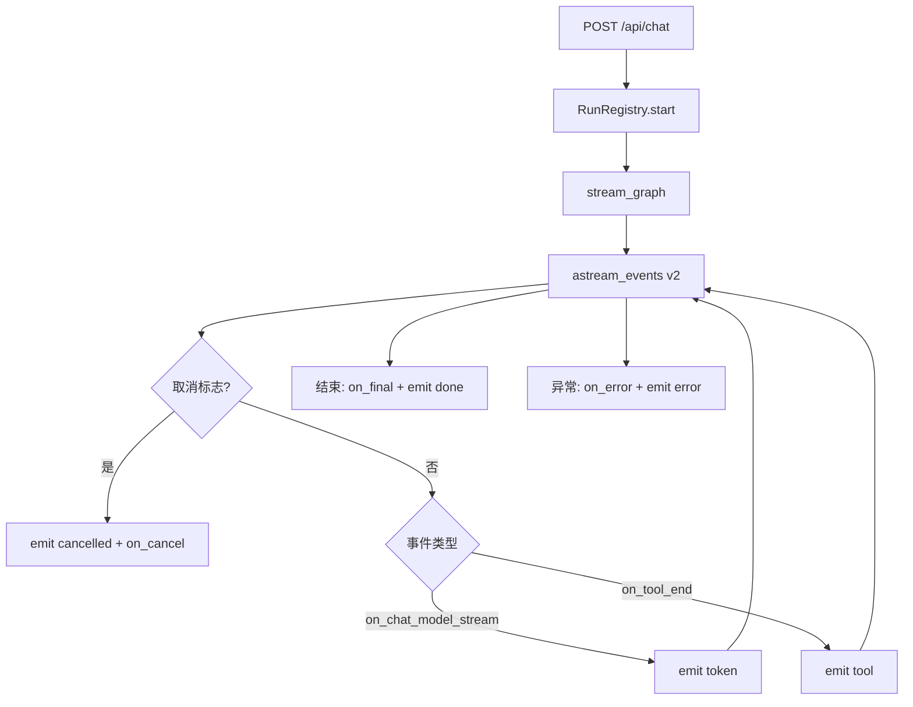

# 第 01.6 章　流式输出、重试与中断

> 状态：✅ 正文按六节写完；SSE 事件、run 生命周期与取消已接 HTTP，重试仅到 provider 层。
> 所属：第 01 篇　最小可运行 Agent

## 1. 功能与知识点

### 功能

一轮聊天对用户表现为「先出字、可中断、有终态」：

1. **流式**：`graph.astream_events(version="v2")` → `on_chat_model_stream` 转 `token` 事件，`on_tool_end` 转 `tool` 事件。
2. **收敛**：成功发 `done`，异常发 `error`，取消发 `cancelled`；每个事件带递增 `seq`。
3. **中断**：`/api/chat/cancel` 给活跃 run 打取消标记；流每处理一个图事件前检查一次。
4. **重试**：provider 层 `max_retries`（`ChatOpenAI` 构造参数），流层不做重试。
5. **终态**：`RunRegistry` 把 run 从 `running` 落到 `finished/error/cancelled`。

### 知识点如何体现

| 知识点 | 在本功能里体现为 | 可观察证据 |
|---|---|---|
| 流要可排序 | 每帧 `id: seq` + JSON 里的 `seq` | 前端可按 seq 去重 |
| 事件类型固定 | token/tool/done/error/cancelled | `EventStream.emit` 调用点 |
| 取消是信号不是强杀 | `cancel()` 只 set 标志，收尾由执行方做 | `RunRegistry.cancel` |
| 取消检查在事件边界 | 每处理一个 raw 事件前查一次 | 取消延迟=下一个图事件 |
| 取消过的 run 不许报成功 | `finish(status="finished")` 自动改 `cancelled` | `lifecycle.finish` |
| 客户端断开也要终态 | 生成器 `finally` 里 `finish(cancelled)` | `chat.py` 的 `gen()` |

**最小验收**：假模型逐字输出，SSE 里能拼回完整文本，末帧 `done`；调用 cancel 后出现 `cancelled` 且 run 终态不是 finished。

## 2. 最小调用链



### 2.1 事件序列化

```python
def to_sse(self) -> str:
    payload = json.dumps({**self.data, "seq": self.seq}, ensure_ascii=False)
    return f"id: {self.seq}\nevent: {self.type}\ndata: {payload}\n\n"
```

`id` 与 payload 里的 `seq` 必须一致：只在前端解析 JSON 时用 payload，断线重连用 `id`。

### 2.2 取消的两段式

```python
if should_cancel is not None and should_cancel():
    if on_cancel is not None:
        on_cancel()
    yield stream.emit("cancelled").to_sse()
    return
```

第一段是「发信号」（路由层 `/chat/cancel`）；第二段是「执行方看到信号后收尾」。没有强杀线程，避免把 SQLite 连接直接掐断。

### 2.3 终态保护

```python
if rec.cancelled.is_set() and status == "finished":
    status = "cancelled"
```

取消和正常结束可能同时发生；只要取消标记在，最终状态必须是 `cancelled`，不能因为生成器跑完了就报成功。

## 3. 代码创建

| 顺序 | 文件 | 本章职责 | 关键符号 |
|---|---|---|---|
| 1 | `runtime/events.py` | 事件形状 + SSE | `StreamEvent.to_sse`、`EventStream.emit` |
| 2 | `runtime/streaming.py` | 图事件 → 业务事件 | `stream_graph` |
| 3 | `session_execution/lifecycle.py` | run 注册/取消/终态 | `RunRegistry` |
| 4 | `app/gateway/routers/chat.py` | 串起 start/stream/cancel/finish | `gen()`、`/chat/cancel` |
| 5 | `tests/chapters/test_ch01_06_e2e.py` | 端到端 SSE 与落库 | `test_end_to_end` |

### 3.1 为什么在流层做取消检查

图内部没有「用户点了停止」这个输入；把检查放在流的循环里，是唯一不侵入图节点的位置。代价是取消延迟取决于下一个事件到达时间。

### 3.2 `on_final` 失败不等于回答成功

```python
try:
    on_final(final_text)
except Exception as exc:
    on_error(str(exc))
    yield stream.emit("error", message=f"final callback failed: {exc}").to_sse()
    return
```

落库失败时不能发 `done`：用户会以为回答已保存，实际没有。宁可报错，也不静默成功。

### 3.3 上游对照

EvoFlow 的流层还有：断线重连（`Last-Event-ID` 续传）、事件缓冲、背压、逐 token 重试、心跳帧。本章只做「单次连接 + 取消 + 终态」，续传与心跳未实现。

## 4. 测试

### 4.1 覆盖矩阵

| 类型 | 用例 | 验证什么 |
|---|---|---|
| 端到端 | `test_end_to_end` | 模型 → 图 → 落库 → SSE 首帧带 id |
| 端到端 | `test_http_chat_streams_and_second_turn_sees_history` | 逐字流、第二轮历史、四条消息记录 |
| 集成 | `test_ch06_03_approvals`（跨篇） | 取消后审批单随 run 作废 |

### 4.2 运行

```bash
cd /Users/main/my-agent-flow/backend
uv run pytest tests/chapters/test_ch01_06_e2e.py tests/chapters/test_ch01_02_r0_e2e.py -q
```

当前结果：全部通过。

## 5. 完整化

1. **断线续传**：事件缓冲 + `Last-Event-ID` 重放；现在重连只能从头再跑。
2. **心跳**：长工具调用期间发 `ping`，避免网关判定空闲超时。
3. **背压**：前端慢时不能无限攒事件；需要缓冲上限与降级（只发 done + 全文）。
4. **流层重试**：provider 重试之外，模型中途断流是否需要「续写式重试」要单独设计。
5. **取消即时性**：现在下一个事件才生效；工具执行中要能中断，需要工具层配合（03.4）。
6. **错误分级**：`error` 事件只有 message，前端无法区分「模型失败」「落库失败」「工具失败」。

每项都要有独立测试；当前只完成单次流 + 取消。

## 6. 边界与验收

### 本章不做什么

- 不做断线续传、心跳、背压。
- 不做流层重试；重试只发生在 provider 的 HTTP 客户端。
- 不做工具执行中的强制中断。
- 不做事件持久化；刷新页面看不到历史流。

### 验收

```bash
cd /Users/main/my-agent-flow/backend
uv run pytest tests/chapters/test_ch01_06_e2e.py -q
```

预期：`1 passed`。失败时先查：模型替身是否实现 `_stream`（只实现 `_generate` 不会有 token 事件）、`astream_events` 的 `version="v2"` 是否漏传、run 是否在生成器 `finally` 里收尾。

### 下一章依赖

第 02 篇要在「每轮模型调用前」做上下文裁剪；它必须发生在 `on_chat_model_stream` 之前，否则流里看到的是被裁剪后的历史，而 token 统计已经错过。
