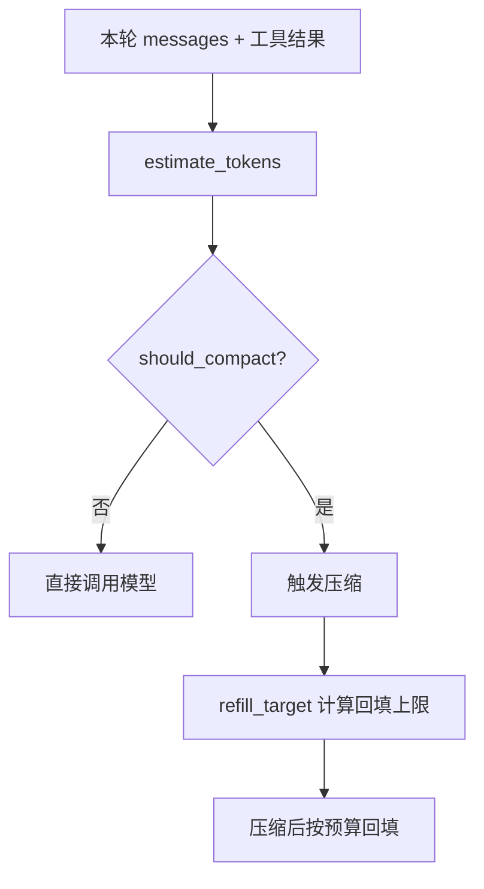
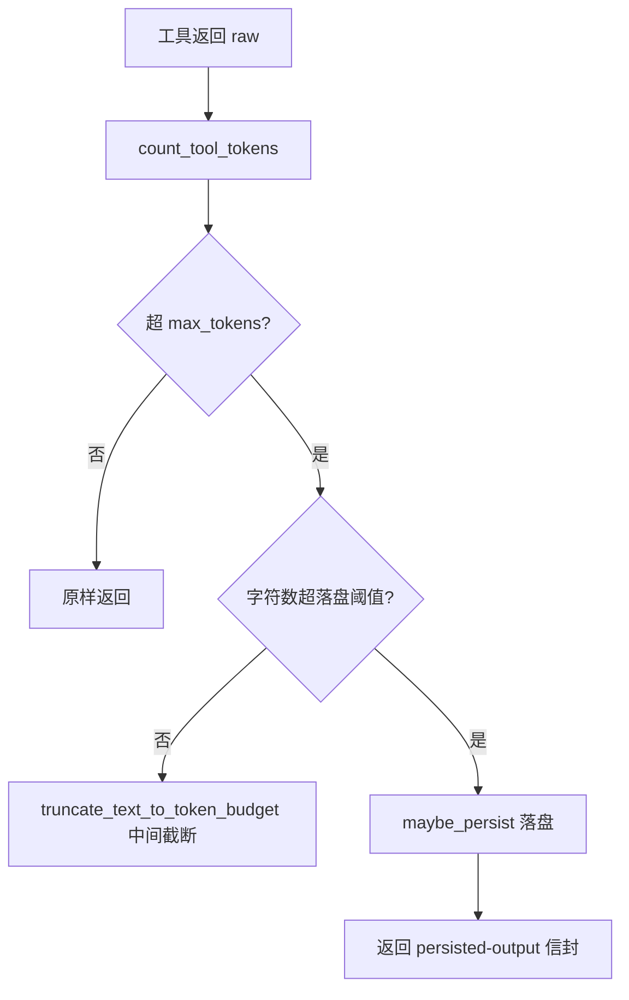

# 第 02.1 章　Context Window 与预算

> 状态：✅ 样板章（正文按六节写完；代码为本地已实现组件，接线边界见 §6）。
> 所属：第 02 篇　上下文与短期记忆

## 1. 功能与知识点

### 功能

在调用模型前回答三个问题：这轮上下文有多大、什么时候必须压缩、压缩后能回填多少；在工具输出进入上下文前回答：超长结果截断还是落盘。

这是两个入口，共用一个预算概念：

- **模型上下文预算**：`estimate_tokens` → `compact_threshold` → `should_compact` → `refill_target`。
- **工具输出预算**：`count_tool_tokens` → `truncate_text_to_token_budget` 或 `maybe_persist`。

### 知识点如何体现

| 知识点 | 在本功能里体现为 | 可观察证据 |
|---|---|---|
| Context window 不等于可用预算 | 模型写 256K，但超过 150K 就压缩；阈值取「比例」和「绝对上限」的较小值 | `compact_threshold(256_000) == 150_000`，`compact_threshold(100_000) == 90_000` |
| 估算宁可高估 | 中文按 1 字 1 token，英文按约 3 字符 1 token | 同一段中英混排，估算值不低于真实分词上限 |
| 压缩后不能立刻再超 | 回填目标 = 阈值 / 1.22（跨轮）或 / 1.5（同轮） | `refill_target(150_000) < 150_000` |
| 截断要保头尾 | 头是命令/错误摘要，尾是最新输出；中间只放省略标记 | 输出以 `HEAD` 开头、`TAIL` 结尾，含 `tokens truncated` |
| 大结果不硬塞上下文 | 超过字符阈值落盘，返回 `<persisted-output>` 信封 | 信封含路径，原文件内容与输入一致 |

**最小验收**：构造 20K 字符工具输出 → 200 token 预算截断 → 头尾保留且 token 不超预算；再构造 20K 字符结果 → 落盘 → 返回信封。

## 2. 最小调用链

### 2.1 模型上下文预算



关键参数：

- `DEFAULT_CONTEXT = 256_000`：模型没写窗口时的保守估值。
- `AUTO_COMPACT_RATIO = 0.9`：留 10% 给压缩本身。
- `ABSOLUTE_CAP = 150_000`：实测超过后 TTFT 从 2s 级飙到 10s 级。
- `POST_COMPRESS_REFILL = 1.22`、`SAME_TURN_REFILL = 1.5`：回填到阈值的 1/1.22 或 1/1.5。

### 2.2 工具输出预算



注意顺序：先判断是否超 token 预算，再决定截断；落盘判断看字符数，避免每次大结果都做 token 计数。

### 2.3 失败点

- 空文本：`estimate_tokens("") == 0`；截断函数返回空串，不抛异常。
- `max_tokens <= 0`：截断返回空串，调用方必须自己决定是否报错。
- 预算小到放不下头尾：退化为固定头部 + 提示，不能返回空串。
- 落盘目录不可写：`OSError` 时退回截断摘要，不阻断工具调用。
- 重复落盘：文件名含内容哈希，同一内容重放命中同一文件，不互相覆盖。

## 3. 代码创建

| 顺序 | 文件 | 本章职责 | 关键符号 |
|---|---|---|---|
| 1 | `context/budget.py` | 估算、阈值、是否压缩、回填目标 | `estimate_tokens`、`compact_threshold`、`should_compact`、`refill_target` |
| 2 | `context/tool_tokens.py` | 工具输出 token 计数与字符/ token 换算 | `count_tool_tokens` |
| 3 | `tools/tool_output_truncation.py` | 中间截断、带原始计数的格式化头 | `truncate_text_to_token_budget`、`formatted_truncate_tool_output` |
| 4 | `tools/large_result_store.py` | 超阈值落盘、信封、清理 | `maybe_persist`、`is_persisted_output_content` |
| 5 | 调用方 | 目前未接模型循环与工具中间件 | 见 §6 |

### 3.1 阈值与回填

```python
DEFAULT_CONTEXT = 256_000
AUTO_COMPACT_RATIO = 0.9
ABSOLUTE_CAP = 150_000
POST_COMPRESS_REFILL = 1.22
SAME_TURN_REFILL = 1.5


def compact_threshold(context_length: int = DEFAULT_CONTEXT) -> int:
    """压缩触发阈值：上下文比例与绝对上限取较小值。"""
    by_ratio = int(context_length * AUTO_COMPACT_RATIO)
    return min(by_ratio, ABSOLUTE_CAP)


def refill_target(threshold: int, same_turn: bool = False) -> int:
    """压缩后的回填目标：按同轮/跨轮比例把阈值换算成可用预算。"""
    ratio = SAME_TURN_REFILL if same_turn else POST_COMPRESS_REFILL
    return int(threshold / ratio)
```

这里最容易讲错的是“窗口 256K 就能用 256K”。绝对上限的存在说明：预算是延迟/成本约束，不是模型容量。

### 3.2 中间截断

```python
def truncate_text_to_token_budget(text: str, max_tokens: int) -> str:
    """中间截断到 max_tokens：保留头尾，中间放省略标记。"""
    raw = str(text or "")
    if not raw or max_tokens <= 0:
        return ""
    if count_tool_tokens(raw) <= max_tokens:
        return raw

    omitted = max(0, count_tool_tokens(raw) - max_tokens)
    marker = f"... {omitted} tokens truncated ..."

    lo, hi = 0, len(raw)
    head_len = 0
    while lo <= hi:
        mid = (lo + hi) // 2
        head = raw[:mid]
        tail = raw[len(raw) - mid:] if mid < len(raw) else ""
        candidate = f"{head}\n\n{marker}\n\n{tail}" if tail else f"{head}\n\n{marker}"
        if count_tool_tokens(candidate) <= max_tokens:
            head_len = mid
            lo = mid + 1
        else:
            hi = mid - 1
    ...
```

用二分而不是按比例切：token 估算随字符单调增，二分能保证最终结果不超预算。

### 3.3 落盘信封

```python
def maybe_persist(content, tool_name, tool_call_id, *, thread_id=None) -> str:
    n = len(content)
    if n <= THRESHOLD_CHARS or is_persisted_output_content(content):
        return content

    content_hash = hashlib.md5(content.encode("utf-8")).hexdigest()[:12]
    filename = f"{tool_name}_{tool_call_id}_{content_hash}.txt"
    filepath = store_dir / filename
    try:
        _prune_old_files(store_dir)
        filepath.write_text(content, encoding="utf-8")
        return _format_persisted_output_envelope(...)
    except OSError:
        return content[:SUMMARY_MAX_CHARS] + f"\n\n… [persist failed, total {n:,} chars]"
```

信封只给路径和摘要，不把大内容重新塞回上下文；模型需要细节时再读文件。

## 4. 测试

### 4.1 覆盖矩阵

| 类型 | 用例 | 验证什么 |
|---|---|---|
| 阈值 | `test_cap_beats_ratio` | 大窗口被 150K 截住，小窗口按 90% 算 |
| 回填 | `test_refill` | 回填目标小于阈值，同轮更保守 |
| 截断 | `test_truncate_middle` | 头尾保留、含省略标记、token 不超预算 |
| 落盘 | `test_persist_large` | 信封、路径、原文件内容、重复调用 |
| 边界（建议补） | `truncate_text_to_token_budget("", 0)` | 空输入/零预算返回空串，不抛异常 |
| 失败（建议补） | monkeypatch 写文件抛 `OSError` | 返回摘要，不阻断工具调用 |

### 4.2 运行

```bash
cd /Users/main/my-agent-flow/backend
uv run pytest tests/chapters/test_ch03_04_budget.py -q
```

当前结果：`4 passed`。

## 5. 完整化

1. **接入模型循环**：每轮调用前 `estimate_tokens` → `should_compact`；压缩后按 `refill_target` 回填。当前没有调用方，不能声称已自动压缩。
2. **分层预算**：system prompt、工具定义、历史消息、工具结果各留配额；先保 system 与最近一轮，再压缩旧历史。
3. **工具中间件**：在工具返回处统一走 `formatted_truncate_tool_output` 或 `maybe_persist`，避免每个工具自己截断。
4. **上下文引用登记**：落盘信封登记到 `context_ref_lru`，让模型按需回读并淘汰旧引用；当前 `thread_id` 参数被 `del`，尚未实现。
5. **成本估算**：记录估算 token、实际 usage、压缩次数；估算偏差持续超过 20% 时调整系数。
6. **安全边界**：截断不能把 system prompt 或安全声明截掉；压缩摘要不得吞掉工具错误码。

每项都要有独立测试；接线测试和组件测试分开写。

## 6. 边界与验收

### 本章不做什么

- `context/budget.py` 当前是纯函数，没有被 `build_graph`、模型节点或中间件调用。
- `maybe_persist` 当前没有被工具执行器引用；落盘是组件能力，不是端到端已生效。
- 估算不是精确 tokenizer；它的目标是“宁可高估”，不能拿它做计费。
- 本章不实现摘要压缩算法；只定义触发阈值与回填预算，摘要属于 02.3。

### 验收

```bash
cd /Users/main/my-agent-flow/backend
uv run pytest tests/chapters/test_ch03_04_budget.py -q
```

预期：`4 passed`。失败时先看三处：`ABSOLUTE_CAP` 是否被改动、`max_tokens` 是否为 0、落盘目录 `MYAF_DATA_DIR/large_tool_results` 是否可写。

### 下一章依赖

02.2 的短期记忆策略要用本章的预算：全量/滑窗/摘要不是三种文风，而是三种“在预算内保留什么”的选择。
