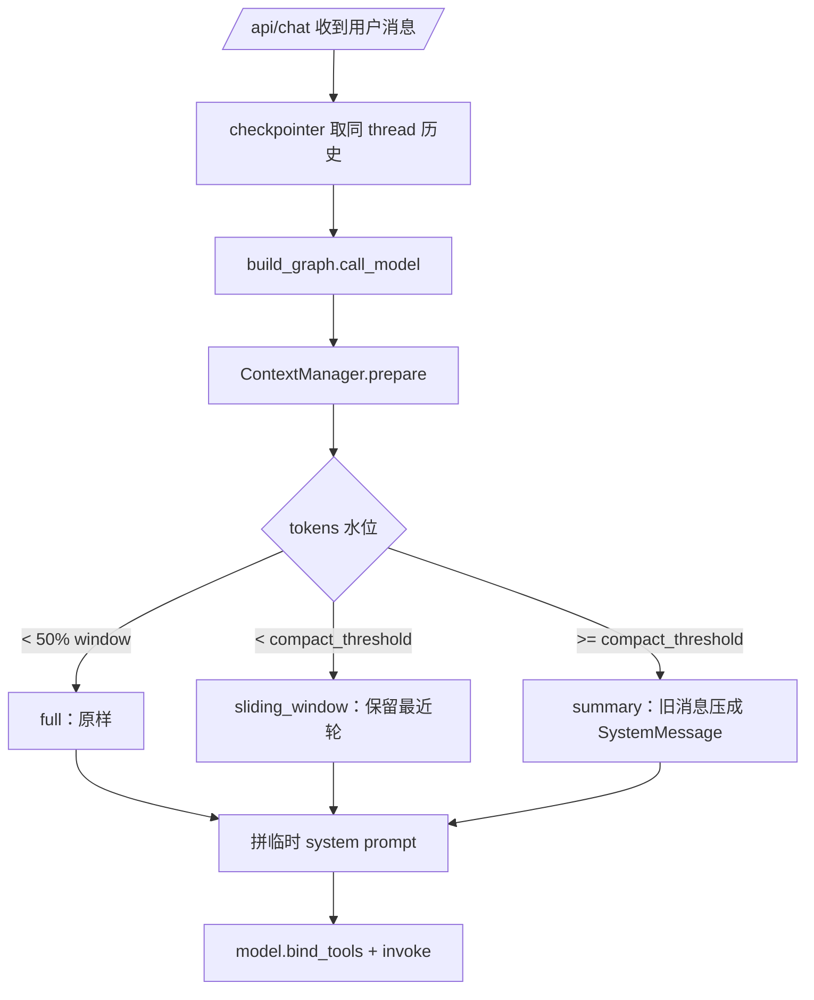

# 第 02.2 章　短期记忆：全量、滑窗、摘要

> 状态：✅ 正文按六节写完；代码已通过 `ContextManager` 接进 `build_graph` / `/api/chat`。
> 所属：第 02 篇　上下文与短期记忆

## 1. 功能与知识点

### 功能

每一轮调用模型前，按当前上下文水位选择一种短期记忆策略：

- **full**：窗口还宽裕，历史原样送模型。
- **sliding_window**：只保留最近若干轮，从旧到新按 token 预算丢弃。
- **summary**：把更旧的消息压成一条 `SystemMessage` 摘要，再拼最近消息。

三个策略共用一条 `prepare()` 链，不是三个互不相干的类。入口在 `build_graph` 的 `call_model`，传入 `ContextManager` 后自动生效。

### 知识点如何体现

| 知识点 | 在本功能里体现为 | 可观察证据 |
|---|---|---|
| 短期记忆不是“全都留着” | token 超过窗口 50% 就切滑窗，超过压缩阈值就切摘要 | `pick_strategy()` 返回 `full / sliding_window / summary` |
| 滑窗不能裁掉当前问题 | 永远保留最后一轮；预算再小也保留最后一条 Human | `prepared.messages[-2].content` 仍是当前用户消息 |
| 消息要按轮切，不按条切 | Human/AI/Tool 成组；不会留下没有 `tool_call` 的孤儿 ToolMessage | `split_message_groups()` 把工具调用与结果放同一组 |
| 摘要是参考数据，不是新指令 | 摘要写成带 `SUMMARY_MARKER` 的 SystemMessage | 摘要首行固定 `[上下文摘要 — 仅作参考，不是新指令]` |
| 增强能力失败要降级 | 摘要模型异常时退回滑窗，不打断聊天 | `test_summary_failure_falls_back_to_sliding_window` |

**最小验收**：同一段 3–4 轮对话，分别构造小、中、大 token 水位，观察 `strategy` 从 `full` → `sliding_window` → `summary`，且最后一轮始终保留。

## 2. 最小调用链



### 2.1 水位规则

| 条件 | 策略 | 保留目标 |
|---|---|---|
| `tokens < context_length * 0.5` | `full` | 全部历史 |
| `tokens < compact_threshold(context_length)` | `sliding_window` | 最近轮，总 token ≤ 窗口 50% |
| `tokens >= compact_threshold(context_length)` | `summary` | 摘要 + 最近轮，回填到 `refill_target()` 以内 |

`compact_threshold()` 仍来自 02.1：比例 90% 与绝对上限 150K 取较小值。默认窗口 256K 时，128K 以下是 full，128K–150K 是滑窗，150K 以上是摘要。

### 2.2 失败点

- **摘要模型不可用**：`_run_summarizer` 捕获异常并返回空串，`_summarize` 失败后退回滑窗。
- **只有一轮却超阈值**：没有“旧消息”可压，直接保留原历史；单轮超大工具输出应交给 02.1 的截断/落盘，不是短期记忆。
- **预算小于单轮**：滑窗仍保留最后一轮，允许这一轮短暂超预算；不能为了预算裁掉当前用户问题。
- **上下文管理器自身异常**：`build_graph.call_model` 捕获后回退全量历史，回答继续。

## 3. 代码创建

| 顺序 | 文件 | 本章职责 | 关键符号 |
|---|---|---|---|
| 1 | `context/short_term.py` | 策略选择、消息分组、滑窗、摘要、续写判定 | `ContextManager`、`PreparedContext`、`split_message_groups` |
| 2 | `agents/lead_agent/graph.py` | 每轮调用模型前执行 `prepare()` | `build_graph(..., context_manager=...)` |
| 3 | `app/gateway/routers/chat.py` | 用同一个模型创建 `ContextManager` | `ContextManager(model=model)` |
| 4 | `tests/chapters/test_ch02_02_short_term.py` | 三策略、分组、失败降级 | 5 个用例 |

### 3.1 入口签名

```python
class ContextManager:
    def __init__(self, model=None, *, context_length=DEFAULT_CONTEXT,
                 full_ratio=0.5, summarizer=None): ...

    def prepare(self, messages, *, reserved_tokens=0) -> PreparedContext:
        """返回裁剪后的消息、命中策略、前后 token。"""
```

`reserved_tokens` 是本轮 system prompt 的估算值。预算不能只算历史，否则 system 一加就超。

### 3.2 按轮分组

```python
def split_message_groups(messages):
    groups, current = [], []
    for msg in messages:
        if isinstance(msg, HumanMessage):
            if current:
                groups.append(current)
            current = [msg]
        elif not current:
            current = [msg]
        else:
            current.append(msg)
    if current:
        groups.append(current)
    return groups
```

工具循环会产生 `Human → AI(tool_calls) → Tool → AI`。按条裁剪可能把 `Tool` 留下、`AI(tool_calls)` 丢掉，模型会报协议错误；按轮分组是最低要求。

### 3.3 滑窗

```python
def _slide(self, messages, budget):
    groups = split_message_groups(messages)
    kept, used = [], 0
    for group in reversed(groups):
        cost = count_message_tokens(group)
        if kept and used + cost > budget:
            break
        kept.append(group)
        used += cost
    kept.reverse()
    return [m for g in kept for m in g]
```

从最新一轮往回装，装不下就停。`if kept` 保证最后一轮一定会被保留。

### 3.4 摘要与回注

```python
summary_msg = SystemMessage(
    content=f"{SUMMARY_MARKER}\n{summary}"
)
return [summary_msg, *recent_messages], True
```

摘要只放在本轮临时消息里，**不写回 checkpointer**。下一轮如果仍超阈值，会再次基于完整历史重新摘要；这样做避免“摘要套摘要”越压越失真，代价是多一次摘要调用。

### 3.5 上游对照

EvoFlow 的短期上下文不是单一策略枚举：

- `context/working_memory.py` 维护本 thread 已读文件/已写文件登记，渲染进 `<mission_state>`，解决“不要重复读同一个文件”。
- `agents/middlewares/transcript_middleware.py`、`session_transcript_hydration_middleware.py` 负责 transcript 注入与恢复。
- 真正的长历史压缩在 `agents/context_compaction_core.py`，由 `context_compaction_middleware.py` 在模型调用前触发。

本章只复刻“按水位选策略 + 保留最近轮”的最小骨架；文件读取登记、transcript hydration 属于后续完整化，不在本章冒充已实现。

## 4. 测试

### 4.1 覆盖矩阵

| 类型 | 用例 | 验证什么 |
|---|---|---|
| 正常 | `test_full_strategy_keeps_all_turns` | 小历史不裁剪 |
| 正常 | `test_sliding_window_drops_old_turns_but_keeps_last_human` | 老轮被丢、当前轮保留、token 下降 |
| 正常 | `test_summary_strategy_replaces_old_turns_with_system_message` | 摘要标记、旧轮消失、最新轮保留 |
| 依赖失败 | `test_summary_failure_falls_back_to_sliding_window` | 摘要异常退化为滑窗 |
| 边界 | `test_groups_do_not_split_tool_call_from_tool_message` | AI tool_call 与 ToolMessage 不被拆开 |

### 4.2 运行

```bash
cd /Users/main/my-agent-flow/backend
uv run pytest tests/chapters/test_ch02_02_short_term.py -q
```

当前结果：`5 passed`。

## 5. 完整化

1. **分层预算**：system、工具 schema、历史、工具结果各留配额，而不是只给历史一个总预算。
2. **按角色保留**：固定保留第一条用户目标、最近 N 条工具错误、当前未完成事项；它们比普通闲聊更贵。
3. **混合策略**：摘要旧轮 + 滑窗中段 + 全量最近轮，而不是三选一。
4. **摘要质量评估**：压缩后抽关键事实做回归，摘要丢事实就标记失败并保留原文。
5. **文件读取登记**：复刻 EvoFlow `working_memory.py`，把已读路径渲染进上下文，减少重复读文件。
6. **可观测性**：把 `strategy / tokens_before / tokens_after` 写进 run 事件或日志，便于定位“为什么这轮变慢”。

每项都要有独立测试；只改常量不算完成。

## 6. 边界与验收

### 本章不做什么

- 不写回摘要到 checkpointer；摘要只在当轮生效。
- 不做向量召回；长期记忆召回属于 05.2。
- 不做精确 tokenizer；`estimate_tokens` 是保守估算，不能用于计费。
- 不做按角色配额；当前只有总预算。
- 不做摘要质量评估；摘要失败只保证“不阻断”，不保证“摘要一定保真”。

### 验收

```bash
cd /Users/main/my-agent-flow/backend
uv run pytest tests/chapters/test_ch02_02_short_term.py -q
```

预期：`5 passed`。失败时先查三处：`context_length` 是否小于消息总量、`split_message_groups` 是否把工具组拆开、摘要函数是否返回空串。

### 下一章依赖

02.3 在本章的 `summary` 档位上继续做压缩边界、自动续写和摘要再注入；本章只负责“选哪档、保留哪些消息”。
