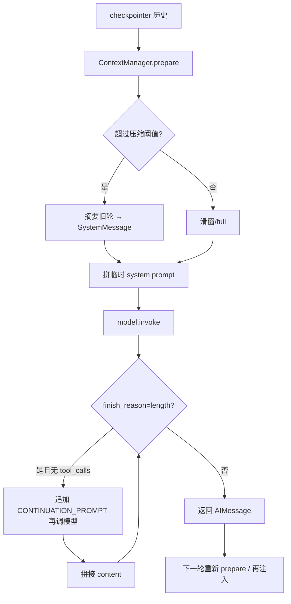

# 第 02.3 章　压缩、自动续写与再注入

> 状态：✅ 正文按六节写完；压缩与续写已接进 `build_graph`，摘要按轮再注入。
> 所属：第 02 篇　上下文与短期记忆

## 1. 功能与知识点

### 功能

解决长回答和高水位历史的两个断点：

1. **压缩**：历史超过压缩阈值时，把旧轮压成一条摘要 `SystemMessage`，再把最近轮拼回去。
2. **自动续写**：模型因 `finish_reason=length / max_tokens` 截断时，带“从截断处继续”的提示再调一次模型，把两段回答拼成一条。
3. **再注入**：摘要和续写结果都在下一轮模型调用前重新进入消息列表，不依赖模型“自己记得”。

入口仍是 `/api/chat` → `build_graph.call_model`；`max_continuations=2` 控制续写上限。

### 知识点如何体现

| 知识点 | 在本功能里体现为 | 可观察证据 |
|---|---|---|
| 压缩的边界是“旧轮”，不是当前轮 | 只摘要 `cut_at` 之前的轮；最近轮原样保留 | 摘要后最后一条 Human 仍是当前问题 |
| 摘要必须标记为参考 | `SUMMARY_MARKER` 写明“不是新指令” | 摘要 SystemMessage 首行固定标记 |
| 截断要看协议字段，不猜内容 | `needs_continuation()` 只认 `finish_reason/stop_reason` | `stop` 不续写，`length` 续写 |
| 续写不能重复前文 | 提示词明确“从截断处继续，不要重复” | 第二次调用最后一条是 `CONTINUATION_PROMPT` |
| 续写有上限 | `max_continuations` 限制循环次数 | 达到上限就停，不无限调用 |
| 工具调用优先于续写 | 有 `tool_calls` 时不续写，交给工具循环 | `needs_continuation()` 对 tool_calls 返回 False |

**最小验收**：假模型第一次返回 `finish_reason=length`，第二次返回收尾；图输出两段拼接文本，模型只被调用两次。

## 2. 最小调用链



### 2.1 压缩与回填

- 触发：`tokens >= compact_threshold(context_length)`。
- 保留：从最新轮往回装，直到不超过 `refill_target(threshold)`。
- 压缩：旧轮 `_transcript()` 成文本，交给摘要模型；摘要最多占回填目标的 12%。
- 回注：`SystemMessage(SUMMARY_MARKER + 摘要)` 放在最近轮之前。

### 2.2 续写判定

```python
finish = str(meta.get("finish_reason") or meta.get("stop_reason") or "").lower()
return finish in {"length", "max_tokens", "max_output_tokens"}
```

不用“回答很短”判断截断：短回答可能是正常结论，误续写会重复内容。只认 provider 的结束原因。

### 2.3 失败点

- 摘要调用异常 → 退滑窗（02.2 已测）。
- 续写第二次仍 `length` → 继续到 `max_continuations`，到上限停止。
- 续写返回 `tool_calls` → 当前实现把 content 拼接后带回 tool_calls，交给工具循环；不会无限续写。
- 模型不返回 `response_metadata` → 视为正常结束，不续写。

## 3. 代码创建

| 顺序 | 文件 | 本章职责 | 关键符号 |
|---|---|---|---|
| 1 | `context/short_term.py` | 摘要压缩、续写判定、续写提示 | `needs_continuation`、`CONTINUATION_PROMPT`、`ContextManager._summarize` |
| 2 | `agents/lead_agent/graph.py` | 调模型后检查截断并续写，拼接 `AIMessage` | `max_continuations` |
| 3 | `app/gateway/routers/chat.py` | 打开续写上限 | `max_continuations=2` |
| 4 | `tests/chapters/test_ch02_03_compaction.py` | 截断判定、自动续写、正常不续写、上下文接管 | 4 个用例 |

### 3.1 压缩核心

```python
target = refill_target(compact_threshold(self.context_length))
keep, used = [], 0
for idx in range(len(groups) - 1, -1, -1):
    cost = count_message_tokens(groups[idx])
    if keep and used + cost > target:
        cut_at = idx + 1
        break
    keep.append(groups[idx])
    used += cost
    cut_at = idx
summary = self._run_summarizer(old_groups)
```

先算“最近轮能装多少”，再把剩下的旧轮一次摘要。不是先摘要再硬塞，否则回填后可能又超阈值。

### 3.2 续写循环

```python
combined = _message_text(reply)
current = reply
for _ in range(max_continuations):
    if not needs_continuation(current):
        break
    follow = messages + [current, HumanMessage(content=CONTINUATION_PROMPT)]
    current = bound.invoke(follow)
    combined += _message_text(current)

if combined != _message_text(reply):
    reply = AIMessage(content=combined, tool_calls=..., response_metadata=...)
```

消息列表包含“原问题 + 前半段 + 继续提示”，模型能看到截断位置。最终只把拼接后的 `AIMessage` 放进图状态，避免把续写中间轮当成多轮对话。

### 3.3 再注入

本轮摘要只在本轮消息列表里；下一轮 `ContextManager.prepare()` 会重新基于 checkpointer 的完整历史判断。若仍超阈值，重新摘要。

这样做的取舍：

- **不写回**：避免摘要污染历史、摘要套摘要；代价是重复摘要成本。
- **写回**：省一次调用，但会永久丢失原文，且摘要错误无法回溯。

当前选择“不写回”，与 02.1 “摘要不能吞掉工具错误码”的保守取向一致。

### 3.4 上游对照

EvoFlow 的压缩链更重：

- `agents/context_compaction_core.py`：消息裁剪、工具结果分级 prune、摘要生成、token 估算、摘要失败冷却。
- `agents/context_compaction_middleware.py`：在模型调用前判断阈值、注入摘要、写事件。
- `context/compaction_token_utils.py`：token 计数与摘要失败冷却常量。

本章只复刻最小链路：阈值判断、旧轮摘要、最近轮回填、`finish_reason` 续写。工具结果分级 prune、摘要失败冷却、压缩事件、人工编辑摘要均未实现。

## 4. 测试

### 4.1 覆盖矩阵

| 类型 | 用例 | 验证什么 |
|---|---|---|
| 协议判定 | `test_needs_continuation_only_for_length_finish` | `length/max_tokens` 续写，`stop` 与 tool_calls 不续写 |
| 正常 | `test_graph_auto_continues_truncated_answer` | 两段拼接、第二次带继续提示 |
| 正常 | `test_graph_does_not_continue_normal_answer` | 正常结束只调一次 |
| 接线 | `test_graph_applies_context_manager_before_model` | 模型实际收到的历史已被裁剪 |

### 4.2 运行

```bash
cd /Users/main/my-agent-flow/backend
uv run pytest tests/chapters/test_ch02_03_compaction.py -q
```

当前结果：`4 passed`。

## 5. 完整化

1. **工具结果分级 prune**：复刻 EvoFlow 的 critical/moderate 分级，旧工具结果先清空或保留头尾，再决定是否摘要。
2. **摘要失败冷却**：同一 thread 摘要连续失败后暂停一段时间，避免每轮都多打一次失败请求。
3. **压缩事件**：发 `context_compaction` 事件，带压缩前后 token、摘要长度、被丢轮次，便于前端提示“历史已压缩”。
4. **摘要保真校验**：压缩后抽关键事实（文件路径、错误码、未完成事项）做包含检查；缺失就保留原文。
5. **人工编辑摘要**：允许用户查看/修正摘要，再把修正版写回；当前摘要不可见、不可编辑。
6. **跨轮缓存**：同一摘要输入哈希命中缓存，减少重复摘要调用。

每项都要有独立测试；当前只完成最小链路。

## 6. 边界与验收

### 本章不做什么

- 不把摘要写回 checkpointer，因此不能声称“永久压缩历史”。
- 不做工具结果分级 prune；旧工具输出可能仍占预算。
- 不做摘要保真校验；摘要丢事实时只能靠模型自行发现。
- 不做压缩事件与前端提示。
- 续写只处理“无 tool_calls 的截断回答”；工具循环中的截断不在本章范围。

### 验收

```bash
cd /Users/main/my-agent-flow/backend
uv run pytest tests/chapters/test_ch02_03_compaction.py -q
```

预期：`4 passed`。失败时先查：`response_metadata` 是否带 `finish_reason`、第二次调用是否真的收到 `CONTINUATION_PROMPT`、`max_continuations` 是否为 0。

### 下一章依赖

02.4 要在本章的摘要和工具输出上做“不可信数据”包装与注入扫描；摘要、工具结果、记忆都不得升级成系统指令。
