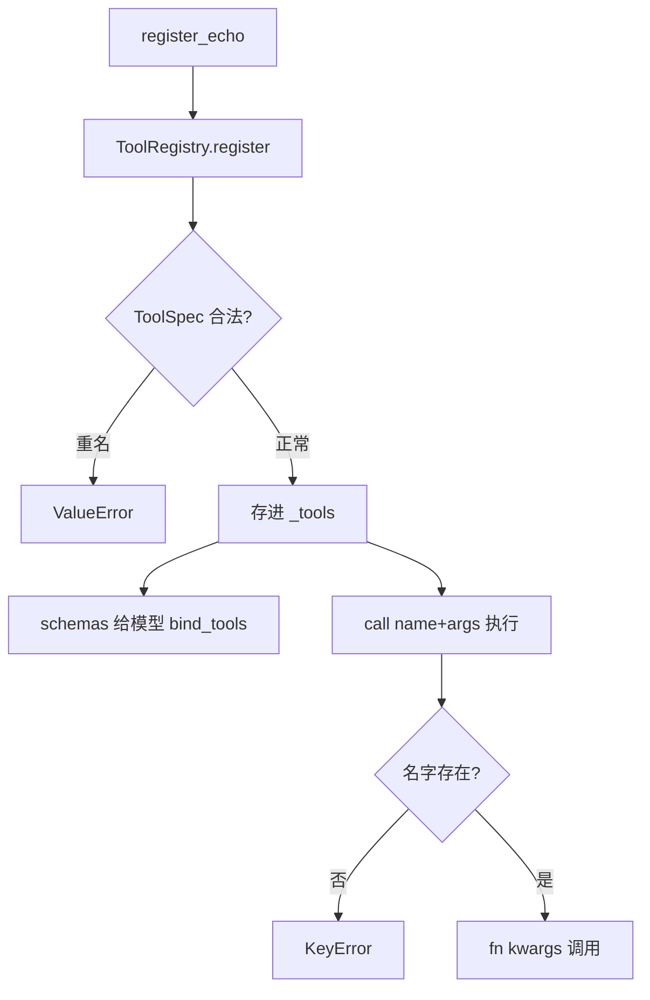

# 第 03.1 章　工具协议与注册

> 状态：✅ 正文按六节写完；`ToolRegistry` 已接图（`bind_tools(schemas)`），echo/文件/命令工具共用同一张表。
> 所属：第 03 篇　工具与行动

## 1. 功能与知识点

### 功能

把一个 Python 函数变成模型能调用的工具，只有三件事：

1. **声明**：`ToolSpec(name, description, input_schema, fn)` —— 名称、描述、JSON Schema、可调用对象绑在一起。
2. **注册**：`ToolRegistry.register()` —— 重名直接拒绝，不做「后者覆盖前者」。
3. **出库**：`schemas()` 产出 OpenAI function calling 形状；`call(name, args)` 按名调用。

图里通过 `model.bind_tools(tools.schemas())` 把工具清单交给模型。

### 知识点如何体现

| 知识点 | 在本功能里体现为 | 可观察证据 |
|---|---|---|
| 声明与执行必须绑定 | `ToolSpec` 同时带 schema 和 fn | 少一个就无法既给模型看又执行 |
| schema 用业界形状 | `{"type":"function","function":{...}}` | 直接可喂 OpenAI 兼容模型 |
| 重名是错误不是覆盖 | `raise ValueError("工具重名")` | 两个插件注册同名工具时启动即失败 |
| 未知工具显式报错 | `KeyError("未注册的工具")` | 图里转成 `ERROR` 回灌模型 |
| 描述是给模型看的 | `description` 写「什么时候用」，不是实现细节 | 影响模型选工具 |

**最小验收**：注册 `echo` → `schemas()[0].function.name == "echo"`、`required == ["text"]`、`call("echo", {"text":"hi"}) == "hi"`；调未知工具抛 `KeyError`。

## 2. 最小调用链



### 2.1 schema 生成

```python
def schemas(self):
    return [{"type": "function",
             "function": {"name": s.name, "description": s.description,
                          "parameters": s.input_schema}}
            for s in self._tools.values()]
```

不做「从函数签名自动推断 schema」：推断出来的 `required`、枚举、范围往往不准，宁可手写。

### 2.2 调用

```python
def call(self, name: str, args: dict[str, Any]) -> Any:
    spec = self._tools.get(name)
    if spec is None:
        raise KeyError(f"未注册的工具：{name}")
    return spec.fn(**args)
```

`**args` 直接展开：参数名必须和 schema 一致，多一个少一个都由 Python 抛 `TypeError`，不静默忽略。

### 2.3 失败点

- schema 与函数签名不一致：调用时 `TypeError`，图回灌成 `ERROR`。
- 工具返回非字符串：图里 `str(output)` 归一，结构化结果会丢类型（在 03.2 讨论）。
- 工具内阻塞：同步工具会卡住整个图；长任务应走 03.4 后台任务。

## 3. 代码创建

| 顺序 | 文件 | 本章职责 | 关键符号 |
|---|---|---|---|
| 1 | `tools/registry.py` | 声明 + 注册 + 调用 | `ToolSpec`、`ToolRegistry` |
| 2 | `tools/builtins/echo.py` | 最小工具样例 | `echo`、`register_echo` |
| 3 | `agents/lead_agent/graph.py` | 把 schema 绑给模型 | `model.bind_tools(tools.schemas())` |
| 4 | `tests/chapters/test_ch01_04_tools.py` | schema 与调用 | 2 个用例 |

### 3.1 echo 为什么值得留着

它不是占位符：ToolRegistry → bind_tools → tool_calls → 回灌 的整条链都能用它验证，不引入文件、网络、权限。所有工具循环测试都从它开始。

### 3.2 取舍：一张全局表 vs 每会话一张

现在 `/api/chat` 每个请求新建 `ToolRegistry`：工具集合可以按请求裁剪（比如只给只读工具），代价是注册开销重复。全局表单例省开销，但做不到「按用户/场景限权」。

### 3.3 上游对照

EvoFlow 的工具声明还带：side effects 标注、幂等键、超时、权限级别、结果 schema。本章只保留「名字/描述/入参 schema/函数」，其余交给执行器与策略层。

## 4. 测试

### 4.1 覆盖矩阵

| 类型 | 用例 | 验证什么 |
|---|---|---|
| 正常 | `test_schema_and_call` | function schema 形状、required、调用返回 |
| 失败 | `test_unknown_tool` | 未注册工具抛 `KeyError` |

### 4.2 运行

```bash
cd /Users/main/my-agent-flow/backend
uv run pytest tests/chapters/test_ch01_04_tools.py -q
```

当前结果：`2 passed`。

## 5. 完整化

1. **入参校验**：按 `input_schema` 在执行前校验，返回结构化错误而不是 `TypeError`。
2. **结果 schema**：声明 `output_schema`，让模型知道结果是文本还是 JSON。
3. **副作用标级**：只读/可写/危险，策略层按级别定 allow/ask/deny，不靠命令字符串正则。
4. **超时声明**：每个工具自带默认超时，执行器统一施加。
5. **版本与弃用**：同名工具升级要能标记 deprecated，并在 schema 描述里提示替代工具。
6. **按场景裁剪**：同一张表按 agent/用户过滤可见工具，避免「全能助手」暴露危险命令。

每项都要有独立测试；当前只完成协议最小面。

## 6. 边界与验收

### 本章不做什么

- 不做参数校验、不做结果 schema、不做超时声明。
- 不做工具版本管理与弃用提示。
- 不做按用户/场景限权；策略在 03.7。
- 不承诺「注册即安全」：名字和描述都可能被模型误用。

### 验收

```bash
cd /Users/main/my-agent-flow/backend
uv run pytest tests/chapters/test_ch01_04_tools.py -q
```

预期：`2 passed`。失败时先查：`input_schema.required` 是否写成 `["text"]`、注册是否发生在 `build_graph` 之前、模型是否实现了 `bind_tools`。

### 下一章依赖

03.2 要把 `registry.call` 包进中间件链；如果执行器绕过 registry 直接调函数，03.1 的「一张表是唯一事实」就失效了。
