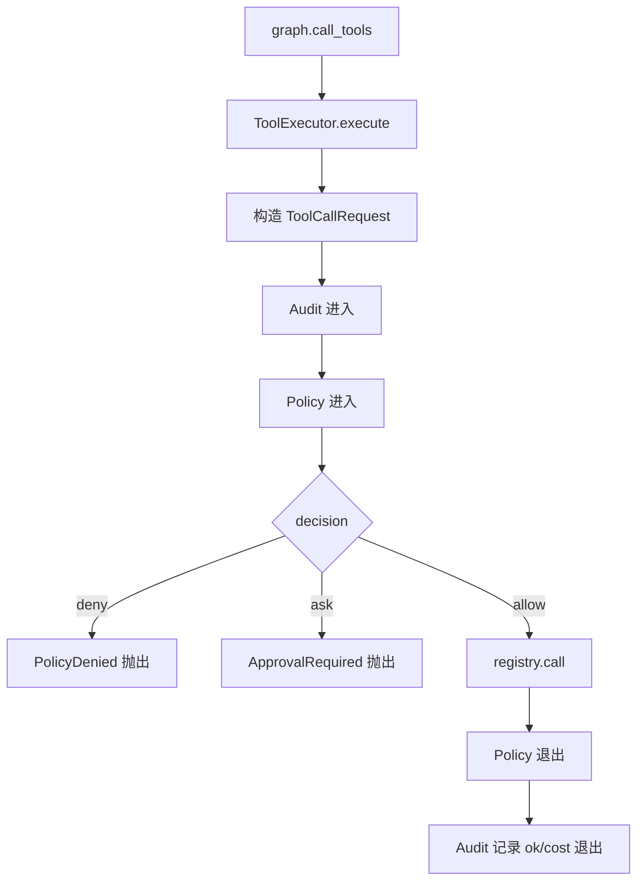

# 第 03.2 章　工具分发与中间件

> 状态：✅ 正文按六节写完；`ToolExecutor` + `AuditMiddleware` + `PolicyMiddleware` 已接 `/api/chat`，7 个执行器/中间件用例通过。
> 所属：第 03 篇　工具与行动

## 1. 功能与知识点

### 功能

图只认识一个执行入口，所有横切逻辑挂在中间件上：

1. **请求对象**：`ToolCallRequest(tool_call, thread_id, run_id, metadata)` —— 一次调用的完整事实。
2. **洋葱链**：`run_chain([m0, m1], request, call)`，列表第一个在最外层，进入正序、退出逆序。
3. **审计**：`AuditMiddleware` 记工具名、参数摘要（截 120 字）、耗时、成功/失败；失败继续抛。
4. **策略**：`PolicyMiddleware` 调 `sandbox.policy.evaluate`，deny 抛 `PolicyDenied`，ask 抛 `ApprovalRequired`。

`/api/chat` 的装配顺序是 `[AuditMiddleware(), PolicyMiddleware(store)]`：审计在最外层，能看到「被策略拒绝」也记一条。

### 知识点如何体现

| 知识点 | 在本功能里体现为 | 可观察证据 |
|---|---|---|
| 中间件统一签名 | `wrap_tool_call(request, handler)` | 子类只写一个方法 |
| 洋葱顺序由嵌套保证 | `for mw in reversed(middlewares)` | `test_chain_is_onion` 断言 in/out 序列 |
| 审计不吞错 | `except Exception: logger...; raise` | 失败后异常继续上抛 |
| 参数摘要要截断 | `_brief(args, limit=120)` | 日志里不出现完整密钥 |
| 请求可改写 | `Recorder` 把 args 改成 `rewritten` | 工具收到的是改写后的参数 |
| 策略在工具前生效 | deny 时 `stub.calls == []` | `test_deny_blocks_before_tool_runs` |

**最小验收**：两个中间件时事件序列为 `outer:in → inner:in → call → inner:out → outer:out`；工具抛错时中间件仍退出且异常不被吞。

## 2. 最小调用链



### 2.1 链组装

```python
handler = call
for mw in reversed(list(middlewares)):
    handler = _wrap_one(mw, handler)
return handler(request)
```

从后往前包：最后被包的（列表第一个）在最外层。这里用 `_wrap_one` 单独函数，避免闭包共享最后一个 `handler`。

### 2.2 策略中间件

```python
if result.decision is Decision.deny:
    raise PolicyDenied(f"拒绝执行：{result.reason}")
if result.decision is Decision.ask:
    approval_id = str((getattr(request, "metadata", {}) or {}).get("approval_id") or "")
    if approval_id and self.store.is_approved(approval_id, tool, args):
        return handler(request)
    ...
    raise ApprovalRequired(ap.id, result.reason)
return handler(request)
```

只有 shell 类工具走策略；`read_file`/`echo` 不受影响。审批单校验同时比对 tool 和 args：换命令不能复用旧单。

### 2.3 失败点

- 中间件自身抛异常：会中断整次调用，图回灌 `ERROR`；中间件必须自己保证不抛非业务异常。
- 审计与策略顺序反了：被拒绝的调用会看不到审计记录。
- `run_id` 为空：审批单按 `run_id=""` 建，多个 run 会串单。

## 3. 代码创建

| 顺序 | 文件 | 本章职责 | 关键符号 |
|---|---|---|---|
| 1 | `agents/middlewares/chain.py` | 基类 + 洋葱组装 | `Middleware`、`run_chain` |
| 2 | `tools/executor.py` | 请求对象 + 执行入口 | `ToolCallRequest`、`ToolExecutor` |
| 3 | `agents/middlewares/audit.py` | 审计一行日志 | `AuditMiddleware`、`_brief` |
| 4 | `agents/middlewares/policy.py` | allow/ask/deny 接线 | `PolicyMiddleware` |
| 5 | `app/gateway/routers/chat.py` | 装配中间件 | `ToolExecutor(tools, [...])` |
| 6 | `tests/chapters/test_ch03_02_executor.py` | 执行器行为 | 2 个用例 |
| 7 | `tests/chapters/test_ch03_03_middleware.py` | 洋葱与审计 | 3 个用例 |
| 8 | `tests/chapters/test_ch03_07_policy.py` | 策略与审批 | 7 个用例 |

### 3.1 为什么不让图直接调用工具

图的职责是编排模型回合；把审计、策略、审批放进图，会导致「换一个入口就绕过了治理」。执行器是唯一入口，图只认它。

### 3.2 取舍：异常 vs 结构化结果

现在策略拒绝以异常形式抛出，图把它变成 `ERROR:` 文本回灌。好处是链路简单；坏处是「被拒绝」和「执行失败」在模型看来一样。结构化结果（`{"ok":false,"code":"denied"}`）能区分，但要图配合解析。

### 3.3 上游对照

EvoFlow 的执行器还做：参数校验、超时、结果截断/落盘、并发控制、幂等、审批恢复。本章只做「链 + 审计 + 策略」，其余分到 03.4/03.7。

## 4. 测试

### 4.1 覆盖矩阵

| 类型 | 用例 | 验证什么 |
|---|---|---|
| 正常 | `test_executor_runs_middleware_and_tool` | 中间件改写参数并记录顺序 |
| 失败 | `test_executor_does_not_swallow_errors` | 未知工具抛 `KeyError`，不吞 |
| 顺序 | `test_chain_is_onion` | 进入正序、退出逆序 |
| 失败 | `test_chain_propagates_error` | 工具抛错时中间件仍退出 |
| 审计 | `test_audit_logs_success` | 记工具名、参数摘要、耗时、ok=True |
| 策略 | `test_deny_blocks_before_tool_runs` | deny 时工具未执行 |
| 审批 | `test_ask_passes_after_approval_only` | 未批准拒绝，批准后放行 |

### 4.2 运行

```bash
cd /Users/main/my-agent-flow/backend
uv run pytest tests/chapters/test_ch03_02_executor.py tests/chapters/test_ch03_03_middleware.py tests/chapters/test_ch03_07_policy.py -q
```

当前结果：2 + 3 + 7 = 12 passed。

## 5. 完整化

1. **结构化结果**：统一返回 `{ok, code, output}`，区分拒绝/超时/校验失败/执行失败。
2. **参数校验中间件**：按 `input_schema` 校验，早于策略层，避免危险命令先过审批再因参数错失败。
3. **超时中间件**：同步工具在线程里跑并限时，不能只依赖工具自觉。
4. **结果截断/落盘**：大输出走 `formatted_truncate_tool_output` + `maybe_persist`。
5. **并发与限流**：同批工具并发上限、按工具并发隔离。
6. **审批恢复**：批准后从挂起点继续本轮，而不是让模型重新发起。
7. **审计落库**：现在只写日志；需要表 + 查询接口，支持按 run/工具回放。

每项都要有独立测试；当前只完成链、审计、策略。

## 6. 边界与验收

### 本章不做什么

- 不做参数校验、超时、截断、并发、幂等。
- 不做审批通过后的自动恢复；本轮以 `ApprovalRequired` 结束。
- 审计只进日志文件，不入库、不提供查询。
- 不区分「策略拒绝」与「工具失败」的错误码。

### 验收

```bash
cd /Users/main/my-agent-flow/backend
uv run pytest tests/chapters/test_ch03_02_executor.py -q
```

预期：`2 passed`。失败时先查：中间件列表顺序是否反了、`ToolCallRequest.tool_call` 是否是 dict（审计按 dict 读）、`handler` 是否被闭包共享。

### 下一章依赖

03.3 的命令工具会带来真实副作用；它必须复用本执行器，否则策略与审计对 `run_command` 不生效。
