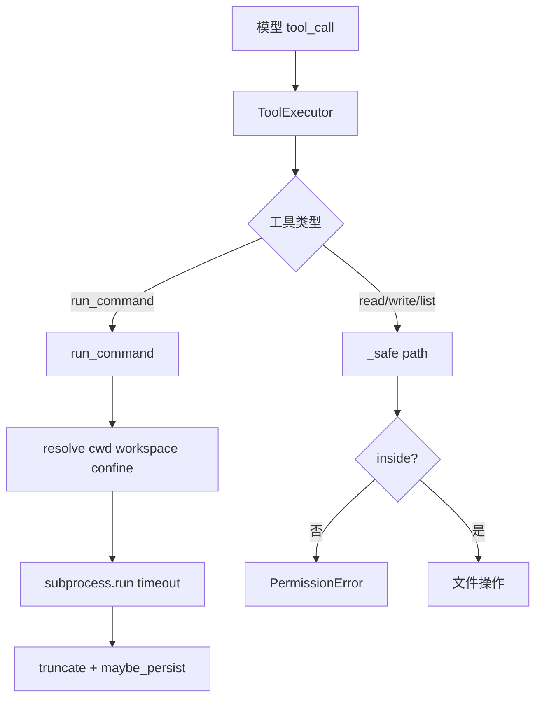

# 第 03.3 章　宿主边界与直接执行

> 状态：✅ 正文按六节写完；路径守卫、桥接 token、同步命令与文件工具已接 `/api/chat`，9 个用例通过。
> 所属：第 03 篇　工具与行动

## 1. 功能与知识点

### 功能

模型要能「真的动手」，就必须先有边界：

1. **路径守卫**：所有文件与命令的 cwd 都限定在 `MYAF_WORKSPACE`（默认 `.myaf/workspace`）。
2. **折平再比较**：`realpath` 先把 `..`、软链、重复分隔符折平，再判是否在区内。
3. **桥接鉴权**：CUA/宿主桥用 `MYAF_BRIDGE_TOKEN`，没配就一律拒绝，比较用 `hmac.compare_digest`。
4. **同步执行**：`run_command` 用 `subprocess.run(shell=True, cwd=workspace, timeout=10)`，超时杀进程。
5. **输出整形**：结果拼成 `exit/stdout/stderr`，超 4000 token 截断，特别大再落盘给引用。

### 知识点如何体现

| 知识点 | 在本功能里体现为 | 可观察证据 |
|---|---|---|
| 相对路径以 workspace 为基准 | `root / candidate`，不看进程 cwd | `test_relative_path_uses_workspace` |
| 软链逃逸要真解析 | `os.path.realpath` 后再比前缀 | `test_symlink_escape` |
| 越界必须拒绝 | `PermissionError("路径越出 workspace")` | 写 `../escape.txt` 报错 |
| 没配 token 不放行 | 空 `expected` 直接 `False` | `test_bridge_token` |
| 常量时间比较 | `hmac.compare_digest` | 不用 `==` |
| 超时是硬边界 | `timeout=max(1, int(timeout))` | `sleep 5` + `timeout=1` 返回 `timeout after 1s` |

**最小验收**：workspace 内写/读/列正常；`../escape.txt` 与 `/etc/passwd` 被拒；`sleep 5` 在 1 秒超时；桥接未配 token 时校验恒为 False。

## 2. 最小调用链



### 2.1 路径解析

```python
root = Path(os.path.realpath(str(workspace)))
candidate = Path(os.path.expanduser(path))
if not candidate.is_absolute():
    candidate = root / candidate
target = Path(os.path.realpath(str(candidate)))
inside = target == root or root in target.parents
```

只用字符串 `startswith` 判前缀会放过 `/ws2` 这种「前缀相同但不在区内」的路径，也会被软链绕过。`realpath` + `parents` 是更稳的判定。

### 2.2 同步执行

```python
proc = subprocess.run(command, shell=True, cwd=_cwd(), capture_output=True,
                      text=True, timeout=max(1, int(timeout)), check=False)
raw = f"exit={proc.returncode}\nstdout:\n{proc.stdout}\nstderr:\n{proc.stderr}"
shaped = formatted_truncate_tool_output(raw, _MAX_OUTPUT_TOKENS)
return large_result_store.maybe_persist(shaped, "run_command", "")
```

`check=False`：退出码交给模型判断，不把非零退出当异常。很多命令用退出码表达「没找到匹配」，这不等于工具坏了。

### 2.3 失败点

- `shell=True`：命令字符串里的 `|`、`&&`、重定向都生效；安全靠策略层（03.7）而非解析。
- 超时只杀 `subprocess.run` 的子进程，它自己再 fork 的孙进程可能残留（后台任务见 03.4）。
- workspace 不存在：`mkdir(parents=True, exist_ok=True)` 自动建。

## 3. 代码创建

| 顺序 | 文件 | 本章职责 | 关键符号 |
|---|---|---|---|
| 1 | `tools/host_direct/workspace_path_guard.py` | 路径解析与策略 | `Policy`、`Resolution`、`resolve` |
| 2 | `tools/host_direct/bridge_auth.py` | 桥接 token | `verify_bridge_token` |
| 3 | `tools/builtins/shell.py` | 同步命令 | `run_command` |
| 4 | `tools/builtins/workspace_files.py` | 读/写/列目录 | `read_file`、`write_file`、`list_dir` |
| 5 | `tests/chapters/test_ch03_01_guard.py` | 守卫四类 | 4 个用例 |
| 6 | `tests/chapters/test_ch03_03_host_tools.py` | 命令与文件 | 5 个用例 |

### 3.1 为什么 `confine` 不是默认

`Policy.disabled` 是默认：老代码/测试调 `resolve()` 时不期望被限制。只有工具入口显式传 `confine`。默认值保守会让隐式调用悄悄越界，这里选择「默认不管、入口必管」。

### 3.2 取舍：shell 字符串 vs argv 列表

- 字符串 + `shell=True`：管道、重定向、环境变量都能用，贴近「给 Agent 一台终端」。
- argv 列表：不能被注入 `; rm -rf`，但丢掉了 shell 能力。

当前选字符串，安全靠「策略 + 审批」，不是靠禁止 shell 语法。

### 3.3 上游对照

EvoFlow 的宿主层还做：cwd/env 白名单、命令超时分级、输出脱敏、跨平台命令映射。本章只做「confine + 超时 + 截断/落盘」。

## 4. 测试

### 4.1 覆盖矩阵

| 类型 | 用例 | 验证什么 |
|---|---|---|
| 正常 | `test_confine_policy` | 区内 resolved，`..` 越界 escaped |
| 边界 | `test_relative_path_uses_workspace` | 相对路径按 workspace 拼，不看 cwd |
| 安全 | `test_symlink_escape` | 软链指向区外判 escaped |
| 兼容 | `test_disabled_follows_evoflow` | disabled 不限制绝对路径 |
| 正常 | `test_run_command_returns_exit_code` | `echo hi` 返回 `exit=0` |
| 边界 | `test_run_command_timeout` | 超时返回 `timeout after 1s` |
| 安全 | `test_file_tools_confine_to_workspace` | `../` 与 `/etc/passwd` 被拒 |
| 正常 | `test_background_lifecycle` | 后台启停与快照（03.4 共用） |

### 4.2 运行

```bash
cd /Users/main/my-agent-flow/backend
uv run pytest tests/chapters/test_ch03_01_guard.py tests/chapters/test_ch03_03_host_tools.py -q
```

当前结果：4 + 5 = 9 passed。

## 5. 完整化

1. **环境白名单**：`env=` 只透传 `PATH/HOME/LANG`，不继承 API key。
2. **输出脱敏**：命中 `sk-`、`token=` 等模式时打码，避免密钥进模型上下文。
3. **命令映射**：Windows 下 `ls`→`dir` 这类映射，或直接限定 POSIX。
4. **超时分级**：按工具声明默认值，不再让模型随便传 120。
5. **磁盘配额**：workspace 总大小与单文件上限，防止模型写满磁盘。
6. **审计关联**：命令与产出的文件 id 关联，能回答「这个文件是谁写的」。

每项都要有独立测试；当前只完成边界与同步执行。

## 6. 边界与验收

### 本章不做什么

- 不做 env 白名单、不做输出脱敏、不做磁盘配额。
- 不做跨平台命令兼容；默认 POSIX shell。
- 不做「命令静态分析」；危险判定交给 03.7 的正则策略。
- 不做孙进程回收；后台任务另做。

### 验收

```bash
cd /Users/main/my-agent-flow/backend
uv run pytest tests/chapters/test_ch03_03_host_tools.py -q
```

预期：`5 passed`。失败时先查：`MYAF_WORKSPACE` 是否指向存在的目录、`realpath` 是否在 macOS 上把 `/tmp` 折成 `/private/tmp`（前缀比较要用解析后的 root）。

### 下一章依赖

03.4 的后台任务复用同一套 cwd 与守卫；它额外要解决「进程活着的状态」与「输出文件增长」。
