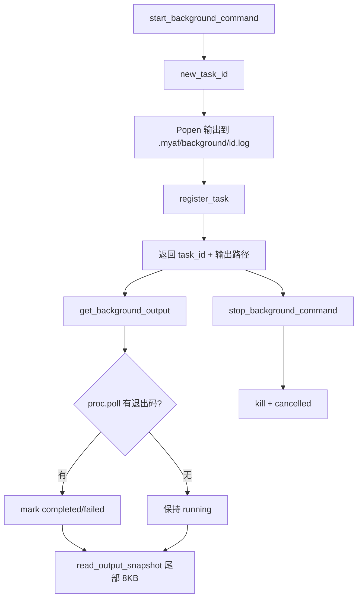

# 第 03.4 章　后台任务与输出快照

> 状态：✅ 正文按六节写完；`start_background_command` / `get_background_output` / `stop_background_command` 已接工具表，6 个用例通过。
> 所属：第 03 篇　工具与行动

## 1. 功能与知识点

### 功能

模型启动长命令后不能等它跑完；后台任务提供三件事：

1. **启动**：`Popen(shell=True, cwd=workspace, stdout=日志文件, start_new_session=True)`，立即返回 task id + 输出路径。
2. **读快照**：只读日志尾部 8KB，标 `truncated`，并顺手把已退出进程的 `running` 刷成 `completed/failed`。
3. **停止**：`proc.kill()` + 置 `cancelled`、`exit_code=-1`；已结束的任务再停是 no-op。

任务表是进程内 `dict`，`list_tasks(running_only, thread_id)` 供面板查询。

### 知识点如何体现

| 知识点 | 在本功能里体现为 | 可观察证据 |
|---|---|---|
| 输出不能全量回灌 | 只读尾部 `8192` 字节 | `test_read_output_snapshot` |
| 状态由轮询刷新 | 读输出时 `proc.poll()` 判结束 | `test_background_lifecycle` |
| 停止不动终态 | 只对 `running` 任务 `kill` | `test_stop_task` 再停不改退出码 |
| 输出落文件不落内存 | `stdout=fh`，进程退出后文件仍在 | 重启后仍可读文件 |
| 独立进程组 | `start_new_session=True` | 终端 Ctrl-C 不连带后台任务 |
| 面板要「可取消」标志 | `cancellable = status == running` | `task_to_summary` |

**最小验收**：启动 `echo bg-done` → 读到 `bg-done` 且状态离开 running；启动 `sleep 30` → stop 后状态 `cancelled`。

## 2. 最小调用链



### 2.1 启动

```python
out_path = (_cwd() / ".myaf" / "background" / f"{task_id}.log")
fh = out_path.open("wb")
proc = subprocess.Popen(command, shell=True, cwd=_cwd(), stdout=fh,
                        stderr=subprocess.STDOUT, start_new_session=True)
fh.close()
```

父进程立刻关掉句柄：文件已经在子进程里打开，父进程不需要一直持有。不关的话 Windows 上会锁文件、POSIX 上会泄漏 fd。

### 2.2 快照

```python
raw = task.output_path.read_bytes()
if len(raw) > BACKGROUND_BASH_OUTPUT_MAX_BYTES:
    truncated = True
    raw = raw[-BACKGROUND_BASH_OUTPUT_MAX_BYTES:]
```

读尾部而不是头部：后台任务的价值在「最新的报错」，头部往往是启动横幅。

### 2.3 失败点

- 输出路径所在目录不可写：`mkdir` 或 `open` 抛错，任务根本没起来。
- 进程启动即失败：日志里通常有 `command not found`，状态在下次读时变 `failed`。
- 任务表是进程内内存：服务重启后 `get_task` 找不到，日志文件还在但失去索引。

## 3. 代码创建

| 顺序 | 文件 | 本章职责 | 关键符号 |
|---|---|---|---|
| 1 | `tools/host_direct/background_bash.py` | 任务表、状态、快照 | `BackgroundBashTask`、`stop_task`、`read_output_snapshot` |
| 2 | `tools/builtins/shell.py` | 工具层启动/读取/停止 | `start_background_command`、`get_background_output` |
| 3 | `app/gateway/routers/chat.py` | 注册 shell 工具 | `register_shell(tools)` |
| 4 | `tests/chapters/test_ch03_02_host_direct.py` | 任务表行为 | 4 个用例 |
| 5 | `tests/chapters/test_ch03_03_host_tools.py` | 工具层生命周期 | 2 个后台用例 |

### 3.1 为什么状态要懒刷新

没有后台线程轮询：只有人读的时候才 `poll()`。省一个线程，代价是「不读就不知道已结束」。对 Agent 足够——它读输出时状态自然更新。

### 3.2 取舍：进程内表 vs 持久化

进程内表简单，重启丢失；持久化要处理「进程已死但状态是 running」的孤儿。本章先接受丢失，孤儿检测列进完整化。

### 3.3 上游对照

EvoFlow 的后台任务还做：心跳、孤儿回收、按 thread 配额、输出增量游标、退出码事件推送。本章只做「启动 + 尾部快照 + 停止」。

## 4. 测试

### 4.1 覆盖矩阵

| 类型 | 用例 | 验证什么 |
|---|---|---|
| 正常 | `test_register_get_list` | 登记/取/过滤/摘要形状 |
| 正常 | `test_stop_task` | kill 后置 cancelled，重复 stop 幂等 |
| 边界 | `test_read_output_snapshot` | 超 8KB 只回尾部且标 truncated |
| 安全 | `test_bridge_token` | 未配 token 拒绝，配了常量时间比对 |
| 接线 | `test_background_lifecycle`（工具层） | 启动 → 读 → 状态离开 running |
| 接线 | `test_background_stop`（工具层） | 停止长任务 |

### 4.2 运行

```bash
cd /Users/main/my-agent-flow/backend
uv run pytest tests/chapters/test_ch03_02_host_direct.py tests/chapters/test_ch03_03_host_tools.py -q
```

当前结果：4 + 5 = 9 passed。

## 5. 完整化

1. **孤儿回收**：服务启动时扫描「状态 running 但 pid 不存在」的任务，置 `unknown`。
2. **启动事件**：任务一启动就发事件，前端不必轮询。
3. **增量读取**：按字节游标读新增内容，而不是每次重读尾部。
4. **配额**：每 thread 同时运行任务上限、单任务输出文件上限（滚动截断）。
5. **持久化**：任务表落 SQLite，重启后仍能查到输出路径与终态。
6. **环境隔离**：后台任务同样要 env 白名单（03.3 完整化项）。

每项都要有独立测试；当前只完成最小生命周期。

## 6. 边界与验收

### 本章不做什么

- 不做孤儿回收、不做持久化任务表。
- 不做增量输出、不做输出滚动上限。
- 不做启动事件推送；只能轮询 `get_background_output`。
- 不做线程/进程配额。

### 验收

```bash
cd /Users/main/my-agent-flow/backend
uv run pytest tests/chapters/test_ch03_03_host_tools.py -q
```

预期：`5 passed`。失败时先查：日志文件是否真的写进 `.myaf/background/`、`sleep` 是否被杀（`start_new_session` 后 `kill` 只杀直接子进程）、读取是否发生在进程退出前导致状态仍 running。

### 下一章依赖

03.5 的 CUA 会话同样是「长生命周期对象」；它不能复用本任务表，因为它还需要保存「当前画面」和动作历史。
