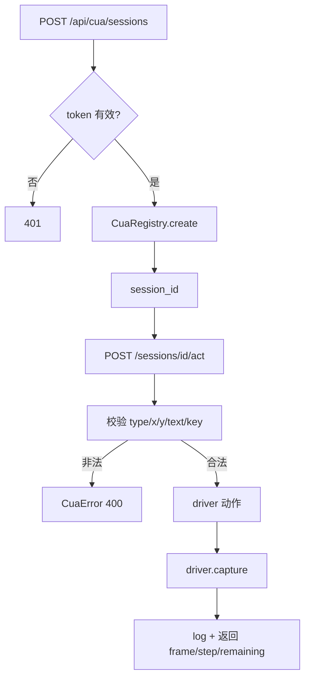

# 第 03.5 章　浏览器与 Computer-Use

> 状态：✅ 正文按六节写完；CUA 会话层与 `/api/cua/*` 已实现并鉴权，5 个用例通过。**未接真实截图/点击驱动**。
> 所属：第 03 篇　工具与行动

## 1. 功能与知识点

### 功能

Computer-Use 的核心是「感知 → 行动 → 再感知」的循环，本章先做协议与会话，不做真实桌面：

1. **会话**：`CuaRegistry.create(driver, thread_id, max_steps)` → `session_id`。
2. **动作协议**：`screenshot` / `click(x,y)` / `type(text)` / `key(name)`，非法动作不消耗步数。
3. **观察结果**：每个动作后调 `driver.capture()`，返回 `frame` + `step` + `remaining`。
4. **上限**：`max_steps` 到顶拒绝，防止模型无限点。
5. **鉴权**：所有 `/api/cua/*` 要求 `x-bridge-token`，`MYAF_BRIDGE_TOKEN` 未配则一律 401。

当前驱动只有 `NullDriver`（记录动作、返回 `null-frame:N`）：协议能跑通，真实截图/点击没有。

### 知识点如何体现

| 知识点 | 在本功能里体现为 | 可观察证据 |
|---|---|---|
| 驱动与协议分离 | `CuaDriver` Protocol，会话层不 import 平台库 | 换平台只换 driver |
| 动作先校验后执行 | 非法 click 抛错且 `steps` 不变 | `test_invalid_action_does_not_consume_step` |
| 动作必须留日志 | `session.log` 逐条记 `type/step/frame` | `act()` 内 append |
| 步数上限是硬约束 | `steps >= max_steps` 抛 `CuaError` | `test_step_limit_and_close` |
| 高危接口必须鉴权 | `verify_bridge_token` 前置 | 无 token 401 |
| 没配 token 不等于开放 | `expected` 为空直接 False | API 测试第一步 |

**最小验收**：建会话 → click 后驱动收到 `(10,20)`、返回 `frame-1`；第 3 步超 2 步上限被拒；无 token 时建会话 401。

## 2. 最小调用链



### 2.1 动作校验

```python
if kind == "click":
    x, y = action.get("x"), action.get("y")
    if not isinstance(x, int) or not isinstance(y, int):
        raise CuaError("click 需要整数 x/y")
    self.driver.click(x, y)
```

`bool` 是 `int` 的子类，理论上 `True` 能过；这里不额外处理，因为模型不会产出布尔坐标，而 API 的 pydantic 已限定 `int`。

### 2.2 步数与关闭

```python
def _check_open(self):
    if self.closed:
        raise CuaError("会话已关闭")
    if self.steps >= self.max_steps:
        raise CuaError(f"超过步数上限 {self.max_steps}")
```

先查关闭再查步数：关闭后不该报「步数超限」，那会误导排查。

### 2.3 失败点

- `NullDriver` 不产生真实画面：前端拿到 `null-frame:N` 只能验证协议，不能验证视觉。
- 会话表是进程内内存：服务重启后 session_id 全部失效。
- 多客户端共用一个 token：当前没有按 thread 隔离权限，谁拿到 token 都能操作任何 session。

## 3. 代码创建

| 顺序 | 文件 | 本章职责 | 关键符号 |
|---|---|---|---|
| 1 | `cua/session.py` | 协议、会话、注册表 | `CuaDriver`、`CuaSession.act`、`CuaRegistry` |
| 2 | `app/gateway/routers/cua.py` | HTTP 接口 + 鉴权 + `NullDriver` | `create_session`、`act`、`screen` |
| 3 | `app/gateway/main.py` | 挂载路由 | `cua_router` |
| 4 | `tests/chapters/test_ch03_05_cua.py` | 协议与鉴权 | 5 个用例 |

### 3.1 为什么先做 NullDriver

真实 CUA 需要平台授权（macOS 辅助功能、屏幕录制），在 CI 里不可用。先把「鉴权 → 会话 → 动作 → 观察」这条链用 NullDriver 跑通，再换驱动时只需要实现四个方法。

### 3.2 取舍：白名单动作 vs 自由脚本

- 白名单动作：可控、可审计，但表达力有限（复杂拖拽要加动作）。
- 自由脚本：表达力强，但等于给模型执行任意代码，风险高于 shell。

当前选白名单，拖拽/滚动列进完整化。

### 3.3 上游对照

EvoFlow 的 CUA 还包含：浏览器（Playwright）驱动、截图压缩与坐标缩放、OCR/视觉模型定位、动作失败重试、会话级录制回放。本章只做协议与鉴权，**不能声称「浏览器自动化已完成」**。

## 4. 测试

### 4.1 覆盖矩阵

| 类型 | 用例 | 验证什么 |
|---|---|---|
| 正常 | `test_actions_reach_driver` | click/type/key 调到驱动，frame 递增 |
| 边界 | `test_invalid_action_does_not_consume_step` | 非法坐标/未知动作不消耗步数 |
| 边界 | `test_step_limit_and_close` | 超步数拒绝，关闭后不可读屏 |
| 安全 | `test_api_requires_token_and_works` | 无 token 401，配了能建会话/执行/关闭 |

### 4.2 运行

```bash
cd /Users/main/my-agent-flow/backend
uv run pytest tests/chapters/test_ch03_05_cua.py -q
```

当前结果：`5 passed`。

## 5. 完整化

1. **真实驱动**：Playwright（浏览器）与平台原生（桌面）各实现一份 `CuaDriver`。
2. **视觉定位**：截图 + 模型/OCR 输出坐标，替代「模型猜坐标」。
3. **截图治理**：压缩、限制频率、必要时落盘后给引用，避免 base64 撑爆上下文。
4. **失败重试**：点击没生效要能检测（前后截图差异）并重试一次。
5. **会话隔离**：token → 用户 → thread，一个 session 只允许创建者操作。
6. **录制回放**：动作日志可回放，便于复现 bug 与做评测。
7. **超时与回收**：空闲会话自动关闭，防止驱动进程泄漏。

每项都要有独立测试；当前只完成协议层。

## 6. 边界与验收

### 本章不做什么

- 不做真实截图/点击，不接 Playwright 或平台驱动。
- 不做视觉定位、不做 OCR。
- 不做会话持久化、不做按用户隔离。
- 不做拖拽/滚动/组合键等动作。

### 验收

```bash
cd /Users/main/my-agent-flow/backend
uv run pytest tests/chapters/test_ch03_05_cua.py -q
```

预期：`5 passed`。失败时先查：`MYAF_BRIDGE_TOKEN` 是否设置、header 名是否为 `x-bridge-token`、`max_steps` 是否小于 1（会被夹到 1）。

### 下一章依赖

03.6 的 MCP 工具与 Skills 会成为新的工具来源；CUA 不走普通工具表（它需要会话，不是一次性调用），两者不能混在同一执行器里。
