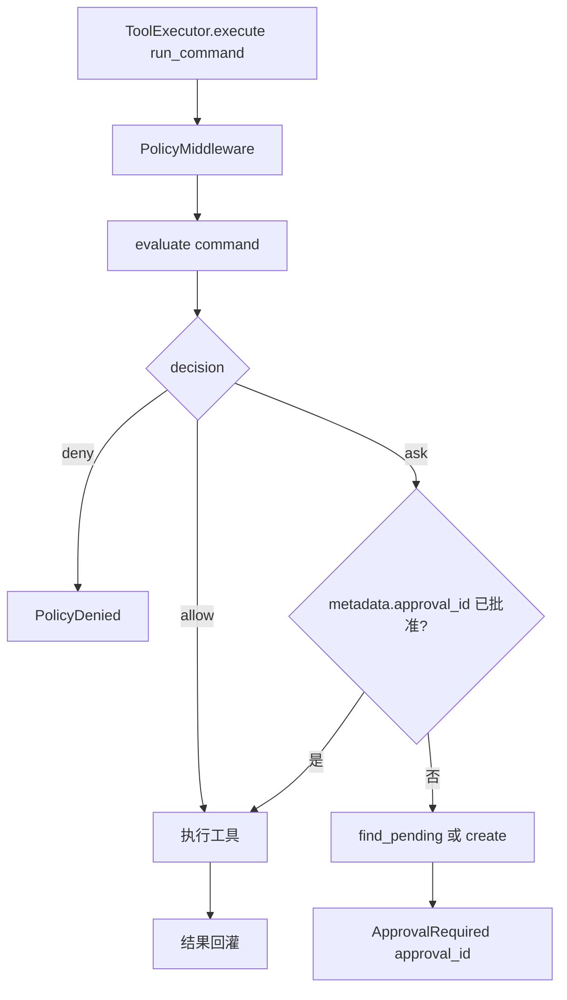

# 第 03.7 章　权限、沙箱与审批

> 状态：✅ 正文按六节写完；三档策略、审批单、`/api/approvals` 与中间件已接 `/api/chat`，8 个用例通过。**审批通过后不会自动恢复本轮**。
> 所属：第 03 篇　工具与行动

## 1. 功能与知识点

### 功能

危险命令不能只靠提示词劝阻，要有一道代码层的门：

1. **三档判定**：`deny → ask → allow`，先判危险模式，再判写操作。顺序反了会出现「写操作已批准，但命令其实是 `rm -rf /`」。
2. **deny**：`rm -rf /`、fork bomb、`mkfs/dd if=`、`curl … | sh` 直接 `PolicyDenied`，工具不执行。
3. **ask**：写盘特征（`> /`、`tee`、`sed -i`）生成审批单；无批准单抛 `ApprovalRequired(approval_id)`。带 `body.approval_id` 重发本轮时会经 `configurable` 传到执行器 metadata，已批准才放行。
4. **审批单**：`ApprovalStore` 按 `run_id + tool + args` 复用 pending；`resolve()` 只有 `approved/rejected`，终态不可改。
5. **API**：`GET /api/approvals?run_id=`、`POST /api/approvals/{id}`；404/409/400 各自区分。
6. **run 取消连带作废**：`cancel_run(run_id)` 把该 run 的 pending 全置 `cancelled`。

### 知识点如何体现

| 知识点 | 在本功能里体现为 | 可观察证据 |
|---|---|---|
| 判定顺序 | 先 `DANGEROUS` 后 `WRITE_MARKERS` | `rm -rf /` 不会落到 ask |
| 批准不能洗白危险命令 | deny 在 ask 之前，且不查批准单 | `test_deny_blocks_before_tool_runs` |
| 审批单绑定参数 | `is_approved(id, tool, args)` 比对三者 | 换命令仍需新单 |
| pending 复用 | `find_pending` 命中就返回旧单 | 同 run 重复调用不刷屏 |
| 终态不可改 | `resolve` 对非 pending 抛 `RuntimeError` | 第二次批准 409 |
| 取消按 run 生效 | `cancel_run` 批量置 cancelled | 放弃本轮不用逐单点拒绝 |

**最小验收**：`rm -rf /` 被拒且工具调用数为 0；写盘命令生成审批单；批准后带 `approval_id` 重发，工具执行并回灌，换参数仍被拦。

## 2. 最小调用链



### 2.1 策略正则

```python
DANGEROUS = [
    re.compile(r"rm\s+-rf\s+/"),
    re.compile(r":\s*\(\s*\)\s*\{"),
    re.compile(r"mkfs|dd\s+if="),
    re.compile(r"curl[^|]*\|\s*(sh|bash)"),
]
WRITE_MARKERS = [re.compile(r">\s*/"), re.compile(r"\btee\b"), re.compile(r"\bsed\s+-i\b")]
```

正则只能挡「明显形态」。`rm -rf "$HOME"`、`python -c "import shutil;..."` 都绕得过；这是策略层的已知上限，不是「沙箱」。

### 2.2 审批单

```python
def is_approved(self, approval_id, tool, args, now=None) -> bool:
    ap = self.get(approval_id)
    return bool(ap and ap.status == "approved" and ap.tool == tool
                and ap.args == args and (ap.deadline is None or now <= ap.deadline))
```

四个条件缺一不可：状态、工具、参数、有效期。少了参数比对，批准一次 `echo` 就能跑任意命令。

### 2.3 失败点

- 审批单 TTL：`create(ttl=300)`，过期后 `is_approved` 为 False；前端要显示 deadline。
- `run_id` 为空：中间件用 `run_id=""` 建单，多 run 串单；图里必须传 `run_id`。
- 审批 API 用的是全局 store：`get_approval_store()` 是进程内单例，重启丢单。

## 3. 代码创建

| 顺序 | 文件 | 本章职责 | 关键符号 |
|---|---|---|---|
| 1 | `sandbox/policy.py` | 三档判定 | `Decision`、`PolicyResult`、`evaluate` |
| 2 | `sandbox/approvals.py` | 审批单生命周期 | `Approval`、`ApprovalStore`、`get_approval_store` |
| 3 | `agents/middlewares/policy.py` | 工具执行前拦截 | `PolicyMiddleware`、`ApprovalRequired` |
| 4 | `app/gateway/routers/approvals.py` | 列表/批准/拒绝 | `list_approvals`、`decide` |
| 5 | `app/gateway/main.py` | 挂载路由 | `approvals_router` |
| 6 | `tests/chapters/test_ch03_07_policy.py` | 策略 + 审批 + API | 7 个用例 |
| 7 | `tests/chapters/test_ch06_03_approvals.py` | 终态与按 run 取消 | 1 个用例 |

### 3.1 为什么中间件只管 shell

`read_file`/`write_file` 走路径守卫（03.3），不是命令；`echo` 无副作用。策略只对 `run_command` / `start_background_command` 生效，避免「读文件也要审批」把 Agent 卡死。

### 3.2 取舍：异常 vs 挂起

- 异常：实现简单，模型会看到 `ERROR: 审批未完成`，可以继续对话；但本轮无法「批准后自动续跑」。
- 挂起：LangGraph `interrupt` 能暂停并恢复，但要处理 checkpoint 恢复、前端状态、超时。

当前选异常，把恢复列进完整化；**不能声称「审批流已端到端闭环」**。

### 3.3 上游对照

EvoFlow 的审批还包含：持久化审批单、按用户/租户隔离、审批超时事件、批量批准、批准后恢复执行、危险命令 AST 级解析。本章只做「正则判定 + 内存审批 + HTTP 决策」。

## 4. 测试

### 4.1 覆盖矩阵

| 类型 | 用例 | 验证什么 |
|---|---|---|
| 安全 | `test_deny_blocks_before_tool_runs` | deny 时工具未执行 |
| 正常 | `test_allow_runs_tool` | 普通命令直接放行 |
| 审批 | `test_ask_creates_pending_and_blocks_once` | 生成 pending，重复调用复用同单 |
| 审批 | `test_ask_passes_after_approval_only` | 未批准拒绝，批准后放行，换参数仍拦 |
| 接线 | `test_graph_forwards_approval_id` | 图把 `configurable.approval_id` 传进执行器 metadata |
| 隔离 | `test_non_shell_tool_is_untouched` | echo 不受策略影响 |
| API | `test_approvals_api_lists_and_resolves` | 列表/批准/终态 409/不存在 404 |
| 同源 | `test_policy_decision_shape` | 策略判定只有一套正则 |
| 终态 | `test_terminal_and_cancel` | 终态不可改，取消按 run 生效 |

### 4.2 运行

```bash
cd /Users/main/my-agent-flow/backend
uv run pytest tests/chapters/test_ch03_07_policy.py tests/chapters/test_ch06_03_approvals.py -q
```

当前结果：8 + 1 = 9 passed。

## 5. 完整化

1. **批准后恢复**：用 LangGraph `interrupt` 暂停图，审批通过后从 checkpoint 续跑，而不是让模型重新发起。
2. **持久化审批单**：落 SQLite，重启不丢；`run_id` 索引。
3. **超时事件**：TTL 到期自动置 `expired` 并发事件，前端不用轮询。
4. **AST 级判定**：解析命令而不是正则匹配，能识别 `rm -rf "$HOME"`。
5. **用户/租户隔离**：审批单归属到身份，别的用户不能批准。
6. **审批原因可视化**：把命中的规则、命令原文、影响范围一起返回。
7. **批量与撤销**：一次批准同 run 多条；已执行的操作不可撤销，但可生成反向操作建议。

每项都要有独立测试；当前只完成「拦截 + 决策」。

## 6. 边界与验收

### 本章不做什么

- 不做批准后的自动续跑；要客户端带 `approval_id` 重发本轮，而不是服务端自己恢复挂起的图。
- 不做 AST 级命令解析，正则挡不住改写形态。
- 不做审批单持久化、租户隔离、超时事件。
- 不提供「沙箱」隔离（容器/用户降权）；这里只有策略门。

### 验收

```bash
cd /Users/main/my-agent-flow/backend
uv run pytest tests/chapters/test_ch03_07_policy.py -q
```

预期：`8 passed`。失败时先查：写命令是否写成 `echo 1 > /tmp/a`（`> 文件名` 不触发 ask）、`run_id` 是否为空、审批单是否已过期。

### 下一章依赖

第 04 篇的运行生命周期要保证「一个 run 的所有审批单随 run 终态收尾」；否则取消后 pending 会一直留在列表里。
