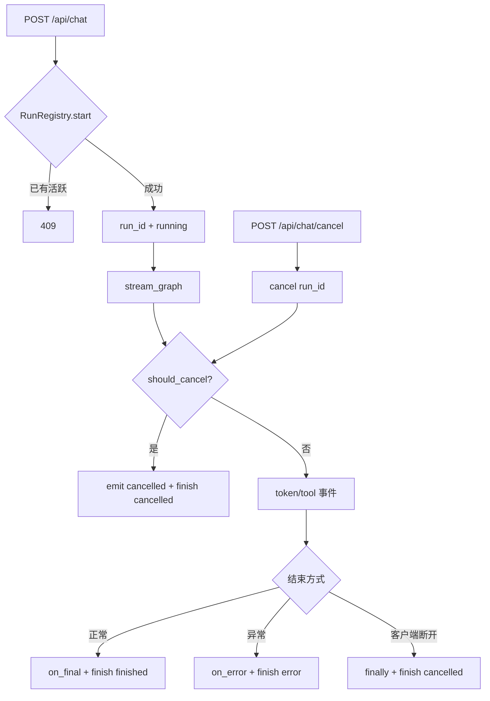

# 第 04.3 章　运行生命周期与事件

> 状态：✅ 正文按六节写完；`RunRegistry`、`/api/chat/cancel`、SSE 事件与终态已接，4 个生命周期用例通过。
> 所属：第 04 篇　运行状态与持久化

## 1. 功能与知识点

### 功能

一次 run 从「接单」到「收尾」必须有唯一状态，不能出现「流断了但状态还在 running」：

1. **单活**：同 thread 已有 running 时，`start()` 抛错，`/api/chat` 转 409。
2. **取消**：`cancel(run_id)` 只对 running 生效，返回 bool；`is_cancelled` 由流层轮询。
3. **终态**：`finish(run_id, status)` 只接受 `finished/cancelled/error`；取消过的 run 不许报 finished。
4. **断开兜底**：流生成器 `finally` 里若仍 running，置 `cancelled`。
5. **事件**：`token/tool/done/error/cancelled` 五类，每类带递增 `seq`。

### 知识点如何体现

| 知识点 | 在本功能里体现为 | 可观察证据 |
|---|---|---|
| 单活是正确性要求 | 两条 run 会抢写同一 checkpoint | `test_one_active_run_per_thread` |
| 取消优先 | `cancelled` 覆盖 `finished` | `test_cancel_wins_over_finish` |
| 取消按 run 隔离 | 只查目标 run 的 event | `test_cancel_is_per_run` |
| 幂等收尾 | 取消不存在/已结束返回 False，不抛 | `test_cancel_unknown_and_done` |
| 状态必须落终态 | 流结束/失败/断开三处都 `finish` | `chat.py` 的 `on_final/on_error/finally` |
| 终态白名单 | `ALLOWED_END` 不含 `failed` | 避免「取消」和「出错」混成一个词 |

**最小验收**：同 thread 第二次 start 抛错，finish 后可再开；cancel 后 finish 仍是 cancelled；取消别的 thread 的 run 不受影响。

## 2. 最小调用链



### 2.1 单活判定

```python
active = self.active_for_thread(thread_id)
if active is not None:
    raise RuntimeError(f"线程 {thread_id} 已有活跃 run：{active.run_id}")
```

不是「后来的覆盖前面的」：两条同时跑会各自写 checkpoint，历史交错，恢复时无法判断哪条是事实。

### 2.2 终态保护

```python
if status not in ALLOWED_END:
    raise ValueError(f"非法终态：{status}")
...
if rec.cancelled.is_set() and status == "finished":
    status = "cancelled"
```

取消标记一旦置上就不可逆；即使模型正常答完，也只能记为 cancelled。

### 2.3 失败点

- 进程重启：`RunRegistry` 是内存表，所有 run 消失；前端看到的 running 变孤儿。
- 取消延迟：只有流层在下一个图事件前检查；工具长阻塞期间取消不生效。
- 事件不持久：刷新页面后看不到历史事件，只能看消息表。

## 3. 代码创建

| 顺序 | 文件 | 本章职责 | 关键符号 |
|---|---|---|---|
| 1 | `session_execution/lifecycle.py` | run 注册与终态 | `RunRecord`、`RunRegistry`、`ALLOWED_END` |
| 2 | `runtime/events.py` | 事件与 SSE | `StreamEvent`、`EventStream` |
| 3 | `runtime/streaming.py` | 取消检查与收尾 | `stream_graph` |
| 4 | `app/gateway/routers/chat.py` | start/cancel/finish 接线 | `_RUNS`、`/chat/cancel` |
| 5 | `tests/chapters/test_ch02_02_lifecycle.py` | 四种状态行为 | 4 个用例 |

### 3.1 为什么不用「一个全局 run 状态机」

状态机要先定义所有迁移边；当前只有「running → 三终态」，用 `status` 字符串 + 白名单就够。加超时扫描时再考虑显式状态机。

### 3.2 取舍：进程内表 vs 数据库

进程内表简单，但重启丢；数据库表能查历史，但要处理「孤儿 running」。当前选进程内，孤儿检测列进完整化。

### 3.3 上游对照

EvoFlow 的 run 还包含：超时扫描、心跳、跨进程 ID、run 事件表、重连订阅。本章只做「单活 + 取消 + 终态」。

## 4. 测试

### 4.1 覆盖矩阵

| 类型 | 用例 | 验证什么 |
|---|---|---|
| 正常 | `test_one_active_run_per_thread` | 同线程第二次 start 拒绝，收尾后可再开 |
| 取消 | `test_cancel_wins_over_finish` | 取消后 finish 仍为 cancelled |
| 隔离 | `test_cancel_is_per_run` | 取消只影响目标 run |
| 幂等 | `test_cancel_unknown_and_done` | 不存在/已收尾返回 False，不抛 |

### 4.2 运行

```bash
cd /Users/main/my-agent-flow/backend
uv run pytest tests/chapters/test_ch02_02_lifecycle.py -q
```

当前结果：`4 passed`。

## 5. 完整化

1. **超时扫描**：定时把超过 N 分钟的 running 置 error/timeout，并发事件。
2. **run 持久化**：落表，支持「重启后查昨天那次为什么失败」。
3. **心跳**：长工具期间更新 `last_event_at`，超时判定才准。
4. **跨进程**：多 worker 下用数据库或 Redis 做单活锁。
5. **取消即断**：工具层支持取消信号，而不是等下一个图事件。
6. **事件回放**：按 `run_id` 存事件，支持断线重连 `Last-Event-ID`。

每项都要有独立测试；当前只完成最小状态机。

## 6. 边界与验收

### 本章不做什么

- 不做超时扫描、不做 run 持久化、不做跨进程单活。
- 不做心跳与事件回放。
- 取消不能中断正在执行的同步工具。
- 不做 run 历史查询接口。

### 验收

```bash
cd /Users/main/my-agent-flow/backend
uv run pytest tests/chapters/test_ch02_02_lifecycle.py -q
```

预期：`4 passed`。失败时先查：`finish` 是否传了 `failed`（不在白名单）、`cancel` 是否在 `finish` 之后调用（已终态返回 False）、`thread_id` 是否写错。

### 下一章依赖

04.4 的分享要把「某次 run 的对话」导出给别人；它只能读消息表与检查点，不能依赖 run 内存状态。
