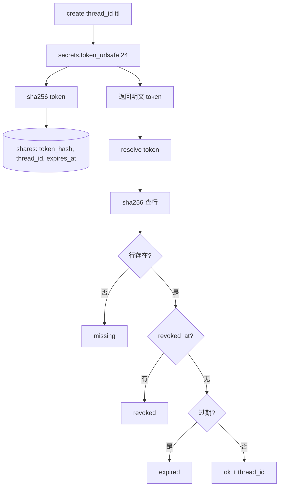

# 第 04.4 章　分享、导出与一致性

> 状态：✅ 正文按六节写完；分享 token 的创建/解析/吊销已实现，3 个用例通过。**没有 HTTP 路由与导出**。
> 所属：第 04 篇　运行状态与持久化

## 1. 功能与知识点

### 功能

分享要回答两个问题：给谁看、什么时候失效。最小实现只做 token 生命周期：

1. **创建**：`create(thread_id, ttl)` → 24 字节 URL-safe token，明文**只返回一次**。
2. **存储**：库里只存 `sha256(token)`；泄露库文件也拿不到可用 token。
3. **解析**：`resolve(token)` → `ok / missing / revoked / expired` + `thread_id`。
4. **吊销**：`revoke(token)` 置 `revoked_at`，旧 token 立即失效。

目前没有「通过 token 读消息」的 HTTP 路由，也没有 Markdown/JSON 导出。

### 知识点如何体现

| 知识点 | 在本功能里体现为 | 可观察证据 |
|---|---|---|
| 明文只出现一次 | `create` 返回值就是唯一一次明文 | 库里按哈希查 |
| 存哈希不存明文 | `_hash` = SHA-256 | 数据库列名 `token_hash` |
| 失效先于内容 | `resolve` 先判 revoked/expired | `status` 四值 |
| 撤销立即生效 | `revoked_at` 写入后下次 resolve 即 revoked | `test_share_revoked` |
| 过期不依赖撤销 | `expires_at > now` 判断 | `test_share_expired` |
| 不存在要区分 | `missing` 不等于 `revoked` | 排查「链接错」与「已撤销」不同 |

**最小验收**：创建 token 能解析到 `t1`；乱码 token 为 `missing`；revoke 后变 `revoked`；ttl 到期变 `expired`。

## 2. 最小调用链



### 2.1 创建

```python
token = secrets.token_urlsafe(24)
self._conn.execute(
    "INSERT INTO shares (token_hash, thread_id, created_at, expires_at) VALUES (?, ?, ?, ?)",
    (_hash(token), thread_id, time.time(), time.time() + ttl_seconds),
)
```

用 `secrets` 不用 `random`：分享 token 等价于「读这段对话的凭证」，必须密码学随机。

### 2.2 解析顺序

```python
if row is None: return ShareResult("missing")
if revoked_at is not None: return ShareResult("revoked")
if expires_at is not None and (now or time.time()) > expires_at: return ShareResult("expired")
return ShareResult("ok", thread_id)
```

先 revoked 后 expired：已撤销的链接不该因为「还没过期」而看起来可用。

### 2.3 失败点

- 库文件可写：哈希也挡不住「删掉记录」——分享库要跟应用库分开权限。
- `ttl_seconds=None`：直接 `time.time() + None` 抛 TypeError；调用方必须给数。
- 同一 thread 多次创建：允许多 token，吊销要逐个；没有「吊销该 thread 全部」接口。

## 3. 代码创建

| 顺序 | 文件 | 本章职责 | 关键符号 |
|---|---|---|---|
| 1 | `collab/shares.py` | token 存储与状态 | `ShareStore`、`ShareResult`、`_hash` |
| 2 | `tests/chapters/test_ch02_04_shares.py` | 四种状态 | 3 个用例 |

### 3.1 为什么先做存储层

分享的「一致性」问题比 UI 更难：token 指向的 thread 可能在分享后被继续追加消息。先把 token 生命周期写死，再决定「分享时是否冻结快照」。

### 3.2 取舍：实时视图 vs 冻结快照

- 实时：分享链接永远看到最新对话，简单；但被分享者能看到后来所有内容。
- 冻结：创建时复制一份消息，分享内容稳定；存储翻倍，且「后续更正」看不到。

当前只有 token，没有视图，等于默认「实时」；快照隔离列进完整化。

### 3.3 上游对照

EvoFlow 的分享还包含：HTTP 路由、访客鉴权、只读渲染、导出 Markdown/PDF、脱敏（工具输出/密钥）、快照隔离。本章只做 token 层，**不能声称「分享功能已完成」**。

## 4. 测试

### 4.1 覆盖矩阵

| 类型 | 用例 | 验证什么 |
|---|---|---|
| 正常 | `test_share_ok_and_missing` | 有效 token → ok + thread；乱码 → missing |
| 撤销 | `test_share_revoked` | revoke 后立即 revoked |
| 过期 | `test_share_expired` | ttl 到期 → expired，无需撤销 |

### 4.2 运行

```bash
cd /Users/main/my-agent-flow/backend
uv run pytest tests/chapters/test_ch02_04_shares.py -q
```

当前结果：`3 passed`。

## 5. 完整化

1. **HTTP 路由**：`POST /api/shares`、`GET /api/shares/{token}`（只读渲染）。
2. **导出**：Markdown/JSON/PDF，导出前后都要脱敏。
3. **脱敏规则**：工具输出里的路径、token、`sk-` 模式打码。
4. **快照隔离**：创建分享时复制消息，后续追加不进入分享视图。
5. **访客鉴权**：token + 可选口令，防转发扩散。
6. **吊销批量**：按 thread 吊销全部；过期清理任务。
7. **一致性检查**：分享视图与消息表 seq 对齐，缺行要显式提示「归档缺失」。

每项都要有独立测试；当前只完成 token 层。

## 6. 边界与验收

### 本章不做什么

- 没有 HTTP 路由，token 目前只能被代码调用，不能从浏览器访问。
- 不做导出、不做脱敏、不做快照隔离。
- 不做访客鉴权与口令。
- 不做过期清理任务。

### 验收

```bash
cd /Users/main/my-agent-flow/backend
uv run pytest tests/chapters/test_ch02_04_shares.py -q
```

预期：`3 passed`。失败时先查：`ttl_seconds` 是否为 None、`resolve` 是否传了错误的 `now`、库路径是否为临时文件（每个用例要独立库）。

### 下一章依赖

第 05 篇的长期记忆与产物可以成为分享内容的一部分；分享脱敏必须先覆盖「记忆里的用户偏好」这类个人信息。
