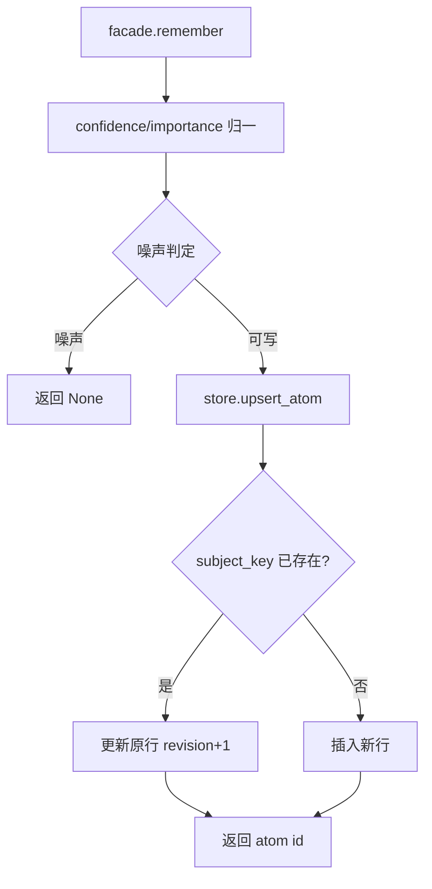

# 第 05.1 章　长期记忆写入：atom 与 namespace

> 状态：✅ 正文按六节写完；atom 写入、命名空间、subject 替换与噪声过滤已实现，9 个记忆用例通过。**未接聊天入口**。
> 所属：第 05 篇　长期记忆与资产

## 1. 功能与知识点

### 功能

长期记忆的最小单位是 atom（一条可独立召回的事实），写入要解决四件事：

1. **命名空间**：`user:xxx` / `agent:xxx` / `workspace:xxx` / `person:xxx`；非法前缀归一成 `user:default`。
2. **分层**：`layer=semantic/episodic/procedural`，`kind=fact/preference/decision/...`。
3. **同主题替换**：带 `subject_key` 的新值会更新原行并 `revision+1`，不是插一条新的互相矛盾。
4. **噪声过滤**：`confidence < 0.55` 且非 pin、无 subject、来源不是 `user/manual/migrate` → 不写库。

`facade.remember()` 是唯一写入口；`upsert_atom` 负责 SQL，不暴露给业务层。

### 知识点如何体现

| 知识点 | 在本功能里体现为 | 可观察证据 |
|---|---|---|
| 命名空间是隔离边界 | `user_ns("u1")` 与 `agent_ns("a")` 不同前缀 | `test_namespaces_parse_and_prefix` |
| 非法命名空间不静默 | `parse_namespace` 归一成 `user:default` | 不抛异常但有默认值 |
| 同 subject 走替换 | `subject_key` 命中后更新原行 | `test_subject_key_replaces_old_value` |
| revision 可追溯 | 每次替换 `revision += 1` | 行内字段 |
| 低置信度不入库 | `remember` 返回 None | `test_facade_noise_filter_and_recall` |
| 软删可恢复 | `soft_delete_atom` 只写 `deleted_at` | 查询过滤而非物理删 |

**最小验收**：写一条 `subject_key=response_style` 的偏好 → 再写同键新值 → 只留一行、`revision=2`、召回得到新值；低置信度噪声 `remember` 返回 `None`。

## 2. 最小调用链



### 2.1 噪声过滤

```python
if (conf < 0.55 and not pin and not subject_key
        and source not in {"user", "manual", "migrate"}):
    return None
```

四个豁免条件是「有理由相信它重要」：人工 pin、有主题键、明确来自用户/迁移。否则低置信度的模型抽取会不断污染记忆。

### 2.2 同主题替换

```python
if subject_key:
    old = 找到同 namespace + subject_key 的活跃行
    if old: update content/fields, revision = old.revision + 1
```

不插第二行：两行互相矛盾的偏好同时存在，召回时只能靠「谁更新」猜，模型会随机选一条。

### 2.3 失败点

- 空 namespace：`remember` 里没有拦，`upsert_atom` 会 `ensure_namespace("")`，等于写进一个「空命名空间」；调用方必须给。
- 同 subject 但 layer 不同：当前仍合并；是否允许「语义层/情节层各存一条」需要策略。
- 软删后同 subject 再写：新行 revision 从 1 开始，旧行仍留 `deleted_at`，历史可查但不可召回。

## 3. 代码创建

| 顺序 | 文件 | 本章职责 | 关键符号 |
|---|---|---|---|
| 1 | `memory/namespaces.py` | 命名空间构造与解析 | `user_ns`、`agent_ns`、`parse_namespace` |
| 2 | `memory/store.py` | atom 表与 upsert | `upsert_atom`、`soft_delete_atom`、`set_pin` |
| 3 | `memory/facade.py` | 写入口与噪声过滤 | `remember`、`forget` |
| 4 | `tests/chapters/test_ch04_01_memory.py` | 写入/替换/召回 | 9 个用例（跨本章与 05.2） |

### 3.1 为什么 revision 不用时间戳

时间戳只能回答「谁更新」，`revision` 能回答「这是第几版」，且便于比较「哪条更新」。两者都存，各司其职。

### 3.2 取舍：软删 vs 物理删

软删保留回溯能力，代价是查询必须带 `deleted_at IS NULL`，漏一处就会召回已忘内容。当前所有读路径统一过滤，新增查询要遵守同一约定。

### 3.3 上游对照

EvoFlow 的写入还包含：LLM 抽取、防抖队列、向量写入、冲突检测、审计日志。本章只做「手工/程序化写入 + 替换 + 噪声过滤」，抽取在 05.4。

## 4. 测试

### 4.1 覆盖矩阵

| 类型 | 用例 | 验证什么 |
|---|---|---|
| 正常 | `test_short_and_long_memory_call_flow` | 短期写入与跨 thread 长期召回 |
| 正常 | `test_subject_key_replaces_old_value` | 同 subject 更新原行、revision 递增 |
| 边界 | `test_namespaces_parse_and_prefix` | 非法前缀归一 |
| 过滤 | `test_facade_noise_filter_and_recall` | 低置信度不写，关键词可召回 |
| 正常 | `test_get_core_and_format_block` | 核心记忆选择与格式 |

### 4.2 运行

```bash
cd /Users/main/my-agent-flow/backend
uv run pytest tests/chapters/test_ch04_01_memory.py -q
```

当前结果：`9 passed`（包含 05.2 的召回用例）。

## 5. 完整化

1. **聊天入口写入**：现在只有测试和手工调用；回答后按策略抽取并写库（05.4 提供队列）。
2. **向量写入**：`embedding` 参数存在但没算；需要 embedding provider。
3. **冲突检测**：同 subject 但内容矛盾时，不只看 revision，还要保留「被推翻值」的证据。
4. **命名空间校验**：空 namespace 直接拒绝。
5. **写入配额**：单用户 atom 上限与清理策略，防止无限增长。
6. **审计**：谁在什么时候写了什么，支持撤回。

每项都要有独立测试；当前只完成组件级写入。

## 6. 边界与验收

### 本章不做什么

- 不接聊天/工具入口；没有「什么值得记」的自动策略。
- 不算 embedding，不做向量检索。
- 不做跨用户权限；命名空间只是字符串隔离。
- 不做写入配额与审计。

### 验收

```bash
cd /Users/main/my-agent-flow/backend
uv run pytest tests/chapters/test_ch04_01_memory.py -q
```

预期：`9 passed`。失败时先查：`MYAF_MEMORY_DB` 是否隔离、`subject_key` 是否为空（空键不替换）、confidence 是否低于 0.55 且无豁免。

### 下一章依赖

05.2 的召回只读已写入的 atom；如果写入没带 `subject_key`，召回会拿到多条相似事实，排序只能靠 importance。
