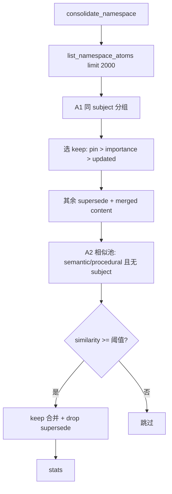

# 第 05.3 章　巩固、冲突与治理

> 状态：✅ 正文按六节写完；同 subject 合并、相似合并、pin 保护与 supersede 已实现，6 个用例通过。**衰减/GC 未做**。
> 所属：第 05 篇　长期记忆与资产

## 1. 功能与知识点

### 功能

写入多了就会重复、矛盾；巩固是「确定性清理」，不调模型：

1. **同 subject 合并**：同 `subject_key` 的多条，选一条 keep，其余 `supersede`（软删 + 记 keeper id）。
2. **相似合并**：只在 `semantic/procedural` 层、且**没有 subject_key**的条目里，按文本相似度阈值合并。
3. **pin 保护**：被 pin 的条目不会被合并掉；如果 keep 不是 pin 而 candidates 是，跳过并计数 `skipped_pin`。
4. **内容合并**：`_merge_content` 不简单覆盖，保留两边信息；`importance/confidence` 取最大值。
5. **阈值判断**：`should_enqueue_threshold()` 只回答「够不够格巩固」，不入队。

### 知识点如何体现

| 知识点 | 在本功能里体现为 | 可观察证据 |
|---|---|---|
| 确定性优先 | 全程规则 + 相似度，不调模型 | 同一输入两次结果一致 |
| 合并要留 keeper | `supersede_atom(drop, keep)` | 被删行 source 里存 keeper id |
| 双通道 | subject 优先，相似度只处理无 subject | `_MERGE_LAYERS` + 空 subject 过滤 |
| pin 是硬保护 | `drop.pin and not keep.pin → skip` | `test_consolidate_keeps_pinned...` |
| 阈值与执行分离 | `should_enqueue_threshold` 只返回 bool | 不偷偷派任务 |
| 上限扫描 | `limit=2000` | 防止一次全表拉爆内存 |

**最小验收**：同 subject 两条 → 合并成一条，另一条 `deleted_at` 非空；无 subject 的两条相似文本 → 合并；pin 条目不会被删。

## 2. 最小调用链



### 2.1 选 keep

```python
keep = live[0]
for cand in live[1:]:
    keep = _keep_prefer(keep, cand)
```

`_keep_prefer` 的比较顺序是「pin → importance → confidence → updated_at」。pin 在第一位，因为人工固定的事实优先级高于模型评分。

### 2.2 相似度

```python
def _similarity(a, b) -> float:
    # 词集合 Jaccard + 字符 bigram Jaccard 的加权
```

英文按词、中文按字符 bigram；纯词集合对中文几乎无效（没有空格分词），所以要加 bigram。

### 2.3 失败点

- 同 subject 但层不同：当前仍合并，可能把「事件」并进「事实」。
- 合并后内容变长：`_merge_content` 没有长度上限，可能超过单条 600 字限制。
- 只扫 2000 条：超过部分不会巩固，也不报「还有剩余」。

## 3. 代码创建

| 顺序 | 文件 | 本章职责 | 关键符号 |
|---|---|---|---|
| 1 | `memory/consolidate.py` | 两组合并 + 阈值 | `consolidate_namespace`、`_keep_prefer`、`should_enqueue_threshold` |
| 2 | `memory/store.py` | supersede / 字段更新 | `supersede_atom`、`update_atom_fields` |
| 3 | `memory/facade.py` | 对外入口 | `consolidate` |
| 4 | `tests/chapters/test_ch04_02_consolidate.py` | 合并与保护 | 6 个用例 |

### 3.1 为什么巩固不调模型

模型合并会「改写语义」，而且同一输入两次结果不同，难排查。先用确定性规则清掉明显重复，把「语义冲突」留给人工或后续策略。

### 3.2 取舍：supersede vs 物理删

`supersede` 只软删并记 keeper：能回答「这条为什么不见了」，也能在 keeper 被删后恢复。代价是表持续增长，需要 GC（未做）。

### 3.3 上游对照

EvoFlow 的巩固还包含：vitality 衰减、归档阈值、GC、冲突策略配置、审计日志、异步任务化。本章只做「合并 + pin 保护」。

## 4. 测试

### 4.1 覆盖矩阵

| 类型 | 用例 | 验证什么 |
|---|---|---|
| 边界 | `test_text_overlap_bounds` | 相同文本=1，无关文本接近 0 |
| 正常 | `test_consolidate_merges_same_subject` | 同 subject 合并 + 被取代行软删 |
| 正常 | `test_consolidate_merges_similar_without_subject` | 无 subject 按相似度合并 |
| 保护 | `test_consolidate_keeps_pinned_same_subject_atom` | 同 subject 时优先保留 pin |
| 阈值 | `test_should_enqueue_threshold` | 只判断条数，不派任务 |
| 注入 | `test_prompt_wraps_untrusted_and_compact_filters` | 巩固后的注入声明与过滤 |

### 4.2 运行

```bash
cd /Users/main/my-agent-flow/backend
uv run pytest tests/chapters/test_ch04_02_consolidate.py -q
```

当前结果：`6 passed`。

## 5. 完整化

1. **vitality 衰减**：按 `last_accessed_at` 降权，长期不用的先归档。
2. **GC**：删除 `deleted_at` 超过 N 天的行，控制表大小。
3. **冲突策略可配**：同 subject 冲突时「保留新值/保留 pin/人工裁决」应可配置。
4. **审计**：每次合并记「谁被谁取代、为什么」，支持撤回。
5. **分页扫描**：2000 条上限改成游标循环，并报告剩余。
6. **异步化**：`should_enqueue_threshold` 命中后入队（05.4 的队列），不阻塞请求。
7. **合并长度控制**：合并后超长时截断或分条。

每项都要有独立测试；当前只完成确定性合并。

## 6. 边界与验收

### 本章不做什么

- 不做衰减、归档、GC；`decay_factor/archive_vitality/gc_*` 参数被显式 `del`。
- 不做语义冲突检测，只做「同 subject 保留最优」。
- 不做审计日志与撤回。
- 不做异步任务；阈值只返回 bool。
- 不做跨命名空间合并。

### 验收

```bash
cd /Users/main/my-agent-flow/backend
uv run pytest tests/chapters/test_ch04_02_consolidate.py -q
```

预期：`6 passed`。失败时先查：`MYAF_MEMORY_DB` 是否隔离、`subject_key` 是否真的相同、相似度阈值是否被传成 0（会把无关条目合并）。

### 下一章依赖

05.4 的队列要决定「什么时候触发巩固」；如果每条记忆写完都巩固，成本会随条数平方增长。
