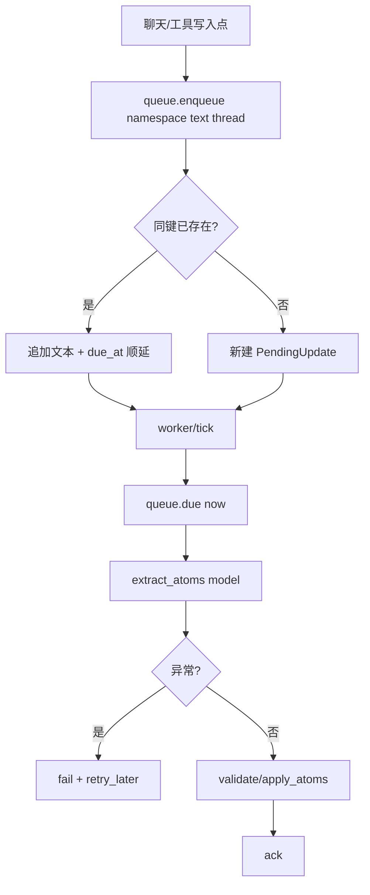

# 第 05.4 章　异步抽取与更新队列

> 状态：✅ 正文按六节写完；防抖队列 + 抽取 + 写回已实现，5 个用例通过。**未接后台 worker 与聊天入口**。
> 所属：第 05 篇　长期记忆与资产

## 1. 功能与知识点

### 功能

记忆不该在回答链路上同步抽取，否则首字延迟翻倍；队列做三件事：

1. **防抖合并**：同 `namespace + thread` 的多次入队合成一条，`due_at` 顺延（默认 3 秒）。
2. **到期出队**：`due(now)` 只取到期项，**不出队**；`ack()` 才删，失败还能重试。
3. **抽取**：`extract_atoms(model, text)` 让模型只输出 JSON 数组，代码做字段校验。
4. **写回**：`apply_atoms()` 逐条 `facade.remember`，低置信度由门面丢弃。
5. **失败退避**：`fail()` 计数 + `retry_later()` 重排，不丢任务。

### 知识点如何体现

| 知识点 | 在本功能里体现为 | 可观察证据 |
|---|---|---|
| 防抖不是节流 | 同键入队只追加内容并顺延 due_at | `test_debounce_merges_same_thread` |
| 出队要显式 ack | `due` 不删，`ack` 才删 | `test_ack_and_retry` |
| 模型只产 JSON | 抽取 prompt 固定字段，代码校验 | `validate_atom` |
| 容错优先级 | JSON 围栏/裸数组都能解，失败返回 [] | `test_extract_empty_and_bad_json` |
| 单条失败不拖批次 | `flush_queue` 逐条 try，失败只影响自己 | `test_flush_failure_keeps_item` |
| 写回可观测 | `apply_atoms` 返回真实落库 id | `test_flush_writes_atoms_and_recallable` |

**最小验收**：同 thread 两次入队 → 一条 item、`due_at` 顺延；到期后 `flush_queue` 抽 2 条、只写 1 条（一条空内容被丢），且可用关键词召回。

## 2. 最小调用链



### 2.1 防抖合并

```python
item = self._items.get(key)
if item is None:
    item = PendingUpdate(key=key, namespace=ns, thread_id=thread_id, text=body)
    self._items[key] = item
else:
    item.text = f"{item.text}\n{body}" if item.text else body
    item.rounds += 1
item.due_at = now + self.debounce_seconds
```

每次新消息都把到期时间往后推：连续对话期间不抽取，等用户停一下再一次性处理。

### 2.2 抽取协议

```python
reply = model.invoke([
    SystemMessage(content=_EXTRACT_PROMPT),
    HumanMessage(content=f"对话记录：\n{body}"),
])
atoms = [a for a in (validate_atom(r) for r in _parse_json_array(str(content))) if a]
```

`_parse_json_array` 先找 ```json 围栏，再退化到首个 `[...]`；两次都失败返回空列表，不抛异常——抽取失败不等于系统失败。

### 2.3 失败点

- 队列在进程内：重启丢未处理项；要做持久化得落表。
- `debounce_seconds=0`：每次入队立即可取，测试方便，线上会造成每轮一次抽取。
- 抽取模型和主模型共用：主模型限流时抽取也失败，任务会一直退避。

## 3. 代码创建

| 顺序 | 文件 | 本章职责 | 关键符号 |
|---|---|---|---|
| 1 | `memory/queue.py` | 防抖队列 | `PendingUpdate`、`MemoryUpdateQueue` |
| 2 | `memory/updater.py` | 抽取、校验、写回 | `extract_atoms`、`validate_atom`、`flush_queue` |
| 3 | `memory/facade.py` | 落库与噪声过滤 | `remember` |
| 4 | `tests/chapters/test_ch05_04_updater.py` | 队列与抽取 | 5 个用例 |

### 3.1 为什么队列不直接写库

写库是「模型产出 → 代码校验 → 存储」三级；队列只负责调度。把写库放进队列会让「抽取失败」和「写库失败」混在一起，退避策略也没法分开。

### 3.2 取舍：内存队列 vs 持久化队列

内存队列零依赖、延迟低；重启丢任务，也无法多 worker 消费。当前选内存，持久化列进完整化。

### 3.3 上游对照

EvoFlow 的 MemoryUpdater 链还包含：会话结束触发、抽取去重、冲突写回、任务状态表、多 worker 租约、失败告警。本章只做「防抖 + 抽取 + 写回 + 退避」。

## 4. 测试

### 4.1 覆盖矩阵

| 类型 | 用例 | 验证什么 |
|---|---|---|
| 防抖 | `test_debounce_merges_same_thread` | 同键合并、due_at 顺延、到期前不可取 |
| 出队 | `test_ack_and_retry` | due 不删、fail 计数、retry_later 重排、ack 清理 |
| 端到端 | `test_flush_writes_atoms_and_recallable` | 抽取 2 条、写 1 条、可召回 |
| 容错 | `test_extract_empty_and_bad_json` | `[]` 与非 JSON 都返回空 |
| 失败 | `test_flush_failure_keeps_item` | 模型抛错时任务保留并计数 |

### 4.2 运行

```bash
cd /Users/main/my-agent-flow/backend
uv run pytest tests/chapters/test_ch05_04_updater.py -q
```

当前结果：`5 passed`。

## 5. 完整化

1. **后台 worker**：定时 tick 或事件触发 `flush_queue`；现在只有测试手动调用。
2. **持久化队列**：落 SQLite，重启续跑；支持多 worker 租约。
3. **会话结束触发**：`/api/chat` 的 `on_final` 里入队，而不是每轮。
4. **抽取去重**：同 subject 的多次抽取在写库前合并，避免巩固压力。
5. **抽取模型隔离**：用小模型/独立额度，避免拖累主回答。
6. **可观测**：队列长度、失败次数、平均延迟进指标。
7. **隐私**：抽取内容含个人信息时按命名空间/租户隔离。

每项都要有独立测试；当前只完成队列与抽取组件。

## 6. 边界与验收

### 本章不做什么

- 不启动后台线程/定时任务；`flush_queue` 只能被显式调用。
- 队列不持久化，重启丢未处理项。
- 不接聊天入口；没有任何自动入队点。
- 不做抽取模型隔离与配额。

### 验收

```bash
cd /Users/main/my-agent-flow/backend
uv run pytest tests/chapters/test_ch05_04_updater.py -q
```

预期：`5 passed`。失败时先查：`now` 是否传了同一个基准时间（`due_at` 是绝对时间）、namespace 是否为空（入队直接 ValueError）、模型返回是否被 ```json 围栏包住。

### 下一章依赖

05.5 的产物与事项会被抽取成记忆；如果抽取把「事项 ID」当事实写进 atom，巩固时会被合并掉。
