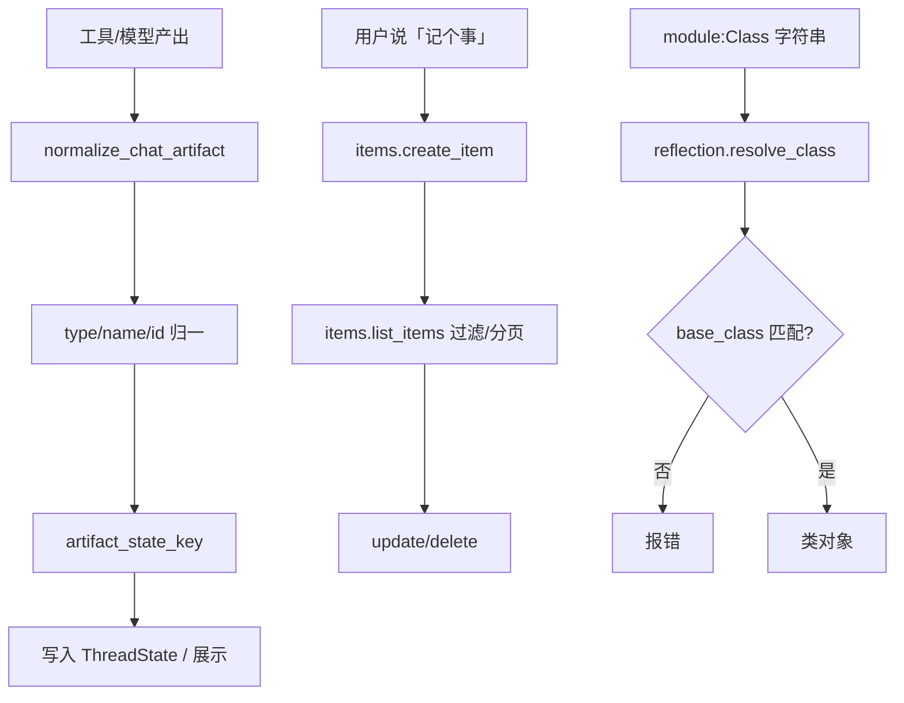

# 第 05.5 章　产物、事项与反思

> 状态：✅ 正文按六节写完；产物归一化、事项 CRUD、反射解析已实现，6 个用例通过。**事项可见性参数是空实现**。
> 所属：第 05 篇　长期记忆与资产

## 1. 功能与知识点

### 功能

Agent 干完活要留下「能接着用的东西」，本章有三类资产：

1. **产物（artifact）**：文件/URL/图片/HTML/文本的统一描述；`normalize_chat_artifact` 归一 + `make_artifact_id` 稳定 id。
2. **事项（item）**：待办/决策/结论，`items/service` 提供 CRUD、过滤、分页。
3. **反思（reflection）**：按字符串路径解析变量/类，供插件式扩展。

三者共同点：**都要有稳定 id**，否则「同一次产出」会被记成两条。

### 知识点如何体现

| 知识点 | 在本功能里体现为 | 可观察证据 |
|---|---|---|
| 归一化优于严格 schema | 别名/扩展名/mime 都能推出类型 | `normalize_artifact_type` 的多分支 |
| 稳定 id | path/url 相同必得同一 id | `test_artifact_normalize_and_dedupe` |
| 状态键优先 path | `artifact_state_key` | `test_artifact_state_key_prefers_path` |
| 事项 CRUD 有边界 | 分页 1~200、非法状态拒绝 | `test_items_crud_and_filters` |
| 可见性不假装实现 | `filter_visibility` 显式 `del` | 代码注释与本章边界 |
| 反射要检查基类 | `resolve_class(path, base_class=...)` | `test_resolve_variable_and_class` |

**最小验收**：同一路径的产物两次归一得到同一 id；事项创建/查询/更新/删除走通；非法状态抛 `ValidationError`；`resolve_class` 对不匹配基类抛错。

## 2. 最小调用链



### 2.1 稳定 id

```python
if path:
    key = f"path:{path.replace(chr(92), '/')}"
elif url:
    key = f"url:{url}"
elif content:
    key = f"content:{type_}:{name}:{sha256(content)[:24]}"
```

同一路径不因展示名变化而变 id：前端追加产物时能「更新」而不是「插一条重复」。

### 2.2 事项过滤

```python
if status_f and str(item.status) != status_f: continue
if not include_done and item.status == ItemStatus.DONE: continue
if tag_f and tag_f not in (item.tags or []): continue
if query and query not in blob.lower(): continue
```

过滤在内存里做：事项量小（个人待办级），先用 JSON 存储，量大了再换 SQL。

### 2.3 失败点

- `size` 非数字：归一成 `None`，不抛。
- 内容超 200k：直接截断，不报错；调用方不知道被截。
- 事项行损坏：`_parse_item` 抛 `ValidationError`，`list_items` 跳过坏行而不是整页失败。

## 3. 代码创建

| 顺序 | 文件 | 本章职责 | 关键符号 |
|---|---|---|---|
| 1 | `artifacts/chat_artifact.py` | 产物归一与 id | `normalize_chat_artifact`、`make_artifact_id`、`artifact_state_key` |
| 2 | `items/models.py` | 事项模型 | `UserItem`、`ItemStatus` |
| 3 | `items/store.py` | JSON 存储 | `load_doc`、`upsert_raw_item` |
| 4 | `items/service.py` | CRUD 与过滤 | `list_items`、`create_item`、`update_item` |
| 5 | `reflection/resolvers.py` | 反射解析 | `resolve_variable`、`resolve_class` |
| 6 | `tests/chapters/test_ch04_03_assets.py` | 三类资产 | 6 个用例 |

### 3.1 为什么产物不是「文件路径」

模型可能产出 URL、HTML、图片；统一成 `{id,type,name,path/url/content}` 后，前端只需一套渲染逻辑。

### 3.2 取舍：JSON 文件 vs SQLite

事项是低频写、单人读；JSON 文件 + 文件锁足够，也方便用户直接看。代价是并发写要小心，且没有事务。

### 3.3 上游对照

EvoFlow 的资产层还包含：产物上传与预览、事项派发到子 Agent、结果回写、反思结果自动应用、可见性/权限。本章只做「归一 + CRUD + 解析」。

## 4. 测试

### 4.1 覆盖矩阵

| 类型 | 用例 | 验证什么 |
|---|---|---|
| 正常 | `test_artifact_normalize_and_dedupe` | 归一、稳定 id、批量去重 |
| 边界 | `test_artifact_state_key_prefers_path` | path 优先于 url |
| 正常 | `test_items_crud_and_filters` | 创建/查询/更新/删除/过滤 |
| 失败 | `test_items_reject_bad_status` | 非法状态拒绝 |
| 正常 | `test_resolve_variable_and_class` | 变量/类解析 + 基类校验 |

### 4.2 运行

```bash
cd /Users/main/my-agent-flow/backend
uv run pytest tests/chapters/test_ch04_03_assets.py -q
```

当前结果：`6 passed`。

## 5. 完整化

1. **产物接聊天**：现在模型产出的文件不会自动登记；要在工具结果里解析并写 ThreadState。
2. **事项派发**：事项 → 子任务 → 结果回写，形成闭环。
3. **可见性/权限**：`filter_visibility/is_admin/scope` 参数被 `del`；接入身份后要做真实过滤。
4. **反思应用**：解析出的类目前只用于扩展点；没有「反思结论自动改进下次执行」。
5. **存储升级**：JSON → SQLite，支持事务与并发。
6. **产物预览**：图片/HTML 的安全渲染与白名单。
7. **脱敏**：产物内容里的密钥/路径在上传/分享前打码。

每项都要有独立测试；当前只完成组件级 CRUD。

## 6. 边界与验收

### 本章不做什么

- 产物不接聊天，模型产出的文件不会自动登记。
- 事项不做派发与回写，只是待办清单。
- 可见性参数是空实现，**不做假过滤**。
- 反思只做解析，不做自动应用。

### 验收

```bash
cd /Users/main/my-agent-flow/backend
uv run pytest tests/chapters/test_ch04_03_assets.py -q
```

预期：`6 passed`。失败时先查：`MYAF_DATA_DIR` 是否隔离、事项状态是否写成中文（枚举只认英文小写）、artifact 的 `path` 是否带反斜杠（会被归一成 `/`）。

### 下一章依赖

第 06 篇的代码索引与知识库会产出新的 artifact 类型；`normalize_artifact_type` 的别名表要跟着扩，而不是另起一套。
