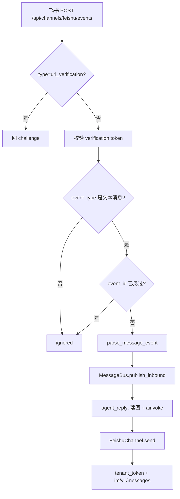

# 第 09.3 章　渠道适配器与消息总线

> 状态：✅ 正文；飞书渠道最小闭环已实现（Webhook 入站 → 总线 → 同一套 Agent 图 → 飞书发回），7 个用例通过。**未用真实飞书凭证联调**，未做加密事件、卡片、文件与多平台。
> 所属：第 09 篇　产品化与治理

## 1. 功能与知识点

### 功能

同一套 Agent 要服务 Web 与 IM。若每加一个渠道就在 Agent 里写一遍分支，渠道数 × 能力数会迅速失控。本章把渠道压成两件事：

1. **入站归一**：平台事件 → `InboundMessage(channel_name, chat_id, text, user_id, metadata)`，`thread_id` 由 `channel:chat` 派生。
2. **出站归一**：Agent 返回纯文本 → `OutboundMessage` → 渠道 `send(thread_id, text)`。
3. **总线解耦**：`MessageBus.publish_inbound()` 是唯一入口：取 handler → 拿回复 → 调渠道发回。渠道不知道 Agent 存在，Agent 不知道飞书存在。
4. **飞书最小适配**：`/api/channels/feishu/events` 处理 `url_verification`、校验 `verification token`、按 `event_id` 去重、解析 `im.message.receive_v1` 文本。
5. **出站真调用**：`FeishuApi.tenant_token()` 缓存 token（提前 60 秒失效），`send_text()` 调 `im/v1/messages?receive_id_type=chat_id`。
6. **回答复用主链路**：`agent_reply()` 与 `/api/chat` 建同一张图（工具、策略、审批、记忆、上下文管理器），只是把流式换成 `ainvoke`。

### 知识点如何体现

| 知识点 | 在本功能里体现为 | 可观察证据 |
|---|---|---|
| 渠道只做传输 | `FeishuChannel` 只有 `send()`；不建图、不碰记忆 | `test_text_event_to_channel_send` |
| 会话映射 | `thread_id = feishu:<chat_id>`，可选 `#topic` | 断言发送目标 `feishu:oc_1` |
| 回调地址验证 | `url_verification` 原样回 `challenge` | `test_url_verification` |
| 来源校验 | 配了 `FEISHU_VERIFICATION_TOKEN` 就 401 | `test_token_mismatch_401` |
| 幂等 | 同 `event_id` 第二次 `ignored=duplicate` | `test_duplicate_event_answered_once` |
| 事件类型过滤 | 图片/文件不进 Agent | `test_non_text_ignored` |
| 提及清洗 | `@_user_xxx` 不进 prompt | `test_mention_stripped` |
| 凭证缓存 | 两次发送只取一次 token | `test_feishu_api_token_cache_and_payload` |

**最小验收**：一条飞书文本事件能走完「验签 → 解析 → Agent → 发回」，且重复推送不重复回答。

## 2. 最小调用链



### 2.1 入站解析

```python
raw = json.loads(message["content"])          # content 是字符串，不是对象
text = _MENTION.sub("", raw["text"]).strip()  # @_user_123 不进 prompt
```

`message_type != "text"` 直接返回 `None`。图片/文件后续要做，但必须先有媒体下载与存储，不能把 `content` 里的 file_key 当文本塞给模型。

### 2.2 thread 映射

```python
@property
def thread_id(self) -> str:
    base = f"{self.channel_name}:{self.chat_id}"
    topic = self.metadata.get("topic_id")
    return f"{base}#{topic}" if topic else base
```

同一群聊共用一个 thread，checkpointer 才有连续上下文。若按 `message_id` 建 thread，每句话都是新会话，Agent 永远「第一次见你」。

### 2.3 出站

```python
data = post("/open-apis/im/v1/messages?receive_id_type=chat_id", {
    "receive_id": chat_id,
    "msg_type": "text",
    "content": json.dumps({"text": text}, ensure_ascii=False),   # 必须二次编码
}, {"Authorization": f"Bearer {token}"})
```

`content` 是 JSON 字符串而非对象，这是飞书 API 最容易踩的坑：传对象会得到 `code=230001 invalid content`。

### 2.4 失败点

- **缺凭证**：`FEISHU_APP_ID/SECRET` 为空时 `tenant_token()` 抛 `FeishuApiError`，不静默发空消息。
- **Agent 失败**：路由记录异常并回 200 + `ok:false`，避免飞书按失败无限重推；代价是这条消息不会自动重试，需要人工看日志。
- **去重只在内存**：`_seen_events` 上限 500，进程重启即清空；多副本部署时两个实例都会回答同一条。
- **同步阻塞**：`send()` 是同步 HTTP，Agent 慢时整个事件请求被拉长；飞书 3 秒超时会重推，靠 `event_id` 去重兜住。

## 3. 代码创建

| 文件 | 符号 | 谁调用 | 输入 → 输出 |
|---|---|---|---|
| `app/channels/message_bus.py` | `InboundMessage.thread_id` | 路由、服务 | 入站 → `feishu:oc_1` |
| 同上 | `MessageBus.publish_inbound()` | `ChannelService.handle` | `InboundMessage` → `OutboundMessage`，并调用渠道 `send` |
| `app/channels/feishu.py` | `FeishuApi.tenant_token()` | `send_text` | 凭证 → token（缓存 7200 秒） |
| 同上 | `FeishuApi.send_text()` | `FeishuChannel.send` | `chat_id, text` → 飞书响应 |
| 同上 | `parse_message_event()` | 路由 | 原始事件 → `InboundMessage \| None` |
| `app/channels/service.py` | `agent_reply()` | 总线 handler | `InboundMessage` → 回复文本（并写消息表） |
| `app/gateway/routers/channels.py` | `feishu_events()` | FastAPI | HTTP → JSON 结果 |
| `app/gateway/main.py` | `include_router(channels_router)` | 启动 | 挂载 `/api/channels/feishu/events` |

### 3.1 总线分发

```python
async def publish_inbound(self, msg: InboundMessage) -> OutboundMessage:
    if self._handler is None:
        raise RuntimeError("MessageBus 没有设置 handler")
    result = self._handler(msg)
    if inspect.isawaitable(result):     # 兼容同步假函数与异步 Agent
        result = await result
    reply = OutboundMessage(msg.channel_name, msg.chat_id, str(result or ""))
    self.channel(msg.channel_name).send(msg.thread_id, reply.text)
    return reply
```

handler 允许同步/异步两种形态，测试注入 `lambda msg: "echo"` 就不必起模型。

### 3.2 复用主链路

```python
graph = build_graph(model, get_checkpointer(), tools=tools, tool_executor=executor,
                    system_prompt=build_system_prompt(memory_block=memory_block),
                    context_manager=ContextManager(model=model), max_continuations=2)
result = await graph.ainvoke({"messages": [HumanMessage(content=msg.text)]},
                             {"configurable": {"thread_id": msg.thread_id, "channel": msg.channel_name}})
```

工具集与 `/api/chat` 保持一致（echo、workspace files、shell + 审计/策略中间件）。IM 里 Agent 能干活，而不是只会聊天，靠的就是这里没有另建一张「简化图」。

## 4. 测试

用例（`tests/chapters/test_ch09_03_channels.py`，7 个）：

1. `test_url_verification`：回显 challenge。
2. `test_text_event_to_channel_send`：回复发到 `feishu:oc_1`，内容含原文本。
3. `test_duplicate_event_answered_once`：第二次 `ignored=duplicate`，只发一次。
4. `test_non_text_ignored`：`image` 事件不发消息。
5. `test_mention_stripped`：`@_user_123 帮我总结` → `帮我总结`。
6. `test_token_mismatch_401`：配了 token 后错误 token 被拒，渠道未发送。
7. `test_feishu_api_token_cache_and_payload`：假传输断言 token 只取一次、`content` 是 JSON 字符串、Authorization 头正确。

```bash
cd /Users/main/my-agent-flow/backend
uv run pytest tests/chapters/test_ch09_03_channels.py -q
# 7 passed
```

全量回归：`uv run pytest -q` → **157 passed**；`uv run ruff check .` → All checks passed。

## 5. 完整化

按「最小闭环已通、逐项加厚」的顺序：

1. **加密事件**：飞书后台开启 Encrypt Key 后，事件体是 `{"encrypt": "..."}`；需 AES-CBC 解密后再解析。当前只支持明文回调。
2. **事件持久化去重**：`_seen_events` 换 SQLite 表（`event_id` 唯一），多副本共享；顺带记录处理状态，失败可重放。
3. **异步投递**：路由只负责入队，后台 worker 跑 Agent，`send` 用线程池或 async HTTP；否则慢回答必然触发飞书重推。
4. **富消息**：卡片（`msg_type=interactive`）、分段流式更新、图片/文件上传（`im/v1/images`、`im/v1/files`）。
5. **多租户与渠道管理**：对齐 EvoFlow 的 `manager.py/store.py`，把 app 凭证、启用状态、会话映射存表；`ChannelService` 按 `channel_name` 取实例。
6. **更多平台**：微信（公众号/客服）、企业微信、钉钉、Telegram、Slack 各自实现 `Channel.send` + 入站解析，总线与 Agent 侧零改动。
7. **可靠性**：出站重试与退避、`code` 分类（限流/权限/参数）、失败消息落 `channel_io_log`。

## 6. 边界与验收

**本章不做**：真实凭证联调、加密事件、卡片/文件、流式分段、多平台、持久化去重、渠道管理后台。

**验收命令与预期**：

```bash
uv run pytest tests/chapters/test_ch09_03_channels.py -q   # 7 passed
uv run pytest -q                                            # 157 passed
```

**常见失败定位**：

- `401 verification token 不匹配`：环境里的 `FEISHU_VERIFICATION_TOKEN` 与飞书后台不一致。
- `{"ignored": "non_text"}`：事件不是文本；查 `message_type`。
- `{"ok": false, "error": "agent_failed"}`：Agent 侧异常，看 `feishu handle failed` 日志与模型/DB 配置。
- `FeishuApiError: 缺少 FEISHU_APP_ID`：凭证未注入；真实联调前必须设置。
- 发出去但飞书报 `invalid content`：`content` 被当对象传了，必须是 `json.dumps` 后的字符串。

**结论**：渠道层从「只有抽象类」推进到「飞书一条消息能进能出」，并且回答走的是带工具与治理的主图。它不是「IM 全平台接入完成」，只是第一个可运行渠道；微信/企微等按第 5 节逐项扩展。
