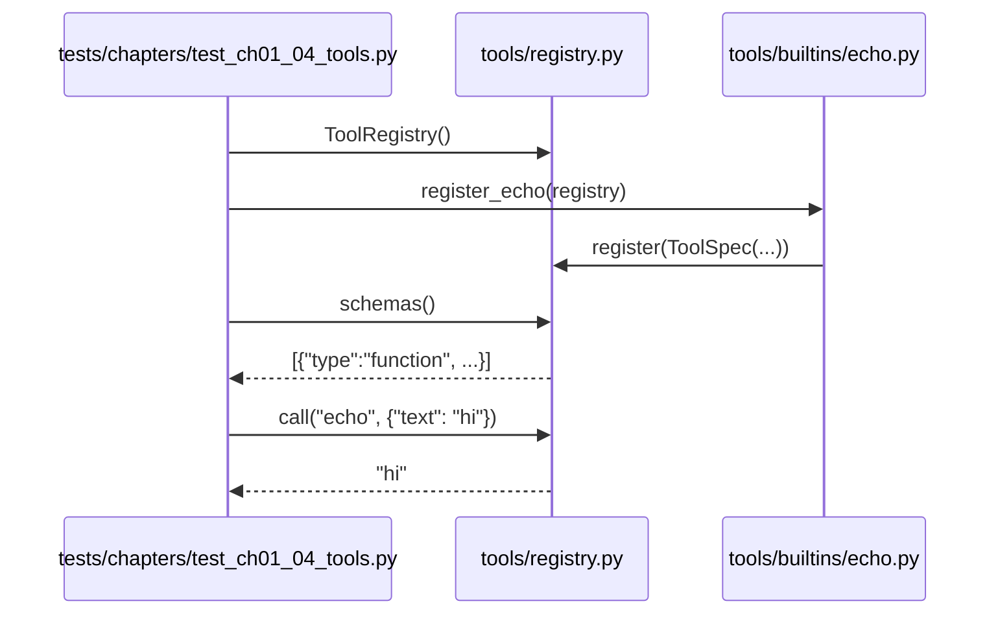

# 第 4 章　工具协议与首批工具 / Tool Protocol and First Tools

> **状态**：本章只实现注册表与 `echo` 一个工具；工具调用循环尚未实现，也不在第 6、7 部分当前大纲内。审批、审计、沙箱分属后续部分。

## 本章目标 / Goals
- 一个 `ToolSpec` + `ToolRegistry`：注册、生成 schema、同步调用。
- schema 用 OpenAI function 形状，模型能直接读。
- 重名工具直接拒绝，未知工具抛 `KeyError`。
- 本章不做：参数校验、结果截断、alias、工具调用循环——当前没有对应章节。

## 最小闭环 / Minimal closed loop
`register_echo(registry)` → `registry.schemas()` 得到一条 function schema → `registry.call("echo", {"text": "hi"})` 返回 `"hi"`。

## 调用逻辑 / Invocation logic


## 4.1 工具声明 / Tool spec
`ToolSpec` 是 frozen dataclass，四个字段：`name`（模型调用时用的名字）、`description`（给模型看的用途）、`parameters`（JSON Schema）、`fn`（真正执行的函数）。

为什么绑在一起：模型只需要前三个，执行只需要 `fn`；拆成两张表迟早对不上。

## 4.2 注册表行为 / Registry behaviour
- `register()`：名字重复直接 `ValueError`，不允许悄悄覆盖。
- `schemas()`：输出 `{"type": "function", "function": {name, description, parameters}}`，这是 OpenAI 兼容接口认的形状。
- `call()`：按名字取 `fn` 并调用；未知名字抛 `KeyError`，由调用方决定怎么呈现。

## 4.3 第一个工具 echo / First tool
`backend/packages/harness/myagentflow/tools/builtins/echo.py` 只做一件事：把 `text` 原样返回。它用来验证 schema → 调用这条链路，不引入任何外部依赖。

## 4.4 工具循环为什么不在本章 / Why no loop here
真实仓库里 `backend/packages/harness/myagentflow/agents/lead_agent/graph.py` 只有 `call_model` 一个节点，模型直接回文本，没有 tool_call 分支。工具循环要有审批、预算、审计才安全；第 6、7 部分当前大纲也不含完整 ReAct 循环。现在硬塞一个循环，只会让错误无限放大。

## 常见坑 / Pitfalls
- 把 `fn` 也塞进 schema 发给模型：序列化会炸，且等于泄露实现。
- 重名静默覆盖：后注册的工具会顶掉前面的，排查时极难发现。
- `call()` 吞掉异常返回空串：调用方无法区分「工具返回空」和「工具挂了」。

## 验收 / Acceptance
- [x] `tests/chapters/test_ch01_04_tools.py::test_schema_and_call`：`type=function`、`required=["text"]`、调用返回 `"hi"`。
- [x] `tests/chapters/test_ch01_04_tools.py::test_unknown_tool`：未知工具抛 `KeyError`。

## 后续扩展预告 / What builds on this
- 第 3 部分：文件/终端工具、中间件审计、上下文预算。
- 第 9 部分：MCP 工具映射进同一个注册表。可参考 Harbor404 笔记《MCP 中台 Tool 数量治理成熟架构方案》（[链接](https://harbor404.fushenlin.com/notes/mcp-tool-governance-architecture/)，仅看过标题，尚未阅读正文）。

## 对照 EvoFlow 核对清单
- [ ] 工具目录的 alias 与 schema 约定
- [ ] 工具结果协议与截断策略
- [ ] 内置工具清单与宿主边界

## 从零实现（手把手）
> 读完这章你有一个工具注册表：注册即有 schema，模型能看见，执行能落到函数。
> 文件路径一律写仓库全路径（`backend/...`），代码注释写「为什么」。

### Step 1　新建 registry.py：ToolSpec + 注册表
**文件**：`backend/packages/harness/myagentflow/tools/registry.py（新建）`
**要写的逻辑**：`ToolSpec` 冻结；`schemas()` 输出 OpenAI function calling 形状；`call()` 统一入口，未知工具给明确报错；`register()` 重名也报错（本章测试只覆盖前两项）。

**代码**

```python
"""一、文件说明
    工具注册表：一个数据结构 + 三个方法。
    为什么要 ToolSpec 而不是裸函数：模型要的是 name/description/JSON Schema，
    执行要的是可调用对象，两者必须绑在一起，否则迟早对不上。

二、目录结构
    packages/harness/myagentflow/tools/
    ├── __init__.py
    └── registry.py  ← 本文件

三、关键方法
    ToolSpec      一个工具的完整声明：名字、描述、JSON Schema、可调用对象。
    ToolRegistry  工具注册表：注册、查找、调用；重名直接拒绝。
"""
from __future__ import annotations

from collections.abc import Callable
from dataclasses import dataclass
from typing import Any


@dataclass(frozen=True)
class ToolSpec:
    """一个工具的完整声明：名字、描述、JSON Schema、可调用对象。"""
    name: str
    description: str
    input_schema: dict[str, Any]
    fn: Callable[..., Any]


class ToolRegistry:
    """工具注册表：注册、查找、调用；重名直接拒绝。"""
    def __init__(self) -> None:
        self._tools: dict[str, ToolSpec] = {}

    def register(self, spec: ToolSpec) -> None:
        if spec.name in self._tools:
            raise ValueError(f"工具重名：{spec.name}")
        self._tools[spec.name] = spec

    def schemas(self) -> list[dict[str, Any]]:
        """给模型看的形状。字段名照 OpenAI function calling，别自创。"""
        return [
            {
                "type": "function",
                "function": {
                    "name": s.name,
                    "description": s.description,
                    "parameters": s.input_schema,
                },
            }
            for s in self._tools.values()
        ]

    def call(self, name: str, args: dict[str, Any]) -> Any:
        spec = self._tools.get(name)
        if spec is None:
            raise KeyError(f"未注册的工具：{name}")
        return spec.fn(**args)
```

**验证**

```bash
uv run python -c "from myagentflow.tools.registry import ToolRegistry, ToolSpec; print('import ok')"
```

### Step 2　加第一个工具：echo
**文件**：`backend/packages/harness/myagentflow/tools/builtins/echo.py（新建）`
**要写的逻辑**：把「函数 + schema」一起定义，注册时一行搞定。

**代码**

```python
"""一、文件说明
    第一个内置工具：echo。它的价值是「证明通路」，不是功能。

二、目录结构
    packages/harness/myagentflow/tools/builtins/
    ├── __init__.py
    └── echo.py  ← 本文件

三、关键方法
    _echo()          原样返回输入，用于验证工具通路。
    register_echo()  把 echo 工具连同 schema 注册进注册表。
"""
from __future__ import annotations

from myagentflow.tools.registry import ToolRegistry, ToolSpec


def _echo(text: str) -> str:
    """原样返回输入，用于验证工具通路。"""
    return text


def register_echo(registry: ToolRegistry) -> None:
    """把 echo 工具连同 schema 注册进注册表。"""
    registry.register(
        ToolSpec(
            name="echo",
            description="把输入原样返回，用于验证工具通路",
            input_schema={
                "type": "object",
                "properties": {"text": {"type": "string", "description": "要回显的文本"}},
                "required": ["text"],
            },
            fn=_echo,
        )
    )
```

**验证**

```bash
uv run python -c "
from myagentflow.tools.registry import ToolRegistry
from myagentflow.tools.builtins.echo import register_echo
r = ToolRegistry(); register_echo(r)
print(r.schemas()); print(r.call('echo', {'text': 'ok'}))
"
```

### Step 3　写测试：schema 形状 + 未知工具报错
**文件**：`backend/tests/chapters/test_ch01_04_tools.py（新建）`
**要写的逻辑**：断言 `type == function`、必填字段、调用结果、未知工具报错。

**代码**

```python
"""一、文件说明
    第 4 章工具协议：schema 生成、调用与未知工具报错。

二、覆盖
    test_schema_and_call()  echo 生成 function schema，required 正确，调用返回输入。
    test_unknown_tool()     调不存在的工具抛 KeyError。

三、运行
    uv run pytest tests/chapters/test_ch01_04_tools.py -q
"""

from __future__ import annotations

import pytest


def test_schema_and_call():
    """echo 生成 function schema，required 正确，调用返回输入。"""
    from myagentflow.tools.builtins.echo import register_echo
    from myagentflow.tools.registry import ToolRegistry

    r = ToolRegistry()
    register_echo(r)
    schema = r.schemas()[0]
    assert schema["type"] == "function"
    assert schema["function"]["name"] == "echo"
    assert schema["function"]["parameters"]["required"] == ["text"]
    assert r.call("echo", {"text": "hi"}) == "hi"


def test_unknown_tool():
    """调不存在的工具抛 KeyError。"""
    from myagentflow.tools.registry import ToolRegistry

    with pytest.raises(KeyError):
        ToolRegistry().call("nope", {})
```

**验证**

```bash
uv run pytest tests/chapters/test_ch01_04_tools.py -v
# 期望：2 passed
```

### 与 EvoFlow 对照

| 我们的做法 | EvoFlow | 为什么 |
|---|---|---|
| `name/description/input_schema` 三件套 | `tools/` 下的工具定义与 schema 生成 | 少一个模型就看不懂工具 |
| 未知工具直接抛错 | 工具分发处的显式分支 | 静默返回 None 会让模型一直重试 |

### 知识点

- [agent-book · LangGraph 课程](https://g0-000.github.io/agent-book/langgraph/)：tool calling 与 ToolNode
- [Harbor404](https://harbor404.fushenlin.com/)：工具调用失败的生产排查思路

### 验收

```bash
uv run pytest tests/chapters/test_ch01_04_tools.py -q
```

## 源码核对记录（路径与符号实测）

- 状态：🔍 结构级。工具 schema、名称去重、错误返回已核；未逐个读 60+ builtin。
- 已核上游：`tools/tools.py`（650）、`tools/tool_catalog.py`（358）、`tools/minimal_schema.py`（89）、`tools/builtins/`（60+ 文件）。
- 本地对应：`tools/registry.py`（59）、`tools/builtins/echo.py`（36）。
- 结论：本地只有 `ToolRegistry` + `echo`，没有 MCP、工具搜索、工具别名、schema 裁剪与 60+ 内置工具；第 1 部分不声明工具循环。
