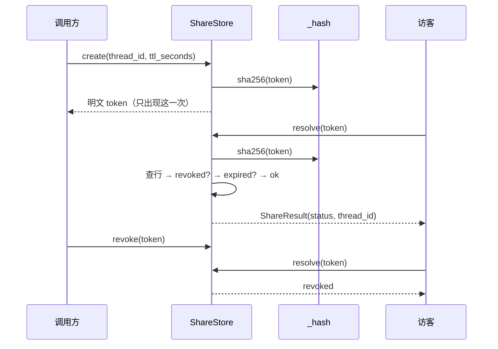

# 第 4 章　分享生命周期 / Sharing

> **本章状态**：🟡 存储层已实现并测试；HTTP 路由与只读快照**未实现**。
> 基准：EvoFlow `f22af539`（v1.3.22）。

## 本章目标 / Goals

- 把「一个会话」投影成「一个不可猜的 token」：拿到 token 才能读。
- token 只存哈希：数据库泄露不等于会话泄露。
- 解析有四个状态：`ok` / `expired` / `revoked` / `missing`，调用方据此决定 404 还是 410。
- 过期靠**时间戳比较**，不靠定时任务：省一个后台进程，也不会漏扫。

**本章不做**：`POST /share`、`GET /share/{{token}}` 路由；快照内容（标题、消息列表、是否含工具输出）；鉴权中间件；分享页前端。本章只做「token 从创建到失效」的存储与判定。

## EvoFlow 源码导读 / Source reading

| 文件 | 行数 | 读什么 |
|---|---|---|
| `backend/app/gateway/routers/share.py` | 154 | `create_share` 里 `secrets.token_urlsafe(24)`；`get_share` 按 token 明文查；`revoke_share` 只置 `revoked_at` |
| `backend/packages/harness/evoflow/persistence/chat_share_repositories.py` | 311 | `create_share(*, token, session_key, title, messages, include_tools, expires_in_days=7, created_by)`：**快照直接落库** |
| `backend/app/gateway/auth.py` | 164 | 分享读路径是否走鉴权 |
| `backend/packages/harness/evoflow/authz/http_guard.py` | 549 | 可见性校验、防 IDOR |

**EvoFlow 的事实**：

1. token 在路由层生成，**明文存进 `evoflow_chat_shares.token`**；撤销置 `revoked_at`，不删行。
2. 分享是**不可变快照**：创建时把 `title` / `messages` / `include_tools` 一起写入，读分享不查原会话。
3. 默认有效期 7 天（`expires_in_days=7`）。
4. 读路径按 token 明文等值查，没有哈希。

## 本章的取舍 / Scope trade-off

| 点 | EvoFlow | 本章 | 为什么 |
|---|---|---|---|
| token 存储 | 明文 | `sha256(token)` | 库泄露时明文 token 等于把所有会话送出去 |
| 主键 | 自增 / token | `token_hash` 主键 | 一个 token 只能对应一条分享，天然防重复 |
| 快照 | 建分享时写消息 | 只存 `thread_id` | 本章只做 token 生命周期；快照读取下一章接消息表 |
| 过期 | 字段 + 读取时判断 | 同 | 都不依赖定时任务 |
| 撤销 | 置 `revoked_at` | 同 | 保留审计，不删行 |

**这是设计选择，不是 EvoFlow 行为**：哈希存储让我们多一层不可逆性，但也意味着「按 token 前缀查分享」这类运维操作做不了。

## 调用逻辑 / Invocation logic



**状态判定顺序必须是 revoked → expired → ok**：用户点了撤销，即使还没到期也必须立刻失效；反过来先判过期，撤销后仍可能显示「过期」而不是「已撤销」，审计语义就乱了。

## 实现步骤 / Step by step

### Step 1　`backend/packages/harness/myagentflow/collab/shares.py`

**职责**：建表、创建 token、解析、撤销。

**逻辑**

1. `_SCHEMA` 五列：`token_hash`（主键）、`thread_id`、`created_at`、`expires_at`、`revoked_at`。
2. `create()` 用 `secrets.token_urlsafe(24)`（约 192 bit 熵），返回明文；库里只写哈希。
3. `resolve()` 先哈希再查；没有行 → `missing`；`revoked_at` 非空 → `revoked`；`now > expires_at` → `expired`；否则 `ok`。
4. `resolve()` 的 `now` 参数是给测试用的注入点：不 mock 系统时钟也能测过期。
5. `revoke()` 只 `UPDATE revoked_at`，不删行：删了就无法回答「这个 token 什么时候被撤销的」。
6. 连接 `check_same_thread=False`：Gateway 的读请求可能来自不同线程；本章不做连接池。

**代码（全文，84 行）**

```python
"""一、文件说明
    分享链接：创建、解析、撤销。
    为什么存 hash 不存 token：数据库泄露时明文 token 等于把所有人的会话送出去。

二、目录结构
    packages/harness/myagentflow/collab/
    ├── __init__.py
    ├── ledger.py  协作账本：任务认领与心跳。
    └── shares.py  ← 本文件

三、关键方法
    ShareResult  分享 token 的解析结果：状态与对应线程。
    _hash()      对分享 token 做 SHA-256；库里只存哈希，不存明文。
    ShareStore   分享记录的 SQLite 存储：创建、解析、吊销。
"""
from __future__ import annotations

import hashlib
import secrets
import sqlite3
import time
from dataclasses import dataclass
from pathlib import Path

# 分享表只存 token 的哈希，不存明文：库泄露也拿不到可用链接（明文下发仅一次）。
_SCHEMA = """
CREATE TABLE IF NOT EXISTS shares (
    token_hash TEXT PRIMARY KEY,
    thread_id  TEXT NOT NULL,
    created_at REAL NOT NULL,
    expires_at REAL,
    revoked_at REAL
);
"""


@dataclass(frozen=True)
class ShareResult:
    """分享 token 的解析结果：状态与对应线程。"""
    status: str          # ok | expired | revoked | missing
    thread_id: str | None = None


def _hash(token: str) -> str:
    """对分享 token 做 SHA-256；库里只存哈希，不存明文。"""
    return hashlib.sha256(token.encode()).hexdigest()


class ShareStore:
    """分享记录的 SQLite 存储：创建、解析、吊销。"""
    def __init__(self, db_path: str | Path):
        Path(db_path).parent.mkdir(parents=True, exist_ok=True)
        self._conn = sqlite3.connect(str(db_path), check_same_thread=False)
        self._conn.executescript(_SCHEMA)

    def create(self, thread_id: str, ttl_seconds: int = 7 * 86400) -> str:
        token = secrets.token_urlsafe(24)
        self._conn.execute(
            "INSERT INTO shares (token_hash, thread_id, created_at, expires_at) VALUES (?, ?, ?, ?)",
            (_hash(token), thread_id, time.time(), time.time() + ttl_seconds),
        )
        self._conn.commit()
        return token          # 明文只在这里出现一次

    def resolve(self, token: str, now: float | None = None) -> ShareResult:
        row = self._conn.execute(
            "SELECT thread_id, expires_at, revoked_at FROM shares WHERE token_hash = ?",
            (_hash(token),),
        ).fetchone()
        if row is None:
            return ShareResult("missing")
        thread_id, expires_at, revoked_at = row
        if revoked_at is not None:
            return ShareResult("revoked")
        if expires_at is not None and (now or time.time()) > expires_at:
            return ShareResult("expired")
        return ShareResult("ok", thread_id)

    def revoke(self, token: str) -> None:
        self._conn.execute(
            "UPDATE shares SET revoked_at = ? WHERE token_hash = ?",
            (time.time(), _hash(token)),
        )
        self._conn.commit()
```

**验证**

```bash
cd /Users/main/my-agent-flow/backend
uv run python -c "
from myagentflow.collab.shares import ShareStore
s = ShareStore('/tmp/myaf-share.sqlite')
t = s.create('t1', ttl_seconds=10)
print(s.resolve(t))
s.revoke(t)
print(s.resolve(t))
"
# 期望：ShareResult(status='ok', thread_id='t1') / ShareResult(status='revoked', thread_id=None)
```

---

### Step 2　`backend/tests/chapters/test_ch02_04_shares.py`

三个用例分开写，避免「撤销 + 过期」混在一个断言里导致过期分支没被真正执行。

**代码（全文，48 行）**

```python
"""一、文件说明
    02/04 分享：ok / missing / revoked / expired 四种状态。

二、覆盖
    test_share_ok_and_missing()   有效 token 能解析到线程；乱码 token 是 missing。
    test_share_revoked()          撤销后旧 token 立即变成 revoked。
    test_share_expired()          ttl 到期后变成 expired，且不依赖撤销。

三、运行
    uv run pytest tests/chapters/test_ch02_04_shares.py -q
"""

from __future__ import annotations


def test_share_ok_and_missing(tmp_path):
    """有效 token 能解析到线程；乱码 token 是 missing。"""
    from myagentflow.collab.shares import ShareStore

    store = ShareStore(tmp_path / "s.sqlite")
    token = store.create("t1", ttl_seconds=60)
    result = store.resolve(token)
    assert result.status == "ok"
    assert result.thread_id == "t1"
    assert store.resolve("bogus").status == "missing"


def test_share_revoked(tmp_path):
    """撤销后旧 token 立即变成 revoked。"""
    from myagentflow.collab.shares import ShareStore

    store = ShareStore(tmp_path / "s.sqlite")
    token = store.create("t1", ttl_seconds=60)
    store.revoke(token)
    assert store.resolve(token).status == "revoked"


def test_share_expired(tmp_path):
    """ttl 到期后变成 expired：时间戳比较，不靠定时任务。"""
    from myagentflow.collab.shares import ShareStore

    store = ShareStore(tmp_path / "s.sqlite")
    token = store.create("t1", ttl_seconds=50)
    expires_at = store._conn.execute(
        "SELECT expires_at FROM shares WHERE thread_id = ?", ("t1",)
    ).fetchone()[0]
    # 把「现在」推到过期之后一秒；没有撤销，状态必须自己走到 expired
    assert store.resolve(token, now=expires_at + 1).status == "expired"
```

**验证**

```bash
cd /Users/main/my-agent-flow/backend
uv run pytest tests/chapters/test_ch02_04_shares.py -q
# 期望：3 passed
```

## 与 EvoFlow 的差异 / Differences

| 点 | EvoFlow | 本章 | 影响 |
|---|---|---|---|
| token 明文/哈希 | 明文 | 哈希 | 运维不能按 token 查；安全更好 |
| 快照内容 | 建分享时写消息 | 未实现 | 访客拿到 token 后还要另行查消息表 |
| 过期单位 | `expires_in_days` | `ttl_seconds` | 测试好用；路由层要换算 |
| 撤销返回 | `{{"ok": true, "revoked": true}}` | 无返回值 | 路由层自己组装响应 |
| 鉴权 | `auth.py` / `http_guard.py` | 未实现 | 本章只有存储层，不能直接暴露给公网 |

## 常见坑 / Troubleshooting

| 症状 | 原因 | 动作 |
|---|---|---|
| 撤销后还能读 | 判定顺序把 expired 放在 revoked 前 | 先判 `revoked_at` |
| token 可枚举 | 用了自增 id / `uuid1` | 用 `secrets.token_urlsafe` |
| 重启后分享全没了 | 用了 `:memory:` | 落文件或 DB |
| 同一 token 建出两条 | 没把 `token_hash` 设主键 | 主键 + `INSERT` 冲突即报错 |
| 过期时间不准 | 客户端传本地时间 | 服务端 `time.time()`，客户端只传 ttl |

## 验收 / Acceptance

```bash
cd /Users/main/my-agent-flow/backend
uv run pytest tests/chapters/test_ch02_04_shares.py -q     # 3 passed
uv run python -m ruff check packages tests                # All checks passed
```

**行为验收**（手工）：创建 → 解析 ok → 撤销 → 解析 revoked；另建一个 ttl=1 的 token，睡 2 秒后解析 expired。

## 知识点

- [agent-book · 会话与权限](https://g0-000.github.io/agent-book/)：为什么分享要用不可猜 token
- [Harbor404 · 幂等设计](https://harbor404.fushenlin.com/notes/idempotency-design/)：重复创建分享怎么避免多份

## 源码核对记录（路径与符号实测）

- 状态：🔍 结构级。路由与表字段已核；未读完 549 行 `http_guard`。
- 已核上游：`app/gateway/routers/share.py`（156）、`persistence/chat_share_repositories.py`（311）、`app/gateway/auth.py`（164）、`authz/http_guard.py`（549）。
- 本地对应：`collab/shares.py`（84）。
- 结论：上游在 `routers/share.py:71` 生成 token、明文存 `evoflow_chat_shares`，快照不可变，提供 POST/GET/DELETE；本地只做 SQLite 表 + SHA-256 哈希 + create/resolve/revoke，没有 HTTP 路由，也没有 `require_session_visible`。这是明确行为差异，不是「已完成」。
