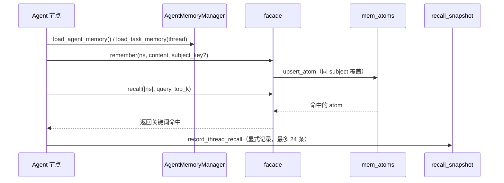

# 第 1 章　会话短期记忆与长期记忆

> 状态：✅ 代码已落地；`tests/chapters/test_ch04_01_memory.py` 8 项通过（实测输出见文末）；源码核对 ✅ 本章声明行为已与 EvoFlow 逐段对照。

## 目标与范围

把「本轮上下文里能看见」和「下一轮还能查到」分开：

- 短期记忆练习：`AgentMemoryManager.add_to_task_history()` 把当前 thread 的 user / assistant 文本写入 task JSON；切换 thread 后不共享这份历史。
- 长期记忆练习：调用方挑出稳定事实，经 `facade.remember()` 写进 SQLite atom；namespace 跨 thread 复用，因此可在后续 thread 召回。agent 级 `memory.json` 是同目录保留的另一种文件接口。
- 写入必须经过门面 `remember/forget/recall`，不允许调用方直接拼 SQL。

本章只做「写入 + 关键词召回 + 软删 + 快照」，不做向量召回；第 2 章只提供显式确定性巩固，不做异步队列。

## 先跑一个完整的小闭环

这一段先把输入、写入、跨线程读取串起来。练习中把用户原话追加到当前 thread 的短期历史；再由程序显式挑出一条稳定偏好，调用 `facade.remember()` 写进长期 atom。切到新 thread 后，短期历史为空，但同一用户命名空间里的偏好仍能关键词召回；最后把召回结果记成快照并格式化成 `<memory>` 块。

```bash
cd /Users/main/my-agent-flow/backend
uv run pytest tests/chapters/test_ch04_01_memory.py::test_short_and_long_memory_call_flow -q
```

练习的完整调用代码在 `backend/tests/chapters/test_ch04_01_memory.py` 的 `test_short_and_long_memory_call_flow`，用上面的 pytest 命令即可运行。它依次调用 `add_to_task_history()` 保存当前 thread 的原始对话、调用 `facade.remember()` 写入调用方明确选出的偏好、切换 thread 后执行 `facade.recall()`，再显式记录 `recall_snapshot` 并格式化记忆块。`remember()` 不会读对话或自动抽取事实；当前仿写也没有把这些步骤接到 Agent 每轮对话，因此这段练习不代表 `/chat` 已自动记忆或自动注入。

## 核心概念

| 概念 | 在本章哪里 | 为什么要它 |
|---|---|---|
| atom（记忆原子） | `memory/store.py: mem_atoms` 一行 | 一条事实要能独立召回、独立删除；整份 JSON 做不到精确遗忘 |
| namespace（命名空间） | `memory/namespaces.py` 四个函数 | 记忆有归属，`user:` 的偏好不能污染 `workspace:` 或 `person:` |
| layer / kind | `store._norm_layer`、`upsert_atom(kind=...)` | layer 决定「事件流水 / 语义事实 / 操作步骤」；kind 决定注入时的类别 |
| subject_key | `upsert_atom(subject_key=...)` | 同一主题只留一个有效值，避免「用户偏好中文」写十遍 |
| revision | `upsert_atom` 命中同 subject 时 +1 | 区分「同一事实的新版本」，不是新插入一行 |
| 软删 / supersede | `soft_delete_atom`、`supersede_atom` | 删掉召回资格，但保留原行供审计和回溯 |
| recall snapshot | `memory/recall_snapshot.py` | 同一轮 prompt 不能边生成边改召回；快照给 UI/审计一个稳定副本 |

一条 atom 的最小字段是：`id`、`namespace_id`、`layer`、`kind`、`content`、`importance`、`confidence`、`vitality`、`subject_key`、`revision`、`pin`、时间戳、`deleted_at`。`evidence` 和 `tags` 是可选证据，不参与本章召回打分。

## 调用逻辑



关键边界：

- `AgentMemoryManager` 只读写 JSON 文件，fail-soft；记忆文件坏了返回空结构，不抛异常。
- `facade.remember` 会丢低置信度噪声：`conf < 0.55` 且非 pin、无 subject、来源不在 `user/manual/migrate`。
- `facade.recall` 只做关键词召回 + 字符预算；`query_embedding` 参数保留但当前不参与。
- `forget` 只软删，`get_atom` 查不到已删行；原始行仍在库里，可审计。

## 文件地图

| 文件（完整路径） | 行数 | 职责 |
|---|---|---|
| `/Users/main/my-agent-flow/backend/packages/harness/myagentflow/timeutil.py` | 32 | 北京时间/UTC ISO 字符串 |
| `/Users/main/my-agent-flow/backend/packages/harness/myagentflow/config/paths.py` | 85 | 数据根与 agent/thread 路径 |
| `/Users/main/my-agent-flow/backend/packages/harness/myagentflow/agents/memory/agent_memory.py` | 153 | agent 级 / task 级 JSON 记忆 |
| `/Users/main/my-agent-flow/backend/packages/harness/myagentflow/memory/namespaces.py` | 59 | 四类命名空间 |
| `/Users/main/my-agent-flow/backend/packages/harness/myagentflow/memory/store.py` | 497 | SQLite 原子表 |
| `/Users/main/my-agent-flow/backend/packages/harness/myagentflow/memory/facade.py` | 258 | 写入门面 |
| `/Users/main/my-agent-flow/backend/packages/harness/myagentflow/memory/recall_snapshot.py` | 111 | 按 thread 的召回快照 |

## 实现步骤

### 1. 先定路径，不散落常量

`Paths` 只认一个 `base_dir`：`$MYAF_DATA_DIR` 优先，否则 `~/.myagentflow`。测试换目录只需改环境变量 + `reset_paths_cache()`。

```python
"""一、文件说明
    数据目录解析：记忆、线程、Agent 文件都从这里取路径。
    为什么集中：路径散落在各模块里，测试要改目录就得 monkeypatch 一堆常量；
    这里只留一个 base_dir 入口，测试改环境变量即可。

二、目录结构
    packages/harness/myagentflow/config/
    ├── __init__.py
    ├── paths.py  ← 本文件
    ├── app_config.py
    └── ...

三、关键方法
    Paths               所有数据路径的根；base_dir 默认 $MYAF_DATA_DIR 或 ~/.myagentflow。
    get_paths()         进程内单例，避免每轮重复解析。
    reset_paths_cache() 测试换目录后清缓存。
"""

from __future__ import annotations

import os
import re
import threading
from pathlib import Path

_SAFE_THREAD_ID_RE = re.compile(r"^[A-Za-z0-9._-]{1,128}$")


class Paths:
    """所有数据路径的根；base_dir 默认 $MYAF_DATA_DIR 或 ~/.myagentflow。"""

    def __init__(self, base_dir: str | Path | None = None) -> None:
        self._base_dir = Path(
            base_dir
            or os.environ.get("MYAF_DATA_DIR")
            or (Path.home() / ".myagentflow")
        )

    @property
    def base_dir(self) -> Path:
        return self._base_dir

    @property
    def memory_file(self) -> Path:
        """全局记忆文件：{base_dir}/memory.json。"""
        return self.base_dir / "memory.json"

    @property
    def agents_dir(self) -> Path:
        return self.base_dir / "agents"

    def agent_dir(self, name: str) -> Path:
        """单个 Agent 目录：{base_dir}/agents/{name}/（名字统一小写）。"""
        return self.agents_dir / name.lower()

    def agent_memory_file(self, name: str) -> Path:
        """Agent 记忆文件：{base_dir}/agents/{name}/memory.json。"""
        return self.agent_dir(name) / "memory.json"

    def thread_dir(self, thread_id: str) -> Path:
        """线程目录：{base_dir}/threads/{thread_id}/；id 做安全校验。"""
        tid = str(thread_id or "").strip()
        if not _SAFE_THREAD_ID_RE.match(tid):
            raise ValueError(f"Invalid thread_id {thread_id!r}")
        return self.base_dir / "threads" / tid


_paths_lock = threading.Lock()
_paths_instance: Paths | None = None


def get_paths() -> Paths:
    """进程内单例，避免每轮重复解析。"""
    global _paths_instance
    with _paths_lock:
        if _paths_instance is None:
            _paths_instance = Paths()
        return _paths_instance


def reset_paths_cache() -> None:
    """测试换目录后清缓存。"""
    global _paths_instance
    with _paths_lock:
        _paths_instance = None
```

### 2. agent 记忆与 task 记忆分文件

agent 文件跨任务，task 文件随 thread。两者结构不同：`facts + context` 与 `conversation_history + task_context`。

```python
class AgentMemoryManager:
    """读写 agent/task 两层记忆文件。

    - Agent 记忆：{base_dir}/agents/{agent_name}/memory.json，跨任务、跨会话；
    - Task 记忆：{base_dir}/threads/{thread_id}/agent_memory/{agent_name}.json，随线程删除。
    """

    def __init__(self, agent_name: str | None = None):
        self.agent_name = agent_name
        self.paths = get_paths()

    def get_agent_memory_path(self) -> Path:
        """取 agent 记忆路径；没有 agent_name 时退回全局 memory.json。"""
        if self.agent_name:
            return self.paths.agent_memory_file(self.agent_name)
        return self.paths.memory_file

    def get_task_memory_path(self, thread_id: str) -> Path:
        """取 task 记忆路径；没有 agent_name 时文件名用 global.json。"""
        return (
            self.paths.thread_dir(thread_id)
            / "agent_memory"
            / f"{self.agent_name or 'global'}.json"
        )

    def load_agent_memory(self) -> dict[str, Any]:
        """读 agent 记忆；文件不存在/坏 JSON 都返回空结构。"""
        memory_path = self.get_agent_memory_path()
        if not memory_path.exists():
            return {"facts": [], "context": {}}
        try:
            with open(memory_path, encoding="utf-8") as f:
                return json.load(f)
        except (OSError, json.JSONDecodeError) as e:
            logger.error("Failed to load agent memory: %s", e)
            return {"facts": [], "context": {}}

    def save_agent_memory(self, memory: dict[str, Any]) -> None:
        """写 agent 记忆；写失败只记日志，不抛异常打断对话。"""
        memory_path = self.get_agent_memory_path()
        memory_path.parent.mkdir(parents=True, exist_ok=True)
        try:
            with open(memory_path, "w", encoding="utf-8") as f:
                json.dump(memory, f, indent=2, ensure_ascii=False)
            logger.debug("Saved agent memory to %s", memory_path)
        except OSError as e:
            logger.error("Failed to save agent memory: %s", e)

    def load_task_memory(self, thread_id: str) -> dict[str, Any]:
        """读 task 记忆；结构固定为 conversation_history + task_context。"""
        memory_path = self.get_task_memory_path(thread_id)
        if not memory_path.exists():
            return {"conversation_history": [], "task_context": {}}
        try:
            with open(memory_path, encoding="utf-8") as f:
                return json.load(f)
        except (OSError, json.JSONDecodeError) as e:
            logger.error("Failed to load task memory: %s", e)
            return {"conversation_history": [], "task_context": {}}

    def save_task_memory(self, thread_id: str, memory: dict[str, Any]) -> None:
        """写 task 记忆；失败只记日志。"""
        memory_path = self.get_task_memory_path(thread_id)
        memory_path.parent.mkdir(parents=True, exist_ok=True)
        try:
            with open(memory_path, "w", encoding="utf-8") as f:
                json.dump(memory, f, indent=2, ensure_ascii=False)
        except OSError as e:
            logger.error("Failed to save task memory: %s", e)

    def get_combined_memory(self, thread_id: str | None = None) -> dict[str, Any]:
        """合并两层：agent_memory 一定返回，task_memory 按 thread_id 可选。"""
        result = {"agent_memory": self.load_agent_memory()}
        if thread_id:
            result["task_memory"] = self.load_task_memory(thread_id)
        return result

    def clear_task_memory(self, thread_id: str) -> None:
        """删 task 记忆文件；线程删除时调用。"""
        memory_path = self.get_task_memory_path(thread_id)
        if memory_path.exists():
            try:
                memory_path.unlink()
                logger.debug("Cleared task memory for thread %s", thread_id)
            except OSError as e:
                logger.error("Failed to clear task memory: %s", e)

    def add_fact_to_agent_memory(self, fact: str, confidence: float = 1.0) -> None:
        """追加一条事实；同文本已存在则不重复写。"""
        memory = self.load_agent_memory()
        facts = memory.get("facts", [])
        if any(f.get("text") == fact for f in facts):
            logger.debug("Fact already exists: %s", fact)
            return
        path = self.get_agent_memory_path()
        facts.append(
            {
                "text": fact,
                "confidence": confidence,
                "created_at": path.stat().st_mtime if path.exists() else 0,
            }
        )
        memory["facts"] = facts
        self.save_agent_memory(memory)

    def add_to_task_history(self, thread_id: str, role: str, content: str) -> None:
        """追加一条 task 对话历史。"""
        memory = self.load_task_memory(thread_id)
        history = memory.get("conversation_history", [])
        history.append({"role": role, "content": content})
        memory["conversation_history"] = history
        self.save_task_memory(thread_id, memory)


# 进程内缓存：同一 agent_name 复用同一个管理器
_agent_memory_managers: dict[str | None, AgentMemoryManager] = {}


def get_agent_memory_manager(agent_name: str | None = None) -> AgentMemoryManager:
    """取/建 agent 记忆管理器；按 agent_name 缓存。"""
    if agent_name not in _agent_memory_managers:
        _agent_memory_managers[agent_name] = AgentMemoryManager(agent_name)
    return _agent_memory_managers[agent_name]
```

### 3. 命名空间只有四类

`user / agent / workspace / person`。没有 `session` 这一层；session 级信息走消息表和 task 记忆，不塞进长期命名空间。

```python
"""一、文件说明
    记忆命名空间 id：user / agent / workspace / person。
    为什么要有命名空间：记忆进入 prompt 前必须知道「属于谁」，否则 A 用户的偏好
    会污染 B 用户；解析函数同时负责把非法/空 id 归一。

二、目录结构
    packages/harness/myagentflow/memory/
    ├── __init__.py
    ├── namespaces.py  ← 本文件
    ├── consolidate.py 确定性巩固
    ├── store.py       原子表读写
    ├── facade.py      remember / recall / forget
    └── recall_snapshot.py

三、关键方法
    user_ns()       用户命名空间，空值归 default。
    agent_ns()      Agent 命名空间，空值退回 user:default。
    workspace_ns()  工作区命名空间，空值抛 ValueError。
    person_ns()     人格命名空间，空值抛 ValueError。
    parse_namespace() 把 "kind:owner" 拆成 (kind, owner)。
"""

from __future__ import annotations


def user_ns(user_id: str = "default") -> str:
    return f"user:{(user_id or 'default').strip() or 'default'}"


def agent_ns(agent_code: str | None) -> str:
    code = (agent_code or "").strip()
    if not code:
        return user_ns("default")
    return f"agent:{code}"


def workspace_ns(workspace_key: str) -> str:
    key = (workspace_key or "").strip()
    if not key:
        raise ValueError("workspace_key required")
    # Accept raw path hash keys like ws-xxx or full workspace id.
    if key.startswith("workspace:"):
        return key
    return f"workspace:{key}"


def person_ns(agent_code: str) -> str:
    code = (agent_code or "").strip().lower()
    if not code:
        raise ValueError("agent_code required")
    return f"person:{code}"


def parse_namespace(ns_id: str) -> tuple[str, str]:
    raw = (ns_id or "").strip()
    if ":" not in raw:
        return "user", raw or "default"
    kind, _, owner = raw.partition(":")
    return kind.strip(), owner.strip()
```

### 4. 原子表：一条记忆一行

表结构 `mem_namespaces` + `mem_atoms`。`subject_key` 相同则更新原行并升 `revision`，这是第 2 章「同主题替换」的基础，不另建图数据库。

```python
def ensure_namespace(
    ns_id: str,
    *,
    title: str = "",
    org_id: str | None = None,
    owner_scope_id: str | None = None,
    created_by: str | None = None,
) -> str:
    """建/更新命名空间，返回规范 id；后三个参数只为签名兼容，当前不落库。"""
    del org_id, owner_scope_id, created_by
    kind, owner = parse_namespace(ns_id)
    nid = f"{kind}:{owner}" if kind and owner else ns_id
    now = utc_now_iso_z()
    with _db() as conn:
        row = conn.execute(
            "SELECT id FROM mem_namespaces WHERE id=?", (nid,)
        ).fetchone()
        if row:
            conn.execute(
                "UPDATE mem_namespaces SET updated_at=?, title=CASE WHEN ?!='' THEN ? ELSE title END WHERE id=?",
                (now, title, title, nid),
            )
            return nid
        conn.execute(
            "INSERT INTO mem_namespaces(id, kind, owner_ref, title, created_at, updated_at) VALUES (?,?,?,?,?,?)",
            (nid, kind or "user", owner or "default", title or nid, now, now),
        )
    return nid
```

```python
def upsert_atom(
    *,
    namespace_id: str,
    content: str,
    layer: str = "semantic",
    kind: str = "fact",
    summary: str = "",
    importance: float = 0.5,
    confidence: float = 0.7,
    vitality: float = 1.0,
    subject_key: str = "",
    evidence: dict[str, Any] | None = None,
    tags: list[Any] | None = None,
    source: str = "",
    pin: bool = False,
    atom_id: str | None = None,
    embedding: list[float] | None = None,
    replace_subject: bool = True,
) -> str | None:
    """写一条记忆；subject_key 相同则替换旧值，避免同一事实堆多份。"""
    del embedding  # 向量召回尚未实现；字段保留只为签名兼容
    text = " ".join(str(content or "").strip().split())
    if not text:
        return None
    ns = ensure_namespace(namespace_id)
    now = utc_now_iso_z()
    layer_n = _norm_layer(layer)
    sk = (subject_key or "").strip()
    aid = (atom_id or "").strip() or str(uuid.uuid4())

    with _db() as conn:
        if replace_subject and sk:
            existing = conn.execute(
                """
                SELECT id, revision FROM mem_atoms
                WHERE namespace_id=? AND subject_key=? AND deleted_at IS NULL
                ORDER BY updated_at DESC LIMIT 1
                """,
                (ns, sk),
            ).fetchone()
            if existing:
                aid = existing["id"]
                rev = int(existing["revision"] or 1) + 1
                conn.execute(
                    """
                    UPDATE mem_atoms SET
                      layer=?, kind=?, content=?, summary=?, importance=?, confidence=?,
                      vitality=?, evidence_json=?, tags_json=?, source=?, revision=?,
                      pin=?, updated_at=?
                    WHERE id=?
                    """,
                    (
                        layer_n,
                        kind or "fact",
                        text,
                        summary or "",
                        clamp01(importance, 0.5),
                        clamp01(confidence, 0.7),
                        clamp01(vitality, 1.0),
                        _dumps(evidence or {}),
                        _dumps(tags or []),
                        source or "",
                        rev,
                        1 if pin else 0,
                        now,
                        aid,
                    ),
                )
                return aid

        conn.execute(
            """
            INSERT INTO mem_atoms(
              id, namespace_id, layer, kind, content, summary, importance, confidence,
              vitality, subject_key, evidence_json, tags_json, source, revision, pin,
              created_at, updated_at
            ) VALUES (?,?,?,?,?,?,?,?,?,?,?,?,?,?,?,?,?)
            """,
            (
                aid,
                ns,
                layer_n,
                kind or "fact",
                text,
                summary or "",
                clamp01(importance, 0.5),
                clamp01(confidence, 0.7),
                clamp01(vitality, 1.0),
                sk,
                _dumps(evidence or {}),
                _dumps(tags or []),
                source or "",
                1,
                1 if pin else 0,
                now,
                now,
            ),
        )
    return aid
```

召回先按关键词命中数，再按 `importance + pin` 排序；这是有意简化，没有 FTS5，也没有向量。

```python
def search_keyword_ns(
    namespace_ids: list[str],
    query: str,
    *,
    top_k: int = 20,
    layers: list[str] | None = None,
) -> list[dict[str, Any]]:
    """关键词召回：按命中词长度加权，再按重要性/新鲜度排序。"""
    q = (query or "").strip()
    if not q or not namespace_ids:
        return []
    terms = _keyword_search_terms(q)
    ns_list = [ensure_namespace(n) for n in namespace_ids]
    scored: list[tuple[float, dict[str, Any]]] = []
    for ns in ns_list:
        for atom in list_namespace_atoms(ns, layers=layers, limit=2000):
            text = f"{atom.get('summary') or ''}\n{atom.get('content') or ''}".lower()
            score = 0.0
            for term in terms:
                if term.lower() in text:
                    score += max(1, len(term))
            if score <= 0:
                continue
            score += float(atom.get("importance") or 0) * 2
            if atom.get("pin"):
                score += 5
            scored.append((score, atom))
    scored.sort(key=lambda kv: (kv[0], kv[1].get("updated_at") or ""), reverse=True)
    out: list[dict[str, Any]] = []
    for score, atom in scored[: max(1, int(top_k))]:
        atom = dict(atom)
        atom["score"] = score
        out.append(atom)
    return out
```

### 5. 门面负责规则，调用方不碰 SQL

```python
def remember(
    namespace: str,
    content: str,
    *,
    layer: str = "semantic",
    kind: str = "fact",
    summary: str = "",
    importance: float | None = None,
    confidence: float | None = None,
    vitality: float = 1.0,
    subject_key: str = "",
    evidence: dict[str, Any] | None = None,
    tags: list[Any] | None = None,
    source: str = "",
    pin: bool = False,
    atom_id: str | None = None,
    embedding: list[float] | None = None,
) -> str | None:
    """写一条记忆；返回 atom id，低置信度噪声返回 None。"""
    conf = mem_store.clamp01(confidence if confidence is not None else 0.7, 0.7)
    # 低置信度、非 pin、无 subject、非用户/手工来源 → 视为噪声
    if (
        conf < 0.55
        and not pin
        and not subject_key
        and source not in {"user", "manual", "migrate"}
    ):
        return None
    imp = mem_store.clamp01(importance if importance is not None else conf, 0.5)
    return mem_store.upsert_atom(
        namespace_id=namespace,
        content=content,
        layer=layer,
        kind=kind,
        summary=summary,
        importance=imp,
        confidence=conf,
        vitality=vitality,
        subject_key=subject_key,
        evidence=evidence,
        tags=tags,
        source=source,
        pin=pin,
        atom_id=atom_id,
        embedding=embedding,
    )
```

```python
def recall(
    namespaces: list[str],
    query: str,
    *,
    layers: list[str] | None = None,
    top_k: int = 8,
    max_chars: int = 1000,
    query_embedding: list[float] | None = None,
) -> list[dict[str, Any]]:
    """关键词召回；向量参数保留但当前不参与。"""
    del query_embedding
    ns = [n for n in namespaces if n]
    q = (query or "").strip()
    if not ns:
        return []
    if not q:
        hits: list[dict[str, Any]] = []
        for n in ns:
            hits.extend(mem_store.list_namespace_atoms(n, layers=layers, limit=top_k))
        hits.sort(
            key=lambda a: (float(a.get("importance") or 0), a.get("updated_at") or ""),
            reverse=True,
        )
        return _budget(hits[:top_k], max_chars)

    kw = mem_store.search_keyword_ns(ns, q, top_k=max(top_k * 3, 12), layers=layers)
    mem_store.touch_accessed([a["id"] for a in kw if a.get("id")])
    return _budget(_filter_archived(kw, q)[:top_k], max_chars)
```

```python
def forget(atom_id: str, *, mode: str = "soft") -> bool:
    """删一条；当前只有 soft，mode 参数为签名兼容。"""
    del mode
    return mem_store.soft_delete_atom(atom_id)
```

```python
def get_core(
    namespaces: list[str],
    *,
    max_chars: int = 1200,
    min_confidence: float = 0.0,
) -> list[dict[str, Any]]:
    """pin + 偏好/行为 + 短背景，供 standing 注入。"""
    prefer_kinds = {"preference", "behavior"}
    context_kinds = {"context"}
    picked: list[dict[str, Any]] = []
    seen: set[str] = set()
    for ns in namespaces:
        if not ns:
            continue
        for atom in mem_store.list_namespace_atoms(ns, pinned_only=True, limit=40):
            if atom["id"] in seen:
                continue
            if float(atom.get("confidence") or 0) < min_confidence:
                continue
            kind = str(atom.get("kind") or "")
            if kind.startswith("section:") or kind == "knowledge":
                continue
            seen.add(atom["id"])
            picked.append(atom)
        for atom in mem_store.list_namespace_atoms(
            ns, layers=["semantic", "procedural"], limit=60
        ):
            if atom["id"] in seen:
                continue
            if float(atom.get("confidence") or 0) < max(min_confidence, 0.7):
                continue
            kind = str(atom.get("kind") or "").strip().lower()
            if kind in prefer_kinds:
                pass
            elif kind in context_kinds:
                text = str(atom.get("content") or "")
                if len(text) > 180 or float(atom.get("importance") or 0) < 0.75:
                    continue
            else:
                continue
            if float(atom.get("importance") or 0) < 0.65 and not atom.get("pin"):
                continue
            seen.add(atom["id"])
            picked.append(atom)
    out: list[dict[str, Any]] = []
    used = 0
    for atom in picked:
        text = (atom.get("summary") or atom.get("content") or "").strip()
        if not text:
            continue
        if used + len(text) > max_chars and out:
            break
        out.append(atom)
        used += len(text) + 1
    return out
```

### 6. 快照冻结本轮召回

同一轮里 prompt 不能因为再次检索而抖动，所以召回结果写进进程内快照，供 UI 和审计回看。

```python
def record_thread_recall(
    thread_id: str,
    *,
    query: str = "",
    standing_preview: str = "",
    hits: list[dict[str, Any]] | None = None,
    source: str = "turn",
) -> None:
    """写快照；空 thread_id 直接忽略。"""
    tid = (thread_id or "").strip()
    if not tid:
        return
    compact: list[dict[str, Any]] = []
    for h in hits or []:
        if not isinstance(h, dict):
            continue
        text = str(h.get("summary") or h.get("content") or "").strip()
        if not text:
            continue
        compact.append(
            {
                "id": str(h.get("id") or ""),
                "namespace_id": str(h.get("namespace_id") or ""),
                "layer": str(h.get("layer") or ""),
                "kind": str(h.get("kind") or ""),
                "content": text[:240],
                "pin": bool(h.get("pin")),
                "source_channel": str(h.get("source_channel") or ""),
            }
        )
        if len(compact) >= 24:
            break
    with _lock:
        _by_thread[tid] = {
            "thread_id": tid,
            "query": (query or "")[:500],
            "standing_preview": (standing_preview or "").strip()[:800],
            "hits": compact,
            "hit_count": len(compact),
            "source": source,
            "updated_at": utc_now_iso_z(),
        }
        _trim()
```

```python
def get_thread_recall(thread_id: str) -> dict[str, Any] | None:
    """取快照副本；没有返回 None。"""
    tid = (thread_id or "").strip()
    if not tid:
        return None
    with _lock:
        snap = _by_thread.get(tid)
        return dict(snap) if snap else None
```

## 测试与实测输出

```bash
cd /Users/main/my-agent-flow/backend
uv run pytest tests/chapters/test_ch04_01_memory.py -q
```

```text
........                                                                 [100%]
8 passed, 13 warnings in 0.05s
```

覆盖点：路径推导、agent/task 记忆互不覆盖、短期写入到新 thread 长期召回的完整调用闭环、同名管理器复用、命名空间解析、同 subject 覆盖并升 revision、噪声过滤与软删、`get_core` 注入块、快照 24 条 / 240 字裁剪与副本语义。

## 与 EvoFlow 对照（文件级）

| EvoFlow 上游文件（行数） | 本项目文件（行数） | 本章保留的符号与范围 | 未复刻 |
|---|---|---|---|
| `/Users/main/EvoFlow/backend/packages/harness/evoflow/memory/namespaces.py`（39） | `/Users/main/my-agent-flow/backend/packages/harness/myagentflow/memory/namespaces.py`（59） | `user_ns` / `agent_ns` / `workspace_ns` / `person_ns` / `parse_namespace`；四类域与空值归一一致 | 无 |
| `/Users/main/EvoFlow/backend/packages/harness/evoflow/agents/memory/agent_memory.py`（214） | `/Users/main/my-agent-flow/backend/packages/harness/myagentflow/agents/memory/agent_memory.py`（153） | `AgentMemoryManager`、agent/task 双文件、`get_combined_memory`、`add_fact_to_agent_memory`、`add_to_task_history` | 上游 logger 细节；本地异常文案更短 |
| `/Users/main/EvoFlow/backend/packages/harness/evoflow/memory/store.py`（747） | `/Users/main/my-agent-flow/backend/packages/harness/myagentflow/memory/store.py`（497） | `ensure_namespace`、`upsert_atom`、`soft_delete_atom`、`supersede_atom`、`update_atom_fields`、`list_namespace_atoms`、`search_keyword_ns`、`touch_accessed`、`count_active_atoms`、`set_pin` | 向量列与 `search_vector_ns`、FTS5 外部表、`mem_atom_entities`、`mark_atom_stale`、迁移标记 |
| `/Users/main/EvoFlow/backend/packages/harness/evoflow/memory/facade.py`（375） | `/Users/main/my-agent-flow/backend/packages/harness/myagentflow/memory/facade.py`（258） | `remember` / `forget` / `consolidate` / `recall` / `get_core` / `format_atoms_block`；噪声门与预算裁剪 | `pin_atom`、`mark_atom_stale`、`mark_related_memories_stale`、`list_atoms`、`_maybe_enqueue_threshold`、向量 RRF、embedding 召回 |
| `/Users/main/EvoFlow/backend/packages/harness/evoflow/memory/recall_snapshot.py`（90） | `/Users/main/my-agent-flow/backend/packages/harness/myagentflow/memory/recall_snapshot.py`（111） | `record_thread_recall` / `get_thread_recall` / `clear_thread_recall`；24 条、500 线程、副本语义 | 无 |

### 与 EvoFlow 的行为差异

| 方面 | 本地实现 | EvoFlow 上游 |
|---|---|---|
| 召回算法 | 纯关键词：命中词数 + `importance` + pin，按 `top_k` 取 | 关键词 + 向量 + RRF 融合；有 embedding 时走混合召回 |
| 向量字段 | `embedding` 参数保留但不落库，`query_embedding` 直接丢弃 | `mem_atoms.embedding` / `embedding_dim` 落库，`search_vector_ns` 可查 |
| 自动巩固 | `remember` 只写入，不触发任何入队 | `remember` 命中阈值后 `_maybe_enqueue_threshold` 派发 `mem_consolidate` job |
| 归档下限 | 固定 `0.15` | `memory_config.consolidate.archive_vitality` |
| stale 标记 | 不实现 | `mark_atom_stale` / `mark_related_memories_stale`，任务或事项关闭时让旧记忆失效 |
| 全文索引 | 普通 SQL `LIKE`/关键词匹配 | FTS5 外部表 `mem_atoms_fts`，写入时同步索引 |

### 源码核对记录（路径与符号实测）

- `memory/namespaces.py`（39 行）：`user_ns`、`agent_ns`、`workspace_ns`、`person_ns`、`parse_namespace`；四类前缀与空值行为逐函数读过。
- `agents/memory/agent_memory.py`（214 行）：`AgentMemoryManager` 及 12 个方法；agent 文件与 task 文件路径、坏 JSON fail-soft、同名管理器缓存均核对。
- `memory/store.py`（747 行）：`ensure_namespace`、`upsert_atom`、`soft_delete_atom`、`supersede_atom`、`update_atom_fields`、`count_active_atoms`、`list_namespace_atoms`、`search_keyword_ns`、`touch_accessed`、`set_pin`；重点读同 subject 复用 `revision`、软删、排序与预算。
- `memory/facade.py`（375 行）：`remember`、`recall`、`get_core`、`_filter_archived`、`_budget`、`format_atoms_block`；核对噪声阈值 `0.55`、归档下限、关键词+向量分支。
- `memory/recall_snapshot.py`（90 行）：`record_thread_recall`、`get_thread_recall`、`clear_thread_recall`、`_trim`、`reset_for_tests`；24 条/500 线程/副本语义逐项一致。

本地对应文件：`memory/namespaces.py`（59）、`agents/memory/agent_memory.py`（153）、`memory/store.py`（497）、`memory/facade.py`（258）、`memory/recall_snapshot.py`（111）。本章声明的写入、召回、软删、快照行为已核；向量、stale、自动入队明确未复刻。

## 本章不做什么

- 不做向量召回：`embedding` / `query_embedding` 只保留签名。
- 不做异步巩固队列：`facade.consolidate(async_job=True)` 返回 `{"ok": False, "error": "async_job not implemented"}`。
- 不做记忆编辑 UI：只提供函数级 API。
- 不做跨进程快照持久化：快照是进程内字典，重启即空。

## 验收清单

- [x] 跨 thread 可读 agent 记忆。
- [x] task 历史只属于当前 thread；显式写入的长期 atom 可在新 thread 召回。
- [x] 同 `subject_key` 不堆重复事实。
- [x] 低置信度噪声不落库。
- [x] `forget` 后召回不再返回。
- [x] 快照有上限且返回副本。
