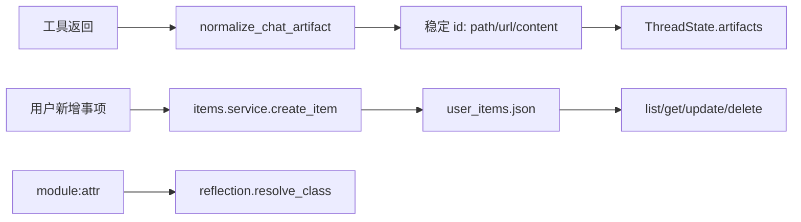

# 第 3 章　资产、产物、事项与反思

> 状态：✅ 代码已落地；`tests/chapters/test_ch04_03_assets.py` 5 项通过；源码核对 ✅ 本章声明行为已与 EvoFlow 逐段对照。

## 目标与范围

把「对话里产生的东西」分成三类，各有自己的存储：

| 类型 | 例子 | 存储 |
|---|---|---|
| 产物 artifact | 生成的图片、PDF、网页、链接 | 会话产物契约（归一化为 dict） |
| 事项 item | 待办、跟进、个人任务 | `user_items.json` |
| 反思 resolver | 配置里的 `module:attr` 延迟加载 | 运行时 import |

本章只做契约与 CRUD，不做派发 Task、不做反思生成、不做资产中心 UI。

## 核心概念

| 概念 | 在本章哪里 | 为什么要它 |
|---|---|---|
| 产物 artifact | `artifacts/chat_artifact.py` | 工具返回结构不统一，前端只认一种契约；产物是「可展示的结果」，不是任务 |
| 稳定 id | `make_artifact_id` | 同一路径/URL 重复出现必须得到同一 id，否则前端每次刷新多一张卡片 |
| 位置三选一 | `path` / `url` / `content` | 本地文件、外链、内联 HTML/文本各有载体；至少有一个才算有效产物，不能全空 |
| `ThreadState.artifacts` | `artifact_state_key` | 图状态仍用字符串键：path 优先、其次 url、最后 id；不是直接存整个 dict 作为键 |
| 事项 item | `items/models.py: UserItem` | 个人待办/跟进，可关联 Task 但不是 Task；`linked_task_ids` 只是引用，不触发调度 |
| 事项存储 | `items/store.py` | `user_items.json` 原子替换 + mtime 失效；跨进程改写后不能读旧缓存 |
| 反射 resolver | `reflection/resolvers.py` | 配置里写 `module:attr`，运行时才 import；避免启动时加载全部可选依赖 |
| 可见性 | `items/service.py: list_items` | 上游按 principal / scope 过滤；本项目没有 principal 体系，参数保留但不做假过滤 |

产物、事项、任务、反思的边界：

- **产物**：一次工具/模型产出的文件、链接、HTML，随会话展示。
- **事项**：用户自己维护的待办，状态是 todo / in_progress / waiting / done / parked。
- **任务**：可执行、可派发、可回写的调度单元；事项只能通过 `linked_task_ids` 关联。
- **反思**：不是数据表，而是「按配置解析类/对象」的加载机制，本章不生成反思内容。

## 调用逻辑



## 文件地图

| 文件（完整路径） | 行数 | 职责 |
|---|---|---|
| `/Users/main/my-agent-flow/backend/packages/harness/myagentflow/artifacts/chat_artifact.py` | 201 | 产物归一化与稳定 id |
| `/Users/main/my-agent-flow/backend/packages/harness/myagentflow/items/models.py` | 99 | `UserItem` 模型 |
| `/Users/main/my-agent-flow/backend/packages/harness/myagentflow/items/store.py` | 157 | JSON 原子写 + mtime 缓存失效 |
| `/Users/main/my-agent-flow/backend/packages/harness/myagentflow/items/service.py` | 271 | 事项 CRUD |
| `/Users/main/my-agent-flow/backend/packages/harness/myagentflow/reflection/resolvers.py` | 89 | `module:attr` 反射解析 |
| `/Users/main/my-agent-flow/backend/packages/harness/myagentflow/admin/errors.py` | 31 | `NotFoundError` / `ValidationError` |

## 实现步骤

### 1. 产物 id 必须稳定

同一路径、同一 URL 重复出现不能生成两个 id；否则前端每次刷新都多一张卡片。

```python
def make_artifact_id(
    *, type_: str, path: str = "", url: str = "", content: str = "", name: str = ""
) -> str:
    """稳定 id：同路径、同 URL 必得同一 id，用于追加/更新而不是重复。"""
    if path:
        key = f"path:{path.replace(chr(92), '/')}"
    elif url:
        key = f"url:{url}"
    elif content:
        digest = hashlib.sha256(content.encode("utf-8", errors="ignore")).hexdigest()[
            :24
        ]
        key = f"content:{type_}:{name or 'untitled'}:{digest}"
    else:
        key = f"empty:{type_}:{name or 'untitled'}"
    if len(key) <= _ID_MAX:
        return key
    digest = hashlib.sha256(key.encode("utf-8")).hexdigest()[:40]
    return f"h:{digest}"
```

### 2. 单条归一化：非法输入返回 None

```python
def normalize_chat_artifact(raw: Any) -> dict[str, Any] | None:
    """单条归一化；字符串按 http(s) 当 URL，否则当本地文件。"""
    if raw is None:
        return None
    if isinstance(raw, str):
        s = raw.strip()
        if not s:
            return None
        if re.match(r"^https?://", s, re.IGNORECASE):
            return normalize_chat_artifact({"type": "url", "url": s})
        return normalize_chat_artifact({"type": "file", "path": s})
    if not isinstance(raw, dict):
        return None

    path = str(raw.get("path") or "").strip()[:_PATH_MAX]
    url = str(raw.get("url") or raw.get("href") or raw.get("link") or "").strip()[
        :_URL_MAX
    ]
    content = raw.get("content")
    content_s = "" if content is None else str(content)[:_CONTENT_MAX]
    mime = str(raw.get("mime") or raw.get("mime_type") or "").strip()[:120]
    name = str(raw.get("name") or raw.get("filename") or "").strip()[:_NAME_MAX]
    label = str(raw.get("label") or raw.get("title") or "").strip()[:_LABEL_MAX]
    type_ = normalize_artifact_type(
        raw.get("type") or raw.get("kind"), path=path, url=url, mime=mime
    )

    if not path and not url and not content_s:
        return None
    if not name:
        name = _basename(path or url) or (label if label else type_)

    aid = str(raw.get("id") or raw.get("artifact_id") or "").strip()
    if not aid:
        aid = make_artifact_id(
            type_=type_, path=path, url=url, content=content_s, name=name
        )

    size_raw = raw.get("size")
    size: int | None = None
    if size_raw is not None:
        try:
            size = max(0, int(size_raw))
        except (TypeError, ValueError):
            size = None

    out: dict[str, Any] = {"id": aid[:_ID_MAX], "type": type_, "name": name}
    if path:
        out["path"] = path
    if url:
        out["url"] = url
    if content_s and type_ in {"html", "text"}:
        out["content"] = content_s
    if label:
        out["label"] = label
    if mime:
        out["mime"] = mime
    if size is not None:
        out["size"] = size
    status = str(raw.get("status") or "").strip().lower()
    if status in {"new", "updated"}:
        out["status"] = status
    return out
```

### 3. ThreadState 仍存字符串键

```python
def artifact_state_key(item: dict[str, Any]) -> str:
    """ThreadState.artifacts 存字符串键：path 优先，其次 url，最后 id。"""
    path = str(item.get("path") or "").strip()
    if path:
        return path
    url = str(item.get("url") or "").strip()
    if url:
        return url
    return str(item.get("id") or "").strip()
```

### 4. 事项模型：个人事项不是 Task

`UserItem` 可以 0..n 关联 Task，但本身不是可执行任务；`linked_task_ids` 只是关联。

```python
class UserItem(BaseModel):
    """用户个人事项；extra=ignore，旧数据多余字段不炸。"""

    model_config = ConfigDict(extra="ignore")

    id: str = Field(default="", description="事项 ID")
    title: str = Field(default="", description="标题")
    notes: str = Field(default="", description="备注")
    conclusion: str = Field(default="", description="处理结论（完成后如何收口）")
    status: ItemStatus = Field(default=ItemStatus.TODO)
    priority: ItemPriority = Field(default=ItemPriority.NORMAL)
    due_at: str | None = Field(
        default=None, description="截止日期 ISO8601 或 YYYY-MM-DD"
    )
    tags: list[str] = Field(default_factory=list)
    assignee_intent: str | None = Field(
        default=None, description="意向责任人 agent_code（未派发）"
    )
    assignee_label: str | None = Field(default=None, description="意向责任人显示名")
    linked_task_ids: list[str] = Field(
        default_factory=list, description="关联的可执行 Task id"
    )
    progress: int = Field(default=0, ge=0, le=100)
    source: str = Field(default="user", description="user|xiaomi|migrated_inbox|…")
    source_ref: str | None = Field(
        default=None, description="来源引用（如旧 inbox task id）"
    )
    org_id: str | None = Field(default=None, description="组织 id")
    owner_scope_id: str | None = Field(
        default=None, description="归属 scope，如 personal:<pid>"
    )
    created_by: str | None = Field(default=None, description="创建者 principal_id")
    created_at: str = Field(default="")
    updated_at: str = Field(default="")

    def to_public_dict(self) -> dict[str, Any]:
        d = self.model_dump()
        d["status"] = str(self.status)
        d["priority"] = str(self.priority)
        d["status_label"] = STATUS_LABEL_ZH.get(self.status, str(self.status))
        return d
```

### 5. JSON 存储：原子替换 + 跨进程失效

`tmp.replace(path)` 保证不会读到半份 JSON；mtime 变化则丢弃进程缓存。

```python
def upsert_raw_item(item: dict[str, Any]) -> dict[str, Any]:
    """id 已存在则整行替换，否则追加。"""
    with _lock:
        doc = _load_unlocked()
        items = doc.get("items")
        if not isinstance(items, list):
            items = []
            doc["items"] = items
        iid = str(item.get("id") or "").strip()
        if not iid:
            raise ValueError("item id required")
        for i, row in enumerate(items):
            if isinstance(row, dict) and str(row.get("id") or "") == iid:
                items[i] = item
                _save_unlocked(doc)
                return item
        items.append(item)
        _save_unlocked(doc)
        return item
```

```python
def delete_raw_item(item_id: str) -> bool:
    with _lock:
        doc = _load_unlocked()
        items = doc.get("items")
        if not isinstance(items, list):
            return False
        iid = str(item_id or "").strip()
        next_items = [
            r
            for r in items
            if not (isinstance(r, dict) and str(r.get("id") or "") == iid)
        ]
        if len(next_items) == len(items):
            return False
        doc["items"] = next_items
        _save_unlocked(doc)
        return True
```

### 6. 业务层只做白名单更新

```python
def create_item(
    *,
    title: str,
    notes: str = "",
    conclusion: str = "",
    status: str | None = None,
    priority: str | None = None,
    due_at: str | None = None,
    tags: Any = None,
    assignee_intent: str | None = None,
    assignee_label: str | None = None,
    source: str = "user",
    source_ref: str | None = None,
    progress: int | None = None,
    org_id: str | None = None,
    owner_scope_id: str | None = None,
    created_by: str | None = None,
) -> dict[str, Any]:
    title_n = str(title or "").strip()
    if not title_n:
        raise ValidationError("title is required")
    st = str(status or ItemStatus.TODO).strip().lower()
    if st not in ITEM_STATUSES:
        raise ValidationError(f"invalid status: {st}")
    pri = str(priority or ItemPriority.NORMAL).strip().lower()
    if pri not in ITEM_PRIORITIES:
        raise ValidationError(f"invalid priority: {pri}")
    now = _now()
    item = UserItem(
        id=_new_id(),
        title=title_n,
        notes=str(notes or "").strip(),
        conclusion=str(conclusion or "").strip(),
        status=ItemStatus(st),
        priority=ItemPriority(pri),
        due_at=str(due_at or "").strip() or None,
        tags=_normalize_tags(tags),
        assignee_intent=str(assignee_intent or "").strip() or None,
        assignee_label=str(assignee_label or "").strip() or None,
        linked_task_ids=[],
        progress=max(0, min(100, int(progress if progress is not None else 0))),
        source=str(source or "user").strip() or "user",
        source_ref=str(source_ref or "").strip() or None,
        org_id=str(org_id or "").strip() or None,
        owner_scope_id=str(owner_scope_id or "").strip() or None,
        created_by=str(created_by or "").strip() or None,
        created_at=now,
        updated_at=now,
    )
    saved = item_store.upsert_raw_item(item.model_dump())
    return {"ok": True, "item": _parse_item(saved).to_public_dict()}
```

```python
def update_item(item_id: str, patch: dict[str, Any] | None) -> dict[str, Any]:
    """白名单字段更新；status/priority 非法直接拒绝，不做静默降级。"""
    iid = str(item_id or "").strip()
    if not iid:
        raise ValidationError("item_id is required")
    patch = patch if isinstance(patch, dict) else {}
    found: dict[str, Any] | None = None
    for raw in item_store.list_raw_items():
        if isinstance(raw, dict) and str(raw.get("id") or "") == iid:
            found = dict(raw)
            break
    if found is None:
        raise NotFoundError(f"item '{iid}' not found")
    item = _parse_item(found)
    data = item.model_dump()
    for key, value in patch.items():
        if key not in _UPDATABLE:
            continue
        if key == "status":
            st = str(value or "").strip().lower()
            if st not in ITEM_STATUSES:
                raise ValidationError(f"invalid status: {st}")
            data["status"] = st
        elif key == "priority":
            pri = str(value or "").strip().lower()
            if pri not in ITEM_PRIORITIES:
                raise ValidationError(f"invalid priority: {pri}")
            data["priority"] = pri
        elif key == "tags":
            data["tags"] = _normalize_tags(value)
        elif key == "progress":
            try:
                data["progress"] = max(0, min(100, int(value)))
            except (TypeError, ValueError) as exc:
                raise ValidationError("progress must be 0..100") from exc
        elif key == "due_at":
            data["due_at"] = str(value or "").strip() or None
        else:
            data[key] = str(value or "").strip()
    data["updated_at"] = _now()
    saved = item_store.upsert_raw_item(data)
    return {"ok": True, "item": _parse_item(saved).to_public_dict()}
```

```python
def delete_item(item_id: str) -> dict[str, Any]:
    iid = str(item_id or "").strip()
    if not iid:
        raise ValidationError("item_id is required")
    if not item_store.delete_raw_item(iid):
        raise NotFoundError(f"item '{iid}' not found")
    return {"ok": True, "deleted": iid}
```

### 7. 反射解析：延迟 import

```python
def resolve_variable(
    variable_path: str,
    expected_type: type | tuple[type, ...] | None = None,
):
    """解析 "module:attr"；模块不存在/属性不存在都统一抛 ImportError。"""
    try:
        module_path, variable_name = variable_path.rsplit(":", 1)
    except ValueError as err:
        raise ImportError(
            f"{variable_path} doesn't look like a variable path. Example: pkg.module:variable"
        ) from err
    try:
        module = import_module(module_path)
    except ImportError as err:
        module_root = module_path.split(".", 1)[0]
        if (
            isinstance(err, ModuleNotFoundError)
            or getattr(err, "name", None) == module_root
        ):
            raise ImportError(
                f"Could not import module {module_path}. {_build_missing_dependency_hint(module_path, err)}"
            ) from err
        raise ImportError(f"Error importing module {module_path}: {err}") from err
    try:
        variable = getattr(module, variable_name)
    except AttributeError as err:
        raise ImportError(
            f"Module {module_path} does not define {variable_name}"
        ) from err
    if expected_type is not None and not isinstance(variable, expected_type):
        type_name = (
            expected_type.__name__
            if isinstance(expected_type, type)
            else " or ".join(t.__name__ for t in expected_type)
        )
        raise ValueError(
            f"{variable_path} is not an instance of {type_name}, got {type(variable).__name__}"
        )
    return variable
```

```python
def resolve_class(class_path: str, base_class: type | None = None) -> type:
    """解析类；可选校验继承关系。"""
    model_class = resolve_variable(class_path, expected_type=type)
    if not isinstance(model_class, type):
        raise ValueError(f"{class_path} is not a valid class")  # noqa: TRY004
    if base_class is not None and not issubclass(model_class, base_class):
        raise ValueError(f"{class_path} is not a subclass of {base_class.__name__}")
    return model_class
```

## 测试与实测输出

```bash
cd /Users/main/my-agent-flow/backend
uv run pytest tests/chapters/test_ch04_03_assets.py -q
```

```text
.....                                                                    [100%]
5 passed, 13 warnings in 0.12s
```

覆盖点：扩展名推断图片、同路径 id 稳定、批量去重、状态键优先级、事项 CRUD/过滤、非法 status 抛 `ValidationError`、反射解析成功与失败。

## 与 EvoFlow 对照（文件级）

| EvoFlow 上游文件（行数） | 本项目文件（行数） | 本章保留的符号与范围 | 未复刻 |
|---|---|---|---|
| `/Users/main/EvoFlow/backend/packages/harness/evoflow/artifacts/chat_artifact.py`（229） | `/Users/main/my-agent-flow/backend/packages/harness/myagentflow/artifacts/chat_artifact.py`（201） | `normalize_artifact_type`、`_basename`、`make_artifact_id`、`normalize_chat_artifact`、`normalize_chat_artifacts`、`artifact_state_key`；六类产物、稳定 id、批量去重 | `platform` 类型及其 `platformAction` / `platformDomain` / `toolCallId` 分支 |
| `/Users/main/EvoFlow/backend/packages/harness/evoflow/items/models.py`（77） | `/Users/main/my-agent-flow/backend/packages/harness/myagentflow/items/models.py`（99） | `ItemStatus`、`ItemPriority`、`UserItem`、`to_public_dict`；字段名与枚举值一致 | 无 |
| `/Users/main/EvoFlow/backend/packages/harness/evoflow/items/store.py`（146） | `/Users/main/my-agent-flow/backend/packages/harness/myagentflow/items/store.py`（157） | `load_doc`、`save_doc`、`list_raw_items`、`replace_all_items`、`upsert_raw_item`、`delete_raw_item`；JSON 原子替换 + mtime 缓存失效 | 路径改 `MYAF_DATA_DIR`；其余行为一致 |
| `/Users/main/EvoFlow/backend/packages/harness/evoflow/items/service.py`（890） | `/Users/main/my-agent-flow/backend/packages/harness/myagentflow/items/service.py`（271） | `list_items`、`get_item`、`create_item`、`update_item`、`delete_item`；过滤、分页、状态/优先级校验 | `item_visible_to_principal`、可见性过滤、`dispatch_item`、`_link_task`、`_stamp_task_user_item`、`sync_item_from_linked_task`、`_wake_employee_for_item`、`migrate_inbox_tasks`、完成时 `stale_memories_on_close` |
| `/Users/main/EvoFlow/backend/packages/harness/evoflow/reflection/resolvers.py`（102） | `/Users/main/my-agent-flow/backend/packages/harness/myagentflow/reflection/resolvers.py`（89） | `_build_missing_dependency_hint`、`resolve_variable`、`resolve_class`；`module:attr` 解析与基类校验 | 错误文案更短；异常类型与行为一致 |

### 与 EvoFlow 的行为差异

| 方面 | 本地实现 | EvoFlow 上游 |
|---|---|---|
| 产物类型 | `ARTIFACT_TYPES` = file / image / video / url / html / text | 多一个 `platform`；有平台卡片专用字段和 id 规则 |
| 事项可见性 | `list_items` 对 `is_admin` / `personal_scope` / `org_scope` / `principal` / `filter_visibility` 执行 `del`，不过滤 | `filter_visibility=True` 时调用 `owner_scope_visible_to_principal`，按 principal/scope 过滤 |
| 单条事项可见性 | 不实现 | `item_visible_to_principal(item_id, ...)` 逐条判断 |
| 事项完成 | 只把 status 改成 done；不强制 progress=100 | done 时若 `progress < 100` 自动补到 100；并触发 `stale_memories_on_close` |
| 事项更新 | 白名单字段通用循环；字符串字段统一 `strip` | 显式逐字段赋值，`linked_task_ids` 做去重 |
| Task 关联 | `linked_task_ids` 只是字段 | `_link_task` / `_stamp_task_user_item` 双向写 Task 文档；`sync_item_from_linked_task` 回写状态 |
| 派发 / 唤醒 | 不实现 | `dispatch_item`、`_wake_employee_for_item`、`_finish_dispatch_with_optional_wake` |
| 旧 inbox 迁移 | 不实现 | `migrate_inbox_tasks` 把旧 task 迁成事项 |

### 源码核对记录（路径与符号实测）

- `artifacts/chat_artifact.py`（229 行）：`normalize_artifact_type`、`make_artifact_id`、`normalize_chat_artifact`、`normalize_chat_artifacts`、`artifact_state_key`；逐段核对 path > url > content 的 id 规则、`platform` 分支、六类扩展名推断。
- `items/models.py`（77 行）：`ItemStatus`、`ItemPriority`、`UserItem`、`to_public_dict`；枚举值与字段逐项一致。
- `items/store.py`（146 行）：`_load_unlocked`、`_save_unlocked`、`upsert_raw_item`、`delete_raw_item`；核对 `tmp.replace` 原子替换与 mtime 缓存失效。
- `items/service.py`（890 行）：`list_items`、`item_visible_to_principal`、`create_item`、`update_item`、`delete_item`、`dispatch_item`、`migrate_inbox_tasks`；重点读可见性、done→progress=100、Task 关联与完成时 stale 钩子。
- `reflection/resolvers.py`（102 行）：`resolve_variable`、`resolve_class`、`_build_missing_dependency_hint`；核对 `module:attr` 解析、缺模块提示和基类校验。

本地对应文件：`artifacts/chat_artifact.py`（201）、`items/models.py`（99）、`items/store.py`（157）、`items/service.py`（271）、`reflection/resolvers.py`（89）。本章声明的产物契约、事项 CRUD、原子写、反射解析已核；platform 产物、可见性、Task 派发/回写/迁移明确未复刻。

## 本章不做什么

- 不做 Task 派发与回写：`linked_task_ids` 只存关联，不触发调度。
- 不做反思生成：`resolvers` 只负责解析配置里的对象。
- 不做资产去重表：去重靠稳定 id，不额外建索引表。
- 不做事项权限过滤：`list_items` 保留 `is_admin/personal_scope/...` 参数但不做假过滤。

## 验收清单

- [x] 同一路径产物 id 稳定。
- [x] 非法产物输入不落库。
- [x] 事项可创建、查询、更新、删除。
- [x] 非法 status 不会被静默接受。
- [x] 配置字符串能解析成类并校验基类。
