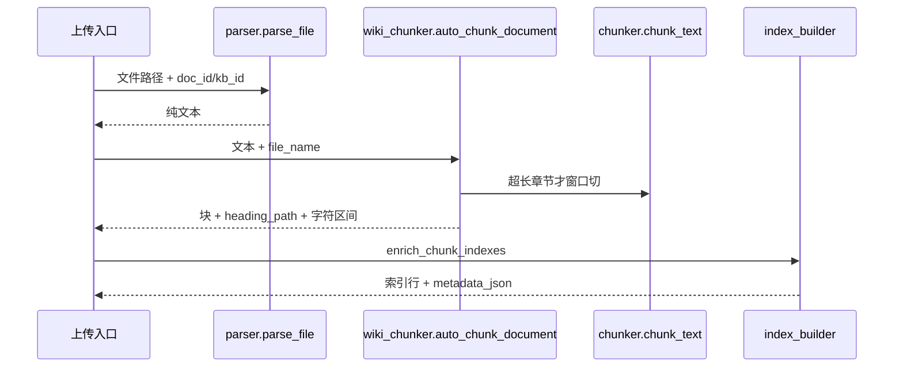

# 第 1 章　上传解析与切块

> 状态：✅ 代码已落地；`tests/chapters/test_ch05_01_chunker.py` 5 项通过。

## 目标与范围

把上传文件变成“能定位、能检索”的块：

1. 按扩展名选解析器，统一产出纯文本。
2. 文本按空行切段，再按 token 预算装箱；超长段落保留重叠。
3. Markdown 额外保留标题路径，检索命中后模型知道“这段属于哪一节”。
4. 生成索引行，供第 2 章向量化时拼接。

本章只做文本解析与切块，不落库、不调用 embedding；存储与建库在第 3 章，向量化在第 2 章。

## 调用逻辑



关键边界：

- 解析失败必须带 `doc_id/kb_id/path`，否则上传任务队列里无法定位坏文件。
- `char_start/char_end` 基于原文；重叠块允许区间重叠，不允许越界。
- PDF 没有 `pypdf` 时报缺依赖，不返回空文本假装成功。

## 文件地图

| 文件（完整路径） | 行数 | 职责 |
|---|---|---|
| `/Users/main/my-agent-flow/backend/packages/harness/myagentflow/knowledge/parser.py` | 151 | 扩展名分流；文本、docx、pptx、可选 PDF |
| `/Users/main/my-agent-flow/backend/packages/harness/myagentflow/knowledge/chunker.py` | 151 | 段落装箱、重叠硬切、字符区间 |
| `/Users/main/my-agent-flow/backend/packages/harness/myagentflow/knowledge/wiki_chunker.py` | 193 | Markdown 标题路径、章节合并 |
| `/Users/main/my-agent-flow/backend/packages/harness/myagentflow/knowledge/index_builder.py` | 96 | 文档摘要、块索引行、embedding 文本 |
| `/Users/main/my-agent-flow/backend/tests/chapters/test_ch05_01_chunker.py` | 111 | 5 个章节测试 |

## 实现步骤

### 1. 先按扩展名分流，再决定谁能解析

纯文本直接读；docx/pptx 用 stdlib 解 zip + XML；PDF 才去 import `pypdf`。这样没有 PDF 依赖时，Markdown 上传仍然可用。

```python
def parse_file(
    file_path: str | Path,
    *,
    doc_id: str | None = None,
    kb_id: str | None = None,
) -> str:
    """把文件解析成纯文本。

    纯文本按 UTF-8 读取；docx/pptx 直接解 zip + XML，不依赖 Office 运行时；
    PDF 有 pypdf 才解析，否则明确报缺少依赖，而不是返回空串。
    """
    p = Path(file_path)
    if not p.exists():
        ctx = _format_context(doc_id=doc_id, kb_id=kb_id, path=p)
        raise FileNotFoundError(f"File not found: {p} ({ctx})")

    ext = p.suffix.lower()
    ctx = _format_context(doc_id=doc_id, kb_id=kb_id, path=p)
    if ext in _TEXT_EXTENSIONS:
        return p.read_text(encoding="utf-8", errors="replace")
    if ext == ".docx":
        return _fallback_docx(p, ctx=ctx)
    if ext == ".pptx":
        return _fallback_pptx(p, ctx=ctx)
    if ext == ".pdf":
        return _parse_pdf(p, ctx=ctx)
    raise ValueError(f"Unsupported file type '{ext}' ({ctx})")
```

### 2. 段落装箱，超长段才硬切

先按空行切段，能装进一个预算就合在一起；只有单段超过预算才走字符窗口。这样正常文档不会在句子中间断开。

```python
def chunk_text(
    text: str,
    chunk_size: int = 512,
    overlap: int = 50,
) -> list[dict]:
    """把文本切成重叠块，尽量不切断段落。

    返回的每块都带 ``char_start`` / ``char_end``，用于回答时回指原文位置。
    重叠按 token 计，内部换算成字符时使用 4 字符 ≈ 1 token 的同一套估算。
    """
    if not text or not text.strip():
        return []

    chunk_size = max(1, int(chunk_size))
    overlap = max(0, min(int(overlap), chunk_size - 1))
    paragraphs = _split_paragraphs(text)
    if not paragraphs:
        return []

    chunks: list[dict] = []
    current_parts: list[str] = []
    current_tokens = 0
    current_start = paragraphs[0]["start"]
    current_end = paragraphs[0]["end"]
    overlap_chars = overlap * 4

    for para in paragraphs:
        para_text = para["text"]
        para_tokens = _count_tokens(para_text)

        if para_tokens > chunk_size:
            if current_parts:
                chunks.append(_make_chunk(current_parts, current_start, current_end))
                current_parts = []
                current_tokens = 0

            for piece_text, piece_start, piece_end in _hard_split(
                para_text,
                chunk_size=chunk_size,
                overlap=overlap,
                base_start=para["start"],
            ):
                chunks.append(_make_chunk([piece_text], piece_start, piece_end))
            continue

        if current_tokens + para_tokens > chunk_size and current_parts:
            chunks.append(_make_chunk(current_parts, current_start, current_end))
            tail = chunks[-1]["content"][-overlap_chars:] if overlap_chars else ""
            current_parts = [tail] if tail else []
            current_tokens = _count_tokens(tail) if tail else 0
            current_start = max(0, para["start"] - len(tail))

        current_parts.append(para_text)
        current_tokens += para_tokens
        current_end = para["end"]

    if current_parts:
        chunks.append(_make_chunk(current_parts, current_start, current_end))
    return chunks
```

### 3. Markdown 保留标题路径

`auto_chunk_document` 先按 `#` 切章节，用标题栈维护 `一级 / 二级`；相邻小章节合并，超长章节再交给 `chunk_text`。

```python
def auto_chunk_document(text: str, *, file_name: str = "") -> list[dict]:
    """按文档结构切块，返回兼容 ``chunk_text`` 的字段并额外带 ``heading_path``。"""
    raw = (text or "").strip()
    if not raw:
        return []

    is_markdown = (
        file_name.lower().endswith(".md") or _HEADING_RE.search(raw) is not None
    )
    sections = (
        _split_markdown_sections(raw) if is_markdown else _split_plain_sections(raw)
    )
    merged = _merge_small_sections(sections)

    chunks: list[dict] = []
    for section in merged:
        content = section["content"].strip()
        if not content:
            continue
        chunks.append(
            {
                "content": content,
                "token_count": _count_tokens(content),
                "char_start": section["start"],
                "char_end": section["end"],
                "heading_path": section.get("heading_path")
                or section.get("title")
                or file_name
                or "正文",
                "title": section.get("title") or "",
                "index_text": "",
            }
        )
    if chunks:
        return chunks

    legacy = chunk_text(raw, chunk_size=512, overlap=50)
    for item in legacy:
        item["heading_path"] = file_name or "正文"
        item["title"] = ""
        item["index_text"] = ""
    return legacy
```

### 4. 索引行不等于正文

索引用“标题 + 关键词”做一条短提示，不把整段再复制一遍。`embedding_text_for_chunk` 只在索引行不在正文里时拼接，避免重复。

```python
def enrich_chunk_indexes(chunks: list[dict], *, file_name: str = "") -> list[dict]:
    """给每个块补 ``index_text`` 与 ``metadata_json``；不修改传入列表。"""
    out: list[dict] = []
    for index, chunk in enumerate(chunks):
        heading = str(
            chunk.get("heading_path")
            or chunk.get("title")
            or file_name
            or f"段落 {index + 1}"
        )
        keywords = _extract_keywords(chunk.get("content") or "", limit=6)
        index_text = " · ".join([heading, *keywords]) if keywords else heading
        meta = {
            "heading_path": heading,
            "index_text": index_text,
            "title": chunk.get("title") or "",
            "kind": "section",
        }
        enriched = dict(chunk)
        enriched["index_text"] = index_text
        enriched["metadata_json"] = json.dumps(meta, ensure_ascii=False)
        out.append(enriched)
    return out
```

## 关键设计

- **字符区间是引用能力的地基**：没有 `char_start/char_end`，回答只能给“某文档”，不能回到具体段落。
- **小章节合并**：一个标题下面只有一句话时，单独成块会让检索上下文太薄；合并到相邻章节更稳。
- **解析器分层**：文本、OOXML、PDF 三条路径互不依赖；缺 PDF 依赖不会阻断 Markdown 上传。
- **token 估算可退化**：有 `tiktoken` 就精确计数，没有按 4 字符 ≈ 1 token；预算不会因为环境不同而完全失效。

## 与 EvoFlow 的差异

| 主题 | EvoFlow | 本项目 |
|---|---|---|
| 转换器 | MarkItDown 统一转 Markdown | 文本直读；docx/pptx stdlib 解包；PDF 可选 pypdf |
| 切块入口 | `chunker.py` + `wiki_chunker.py` + `processor.py` | 只保留 parser/chunker/wiki_chunker/index_builder |
| 标题路径 | wiki 切块保留完整层级 | 保留，但小章节会合并成 `一级 / 二级` |
| 二进制范围 | PDF/Office/图片 OCR 等 | 不做 OCR；PDF 只提文本层 |
| 落库 | processor 解析后直接入队 | 本章不落库，上传落库在第 3 章 |

## 测试与实测

覆盖点：

- `test_parse_text_and_reject_unknown()`：Markdown 读出原文；`.bin` 报 `Unsupported file type`。
- `test_chunk_text_keeps_offsets_and_overlap()`：每块区间不越界；相邻块有重叠。
- `test_auto_chunk_document_keeps_heading()`：块带 `heading_path`，正文含标题。
- `test_index_builder_summary_and_enrich()`：摘要取标题；索引行进入 embedding 文本。
- `test_parse_docx_and_pptx()`：stdlib 解包 Word 正文与 PPT 幻灯片文本。

```text
uv run pytest tests/chapters/test_ch05_01_chunker.py -q
5 passed, 13 warnings
```

## 本章不做什么

- 不做 OCR，不解析扫描版 PDF。
- 不做图片/音频/视频转文本。
- 不做异步解析队列；大文件解析会阻塞当前调用。
- 不把解析结果直接写入数据库；写入在 `knowledge/owned/service.py`。

## 验收清单

- [x] 文本/Markdown 可解析。
- [x] docx/pptx 不依赖 Office 运行时。
- [x] PDF 缺依赖时明确报错。
- [x] 块带 `char_start/char_end`。
- [x] Markdown 块带 `heading_path`。
- [x] 索引行与 embedding 文本可生成。
