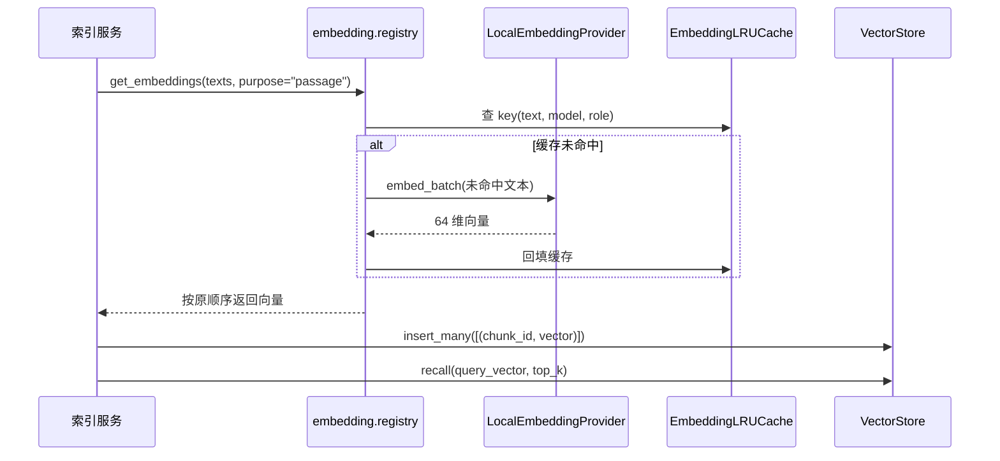

# 第 2 章　Embedding 与向量检索

> 状态：✅ 代码已落地；`tests/chapters/test_ch05_02_vector.py` 4 项通过。

## 目标与范围

把第 1 章的块变成可召回的向量：

1. 提供统一的 `get_embedding/get_embeddings` 入口，调用方不直接依赖具体模型。
2. 用进程内 LRU 缓存避免重复向量化；缓存键区分 query/passage。
3. 向量按 dataset 写入 SQLite，召回时算余弦并返回 `chunk_id/distance/score`。

本章的 embedding 是 **离线 BLAKE2 特征哈希**，不是语义模型。它保证链路可跑、结果确定、测试不依赖网络；同义改写召回弱，属于已知边界。

## 调用逻辑



关键边界：

- 缓存只缓存成功结果；后端报错不写缓存。
- 批量返回数量必须与输入数量一致，否则直接报错。
- 写入/查询维度不一致直接拒绝，不静默补零。

## 文件地图

| 文件（完整路径） | 行数 | 职责 |
|---|---|---|
| `/Users/main/my-agent-flow/backend/packages/harness/myagentflow/knowledge/embedding/base.py` | 99 | Provider 接口、错误、LRU 缓存 |
| `/Users/main/my-agent-flow/backend/packages/harness/myagentflow/knowledge/embedding/local_provider.py` | 92 | 离线哈希向量 |
| `/Users/main/my-agent-flow/backend/packages/harness/myagentflow/knowledge/embedding/registry.py` | 183 | 选 provider、批量调用、维度校验 |
| `/Users/main/my-agent-flow/backend/packages/harness/myagentflow/knowledge/vector/sqlite_vec.py` | 183 | 按 dataset 建表、写入、余弦召回 |
| `/Users/main/my-agent-flow/backend/tests/chapters/test_ch05_02_vector.py` | 90 | 4 个章节测试 |

## 实现步骤

### 1. 缓存键必须先分清 query 与 passage

同一段文本作为文档块和查询时，某些模型会返回不同向量；缓存键带角色，避免混用。

```python
def _cache_key(text: str, model: str, *, is_query: bool = False) -> str:
    """稳定缓存键：同一文本、同一模型、同一角色才复用。"""
    role = "q" if is_query else "p"
    raw = f"{text}\x00{model}\x00{role}"
    return hashlib.sha256(raw.encode("utf-8")).hexdigest()
```

### 2. 离线向量：特征哈希 + L2 归一化

英文标识符拆 CamelCase/snake_case，中文取整段与二元组；每个 token 哈希到固定维度，按哈希位决定正负号。

```python
    def embed_sync(self, text: str) -> list[float]:
        """同步实现；测试与批处理都走这里，避免再包一层事件循环。"""
        vector = [0.0] * self._dim
        for token in _tokens(text):
            digest = hashlib.blake2b(token.encode("utf-8"), digest_size=16).digest()
            index = int.from_bytes(digest[:8], "big") % self._dim
            sign = 1.0 if digest[8] & 1 else -1.0
            vector[index] += sign
        norm = math.sqrt(sum(value * value for value in vector))
        if norm <= 0:
            return vector
        return [value / norm for value in vector]
```

### 3. 先查缓存，只把未命中文本发给后端

批量入口先占位结果数组，再收集未命中索引；后端返回后按原索引回填，保证输出顺序与输入一致。

```python
async def get_embeddings(
    texts: list[str],
    model_config: ModelConfig | None = None,
    *,
    expected_dim: int | None = None,
    batch_size: int = MAX_BATCH_SIZE,
    purpose: str | None = None,
    kb_id: str | None = None,
) -> list[list[float]]:
    """批量向量化：缓存命中直接复用，未命中按 batch_size 分批请求。"""
    del kb_id  # 本章没有用量计费，保留签名便于后续接入
    if not texts:
        raise ValueError("texts must not be empty")

    config = model_config or get_embedding_config()
    provider = _resolve_provider(config)
    model_name = provider.model_name
    is_query = str(purpose or "").strip().lower() == "query"

    results: list[list[float] | None] = [None] * len(texts)
    uncached_indexes: list[int] = []
    uncached_texts: list[str] = []
    for index, text in enumerate(texts):
        key = _cache_key(text, model_name, is_query=is_query)
        hit = _cache.get(key)
        if hit is not None:
            results[index] = hit
        else:
            uncached_indexes.append(index)
            uncached_texts.append(text)

    if uncached_texts:
        size = max(1, min(int(batch_size), MAX_BATCH_SIZE))
        fetched: list[list[float]] = []
        for start in range(0, len(uncached_texts), size):
            batch = uncached_texts[start : start + size]
            vectors = await provider.embed_batch(batch)
            if len(vectors) != len(batch):
                raise EmbeddingError(
                    f"Embedding backend returned {len(vectors)} vectors for {len(batch)} inputs"
                )
            fetched.extend(vectors)

        for offset, vector in enumerate(fetched):
            if expected_dim is not None and len(vector) != expected_dim:
                raise EmbeddingDimensionError(
                    f"Embedding dimension mismatch at index {uncached_indexes[offset]}: "
                    f"expected {expected_dim}, got {len(vector)}"
                )
            index = uncached_indexes[offset]
            results[index] = vector
            _cache.set(
                _cache_key(uncached_texts[offset], model_name, is_query=is_query),
                vector,
            )

    out: list[list[float]] = []
    for vector in results:
        if vector is None:  # pragma: no cover - 防御式兜底
            raise EmbeddingError("Internal error: unfilled embedding slot")
        out.append(vector)
    return out
```

### 4. 写入先校验维度，召回按 distance 升序

每个 dataset 一张表，`chunk_id` 做主键；重复写入用 `INSERT OR REPLACE`。召回算余弦，`distance = 1 - score`。

```python
    def insert_many(self, items: Iterable[tuple[str, Sequence[float]]]) -> int:
        """批量写入，返回写入条数。"""
        dim = self.dim
        rows: list[tuple[str, bytes]] = []
        for chunk_id, embedding in items:
            if len(embedding) != dim:
                raise VectorStoreError(
                    f"embedding dimension mismatch for chunk {chunk_id}: expected {dim}, got {len(embedding)}"
                )
            rows.append((str(chunk_id), _pack_vector(embedding)))
        if not rows:
            return 0
        table = _vectors_table_for(self.dataset_id)
        with db() as conn:
            conn.executemany(
                f"INSERT OR REPLACE INTO {table} (chunk_id, embedding) VALUES (?, ?)",
                rows,
            )
        return len(rows)
```

```python
    def recall(
        self, query_embedding: Sequence[float], *, top_k: int = 5
    ) -> list[RecallHit]:
        """按余弦相似度召回 top_k；维度不一致直接报错。"""
        dim = self.dim
        if len(query_embedding) != dim:
            raise VectorStoreError(
                f"query embedding dimension mismatch: expected {dim}, got {len(query_embedding)}"
            )
        table = _vectors_table_for(self.dataset_id)
        with db() as conn:
            rows = conn.execute(f"SELECT chunk_id, embedding FROM {table}").fetchall()
        hits: list[RecallHit] = []
        for chunk_id, blob in rows:
            score = _cosine(query_embedding, _unpack_vector(blob, dim))
            hits.append(
                RecallHit(chunk_id=str(chunk_id), distance=1.0 - score, score=score)
            )
        hits.sort(key=lambda hit: hit.distance)
        return hits[: max(1, int(top_k))]
```

## 关键设计

- **不直接暴露 Provider**：业务层只调 registry，换模型不需要改调用方。
- **缓存是进程内**：多进程/多实例不共享；重启后第一次索引会重新算，这是可接受的代价。
- **维度和表绑定**：同一 dataset 的向量表只有一个维度；换模型必须重建 dataset 向量。
- **全表扫描**：本章没有 ANN 索引，`recall` 是 O(块数)；适合几千块，不适合百万级。

## 与 EvoFlow 的差异

| 主题 | EvoFlow | 本项目 |
|---|---|---|
| Provider | OpenAI / 本地模型 / 多后端 | 只实现 `hash-local` |
| 语义能力 | 真实 embedding | 词法特征哈希，同义改写弱 |
| 向量索引 | sqlite-vec `vec0` + 距离函数 | 普通表 + Python 余弦 |
| 缓存 | 可能按 provider/model 分层 | 进程内 LRU，键带 query/passage 角色 |
| 维度 | 由模型决定，常见 1536 | 默认 64，可通过 `embedding_dim` 改 |

## 测试与实测

覆盖点：

- `test_local_embedding_is_deterministic()`：同文本同向量，L2 范数为 1。
- `test_embedding_cache_skips_second_backend_call()`：第二次只命中缓存，provider 只调一次。
- `test_vector_store_recall_orders_hits()`：同向向量排第一，score ≈ 1。
- `test_vector_store_rejects_dimension_mismatch()`：2 维写 3 维表、2 维查 3 维表都报错。

```text
uv run pytest tests/chapters/test_ch05_02_vector.py -q
4 passed, 13 warnings
```

## 本章不做什么

- 不接真实语义 embedding 模型，不做模型下载。
- 不做向量量化、ANN、分区。
- 不做多租户配额/计费。
- 不把向量写入文档表；向量表与文档块表分开。

## 验收清单

- [x] `get_embedding/get_embeddings` 可用。
- [x] 缓存能避免重复调用。
- [x] 维度不一致会报错。
- [x] 向量可写入、可召回。
- [x] 召回结果带 `chunk_id/distance/score`。
