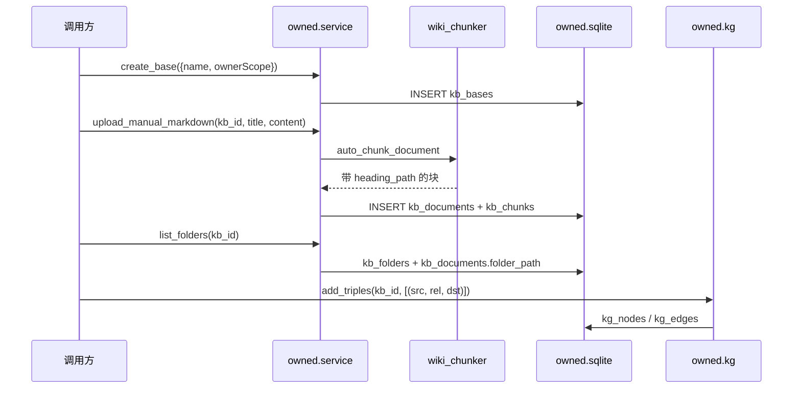

# 第 3 章　Owned Knowledge 与知识地图

> 状态：✅ 代码已落地；`tests/chapters/test_ch05_03_owned.py` 4 项通过。

## 目标与范围

把“文档知识库”真正落成一个有归属、有目录、有实体关系的库：

- **建库**：`kb_bases` 记录名称、`owner_scope` 与描述。
- **归属过滤**：`public` 对所有 scope 可见，私有库只对同 scope 可见。
- **上传**：Markdown 文档写入 `kb_documents`，按标题切块写入 `kb_chunks`。
- **目录地图**：显式目录 + 文档 `folder_path` 推导出的隐式父目录。
- **实体图**：三元组写 `kg_nodes/kg_edges`，输出可直接渲染的 `nodes/edges`。

本章只做存储与地图读取，不做混合检索、不做任务队列、不做文档链接图。

## 调用逻辑



关键边界：

- 建库时 `name` 必填；`ownerScope` 默认 `public`。
- 上传前必须确认库存在，避免写出一批无主文档。
- 目录路径拒绝 `.`、`..`、隐藏目录与依赖目录。
- 实体图同名节点合并，边按 `(src,dst,rel)` 去重。

## 文件地图

| 文件（完整路径） | 行数 | 职责 |
|---|---|---|
| `/Users/main/my-agent-flow/backend/packages/harness/myagentflow/knowledge/owned/db.py` | 88 | 连接、锁、初始化 |
| `/Users/main/my-agent-flow/backend/packages/harness/myagentflow/knowledge/owned/schema.py` | 106 | `kb_*` / `kg_*` 表结构 |
| `/Users/main/my-agent-flow/backend/packages/harness/myagentflow/knowledge/owned/ids.py` | 33 | 前缀 id 与 UTC 时间 |
| `/Users/main/my-agent-flow/backend/packages/harness/myagentflow/knowledge/owned/service.py` | 322 | 建库、文档、块、目录 |
| `/Users/main/my-agent-flow/backend/packages/harness/myagentflow/knowledge/owned/kg.py` | 293 | 实体节点、边、图输出 |
| `/Users/main/my-agent-flow/backend/tests/chapters/test_ch05_03_owned.py` | 89 | 4 个章节测试 |

## 实现步骤

### 1. 归属范围在建库时定死

`owner_scope` 不是展示字段，而是检索过滤条件。`list_bases(scope)` 的 SQL 直接写 `IN ('public', ?)`，避免先全查再在 Python 里过滤。

```python
def list_bases(owner_scope: str | None = None) -> list[dict[str, Any]]:
    """列出知识库；传 owner_scope 时只返回 public + 同 scope 的库。"""
    with db() as conn:
        if owner_scope:
            rows = conn.execute(
                "SELECT * FROM kb_bases WHERE owner_scope IN ('public', ?) ORDER BY created_at DESC",
                (owner_scope,),
            ).fetchall()
        else:
            rows = conn.execute(
                "SELECT * FROM kb_bases ORDER BY created_at DESC"
            ).fetchall()
    return [_row_base(row) for row in rows]
```

### 2. 上传 = 文档行 + 块行，一次事务

先写文档，再切块写块；中间失败会回滚，避免出现“文档存在但零块”的半成品。

```python
def upload_manual_markdown(
    kb_id: str,
    *,
    title: str,
    content: str,
    folder_path: str = "",
) -> dict[str, Any]:
    """写入一篇 Markdown 文档，按标题切块后落库。"""
    if not get_base(kb_id):
        raise ValueError("knowledge base not found")
    text = str(content or "")
    if not text.strip():
        raise ValueError("content is required")
    label = str(title or "").strip() or "note"
    file_name = f"{label}.md"
    folder = _resolve_folder_path(folder_path)
    now = utc_now()
    doc_id = new_id("doc_")

    with db() as conn:
        _ensure_folder_rows(conn, kb_id, folder, now=now)
        conn.execute(
            """
            INSERT INTO kb_documents(
                doc_id, kb_id, title, file_name, content, folder_path, source_type, created_at, updated_at
            ) VALUES (?, ?, ?, ?, ?, ?, 'manual', ?, ?)
            """,
            (doc_id, kb_id, label, file_name, text, folder, now, now),
        )

        chunks = enrich_chunk_indexes(
            auto_chunk_document(text, file_name=file_name), file_name=file_name
        )
        rows: list[tuple[Any, ...]] = []
        for ordinal, chunk in enumerate(chunks):
            rows.append(
                (
                    new_id("chunk_"),
                    kb_id,
                    doc_id,
                    ordinal,
                    chunk["content"],
                    chunk.get("heading_path") or "",
                    int(chunk.get("token_count") or 0),
                    int(chunk.get("char_start") or 0),
                    int(chunk.get("char_end") or 0),
                    now,
                )
            )
        if rows:
            conn.executemany(
                """
                INSERT INTO kb_chunks(
                    chunk_id, kb_id, doc_id, ordinal, content, heading_path,
                    token_estimate, char_start, char_end, created_at
                ) VALUES (?, ?, ?, ?, ?, ?, ?, ?, ?, ?)
                """,
                rows,
            )
    return get_document(doc_id) or {}
```

### 3. 目录地图不只读显式目录

用户上传时只给了 `work/notes`，没有显式创建 `work`；`list_folders` 必须从文档路径反推父目录，否则前端树会缺层。

```python
def list_folders(kb_id: str) -> list[dict[str, Any]]:
    """返回目录地图：显式目录 + 文档路径推导出的隐式父目录。"""
    with db() as conn:
        explicit_rows = conn.execute(
            "SELECT path, created_at FROM kb_folders WHERE kb_id = ?", (kb_id,)
        ).fetchall()
        doc_rows = conn.execute(
            "SELECT folder_path FROM kb_documents WHERE kb_id = ?", (kb_id,)
        ).fetchall()

    explicit = {
        _resolve_folder_path(row["path"]): row["created_at"]
        for row in explicit_rows
        if row["path"]
    }
    paths: set[str] = set(explicit)
    for row in doc_rows:
        raw = _resolve_folder_path(row["folder_path"])
        if not raw:
            continue
        parts = raw.split("/")
        for index in range(1, len(parts) + 1):
            paths.add("/".join(parts[:index]))

    out: list[dict[str, Any]] = []
    for path in sorted(paths):
        out.append(
            {
                "path": path,
                "name": path.split("/")[-1],
                "explicit": path in explicit,
                "createdAt": explicit.get(path, ""),
            }
        )
    return out
```

### 4. 实体图用三元组写，节点自动合并

`add_triples` 只接收业务语义，不要求调用方先算节点 id；同名节点复用，边按关系类型去重。

```python
def add_triples(
    kb_id: str,
    triples: list[tuple[str, str, str]],
    *,
    chunk_id: str | None = None,
) -> dict[str, int]:
    """批量写 ``(src, rel, dst)``，返回节点触碰次数与边新增次数。"""
    nodes = 0
    edges = 0
    for src, rel, dst in triples:
        src_name = _norm_name(src)
        dst_name = _norm_name(dst)
        if not src_name or not dst_name or src_name == dst_name:
            continue
        source = upsert_node(kb_id, src_name, chunk_id=chunk_id)
        target = upsert_node(kb_id, dst_name, chunk_id=chunk_id)
        nodes += 2
        upsert_edge(kb_id, source["id"], target["id"], rel)
        edges += 1
    return {"nodesTouched": nodes, "edgesAdded": edges}
```

## 关键设计

- **一个库一个命名空间**：所有表都带 `kb_id`，删除库时按 `kb_id` 级联清掉文档、块、目录、图。
- **块与文档分表**：文档正文只存一份，块用于检索；列块时不需要把整篇正文再拼回来。
- **目录是路径不是 parent_id**：路径字符串更容易做“显式/隐式”合并；重命名目录需要批量改前缀，本章未实现。
- **实体图不依赖向量**：实体节点带 `chunkIds`，后续可以从实体反查块。

## 与 EvoFlow 的差异

| 主题 | EvoFlow | 本项目 |
|---|---|---|
| 存储 | 多库/多表 + 任务/活动/标签/链接 | 单 `owned.sqlite` + 5 张核心表 |
| 文档来源 | 上传、URL、手动、批量任务 | 只做手动 Markdown 上传 |
| 目录 | 路径 + 显式/隐式合并 | 同思路，未做重命名/移动 |
| 实体图 | 完整 KG + 文档链接图 | 节点/边 + 一跳子图 |
| 检索 | 向量 + 关键词 + 图扩展 | 本章不提供检索，向量在第 2 章 |

## 测试与实测

覆盖点：

- `test_create_base_filters_owner_scope()`：public 对所有 scope 可见，私有库只对本 scope。
- `test_upload_markdown_creates_chunks()`：文档与块落库，块带 heading 与 ordinal。
- `test_folders_include_implicit_parents()`：`work/notes` 自动补出 `work`。
- `test_kg_add_triples_and_graph()`：两个实体一条边，`graph_payload` 与 `stats` 对得上。

```text
uv run pytest tests/chapters/test_ch05_03_owned.py -q
4 passed, 13 warnings
```

## 本章不做什么

- 不做文档更新/删除的版本历史。
- 不做目录重命名、移动、批量导入。
- 不做文档链接图、标签统计、活动流。
- 不做异步索引任务；上传是同步落库。

## 验收清单

- [x] 建库与归属过滤可用。
- [x] Markdown 上传后文档/块可查。
- [x] 目录地图包含隐式父目录。
- [x] 三元组可写节点/边。
- [x] 图输出带 `nodeCount/edgeCount`。
