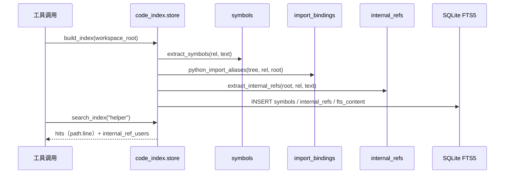

# 第 4 章　Workspace 代码索引与符号上下文

> 状态：✅ 代码已落地；`tests/chapters/test_ch05_04_code_index.py` 4 项通过。

## 目标与范围

让 Agent 在自己的代码库里定位“东西在哪”，而不是靠猜：

- **符号**：Python AST 抽类/函数/方法，给 `path:line` 与签名。
- **全文**：FTS5 索引路径、符号名与源码，覆盖注释/字符串里的关键词。
- **引用**：Python import 别名解析后，找“谁调用了这个符号”。
- **增量**：单个文件重索引先删旧行，再写新行；删除文件时清空旧索引。
- **安全扫描**：跳过 `.git/.venv/node_modules/.myaf`，单文件超过 2MB 不索引。

本章只覆盖 Python 的引用；JS/TS/Java 的跨文件绑定未实现，不伪装成“全语言 LSP”。

## 调用逻辑



关键边界：

- 索引根默认是显式 `workspace_root`；没有就用当前目录。
- `relative_path` 不允许 `..` 逃出工作区。
- 符号查询保留完整标识符，避免 `old_name` 被拆词后误命中 `new_name`。
- 单文件失败只记录到 `failed`，不阻断整批扫描。

## 文件地图

| 文件（完整路径） | 行数 | 职责 |
|---|---|---|
| `/Users/main/my-agent-flow/backend/packages/harness/myagentflow/code_index/store.py` | 478 | 索引库、增量、搜索、状态 |
| `/Users/main/my-agent-flow/backend/packages/harness/myagentflow/code_index/symbols.py` | 140 | Python AST / 正则符号抽取 |
| `/Users/main/my-agent-flow/backend/packages/harness/myagentflow/code_index/tokenize.py` | 93 | 标识符与中文分词、FTS 文本 |
| `/Users/main/my-agent-flow/backend/packages/harness/myagentflow/code_index/import_bindings.py` | 85 | Python import 别名 → 文件 |
| `/Users/main/my-agent-flow/backend/packages/harness/myagentflow/code_index/internal_refs.py` | 83 | AST Call → 调用引用 |
| `/Users/main/my-agent-flow/backend/packages/harness/myagentflow/code_index/format_results.py` | 55 | 结果转可读文本 |
| `/Users/main/my-agent-flow/backend/tests/chapters/test_ch05_04_code_index.py` | 80 | 4 个章节测试 |

## 实现步骤

### 1. 增量索引入口只做一件事

`index_file` 负责解析根、校验相对路径、打开索引库；真正的删除/写入在 `_index_one`，保证全量构建与单文件更新走同一套逻辑。

```python
def index_file(
    workspace_root: str | Path | None = None,
    *,
    relative_path: str,
    thread_id: str | None = None,
    deleted: bool = False,
) -> dict[str, Any]:
    """增量索引一个文件；deleted=True 或文件消失时只做删除。"""
    root = Path(resolve_index_root(workspace_root, thread_id=thread_id))
    rel = _normalize_rel(relative_path)
    path = root / rel
    with _connect(root) as conn:
        return _index_one(conn, root, rel, path, deleted=deleted)
```

### 2. 符号先 AST，解析失败再正则

Python 文件优先 `ast.parse`；语法错误时退回行级 `def/class` 正则，至少保证已存在的符号能被搜到。

```python
def extract_symbols(
    workspace_root: str | Path | None,
    relative_path: str,
    text: str,
    *,
    for_full_build: bool = False,
) -> list[dict]:
    """抽取符号；``workspace_root`` 目前只用于统一路径语义，不参与解析。"""
    del workspace_root, for_full_build  # 保持与上游同名参数，当前实现不需要工作区上下文
    path = str(relative_path or "")
    if path.endswith(".py"):
        try:
            tree = ast.parse(text)
        except SyntaxError:
            return _regex_python_symbols(path, text)
        symbols: list[dict] = []
        _walk_python(tree, text, symbols)
        return symbols
    return _generic_symbols(path, text)
```

### 3. import 别名必须落到工作区文件

`from b import helper as h` 只把 `h` 记成别名还不够，要解析到 `b.py`；否则调用引用只能看到局部名字，无法回答“改动 b.py 会影响谁”。

```python
def python_import_aliases(
    tree: ast.AST,
    from_rel: str | Path,
    workspace_root: str | Path,
) -> dict[str, str]:
    """收集 Python import 别名；解析不到工作区文件的条目直接跳过。"""
    root = Path(workspace_root).resolve()
    from_path = Path(from_rel)
    aliases: dict[str, str] = {}

    for node in ast.walk(tree):
        if isinstance(node, ast.ImportFrom):
            base_parts = _relative_base(from_path, node.level)
            module_parts = [part for part in (node.module or "").split(".") if part]
            for alias in node.names:
                if alias.name == "*":
                    continue
                local = alias.asname or alias.name
                direct = _module_file(root, [*base_parts, *module_parts, alias.name])
                package = _module_file(root, [*base_parts, *module_parts])
                target = direct or package
                if target:
                    aliases[local] = _rel(target, root)
        elif isinstance(node, ast.Import):
            for alias in node.names:
                parts = [part for part in alias.name.split(".") if part]
                target = _module_file(root, parts)
                if target:
                    aliases[alias.asname or parts[-1]] = _rel(target, root)
    return aliases
```

### 4. 只把 Call 当引用，避免 import 行误报

`import` 本身不是调用；只遍历 `ast.Call`，名字或属性来自别名时记录 `from/to/line/symbol`。

```python
def extract_python_internal_refs(
    tree: ast.AST,
    from_rel: str | Path,
    workspace_root: str | Path,
) -> list[dict]:
    """遍历 AST 的 Call，把 import 别名解析成目标文件并记录调用行。"""
    root = Path(workspace_root).resolve()
    aliases = python_import_aliases(tree, from_rel, root)
    from_posix = Path(from_rel).as_posix()
    out: list[dict] = []
    seen: set[tuple[str, int, str, str]] = set()

    def add(to_path: str, line: int, symbol: str) -> None:
        key = (to_path, line, symbol, "call")
        if key in seen:
            return
        seen.add(key)
        out.append(
            {
                "from_path": from_posix,
                "to_path": to_path,
                "line": line,
                "ref_kind": "call",
                "symbol": symbol,
            }
        )

    for node in ast.walk(tree):
        if not isinstance(node, ast.Call):
            continue
        func = node.func
        if isinstance(func, ast.Name) and func.id in aliases:
            add(aliases[func.id], int(node.lineno), func.id)
        elif isinstance(func, ast.Attribute) and isinstance(func.value, ast.Name):
            base = func.value.id
            if base in aliases:
                add(aliases[base], int(node.lineno), func.attr)
    return out
```

### 5. 查询三路合并，结果按分数与位置排序

符号命中分数最高；FTS 负责注释/字符串；引用单独返回 `internal_ref_users`，不混进 hits 里让模型误以为是定义。

```python
def search_index(
    workspace_root: str | Path | None = None,
    query: str = "",
    *,
    queries: list[str] | None = None,
    thread_id: str | None = None,
    limit: int = 20,
) -> dict[str, Any]:
    """查符号、全文与内部引用；query/queries 合并成一个检索词集合。"""
    root = Path(resolve_index_root(workspace_root, thread_id=thread_id))
    db_file = Path(index_db_path(root))
    terms: list[str] = []
    seen: set[str] = set()
    for item in [query, *(queries or [])]:
        for token in _query_terms(str(item or "")):
            key = token.casefold()
            if key not in seen:
                seen.add(key)
                terms.append(token)
    if not terms or not db_file.exists():
        return {"query": query, "hits": [], "internal_ref_users": [], "total": 0}

    with _connect(root) as conn:
        hits = _search_symbols(conn, terms)
        hits.extend(_search_fts(conn, terms))
        refs = _search_refs(conn, terms)
        grouped: dict[tuple[str, int, str], dict[str, Any]] = {}
        for hit in hits:
            key = (str(hit["path"]), int(hit.get("line") or 0), str(hit["kind"]))
            if key not in grouped or hit.get("score", 0) > grouped[key].get("score", 0):
                grouped[key] = hit
        final_hits = sorted(
            grouped.values(),
            key=lambda item: (-item.get("score", 0), item["path"], item.get("line", 0)),
        )
        return {
            "query": query,
            "hits": final_hits[: max(1, int(limit))],
            "internal_ref_users": refs,
            "total": len(final_hits),
        }
```

## 关键设计

- **先结构后语义**：符号名精确命中优先；FTS 只负责兜底，不让“文档里出现过一次”压过真实定义。
- **索引库放工作区**：`{root}/.myaf/code_index/index.db`，同一工作区的线程共享，换工作区天然隔离。
- **单文件事务**：一个文件先删旧行再写新行；`deleted=True` 时只删不写。
- **不追全语言**：Python 引用准确率优先；非 Python 文件只做通用符号正则，不承诺跨文件调用。

## 与 EvoFlow 的差异

| 主题 | EvoFlow | 本项目 |
|---|---|---|
| 解析 | tree-sitter 多语言 + LSP | Python AST + 通用正则 |
| 引用 | Python/JS/TS 导入绑定 | 只做 Python import 别名 + Call |
| 文件监听 | watcher 自动增量 | 由调用方显式 `index_file` |
| 语义检索 | 可能接 embedding/ANN | 只用 FTS5 + 符号表 |
| 结果格式 | 工具层自有格式 | 单独 `format_results.py` |

## 测试与实测

覆盖点：

- `test_index_python_symbols_and_hits()`：类/方法可定位到 `service.py:1`。
- `test_incremental_update_drops_old_symbol()`：重索引后旧符号不再命中。
- `test_internal_refs_returns_callers()`：`a.py` 调用 `b.py.helper` 返回调用行。
- `test_build_index_skips_dependency_dirs()`：跳过 `.venv`，文本关键词走 FTS。

```text
uv run pytest tests/chapters/test_ch05_04_code_index.py -q
4 passed, 13 warnings
```

## 本章不做什么

- 不做 LSP，不提供跳转定义/类型推断。
- 不做文件 watcher，不自动感知磁盘变化。
- 不做 JS/TS/Java/Go 的跨文件引用。
- 不做向量化代码检索；全部走符号 + FTS。

## 验收清单

- [x] 符号带 `path/line/kind/signature`。
- [x] 全文能命中注释/字符串关键词。
- [x] Python 调用引用能返回 `fromPath/toPath/line`。
- [x] 单文件重索引不残留旧符号。
- [x] 跳过依赖目录与超大文件。
