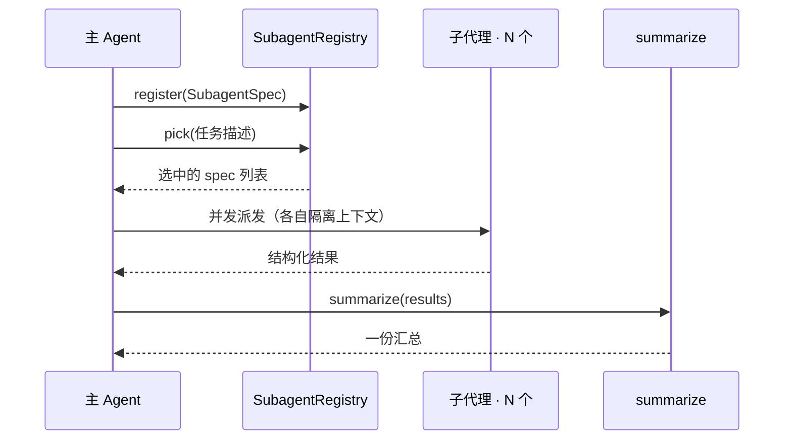

# 第 1 章　子代理注册、选择与结果汇总

> **EvoFlow 对照状态 / Alignment status：** 🔍 结构已核对（路径、行数、符号均取自源码实测），**行为**（调用顺序、边界条件）尚未逐行核对。

## 本章目标
定义子代理的「能力卡片」，并实现一个确定性可解释的委派决策。

## 最小闭环
主 Agent 收到「同时查三份文档」→ 拆成 3 个子任务 → 并发执行 → 汇总成一份答案。

## 调用逻辑 / Invocation logic



- **入口**：主 Agent 只通过 `pick()` 选子代理，选人依据是 `SubagentSpec` 的能力描述，不是模型自由发挥。
- **关键节点**：子代理各自独立上下文，结果只回传结论+证据，不回传整段对话；`describe()` 用于把「有哪些子代理」告诉模型。
- **出口**：`summarize()` 合并时保留来源标注，冲突要给「谁说了什么」而不是强行折中。
- **最容易断的地方**：子代理共享一个 messages 列表（等于没隔离）；汇总丢掉出处，导致无法复核。

## 真实模块地图（已核对：路径 · 行数 · 符号）

| 文件 | 行数 | 关键符号 | 模块常量 |
|---|---|---|---|
| `packages/harness/evoflow/subagents/registry.py:17` | 223 | `_timeout_for_subagent`、`_resolve_subagent_system_prompt`、`_agent_config_to_subagent_config` | — |
| `packages/harness/evoflow/subagents/config.py:32` | 57 | `SubagentConfig`；`resolve_subagent_recursion_limit` | DEFAULT_RECURSION_STEPS_PER_TURN、MIN_SUBAGENT_RECURSION_LIMIT |
| `packages/harness/evoflow/subagents/executor.py:74` | 1127 | `SubagentStatus`、`SubagentResult`、`SubagentExecutor`；`_subagent_prompt_logs_repo_root`、`_log_subagent_prompt`、`_subagent_should_stop` | MAX_CONCURRENT_SUBAGENTS |
| `packages/harness/evoflow/subagents/detached_poll_scheduler.py:25` | 99 | `_loop_thread_main`、`_ensure_loop`、`_task_done` | — |
| `packages/harness/evoflow/subagents/runtime_guard.py:16` | 64 | `lease_metrics_snapshot`、`collab_subtask_lease_seconds`、`is_subtask_background_executor_active` | — |
| `app/gateway/routers/agents.py` | 1555 | `AgentResponse`、`AgentsListResponse`、`AgentCreateRequest`；`_normalize_agent_tools_for_api`、`_matches_agent_list_filters`、`_agent_runtime_available_for_ui` | AGENT_NAME_PATTERN |
| `packages/harness/evoflow/subagents/config.py:32` | 57 | `SubagentConfig`；`resolve_subagent_recursion_limit` | DEFAULT_RECURSION_STEPS_PER_TURN、MIN_SUBAGENT_RECURSION_LIMIT |

## 核心概念
- **能力卡片**：`name / 描述 / 可用工具 / 模型 / 上限（步数、token、时长）`，选择靠描述匹配而非猜。
- **上下文隔离**：子代理只拿到被裁剪的任务简报，不继承主上下文（避免污染与爆炸）。
- **汇总协议**：子代理返回结构化结果（结论 + 证据 + 未解决项），主 Agent 只做融合。

## 自研实现要点
```text
delegate(task, agent_name) → sub_run_id
子代理输入 = {goal, constraints, context_refs[], budget}
子代理输出 = {status, summary, artifacts[], evidence[], open_questions[]}
```

## 业务规则
- 子代理不能再无限套子代理（深度上限 1–2）。
- 子代理失败/超时必须返回结构化失败，不静默。
- 并发上限按模型与机器资源设定。

## 常见坑
- 把完整对话塞给子代理 → 成本和延迟翻倍。
- 主 Agent 反复轮询子代理 → 空转烧钱。
- 汇总时丢证据，只剩「已完成」三个字。

## 验收
- [ ] 并发 3 子任务总耗时 < 串行
- [ ] 子代理失败可被主流程消化
- [ ] 汇总结果含证据引用

### 源码核对记录（路径与符号实测）

- `packages/harness/evoflow/subagents/registry.py`（223 行）
  - 模块自述：Subagent registry for managing available subagents.…
- `packages/harness/evoflow/subagents/config.py`（57 行）：类 `SubagentConfig`；环境变量 `EVOFLOW_SUBAGENT_RECURSION_STEPS_PER_TURN`
  - 模块自述：Subagent configuration definitions.…
- `packages/harness/evoflow/subagents/executor.py`（1127 行）：类 `SubagentStatus`、`SubagentResult`、`SubagentExecutor`
  - 模块自述：Subagent execution engine.…
- `packages/harness/evoflow/subagents/detached_poll_scheduler.py`（99 行）
  - 模块自述：Persistent asyncio loop for detached task_tool poll runners. Collab follow-up often schedules detached polls f…
- `packages/harness/evoflow/subagents/runtime_guard.py`（64 行）
  - 模块自述：Helpers to correlate collab subtask rows with SubagentExecutor background tasks.…
- `app/gateway/routers/agents.py`（1555 行）：类 `AgentResponse`、`AgentsListResponse`、`AgentCreateRequest`、`SkillHubExpertInstallRequest`
  - 模块自述：CRUD API for custom agents.…
- `packages/harness/evoflow/subagents/config.py`（57 行）：类 `SubagentConfig`；环境变量 `EVOFLOW_SUBAGENT_RECURSION_STEPS_PER_TURN`
  - 模块自述：Subagent configuration definitions.…

> 本节只证明**路径、行数、符号存在**；调用顺序与边界条件仍属「行为」，未逐行核对。

## 对照 EvoFlow 核对清单
- [ ] `subagents/config.py` 的代理定义字段
- [ ] `detached_poll_scheduler.py` 的长任务轮询机制

## 从零实现（手把手）
> 读完这章你能注册子代理、按能力标签选人、把子代理结果收敛成一段可回填主对话的摘要。
> 文件路径一律写仓库全路径（`backend/...`），代码注释写「为什么」。

### Step 1　新建 registry.py：注册 + 选择
**文件**：`backend/packages/harness/myagentflow/subagents/registry.py（新建）`
**要写的逻辑**：`SubagentSpec` 带 `tags`；`pick()` 按标签打分，没有命中就返回 None（由上层决定是否降级为自己做）。

**代码**

```python
"""子代理注册表：谁能干什么，谁来干。

为什么要 tags 而不是让模型自由挑：
子代理名字对模型没有语义，标签才有；而且挑错人的代价是一整轮白跑。
"""
from __future__ import annotations

from dataclasses import dataclass, field
from typing import Any, Callable


@dataclass(frozen=True)
class SubagentSpec:
    name: str
    description: str
    tags: tuple[str, ...]
    run: Callable[..., Any]


class SubagentRegistry:
    def __init__(self) -> None:
        self._agents: dict[str, SubagentSpec] = {}

    def register(self, spec: SubagentSpec) -> None:
        self._agents[spec.name] = spec

    def pick(self, wanted_tags: list[str]) -> SubagentSpec | None:
        """标签命中越多越优先；同分取注册更早的（稳定）。"""
        scored = [
            (len(set(wanted_tags) & set(s.tags)), i, s)
            for i, s in enumerate(self._agents.values())
        ]
        best = max(scored, key=lambda x: (x[0], -x[1]), default=None)
        if best is None or best[0] == 0:
            return None
        return best[2]

    def describe(self) -> str:
        return "\n".join(f"- {s.name}：{s.description}（{'/'.join(s.tags)}）"
                         for s in self._agents.values())
```

**验证**

```bash
uv run python -c "
from myagentflow.subagents.registry import SubagentRegistry, SubagentSpec
r = SubagentRegistry(); r.register(SubagentSpec('coder','写代码',('code','refactor'), lambda **k: 'ok'))
print(r.pick(['code']).name, r.pick(['design']), r.describe())
"
```

### Step 2　新建 summarize.py：把子结果压成主对话能用的一段
**文件**：`backend/packages/harness/myagentflow/subagents/summarize.py（新建）`
**要写的逻辑**：只保留结论 + 关键文件/命令 + 失败原因；子代理的中间过程一律不回填，避免主上下文被撑爆。

**代码**

```python
"""子代理结果汇总：只回填「结论 + 证据 + 失败原因」。

为什么不回填全文：子代理动辄跑几十步，全文回填会直接把主上下文顶到压缩阈值。
"""
from __future__ import annotations

LIMIT = 600


def summarize(name: str, result: str, ok: bool = True, evidence: list[str] | None = None) -> str:
    head = f"[子代理 {name}] {'完成' if ok else '失败'}"
    body = result.strip()
    if len(body) > LIMIT:
        body = body[:LIMIT] + "…（已截断）"
    lines = [head, body]
    if evidence:
        lines.append("证据：" + "；".join(evidence[:5]))
    return "\n".join(lines)
```

**验证**

```bash
uv run python -c "
from myagentflow.subagents.summarize import summarize
print(summarize('coder', 'x'*900, evidence=['a.py:12']))
"
```

### 与 EvoFlow 对照

| 我们的做法 | EvoFlow | 为什么 |
|---|---|---|
| 标签选择而不是名字选择 | `subagents/` 的选择逻辑 | 名字对模型无语义 |
| 结果只回填摘要 | 委派结果回填处 | 全文会撑爆主上下文 |

### 知识点

- [agent-book](https://g0-000.github.io/agent-book/)：多 Agent 协作
- Harbor404：子任务失败的兜底

### 验收

```bash
uv run python -c "from myagentflow.subagents.registry import SubagentRegistry; print('ok')"
```
