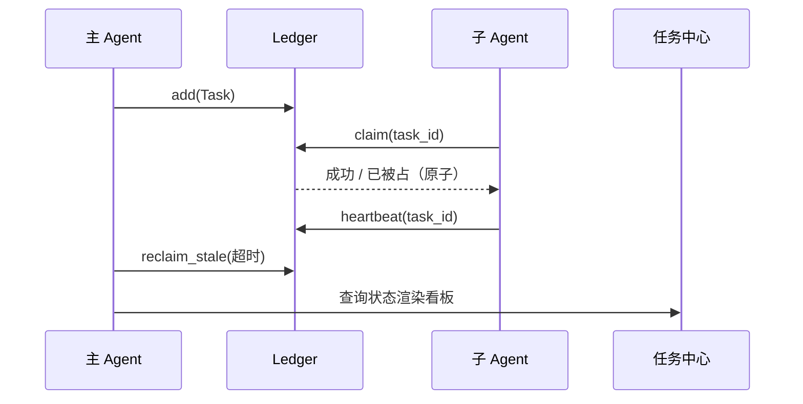

# 第 2 章　协作账本、团队分工、任务中心

> **EvoFlow 对照状态 / Alignment status：** 🔍 结构已核对（路径、行数、符号均取自源码实测），**行为**（调用顺序、边界条件）尚未逐行核对。

## 本章目标
多个 Agent（或人 + Agent）协作时，需要一个**唯一可信的账本**记录「谁在做什么、做到哪」。

## 最小闭环
主 Agent 分派 2 个子任务给不同 Agent → 账本记录指派与状态 → 任务中心展示 → 完成后汇总。

## 调用逻辑 / Invocation logic



- **入口**：`add()` 建任务，`claim()` 抢占——抢占必须是原子的，两人同时抢只能一人成功。
- **关键节点**：`heartbeat()` 续租，`reclaim_stale()` 把超时未续租的任务收回，防止任务被“忘死的 Agent”长期占着。
- **出口**：任务中心只读账本，不做第二份状态，避免看板与真实状态不一致。
- **最容易断的地方**：用「先查再写」实现抢占（并发下双claim）；没有心跳，挂了永远不回收。

## 真实模块地图（已核对：路径 · 行数 · 符号）

| 文件 | 行数 | 关键符号 | 模块常量 |
|---|---|---|---|
| `packages/harness/evoflow/collab/agent_assignment.py:57` | 191 | `normalize_agent_code_key`、`canonical_agent_code`、`is_dispatchable_workflow_worker` | BUILTIN_AGENT_UI_NAMES、DEFAULT_ASSIGNEE_CODE、LEGACY_AGENT_CODE_ALIASES |
| `packages/harness/evoflow/collab/conversation_scope.py:9` | 81 | `tool_call_hits_subtask`、`conversation_msg_belongs_to_subtask`、`is_subtask_mirror_chat_row` | — |
| `packages/harness/evoflow/collab/authorize_execution.py:20` | 280 | `is_task_execution_authorized`、`authorize_main_task_execution`、`_human_message_text` | — |
| `packages/harness/evoflow/collab/conversation_persist.py:20` | 898 | `_normalize_text_content`、`_display_payload`、`_display_row_content` | — |
| `app/gateway/routers/collab.py` | 905 | `ThreadCollabStatePatch`、`ThreadCollabStateResponse`、`SubtaskHistoryResponse`；`_resume_tool_approval_blocking`、`_delayed_client_replay_fallback`、`_resume_tool_approval_background` | — |
| `app/gateway/routers/meetings.py` | 263 | `CreateMeetingRequest`、`DiscussRequest`、`MentionRequest`；`_require_meeting_visible`、`create_meeting_endpoint`、`get_meeting_endpoint` | — |
| `packages/harness/evoflow/a2a/meeting_tool_speak.py:18` | 194 | `_clip`、`build_meeting_verify_tools`、`_tool_by_name` | — |
| `packages/harness/evoflow/a2a/meeting_conclude.py:34` | 331 | `list_meeting_speak_turns`、`_parse_conclude_json`、`_normalize_conclusion` | — |

## 核心概念
- **账本（ledger）**：append-only 的事件流（指派/开始/进度/阻塞/完成），状态由事件推导。
- **指派（assignment）**：任务 → Agent，含能力匹配与负载考虑。
- **会话作用域**：子任务有自己的会话，避免相互看到内部推理。

## 自研实现要点
```text
events(run_id, ts, actor, type, payload)  -- append-only
task_state = fold(events)                 -- 可重建，不双写
```

## 业务规则
- 账本只追加，不改写历史。
- 同一任务不能同时有两个「进行中」负责人。
- 阻塞必须写明「等什么」，否则视为无效状态。

## 常见坑
- 状态双写（事件 + 表）→ 不一致。
- 子任务共享同一个会话 → 上下文互相污染。
- 任务中心展示的是模型自述而非真实状态。

## 验收
- [ ] 状态可由事件重建
- [ ] 任务归属唯一
- [ ] 阻塞原因可读

### 源码核对记录（路径与符号实测）

- `packages/harness/evoflow/collab/agent_assignment.py`（191 行）
  - 模块自述：Resolve plan / supervisor assignee to canonical agent_code + UI display name.…
- `packages/harness/evoflow/collab/conversation_scope.py`（81 行）
  - 模块自述：Scope filters for collab chat transcript rows.…
- `packages/harness/evoflow/collab/authorize_execution.py`（280 行）
  - 模块自述：Authorize collaborative main-task execution (gate before workers run). Kept in a dedicated module so LangGraph…
- `packages/harness/evoflow/collab/conversation_persist.py`（898 行）
  - 模块自述：Persist collab subtask messages in ``evoflow_chat_messages`` (single source of truth). Subtask worker streams …
- `app/gateway/routers/collab.py`（905 行）：类 `ThreadCollabStatePatch`、`ThreadCollabStateResponse`、`SubtaskHistoryResponse`、`ToolApprovalActionBody`
  - 模块自述：Per-thread collaboration state API (``collab_state.json`` under thread dir).…
- `app/gateway/routers/meetings.py`（263 行）：类 `CreateMeetingRequest`、`DiscussRequest`、`MentionRequest`、`ConcludeRequest`
  - 模块自述：Meetings API router. Endpoints: - POST /api/meetings -> create a meeting - GET /api/meetings/{meeting_id} -> g…
- `packages/harness/evoflow/a2a/meeting_tool_speak.py`（194 行）
  - 模块自述：Read-only tools + short tool loop for meeting speak (optional 查证 mode).…
- `packages/harness/evoflow/a2a/meeting_conclude.py`（331 行）
  - 模块自述：Synthesize an optimal plan from meeting oral turns and deposit as a document.…

> 本节只证明**路径、行数、符号存在**；调用顺序与边界条件仍属「行为」，未逐行核对。

## 对照 EvoFlow 核对清单
- [ ] `agent_assignment.py` 的分配策略
- [ ] 会议（meetings）如何影响账本

## 从零实现（手把手）
> 读完这章你能写出一个任务中心：谁领了什么、状态如何、超时怎么收回。
> 文件路径一律写仓库全路径（`backend/...`），代码注释写「为什么」。

### Step 1　新建 ledger.py：认领 + 状态流转
**文件**：`backend/packages/harness/myagentflow/collab/ledger.py（新建）`
**要写的逻辑**：`claim()` 用「版本号 + 条件更新」防双领；心跳更新 `last_seen`；超时任务可被回收。

**代码**

```python
"""协作账本：任务认领与心跳。

为什么要版本号：两个人同时点「认领」，后写的那次必须失败，
否则同一个任务会被执行两遍。
"""
from __future__ import annotations

import time
from dataclasses import dataclass, field


@dataclass
class Task:
    id: str
    title: str
    status: str = "open"          # open | claimed | done | failed
    owner: str | None = None
    version: int = 0
    last_seen: float = field(default_factory=time.time)


class Ledger:
    def __init__(self) -> None:
        self._tasks: dict[str, Task] = {}

    def add(self, task: Task) -> None:
        self._tasks[task.id] = task

    def claim(self, task_id: str, owner: str, expected_version: int) -> Task:
        t = self._tasks[task_id]
        if t.status != "open" or t.version != expected_version:
            raise RuntimeError(f"认领失败：status={t.status} version={t.version}")
        t.owner = owner
        t.status = "claimed"
        t.version += 1                 # 版本一变，别人的条件更新就会失败
        t.last_seen = time.time()
        return t

    def heartbeat(self, task_id: str, owner: str) -> None:
        t = self._tasks[task_id]
        if t.owner != owner:
            raise RuntimeError("不是你的任务")
        t.last_seen = time.time()

    def reclaim_stale(self, timeout: float = 120, now: float | None = None) -> list[str]:
        now = now or time.time()
        freed = []
        for t in self._tasks.values():
            if t.status == "claimed" and now - t.last_seen > timeout:
                t.status, t.owner = "open", None
                t.version += 1
                freed.append(t.id)
        return freed
```

**验证**

```bash
uv run python -c "
from myagentflow.collab.ledger import Ledger, Task
l = Ledger(); l.add(Task('t1','写文档'))
print(l.claim('t1','alice',0).status)
try: l.claim('t1','bob',0)
except RuntimeError as e: print('bob 被拒:', e)
print(l.reclaim_stale(timeout=1, now=l._tasks['t1'].last_seen + 5))
"
```

### Step 2　写测试：双领被拒 + 超时回收
**文件**：`backend/tests/chapters/test_ch07_02_ledger.py（新建）`
**要写的逻辑**：用旧版本号第二次认领必须报错；超时后状态回到 open。

**代码**

```python
from __future__ import annotations

import pytest


def test_double_claim_and_reclaim():
    from myagentflow.collab.ledger import Ledger, Task

    l = Ledger()
    l.add(Task("t1", "写"))
    l.claim("t1", "alice", 0)

    # 第二次认领带的是旧版本号 0：必须被拒（这就是防双领）
    with pytest.raises(RuntimeError):
        l.claim("t1", "bob", 0)

    # 时间不能靠 sleep 凑：把 now 显式推到「最后心跳 + 11 秒」，
    # 超过 timeout=10 才算过期，测试才是确定的
    last_seen = l._tasks["t1"].last_seen
    assert l.reclaim_stale(timeout=10, now=last_seen + 11) == ["t1"]
    assert l._tasks["t1"].status == "open"
    assert l._tasks["t1"].version == 2
```

**验证**

```bash
uv run pytest tests/chapters/test_ch07_02_ledger.py -v
# 期望：1 passed
```

### 与 EvoFlow 对照

| 我们的做法 | EvoFlow | 为什么 |
|---|---|---|
| 版本号条件更新 | `collab/` 的账本 | 无版本会双领 |
| 心跳 + 超时回收 | 同文件 | 进程崩了任务不能永久占着 |

### 知识点

- [Harbor404 · 幂等性设计](https://harbor404.fushenlin.com/notes/idempotency-design/)：重复执行为什么必须防
- agent-book：协作与任务分配

### 验收

```bash
uv run pytest tests/chapters/test_ch07_02_ledger.py -q
```
