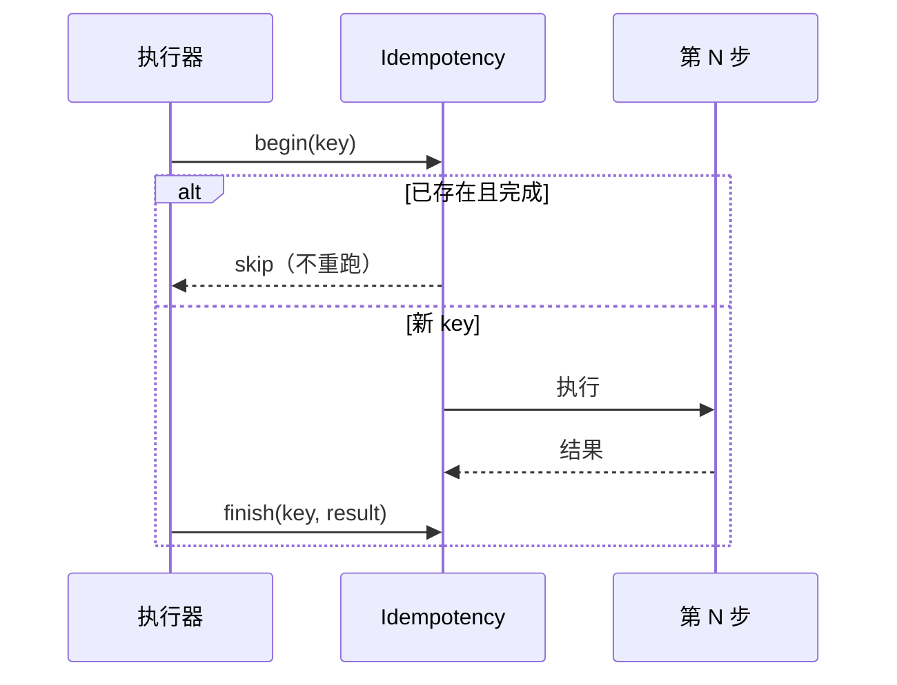

# 第 5 章　暂停恢复、幂等与重复执行

> **EvoFlow 对照状态 / Alignment status：** 🔍 结构已核对（路径、行数、符号均取自源码实测），**行为**（调用顺序、边界条件）尚未逐行核对。

## 本章目标
让「中断后继续」不产生重复副作用——这是长任务系统最容易翻车的地方。

## 最小闭环
执行到第 3 步被暂停 → 恢复 → 第 1、2 步不重跑 → 第 3 步从断点继续。

## 调用逻辑 / Invocation logic



- **入口**：每个有副作用的步骤执行前 `begin(key)`，key 由「任务+步骤+输入摘要」生成。
- **关键节点**：`begin` 返回「首次」才执行，返回「已完成」直接拿旧结果；`finish` 写结果与状态，两步之间崩溃会留下 in-flight 记录。
- **出口**：恢复时先扫 in-flight，超时的按失败处理再重跑。
- **最容易断的地方**：key 里带时间戳（每次都不同，等于没幂等）；只在成功路径写 finish。

## 真实模块地图（已核对：路径 · 行数 · 符号）

| 文件 | 行数 | 关键符号 | 模块常量 |
|---|---|---|---|
| `packages/harness/evoflow/collab/continue_subtask_session.py:17` | 250 | `_acp_agent_names`、`continue_subtask_session` | — |
| `packages/harness/evoflow/collab/conversation_persist.py:20` | 898 | `_normalize_text_content`、`_display_payload`、`_display_row_content` | — |
| `packages/harness/evoflow/collab/continue_subtask_session.py:17` | 250 | `_acp_agent_names`、`continue_subtask_session` | — |

## 核心概念
- **幂等键**：`(run_id, step_id, action_type)`；重复调用先查是否已有成功记录。
- **恢复点**：只从「已提交的检查点」恢复，不从未提交的内存状态恢复。
- **副作用分级**：只读可随意重放；写操作必须幂等键；外部通知必须去重。

## 自研实现要点
```text
effects(key, status, result_ref, created_at)  -- 唯一索引 key
执行前：if effects.exists(key) and status=done → 复用结果
```

## 业务规则
- 恢复不重放「已成功」的步骤。
- 暂停时必须落盘「当前步骤 + 已完成步骤集合」。
- 外部通知（邮件/IM）单独记投递记录。

## 常见坑
- 用消息 id 当幂等键 → 重试生成新 id。
- 只在内存记「做过」→ 重启全丢。
- 恢复时重放整轮 → 重复发消息、重复写文件。

## 验收
- [ ] 暂停/恢复后副作用次数不变
- [ ] 幂等键冲突返回旧结果而非报错
- [ ] 通知类动作有独立投递记录

### 源码核对记录（路径与符号实测）

- `packages/harness/evoflow/collab/continue_subtask_session.py`（250 行）
  - 模块自述：Continue an existing ACP subtask worker session with full context.…
- `packages/harness/evoflow/collab/conversation_persist.py`（898 行）
  - 模块自述：Persist collab subtask messages in ``evoflow_chat_messages`` (single source of truth). Subtask worker streams …
- `packages/harness/evoflow/collab/continue_subtask_session.py`（250 行）
  - 模块自述：Continue an existing ACP subtask worker session with full context.…

> 本节只证明**路径、行数、符号存在**；调用顺序与边界条件仍属「行为」，未逐行核对。

## 对照 EvoFlow 核对清单
- [ ] `continue_subtask_session.py` 的恢复边界
- [ ] 是否已有统一幂等层（目前分散在各域）

## 从零实现（手把手）
> 读完这章你能让「同一次请求重复到达」只执行一次：用幂等键 + 结果缓存。
> 文件路径一律写仓库全路径（`backend/...`），代码注释写「为什么」。

### Step 1　新建 idempotency.py：键 + 缓存 + 占用
**文件**：`backend/packages/harness/myagentflow/session_execution/idempotency.py（新建）`
**要写的逻辑**：`begin(key)` 返回 `fresh / running / cached`；running 时不要重复执行，cached 直接返回旧结果。

**代码**

```python
"""幂等：同一个请求只执行一次。

为什么不是「执行完再检查」：两个并发请求会同时通过检查，
所以必须在执行前就用「占用」把键钉住。
"""
from __future__ import annotations

import threading
import time
from dataclasses import dataclass


@dataclass
class Entry:
    status: str          # running | done
    result: object = None
    at: float = 0.0


class Idempotency:
    def __init__(self) -> None:
        self._items: dict[str, Entry] = {}
        self._lock = threading.Lock()

    def begin(self, key: str) -> tuple[str, object]:
        """返回 (状态, 结果)：fresh 可执行；running 请等待；cached 直接用。"""
        with self._lock:
            cur = self._items.get(key)
            if cur is None:
                self._items[key] = Entry("running", at=time.time())
                return "fresh", None
            if cur.status == "running":
                return "running", None
            return "cached", cur.result

    def finish(self, key: str, result: object) -> None:
        with self._lock:
            e = self._items.get(key)
            if e is None:
                return
            e.status, e.result, e.at = "done", result, time.time()
```

**验证**

```bash
uv run python -c "
from myagentflow.session_execution.idempotency import Idempotency
i = Idempotency()
print(i.begin('k1')); print(i.begin('k1'))
i.finish('k1', 'done!'); print(i.begin('k1'))
"
```

### Step 2　写测试：并发只放一个进去
**文件**：`backend/tests/chapters/test_ch07_05_idempotency.py（新建）`
**要写的逻辑**：第二次 begin 返回 running；finish 后返回 cached 且结果一致。

**代码**

```python
from __future__ import annotations


def test_idempotent():
    from myagentflow.session_execution.idempotency import Idempotency

    i = Idempotency()
    assert i.begin("k")[0] == "fresh"
    assert i.begin("k")[0] == "running"
    i.finish("k", {"ok": True})
    status, result = i.begin("k")
    assert status == "cached" and result == {"ok": True}
```

**验证**

```bash
uv run pytest tests/chapters/test_ch07_05_idempotency.py -v
# 期望：1 passed
```

### 与 EvoFlow 对照

| 我们的做法 | EvoFlow | 为什么 |
|---|---|---|
| 执行前占用键 | 幂等中间件 | 执行后检查挡不住并发 |
| cached 返回旧结果 | 同文件 | 重试要拿到同一结果，不是「再跑一次」 |

### 知识点

- [Harbor404 · 幂等性设计](https://harbor404.fushenlin.com/notes/idempotency-design/)：本章核心参考
- agent-book：重试与恢复

### 验收

```bash
uv run pytest tests/chapters/test_ch07_05_idempotency.py -q
```
