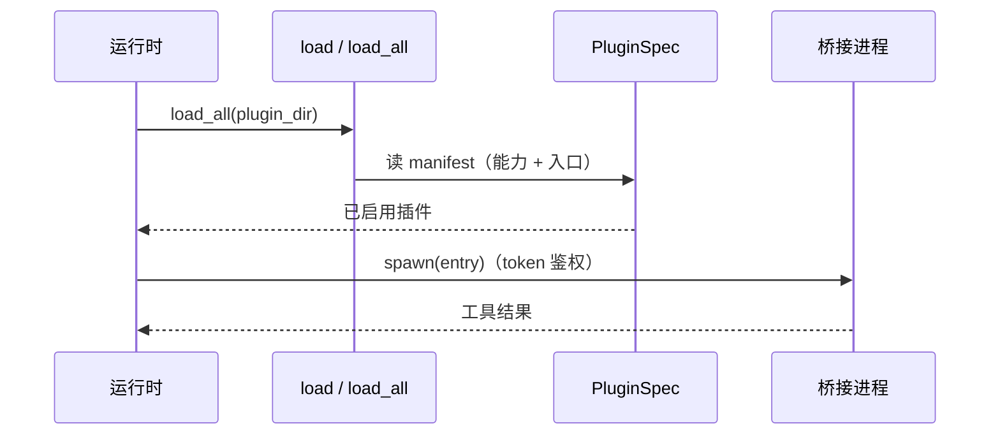

# 第 2 章　插件扩展壳、运行桥接与 Capability 授权

> **EvoFlow 对照状态 / Alignment status：** 🔍 结构已核对（路径、行数、符号均取自源码实测），**行为**（调用顺序、边界条件）尚未逐行核对。

## 本章目标
用插件把「本机能力」安全地接进 Agent：浏览器、桌面、Node 脚本、外部 CLI。

## 最小闭环
安装插件包 → 声明 manifest（能力 + 入口）→ 运行时 spawn 桥接进程 → 工具调用走 token 鉴权。

## 调用逻辑 / Invocation logic



- **入口**：`load_all()` 扫目录、`load()` 读单个 manifest；manifest 缺字段直接跳过并记原因。
- **关键节点**：插件声明的能力要与宿主授予的权限求交集，声明了不等于允许。
- **出口**：桥接进程按需启动、空闲退出，token 每次会话新签。
- **最容易断的地方**：manifest 里写绝对路径（换机器就废）；插件崩溃拖垮主进程。

## 真实模块地图（已核对：路径 · 行数 · 符号）

| 文件 | 行数 | 关键符号 | 模块常量 |
|---|---|---|---|
| `packages/harness/evoflow/plugins/service.py:101` | 862 | `PluginManagementService`；`_now`、`_ulog`、`_diagnostic_to_json` | — |
| `packages/harness/evoflow/plugins/runtime.py:41` | 342 | `_ulog`、`_iter_enabled_plugins`、`enabled_plugin_roots` | — |
| `packages/harness/evoflow/plugins/sources.py:41` | 396 | `PluginSourceError`；`parse_marketplace_source_input`、`fetch_marketplace_json`、`_run_git` | GIT_COMMAND_TIMEOUT_SEC、MARKETPLACE_JSON_TIMEOUT_SEC |
| `packages/harness/evoflow/memory/storage.py:34` | 135 | `MemoryStorage`、`OwnedMemoryStorage`；`create_empty_memory`、`get_memory_storage`、`reset_memory_storage_for_tests` | — |
| `packages/harness/evoflow/plugins/manifest.py:51` | 382 | `PluginManifestError`；`is_record`、`validate_plugin_name`、`find_plugin_manifest_path` | MARKETPLACE_FILE、CLAUDE_MARKETPLACE_FILE、EVOFLOW_MANIFEST_PATH |
| `packages/harness/evoflow/plugins/components.py:19` | 208 | `enumerate_plugin_components`、`_collect_markdown_components`、`_collect_skill_components` | COMPONENT_KINDS |
| `packages/harness/evoflow/plugins/builtin.py:39` | 597 | `_rebrand_listing_text`、`_rebrand_entry_text`、`builtin_plugin_dir` | BUILTIN_DIR、SEED_MANIFEST_VERSION、EXCLUDED_OFFICIAL_PLUGINS |
| `packages/harness/evoflow/plugins/bridge_auth.py:33` | 94 | `_token_file_path`、`reset_bridge_token_cache`、`get_bridge_token` | — |
| `packages/harness/evoflow/plugins/node_repl.py:30` | 1111 | `_ulog`、`_sanitize_model_browser_js`、`_meta_envelope` | — |
| `packages/harness/evoflow/plugins/node_repl_tool.py:111` | 564 | `NodeReplJsInput`；`_maybe_compact_browser_docs_dump`、`_get_thread_id`、`_decode_image` | — |
| `packages/harness/evoflow/plugins/cua_helper.py:40` | 162 | `_helper_entry`、`_helper_addon`、`is_helper_runtime` | HELPER_RUNTIME_DIRNAME、HELPER_ENTRY_REL、HELPER_ADDON_REL |
| `packages/harness/evoflow/capability/registry.py:136` | 489 | `Capability`、`CapabilityRegistry`；`default_decision`、`decide`、`_schema_for_params` | — |
| `packages/harness/evoflow/a2a/models.py:18` | 161 | `TaskState`、`A2ATask`、`AgentCard` | — |
| `app/gateway/routers/plugins.py` | 255 | `AddMarketplaceRequest`、`InstallPluginRequest`、`SetEnabledRequest`；`_org_admin_guard`、`_get_service`、`_to_http_error` | — |
| `packages/harness/evoflow/plugins/manifest.py:51` | 382 | `PluginManifestError`；`is_record`、`validate_plugin_name`、`find_plugin_manifest_path` | MARKETPLACE_FILE、CLAUDE_MARKETPLACE_FILE、EVOFLOW_MANIFEST_PATH |
| `packages/harness/evoflow/plugins/bridge_auth.py:33` | 94 | `_token_file_path`、`reset_bridge_token_cache`、`get_bridge_token` | — |

## 核心概念
- **manifest 即契约**：`{id, version, capabilities[], entry, permissions[]}`。
- **capability 授权**：插件只能拿到被授予的能力（如「浏览器只读」「文件写限于 workspace」）。
- **桥接安全**：随机 token + 仅回环地址 + 一次性会话。
- **隔离**：插件进程独立，崩溃不带走主进程。

## 自研实现要点
```text
plugin(id, version, manifest_json, enabled, installed_at)
bridge(plugin_id, port, token_hash, pid, last_heartbeat)
```

## 业务规则
- 插件安装需签名/来源校验；未知来源默认禁用。
- 能力变更必须重新授权。
- 插件崩溃 → 熔断（连续 3 次失败禁用）。

## 常见坑
- 桥接端口固定且无 token → 本机任意进程可驱动。
- 插件卸载残留进程/端口。
- manifest 声明的能力与实际使用的权限不一致。

## 验收
- [ ] 未授权能力调用被拒
- [ ] 插件进程可回收
- [ ] 崩溃熔断生效

### 源码核对记录（路径与符号实测）

- `packages/harness/evoflow/plugins/service.py`（862 行）：类 `PluginManagementService`；环境变量 `EVOFLOW_OFFICIAL_PLUGIN_MARKETPLACE`
  - 模块自述：Plugin management service — the EvoFlow port of ZCode's plugin management. Implements the same operation set a…
- `packages/harness/evoflow/plugins/runtime.py`（342 行）
  - 模块自述：Plugin runtime integration — exposes installed plugins to the agent runtime. This module is the bridge between…
- `packages/harness/evoflow/plugins/sources.py`（396 行）：类 `PluginSourceError`；环境变量 `EVOFLOW_OFFICIAL_PLUGIN_MARKETPLACE`
  - 模块自述：Marketplace and plugin source parsing/resolution (ZCode parity subset). Supported marketplace sources: ``url``…
- `packages/harness/evoflow/memory/storage.py`（135 行）：类 `MemoryStorage`、`OwnedMemoryStorage`
  - 模块自述：Memory storage providers — backed by unified mem_* on Owned KB.…
- `packages/harness/evoflow/plugins/manifest.py`（382 行）：类 `PluginManifestError`
  - 模块自述：Manifest parsing for plugin.json / marketplace.json and frontmatter helpers. Mirrors ZCode adapters/plugins/ma…
- `packages/harness/evoflow/plugins/components.py`（208 行）
  - 模块自述：Plugin component enumeration (port of ZCode plugin-components.ts). Produces the ``components: [{kind, items: […
- `packages/harness/evoflow/plugins/builtin.py`（597 行）；环境变量 `EVOFLOW_BUNDLED_PLUGINS_ROOT`
  - 模块自述：Builtin official marketplace seeding. The store lists only plugins shipped with EvoFlow: 1. **Packaged bundle*…
- `packages/harness/evoflow/plugins/bridge_auth.py`（94 行）；环境变量 `EVOFLOW_BRIDGE_TOKEN_FILE`、`EVOFLOW_BROWSER_BRIDGE_TOKEN`
  - 模块自述：Browser/CUA bridge token（对齐 ZCode broker-token 鉴权语义）. node-repl 内核桥经本地 HTTP 调 Gateway 的浏览器/CUA 命令面（``/api/brow…
- `packages/harness/evoflow/plugins/node_repl.py`（1111 行）；环境变量 `EVOFLOW_BROWSER_BRIDGE_TOKEN`、`EVOFLOW_BROWSER_DOCS_ROOT`、`EVOFLOW_GATEWAY_PORT`、`EVOFLOW_GATEWAY_URL`
  - 模块自述：EvoFlow host for the ZCode ``node_repl`` kernel (Browser Use / Computer Use). The official plugins' skills (``…
- `packages/harness/evoflow/plugins/node_repl_tool.py`（564 行）：类 `NodeReplJsInput`
  - 模块自述：``mcp__node_repl__js`` — Browser Use / Computer Use kernel tool. Registered only when one of the dependent off…
- `packages/harness/evoflow/plugins/cua_helper.py`（162 行）；环境变量 `EVOFLOW_CUA_HELPER_ROOT`、`EVOFLOW_NODE_COMMAND`
- `packages/harness/evoflow/capability/registry.py`（489 行）：类 `Capability`、`CapabilityRegistry`
  - 模块自述：Capability registry: permission matrix, decision logic, and dispatch. Python/Pydantic port of ``nomifun-gatewa…
- `packages/harness/evoflow/a2a/models.py`（161 行）：类 `TaskState`、`A2ATask`、`AgentCard`
  - 模块自述：A2A protocol data models (Pydantic v2). Mirrors the A2A (Agent-to-Agent) Protocol v0.3 data structures so the …
- `app/gateway/routers/plugins.py`（255 行）：类 `AddMarketplaceRequest`、`InstallPluginRequest`、`SetEnabledRequest`、`ConfigurePluginRequest`
  - 模块自述：ZCode-style plugin management REST API. All endpoints return the exact wire shapes the vendored ZCode settings…
- `packages/harness/evoflow/plugins/manifest.py`（382 行）：类 `PluginManifestError`
  - 模块自述：Manifest parsing for plugin.json / marketplace.json and frontmatter helpers. Mirrors ZCode adapters/plugins/ma…
- `packages/harness/evoflow/plugins/bridge_auth.py`（94 行）；环境变量 `EVOFLOW_BRIDGE_TOKEN_FILE`、`EVOFLOW_BROWSER_BRIDGE_TOKEN`
  - 模块自述：Browser/CUA bridge token（对齐 ZCode broker-token 鉴权语义）. node-repl 内核桥经本地 HTTP 调 Gateway 的浏览器/CUA 命令面（``/api/brow…

> 本节只证明**路径、行数、符号存在**；调用顺序与边界条件仍属「行为」，未逐行核对。

## 对照 EvoFlow 核对清单
- [ ] `manifest.py` 的字段定义
- [ ] `bridge_auth.py` 的鉴权细节
- [ ] 官方插件包清单（`packaging/OFFICIAL-PLUGINS.md`）

## 从零实现（手把手）
> 读完这章你能写一个插件壳：插件只声明「名字 + 入口」，由宿主负责加载与隔离失败。
> 文件路径一律写仓库全路径（`backend/...`），代码注释写「为什么」。

### Step 1　新建 loader.py：声明式加载
**文件**：`backend/packages/harness/myagentflow/skills/loader.py（新建）`
**要写的逻辑**：插件用 `entry` 字符串（`module:func`）；加载失败只记录不抛出，避免一个坏插件拖垮启动。

**代码**

```python
"""插件加载：声明式入口 + 失败隔离。

为什么失败不抛出：插件是第三方代码，一个 import 报错
不该让整个宿主起不来。
"""
from __future__ import annotations

import importlib
import logging
from dataclasses import dataclass
from typing import Any, Callable

logger = logging.getLogger(__name__)


@dataclass(frozen=True)
class PluginSpec:
    name: str
    entry: str          # "package.module:function"


def load(spec: PluginSpec) -> Callable[..., Any] | None:
    module_name, _, attr = spec.entry.partition(":")
    try:
        module = importlib.import_module(module_name)
        fn = getattr(module, attr)
    except Exception as exc:
        logger.error("插件加载失败 %s：%s", spec.name, exc)
        return None
    return fn

def load_all(specs: list[PluginSpec]) -> dict[str, Callable[..., Any]]:
    loaded = {}
    for spec in specs:
        fn = load(spec)
        if fn is not None:
            loaded[spec.name] = fn
    return loaded
```

**验证**

```bash
uv run python -c "
from myagentflow.skills.loader import PluginSpec, load_all
print(load_all([PluginSpec('bad','no_such_mod:fn'), PluginSpec('ok','json:dumps')]))
"
```

### 与 EvoFlow 对照

| 我们的做法 | EvoFlow | 为什么 |
|---|---|---|
| `module:func` 入口 | `skills/` 的插件壳 | 字符串入口才能不改宿主加插件 |
| 加载失败只记日志 | 同文件 | 第三方代码不可信 |

### 知识点

- [MCP Server 多实例与负载均衡：桥接层的坑](https://harbor404.fushenlin.com/notes/mcp-server-multi-instance-load-balancing/)
- [系统课入口：扩展机制](https://g0-000.github.io/agent-book/)

### 验收

```bash
uv run python -c "from myagentflow.skills.loader import PluginSpec; print('ok')"
```
