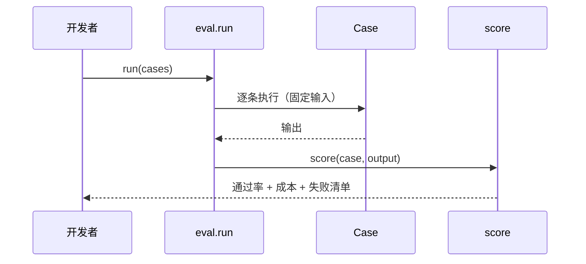

# 第 5 章　Eval 质量评估与回归闭环

> **EvoFlow 对照状态 / Alignment status：** 🔍 结构已核对（路径、行数、符号均取自源码实测），**行为**（调用顺序、边界条件）尚未逐行核对。

## 本章目标
把「感觉变好了」变成「可复现的分数变化」，并让它进入 CI。

## 最小闭环
定义 10 个场景 → 跑基线 → 改提示词/工具 → 再跑 → 对比通过率与成本。

## 调用逻辑 / Invocation logic



- **入口**：`run(cases)` 批量跑，用例固定输入与期望，不允许每次临时改。
- **关键节点**：`score()` 支持精确匹配与规则匹配两类；成本一并记录，否则「变好但贵十倍」看不出来。
- **出口**：结果落基线文件，下次对比通过率与成本变化。
- **最容易断的地方**：用例依赖真实模型导致不可复现；只看总分不看失败清单。

## 真实模块地图（已核对：路径 · 行数 · 符号）

| 文件 | 行数 | 关键符号 | 模块常量 |
|---|---|---|---|
| `packages/harness/evoflow/eval/eval_engine.py:36` | 907 | `_now_ms`、`_new_run_id`、`_new_alert_id` | — |
| `packages/harness/evoflow/eval/case_spec.py:22` | 1251 | `CaseDesign`、`CaseSpec`；`_d`、`_spec`、`catalog_by_id` | FLOW_LABELS、PRIORITY_LABELS、LEVEL_LABELS |
| `packages/harness/evoflow/eval/modules.py:62` | 132 | `resolve_module`、`module_label`、`enrich_case_row` | MODULE_LABELS、MODULE_CASE_DESIGN、MODULE_ORDER |
| `packages/harness/evoflow/eval/performance.py:21` | 366 | `_since_ms`、`_iter_response_latencies`、`_count_messages_by_role` | — |
| `packages/harness/evoflow/eval/business_quality.py:22` | 328 | `_clamp`、`evaluate_task_quality`、`evaluate_tool_reliability` | — |
| `packages/harness/evoflow/eval/security.py:32` | 467 | `_table_exists`、`_columns`、`scan_data_leaks` | — |
| `packages/harness/evoflow/observability/eval_metrics.py:14` | 498 | `fetch_invalid_tool_calls_summary`、`fetch_thread_tool_density`、`fetch_compress_kind_stats` | — |
| `packages/harness/evoflow/eval/data_sources.py:29` | 776 | `_now_ms`、`_table_exists`、`_columns` | — |
| `packages/harness/evoflow/eval/response_adapters.py:22` | 688 | `_ms_to_s`、`_fmt_duration_ms`、`_iso_now` | — |
| `packages/harness/evoflow/eval/dashboard.py:25` | 252 | `_clamp`、`_safe_score`、`_ts_str` | — |
| `app/gateway/routers/eval.py` | 574 | `_org_admin_dep`、`_ok`、`dashboard_summary` | — |
| `packages/harness/evoflow/eval/security.py:32` | 467 | `_table_exists`、`_columns`、`scan_data_leaks` | — |

## 核心概念
- **场景（scenario）即测试用例**：输入 + 期望性质（不含逐字答案）。
- **判定器**：规则断言（含工具名/参数）+ LLM 评判（需校准，防漂移）。
- **多维指标**：正确性、工具正确率、时延、成本、安全。
- **回归门槛**：不达标不得合并。

## 自研实现要点
```text
case(id, input, must_include[], must_call_tools[], must_not[], rubric)
run_eval(cases) → per-case result + aggregate
baseline.json 对比 → delta
```

## 业务规则
- 评测集版本化；改动需评审。
- LLM 评判需固定模型与提示，并抽样人工校验。
- 失败用例必须能单独复跑。

## 常见坑
- 用同一模型既生成又评判 → 自洽偏差。
- 用例过拟合提示词 → 换一批就崩。
- 只看平均分不看成本与时延。

## 验收
- [ ] 基线可复现（同输入同分）
- [ ] 回归门槛生效
- [ ] 失败用例可单跑

### 源码核对记录（路径与符号实测）

- `packages/harness/evoflow/eval/eval_engine.py`（907 行）；环境变量 `EVOFLOW_EVAL_INLINE`
  - 模块自述：Evaluation engine - run management, case registry, history, compare. Dual engines: - scenario — isolated temp …
- `packages/harness/evoflow/eval/case_spec.py`（1251 行）：类 `CaseDesign`、`CaseSpec`
  - 模块自述：Industry-aligned eval case specifications (SSOT for catalog + seeds + UI). Layers (pyramid): L0 — component/de…
- `packages/harness/evoflow/eval/modules.py`（132 行）
  - 模块自述：Eval case module taxonomy (产品七大模块 + 平台门禁 + 观测). Case design SSOT lives in ``evoflow.eval.case_spec``; this mod…
- `packages/harness/evoflow/eval/performance.py`（366 行）
  - 模块自述：性能评测器 —— 基于 ``evoflow_chat_messages`` 的响应延迟与错误统计。 约定： - 响应时间 = 一条 ``user`` 消息与同一会话中下一条 ``assistant`` 消息的 ``cre…
- `packages/harness/evoflow/eval/business_quality.py`（328 行）
  - 模块自述：业务质量评测器 —— 基于 data_sources 采集的真实数据做量化评估。 各评估函数返回结构化的质量评分与明细，供健康总览与业务质量 API 直接消费。 去 Mock 原则：数据为空返回 0/空结构，不生成随机假…
- `packages/harness/evoflow/eval/security.py`（467 行）
  - 模块自述：Security evaluator - real-data security metrics. Covers: data leak scan, permission matrix, config audit, vuln…
- `packages/harness/evoflow/observability/eval_metrics.py`（498 行）
  - 模块自述：Evaluation metrics, health scores, sample thread selection, and eval snapshot bundle.…
- `packages/harness/evoflow/eval/data_sources.py`（776 行）
  - 模块自述：真实数据采集器 —— 从 ``evoflow.db`` 采集评测中心所需的业务数据。 所有查询均为参数化 SQL，优先基于数据库真实表（``evoflow_mission_nodes`` / ``evoflow_chat…
- `packages/harness/evoflow/eval/response_adapters.py`（688 行）
  - 模块自述：评估中心响应适配层 ==================== 将各评估模块的原生输出（snake_case、嵌套结构）转换为前端类型定义 期望的 camelCase 格式，确保前后端字段名完全对齐。 前端类型定义见：ev…
- `packages/harness/evoflow/eval/dashboard.py`（252 行）
  - 模块自述：健康总览数据聚合 —— 综合多维度得分、告警、Agent 排行、评测记录。 去 Mock 原则：所有数据来自真实统计；无数据返回 0/空结构，不生成随机假数据。 有最近 scenario run 时，将 scenario…
- `app/gateway/routers/eval.py`（574 行）
  - 模块自述：评测中心 API 路由 —— 健康总览 + 业务质量 + 安全中心 + 性能基准 + 评测管理。 所有接口返回统一信封 ``{ "code": 0, "data": {...}, "message": "ok" }``。…
- `packages/harness/evoflow/eval/security.py`（467 行）
  - 模块自述：Security evaluator - real-data security metrics. Covers: data leak scan, permission matrix, config audit, vuln…

> 本节只证明**路径、行数、符号存在**；调用顺序与边界条件仍属「行为」，未逐行核对。

## 对照 EvoFlow 核对清单
- [ ] `eval/scenarios/` 的场景数与分类
- [ ] `eval/security.py` 的安全用例
- [ ] RAG/Agent 评测体系（参考 Harbor404📚）

## 从零实现（手把手）
> 读完这章你能写一个最小 eval：固定用例 + 关键词断言 + 通过率，改动后一跑就知道有没有退化。
> 文件路径一律写仓库全路径（`backend/...`），代码注释写「为什么」。

### Step 1　新建 runner.py：用例 + 打分
**文件**：`backend/packages/harness/myagentflow/eval/runner.py（新建）`
**要写的逻辑**：用例是 `(输入, 必须包含的关键词)`；打分只判「包含/不包含」，不做主观评分——主观评分不稳定，回归时会误导。

**代码**

```python
"""Eval：固定用例 + 可判定的断言。

为什么不用「让模型打分」：模型评分每次都会飘，
回归测试需要的是稳定信号，哪怕它很粗糙。
"""
from __future__ import annotations

from collections.abc import Callable
from dataclasses import dataclass


@dataclass(frozen=True)
class Case:
    name: str
    prompt: str
    must_contain: tuple[str, ...] = ()


def score(case: Case, answer: str) -> bool:
    return all(k in answer for k in case.must_contain)


def run(cases: list[Case], answer_fn: Callable[[str], str]) -> dict:
    results = []
    for c in cases:
        try:
            ok = score(c, answer_fn(c.prompt))
        except Exception as exc:
            results.append({"name": c.name, "ok": False, "error": str(exc)})
            continue
        results.append({"name": c.name, "ok": ok})

    passed = sum(1 for r in results if r["ok"])
    return {"total": len(results), "passed": passed,
            "rate": round(passed / max(1, len(results)), 3), "results": results}
```

**验证**

```bash
uv run python -c "
from myagentflow.eval.runner import Case, run
cases = [Case('c1','说你好',('你好',)), Case('c2','说再见',('再见',))]
print(run(cases, lambda p: '你好'))
"
```

### Step 2　写测试：通过率与异常隔离
**文件**：`backend/tests/chapters/test_ch11_05_eval.py（新建）`
**要写的逻辑**：一条命中一条不命中，rate=0.5；抛异常的用例被记为失败而不是中断整轮。

**代码**

```python
from __future__ import annotations


def test_eval():
    from myagentflow.eval.runner import Case, run

    cases = [Case("a", "x", ("你好",)), Case("b", "y", ("再见",))]
    report = run(cases, lambda p: "你好")
    assert report["passed"] == 1 and report["rate"] == 0.5

    def boom(_p):
        raise RuntimeError("model down")

    report = run(cases, boom)
    assert report["passed"] == 0 and all("error" in r for r in report["results"])
```

**验证**

```bash
uv run pytest tests/chapters/test_ch11_05_eval.py -v
# 期望：1 passed
```

### 与 EvoFlow 对照

| 我们的做法 | EvoFlow | 为什么 |
|---|---|---|
| 关键词断言 | `eval/` 的评分 | 主观评分不稳定，回归会误报 |
| 异常记失败不中断 | 同文件 run | 一条崩了不该让整轮无结果 |

### 知识点

- [Agent 评测体系：指标、集与回归](https://harbor404.fushenlin.com/notes/agent-evaluation-system/)
- [RAG 评测体系：检索类指标怎么定](https://harbor404.fushenlin.com/notes/rag-evaluation-system/)

### 验收

```bash
uv run pytest tests/chapters/test_ch11_05_eval.py -q
```
