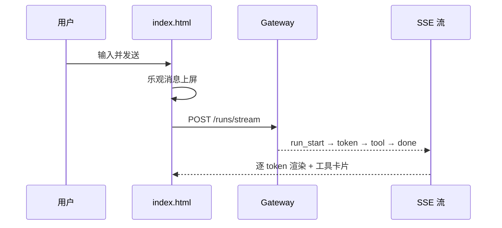

# 第 1 章　Web 启动、聊天会话与历史

> **EvoFlow 对照状态 / Alignment status：** 🔍 结构已核对（路径、行数、符号均取自源码实测），**行为**（调用顺序、边界条件）尚未逐行核对。

## 本章目标
理解一次「发送」在前端到底发生了什么，以及历史消息为什么以服务端为准。

## 最小闭环
输入框发送 → 乐观消息上屏 → POST `/runs/stream` → 逐 token 渲染 → 工具卡片 → 完成。

## 调用逻辑 / Invocation logic



- **入口**：页面只有一个入口 `POST /runs/stream`，历史靠 `GET /sessions/{id}/messages` 回填。
- **关键节点**：先渲染本地消息再发请求（乐观 UI），失败要能回滚；工具事件单独渲染成卡片而不是文本。
- **出口**：`done` 后把 run 状态置完成，断线重连带 `Last-Event-ID` 补齐。
- **最容易断的地方**：等首 token 才上屏（体感慢）；断线后从头重放导致消息重复。

## 真实模块地图（已核对：路径 · 行数 · 符号）

| 文件 | 行数 | 关键符号 | 模块常量 |
|---|---|---|---|
| `evopanel/src/react/chat-app/composer/handle-send.ts` | 934 |  | — |
| `app/gateway/routers/chat_sessions.py` | 2063 | `ForkSessionBody`、`TruncateSessionBody`；`_transcript_db_busy_http`、`_request_principal_id`、`_require_session_access` | — |
| `app/gateway/routers/langgraph_proxy.py` | 963 | `register_active_stream_proxy`、`unregister_active_stream_proxy`、`list_active_stream_proxies` | LANGGRAPH_BASE_URL、DISABLE_SSE_DEBUG_FILE_LOGS、DEBUG_SSE_REASONING |

## 核心概念
- **先 ensure thread 再 run**：`POST /threads` 建执行线，`POST /runs/stream` 才执行。
- **transcript 是 SSOT**：`evoflow_chat_messages` 为模型上下文事实源；本轮 input 只是当前消息。
- **乐观更新**：本地先插一条，服务端确认后替换为权威版本（含 message_id）。
- **attach ≠ create**：`GET .../runs/{id}/stream` 是重连，不是新建。

## 自研实现要点
```text
send(): optimistic(msg) → ensureThread() → POST runs/stream → onEvent(seq)
重连：last_seq → GET run stream（attach）→ 补发 → 去重
```

## 业务规则
- 同一会话不允许两个并发 POST stream。
- 失败回滚乐观消息并提示可重试。
- 历史加载与流式补发不得重复插入。

## 常见坑
- 每次发送都新建 thread → 历史断层。
- 乐观消息无临时 id → 确认后重复。
- 重连直接重放全部 → 重复内容。

## 验收
- [ ] 断线重连无重复
- [ ] 停止后 UI 状态正确
- [ ] 历史与流式结果一致

### 源码核对记录（路径与符号实测）

- `evopanel/src/react/chat-app/composer/handle-send.ts`（934 行）
- `app/gateway/routers/chat_sessions.py`（2063 行）：类 `ForkSessionBody`、`TruncateSessionBody`；环境变量 `EVOFLOW_SESSIONS_LIST_SHED_LIMIT`、`EVOFLOW_SESSIONS_LIST_TIMEOUT_S`
  - 模块自述：Chat session index + application-owned transcript (not LangGraph checkpoint).…
- `app/gateway/routers/langgraph_proxy.py`（963 行）；环境变量 `EVOFLOW_ACTIVE_SESSIONS_CACHE_TTL`、`EVOFLOW_DEBUG_SSE_REASONING`、`EVOFLOW_FAST_THREAD_STATE`、`EVOFLOW_LANGGRAPH_URL`
  - 模块自述：Reverse proxy for LangGraph API under gateway /api/langgraph.…

> 本节只证明**路径、行数、符号存在**；调用顺序与边界条件仍属「行为」，未逐行核对。

## 对照 EvoFlow 核对清单
- [ ] `ws-client.js` 的 TTL/重试策略
- [ ] `ensure-thread` 的 `force_recreate` 条件

## 从零实现（手把手）
> 读完这章你能用一个 HTML 页面把网关跑起来：发消息、看流式回复、切会话。
> 文件路径一律写仓库全路径（`backend/...`），代码注释写「为什么」。

### Step 1　新建 index.html：一个页面三件事
**文件**：`backend/app/webui/static/index.html（新建）`
**要写的逻辑**：用原生 `fetch` + `ReadableStream` 读 SSE，不引前端框架；会话切换就是换 `thread_id`。

**代码**

```python
<!doctype html>
<html lang="zh">
<head><meta charset="utf-8"><title>my-agent-flow</title>
<style>
  body{font-family:system-ui;margin:24px;max-width:760px}
  #log{white-space:pre-wrap;border:1px solid #ddd;padding:12px;height:320px;overflow:auto}
  input{width:70%;padding:8px} button{padding:8px 14px}
</style></head>
<body>
<h2>my-agent-flow</h2>
<div>
  会话：<input id="thread" value="default" size="12">
  <button id="newThread">新会话</button>
</div>
<div id="log"></div>
<div><input id="text" placeholder="输入消息，回车发送"><button id="send">发送</button></div>

<script>
const log = document.getElementById('log');
const threadEl = document.getElementById('thread');

function append(s){ log.textContent += s; log.scrollTop = log.scrollHeight; }

// 读 SSE：按空行切帧，取 data: 行里的 JSON
async function send(){
  const text = document.getElementById('text').value.trim();
  if(!text) return;
  append(`\n你：${text}\nAI：`);
  document.getElementById('text').value = '';

  const resp = await fetch('/api/chat', {
    method:'POST', headers:{'content-type':'application/json'},
    body: JSON.stringify({thread_id: threadEl.value, text})
  });
  const reader = resp.body.getReader();
  const decoder = new TextDecoder();
  let buf = '';
  while(true){
    const {value, done} = await reader.read();
    if(done) break;
    buf += decoder.decode(value, {stream:true});
    const frames = buf.split('\n\n'); buf = frames.pop();   // 最后一段可能不完整
    for(const f of frames){
      for(const line of f.split('\n')){
        if(!line.startsWith('data:')) continue;
        const evt = JSON.parse(line.slice(5));
        if('text' in evt) append(evt.text);
        if('message' in evt) append(`[错误] ${evt.message}`);
      }
    }
  }
}

document.getElementById('send').onclick = send;
document.getElementById('text').addEventListener('keydown', e => { if(e.key==='Enter') send(); });
document.getElementById('newThread').onclick = () => {
  threadEl.value = 't-' + Math.random().toString(36).slice(2,8);
  log.textContent = '';
};
</script>
</body></html>
```

**验证**

```bash
uv run uvicorn app.gateway.main:app --port 8070
# 浏览器打开 http://localhost:8070/webui/static/index.html
# 期望：输入消息后逐字出现回复；点「新会话」后重新开始
```

### 与 EvoFlow 对照

| 我们的做法 | EvoFlow | 为什么 |
|---|---|---|
| 原生 fetch 读流 | `webui/` 的聊天页 | 引框架会盖住「SSE 怎么读」这件事 |
| 按空行切帧 | 同上 | 一次 read 可能半帧，不缓存会解析失败 |

### 知识点

- [agent-book](https://g0-000.github.io/agent-book/)：前端与流式
- Harbor404：SSE 调试

### 验收

```bash
curl -s localhost:8070/health
```
