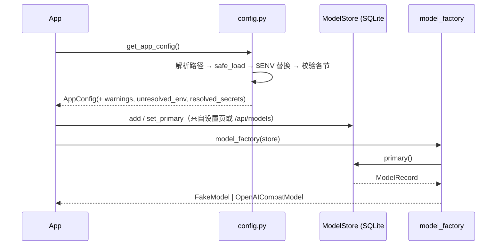

# 第 1 章　配置与模型 / Configuration and Models

> **EvoFlow 对照状态 / Alignment status**
> 配置章节的文件职责与关键符号按 EvoFlow `config/`、`models/` 结构核对；本项目只实现当前闭环所需的五个配置分区和 OpenAI provider。实现细节与上游不同处均标为本项目阶段选择。
>
> ::: warning 证据边界
> 本章以当前仿写仓库代码为实现事实；EvoFlow 源码路径和符号作为结构参照，不把配置示例的注释当作运行时行为证据。
> :::

## 本章目标 / Goals
- 用 **YAML + `$ENV` 替换 + 类型化配置节** 描述应用配置，并在启动时 **fail fast**。
- 本项目当前阶段将模型条目放在配置中，由 resolver 选择、factory 构造；EvoFlow 模型持久化方式属于后续差异说明，不在此伪造 ModelStore。
- 建立 **credential boundary**：密钥只来自环境变量或模型库，且不会出现在 repr、日志、API 列表中。
- 通过 **model factory** 取得「主模型」；测试用 **FakeModel**。

## 1. 已核对的事实 / Verified facts
| # | 事实（来自 `config.example.yaml`） | 本章对应实现 |
|---|---|---|
| 1 | 默认读取工作目录下的 `config.yaml`；可用环境变量 `DEER_FLOW_CONFIG_PATH` 改路径（名字沿用自 DeerFlow） | `resolve_config_path`：参数 → `EVOFLOW_CONFIG_PATH` → 旧名 → `./config.yaml` |
| 2 | 任何字段值都可写 `$ENV_VAR`（如 `api_key: $OPENAI_API_KEY`） | `substitute_env`（整值引用；也支持 `${VAR}`） |
| 3 | `use:` 是 `"package.module:class_or_var"` 字符串（沙箱、工具、护栏 provider 都用它） | `resolve_variable` |
| 4 | `config_version`（上游示例为 11），schema 变化时递增；`make config-upgrade` 合并新字段 | 版本告警；升级命令不复刻 |
| 5 | **聊天模型和 `primary_model` 只存在 SQLite**（`evoflow.db` 的 `evoflow_models` / `evoflow_app_settings`）；YAML 里残留的 `models:` / `primary_model:` **启动时被忽略**；在 EvoPanel「设置 → 模型」或 Gateway `GET/POST/PUT/DELETE /api/models` 管理 | `ModelStore`、`parse_config` 的忽略告警 |
| 6 | 联网搜索偏好存在 DB 键 `web.search`；`config.yaml` 的 `web.backend` 对搜索无效 | `ModelStore.get/set_setting` |
| 7 | `token_usage.pricing`：键支持通配符、**最长匹配优先**；未配置的模型费用记 0（界面显示 —） | `TokenUsage.price_for / cost` |
| 8 | `summarization.trigger` 可写单个或列表，**任一满足即触发（OR）**；类型 `tokens / messages / fraction`；`threshold_ratio: 0.90`，`aggressive_ratio: 1.0`；`keep` 指定保留量 | `Summarization.should_summarize` |
| 9 | `checkpointer.type` ∈ memory / sqlite / postgres；桌面默认 sqlite，路径 `data/checkpoints/checkpoints.db`；memory 不会被清理 | `Checkpointer` |
| 10 | 应用库 `data/app/evoflow.db`；「每个数据库一个子目录」；根目录的旧版扁平文件会在 Gateway 启动时迁移 | `Storage`、`DataPaths` |
| 11 | `execution_security.profile` ∈ read-only / workspace / danger-full-access；`approval` ∈ untrusted / on-request / never；**会话档位覆盖全局值** | `ExecutionSecurity`（会话覆盖留给第 6 部分） |
| 12 | `guardrails`：`enabled`、`fail_closed`（默认 true）、`provider.use + config`；拒绝的调用返回一条错误 ToolMessage，让 Agent 自行调整 | `Guardrails`（行为留给第 6 部分） |
| 13 | `agent_orchestration.default` ∈ react / hybrid / local_scheduler，默认 hybrid | `AgentOrchestration` |
| 14 | `subagents.timeout_seconds` 默认 900，可按 agent 覆盖 | `Subagents.timeout_for` |
| 15 | `skills`：`container_path: /mnt/skills`、`repo_skills_dir: .evoflow/skills`、`extra_roots` | `Skills` |
| 16 | `tool_search.enabled`：MCP 工具只在 system prompt 里列名字，运行时用 `tool_search` 发现（延迟加载） | `ToolSearch`（行为留给第 9 部分） |
| 17 | `tool_results`：超大工具输出落盘，prompt 里只保留摘要 + 路径；`history_keep_full_tools: 3` | `ToolResults`（行为留给第 3 部分） |
| 18 | `data_retention`：日志 7 天；每个线程只保留 5 个 checkpoint；可 vacuum | `DataRetention` |
| 19 | 观测默认关闭（`observability.enabled: false`），开发者用 `EVOFLOW_OBSERVABILITY=1` | `Observability` |
| 20 | **部署形态：** LangGraph Server（`http://localhost:2024`）+ Gateway（`http://localhost:8001`）两个服务；IM 渠道通过它们访问 | 第 10 部分 |
| 21 | 注释里出现 `TokenUsageMiddleware`、已卸载的 `SessionIntentMiddleware`，以及「统一的 summarization 中间件」 | 佐证：运行时确实是 **middleware 链**（见模块地图） |

## 2. 取舍说明 / What we replicate, simplify, or skip
| 类别 | 内容 |
|---|---|
| **复刻（行为与上表一致）** | #1–#19 的加载、替换、校验与纯计算行为 |
| **只建类型、不实现行为** | sandbox、execution_security、guardrails、skills、tool_results、memory、observability、data_retention——后续章节再用 |
| **放进 `extra` 不校验** | `channels`、`code_index`、`web`、`title`、`working_memory`、`acp_agents`、`session_intent` 等（对应章节再建模） |
| **🟡 自研（未核对）** | 配置节里 **文件没写的默认值**；`evoflow_models` 的列；API 的返回格式（密钥掩码为 `***abcd`）；默认数据目录 `.evoflow` |
| **未复刻** | `make config-upgrade`；旧 YAML 一次性导入（`sync_models_from_yaml_to_db`）；Gateway HTTP 路由；「测试连接」 |

## 最小闭环 / Minimal closed loop
```python
cfg   = get_app_config()                                            # ① 读 YAML → 类型化（EvoFlow 同名字段）
paths = DataPaths.from_env()                                         #    相对路径落在 base_dir 下
store = ModelStore(paths.ensure_parent(cfg.storage.sqlite_path))     # ② 模型库（SQLite）
store.add("main", "openai_compatible", "gpt-x", "https://api.example.com/v1", os.environ["OPENAI_API_KEY"])
store.set_primary("main")
model = model_factory(store)                                         # ③ 取主模型；没有主模型会给出可读错误
```

## 调用逻辑 / Invocation logic


## 1.1 配置文件与加载 / File and loading
**核心概念**
- **整值 `$VAR`**：只有整个值是 `$NAME` 或 `${NAME}` 才替换；`"prefix-$NAME"` 不会替换。（🟡 上游示例只展示整值形式，是否支持内嵌未知。）
- **缺失的环境变量不致命**：字段变成 `None` → 使用默认值，并记入 `unresolved_env` 与 `warnings`。这与上游注释一致（飞书的 `push_secret`：环境变量未设置时「该行被忽略，Gateway 仍能启动」）。是否对 **所有** 字段都如此，🟡 未核对。
- **未知顶层键不拒绝**：放进 `extra`，保证向前兼容。

**业务规则**
1. 路径优先级：显式参数 > `EVOFLOW_CONFIG_PATH` > `DEER_FLOW_CONFIG_PATH` > `./config.yaml`。
2. 文件不存在、YAML 语法错误、顶层不是映射 → `ConfigError`，带文件路径或原因。
3. `config_version` 缺失/过旧/过新 → 告警，不阻止启动；类型不是整数 → 报错。
4. 空文件等于 `{}`，全部走默认值。

## 1.2 类型化配置节与行为 / Typed sections and behaviour
每个配置节是一个 `frozen dataclass`，字段名与上游示例一致。几个值得讲的 **行为**：

**① 定价通配符（#7）**
```python
pricing = {"glm-*": (0.6, 2.2), "glm-4-flash*": (0, 0)}
# "glm-4.5"        -> 命中 "glm-*"
# "glm-4-flash-x"  -> 两个都命中，取 **更长** 的 pattern -> 免费
# "other"          -> 未配置 -> 费用 0（界面显示 —）
```

**② 压缩触发（#8）**：`trigger` 是列表，**任一** 条件满足就触发（OR）：
`tokens >= value`、`messages >= value`、`tokens >= fraction × 模型最大输入`。`enabled: false` 时永不触发。

**③ 校验（🟡 我们的设计）**：枚举值（profile、approval、orchestration、checkpointer.type）、范围（ratio ∈ (0,1]，`aggressive_ratio ≥ threshold_ratio`）、`bool` 不能用 `1` 代替、`sqlite/postgres` 必须带 `connection_string`、启用 guardrails 必须有 provider、工具名不可重复。

## 1.3 模型存放在 SQLite / Models live in SQLite
**为什么不放 YAML（推断 🟡）：** 模型由界面管理、需要运行时增删改、带 API Key；放进数据库后可以热更新，也不必把密钥写进可能被提交的文本文件。（上游文件只说明「模型只在 SQLite」，没有说明原因。）

**API 对照（方法 ↔ 上游路由）**
| 方法 | 上游路由 | 说明 |
|---|---|---|
| `add` | `POST /api/models` | 校验 kind、`openai_compatible` 必须有 `base_url`、名称唯一 |
| `list` / `get` | `GET /api/models` | **列表里密钥只返回掩码** `***abcd`，另给 `has_api_key` |
| `update` | `PUT /api/models/{name}` | 只改传入的字段；不传 `api_key` 表示保持不变 |
| `delete` | `DELETE /api/models/{name}` | 删除主模型时同时清除 `primary_model` |
| `set_primary` / `primary` | 设置页「设为主模型」 | 停用的模型不能做主模型 |
| `get/set_setting` | `evoflow_app_settings` 键值 | 如 `web.search` |

> 表名 `evoflow_models` / `evoflow_app_settings` 与键名 `primary_model`、`web.search` 是 ✅；**列结构、返回字段是 🟡**。

## 1.4 凭证边界 / Credential boundary
1. **来源**：密钥来自环境变量（`$VAR`）或模型库，不写在 YAML 明文里。
2. **表示**：EvoFlow **没有 `ModelRecord` 这个类**，也没有统一的 `__repr__` 掩码；掩码是各出口自己做的。
3. **输出（按源码重写）**：真实存在的三处脱敏是——
   - `models/vendor_roundtrip.py:124` `_redact_secrets()`：模型配置回传时把敏感键替换成 `<redacted>`；
   - `admin/platform_handlers.py:3650` `_redact_channel_secrets()`：渠道配置下发前脱敏；
   - `plans/service.py:161-172`：`redact_key=True` 时把 `api_key` 抹掉。
   **不存在** `AppConfig.redactor()` 与 `RedactingFilter`——原文这两处是按想象写的，已删。EvoFlow 没有全局日志脱敏过滤器，所以「日志里带出密钥」是真实风险。
4. **本复刻现状**：`config/app_config.py` 里**目前没有**做任何密钥掩码（如实标注为缺口）；要补就在 `ModelConfig.__repr__` 与日志出口两处加。

**常见坑**：只在日志里脱敏，却把密钥带进异常消息或 URL → Agent 的 `error` 事件同样要过 `Redactor`（见第 2 章）。

## 1.5 模型工厂与 FakeModel / Factory and FakeModel
- 没有设置主模型 → `ConfigError("no primary model configured: add one in Settings -> Models ...")`，对应上游 README 的首次使用流程：**设置 → 模型 → 添加服务商与 API Key → 设为主模型**。
- `FakeModel` 用于离线测试，可脚本化「先调用工具，再给答案」，并记录收到的 messages。
- `OpenAICompatModel` **没有联网测试过**，也不是流式解析，只展示 adapter 形状。

## 1.6 `use:` 动态加载 / Dynamic loading
`resolve_variable("package.module:attr.sub")` 把字符串变成对象，沙箱 provider、工具、护栏 provider 都靠它。**安全提醒：** 它会 `import` 任意模块，等于执行配置里指定的代码，所以 **配置文件必须被当作可信输入**；不要把来自用户的字符串直接喂给它。

## 示例代码 / Sample code

### 我方实现：`config/` 四个文件，一一对应 EvoFlow 的四个文件

EvoFlow 的配置不是一个文件，所以我们也**不合并**：

| EvoFlow 文件 | 我们文件 | 抄了什么 | 裁了什么 |
|---|---|---|---|
| `config/app_config.py`（1005 行） | `config/app_config.py` | `AppConfig` 类、`get_app_config()` / `reload_app_config()` / `reset_app_config()` / `set_app_config()` / `resolve_config_path()`、mtime 缓存（`:486`/`:494`） | 14 个字段分区 → 5 个 |
| `config/model_config.py`（183 行，`ModelConfig:78`） | `config/model_config.py` | `ModelConfig` 全部**核心字段**（`name`/`model`/`use`/`vendor`/`base_url`/`api_key`/`request_timeout`/`max_retries`/`max_tokens`/`context_length`/`temperature`）、`_drop_reserved_model_config_key` 校验器、`DEFAULT_MODEL_MAX_OUTPUT_TOKENS` + `resolve_model_max_output_tokens()` | 30 列 → 13 列（thinking/availability/web_search/credentials 等留空待补） |
| `config/checkpointer_config.py`（40 行） | `config/checkpointer_config.py` | `CheckpointerType`、`CheckpointerConfig(type, connection_string)`、模块单例 `_checkpointer_config` + `get/set_checkpointer_config()` | 无（整份照抄） |
| `config/storage_config.py` | `config/storage_config.py` | `StorageConfig(backend, sqlite_path)` | 默认路径常量先内联，等 data_paths 章节再抽走 |
| `models/resolver.py`（`NoChatModelConfiguredError:38`、`resolve_run_model:63`） | `models/resolver.py` | 同名异常 + `resolve_run_model()` + `get_app_config_safe()` + `_global_default_model()` | 只保留「运行时覆盖 → 全局默认」两层，agent 维度待补 |
| `models/factory.py:879 create_chat_model()` | `models/factory.py` | 同函数名同参数形状（`name=None, thinking_enabled=False, **kwargs`） | 只实现 openai 一家 |

### `config/model_config.py`（字段名照 EvoFlow，注意 `name` ≠ `model`）

```python
class ModelConfig(BaseModel):
    vendor: str | None = Field(default=None, description="英文厂商 id")
    name: str = Field(..., description="这条配置的唯一名称，primary_model 引用它")
    display_name: str | None = Field(default=None)
    description: str | None = Field(default=None)
    use: str = Field(..., description="provider 类路径，如 langchain_openai:ChatOpenAI")
    model: str = Field(..., description="真实模型 ID")
    base_url: str | None = Field(default=None)
    api_key: str | None = Field(default=None)
    request_timeout: float | None = Field(default=None)
    max_retries: int | None = Field(default=None)
    max_tokens: int | None = Field(default=None)
    context_length: int | None = Field(default=None)
    temperature: float | None = Field(default=None)
    model_config = ConfigDict(extra="allow")

    @model_validator(mode="before")
    @classmethod
    def _drop_reserved_model_config_key(cls, data):
        """数据里混进 'model_config' 键要剔掉（Pydantic 类级配置重名）。"""
        if isinstance(data, dict) and "model_config" in data:
            data = dict(data); data.pop("model_config", None)
        return data
```

> **`name` 与 `model` 是两个东西**：`name` 是条目名（`primary_model` 指向它），`model` 才是真正发给厂商的模型 ID。我上一版把两者并成一个 `name`，是错的。

### `config/checkpointer_config.py`（整份照抄，含单例）

```python
CheckpointerType = Literal["memory", "sqlite", "postgres"]

class CheckpointerConfig(BaseModel):
    type: CheckpointerType = Field(default="memory")
    connection_string: str | None = Field(default=None)

_checkpointer_config: CheckpointerConfig | None = None   # 模块级单例，EvoFlow 也这么放

def get_checkpointer_config() -> CheckpointerConfig | None:
    return _checkpointer_config

def set_checkpointer_config(config: CheckpointerConfig | None) -> None:
    global _checkpointer_config
    _checkpointer_config = config
```

### `config/storage_config.py`

```python
DEFAULT_APP_DB_REL = "data/app/myagentflow.db"   # EvoFlow 值在 data_paths.DEFAULT_APP_DB_REL

class StorageConfig(BaseModel):
    backend: Literal["sqlite"] = Field(default="sqlite")
    sqlite_path: str = Field(default=DEFAULT_APP_DB_REL)
```

### `config/app_config.py`（根对象 + 加载，只留 5 个分区）

```python
from myagentflow.config.checkpointer_config import CheckpointerConfig
from myagentflow.config.model_config import ModelConfig
from myagentflow.config.storage_config import StorageConfig

class AppConfig(BaseModel):
    log_level: str = "info"
    models: list[ModelConfig] = Field(default_factory=list)
    primary_model: str | None = None      # 字符串条目名，不是模型对象
    checkpointer: CheckpointerConfig = Field(default_factory=CheckpointerConfig)
    storage: StorageConfig = Field(default_factory=StorageConfig)
    model_config = ConfigDict(extra="allow")
```

加载与缓存（`_get_config_mtime` / `_load_and_cache_app_config` / `get_app_config` / `reload` / `reset` / `set`）照 EvoFlow 名字，不再重复贴。

### `models/resolver.py` 与 `models/factory.py`

```python
# resolver.py
class NoChatModelConfiguredError(RuntimeError): ...

def resolve_run_model(*, agent_code=None, cfg=None, require_configured=True) -> str:
    runtime_name = _runtime_override(cfg)          # cfg["model"] / cfg["model_name"]
    name = runtime_name or _global_default_model() # primary_model → models[0].name
    if not name and require_configured:
        raise NoChatModelConfiguredError("未配置任何模型")
    return name

# factory.py
def create_chat_model(name=None, thinking_enabled=False, **kwargs):
    entry = _entry_by_name(name or resolve_run_model())
    ...
    return ChatOpenAI(model=entry.model, base_url=entry.base_url, api_key=entry.api_key)
```

**验证**

```bash
cd /Users/main/my-agent-flow/backend
uv run python -m pytest tests/chapters/test_ch01_01_config.py -q     # 5 passed
```

### 不复刻：模型存 SQLite（EvoFlow `persistence/schema.py:1031`）

EvoFlow 把模型**存在 SQLite**，不是 yaml。下面是真实建表语句（摘前 12 列，完整 30 列见源码）：

```sql
CREATE TABLE IF NOT EXISTS "evoflow_models" (
    name TEXT PRIMARY KEY,
    vendor TEXT,
    display_name TEXT,
    description TEXT,
    use TEXT NOT NULL,
    model TEXT NOT NULL,
    base_url TEXT,
    api_key TEXT,
    request_timeout REAL,
    max_retries INTEGER,
    max_tokens INTEGER,
    temperature REAL,
    -- 其余列：use_responses_api / output_version / supports_thinking /
    -- supports_reasoning_effort / supports_vision / *_json / context_length /
    -- availability_status / unavailable_* / plan_type / plan_config / updated_at
);
```

配套链路（每条都能指到源码）：

| EvoFlow 位置 | 做什么 |
|---|---|
| `config/models_yaml.py:116` | `flatten_providers_dict()`：把 providers 结构摊平成模型条目 |
| `config/model_config.py:78` | `ModelConfig` 定义 + `resolve_model_max_output_tokens()` 等默认值推导 |
| `models/resolver.py:63` | `resolve_run_model()`：按 run/agent 选择用哪个模型 |
| `models/factory.py` | 真正构造 provider 客户端（含 thinking / reasoning 适配） |
| `persistence/schema.py:222` | `evoflow_app_settings`（key/value），主模型等偏好是这里的行 |

**本复刻不做这件事**：模型写在 `config.yaml` 的 `models:` 段，由 `models/resolver.py:resolve_run_model()` 选名、`models/factory.py:create_chat_model()` 构造（第 1 章即已实现；`AppConfig` 本身不带 `get_model()`，EvoFlow 也没有这个方法）。理由：学习目标是链路与状态管理，不是 30 列模型库的 CRUD；差异已列在文末「与 EvoFlow 对照」表里。

### 我方实现：`models/factory.py`

> **EvoFlow 对应**：`models/factory.py`（构造 provider）+ `models/resolver.py:63`（决定用哪个模型）。下面为我方实现，只保留单模型路径。
```python
def model_factory(store: ModelStore, name: str | None = None, fake_script: list | None = None) -> ChatModel:
    """Primary model unless a name is given. No model configured is a user-facing error, not a crash."""
    rec = store.get(name) if name else store.primary()
    if rec is None:
        raise ConfigError(f"unknown model {name!r}" if name else "no primary model configured: add one in Settings -> Models and set it as primary")
    if not rec.enabled:
        raise ConfigError(f"model {rec.name} is disabled")
    if rec.kind == "fake":
        return FakeModel(fake_script or [{"text": "ok"}])
    return OpenAICompatModel(rec.base_url, rec.api_key, rec.model)
```

### `config.yaml`（我方示例，字段严格照我方 `app_config.py`）

> EvoFlow 的 `config.example.yaml` 是 **796 行、几十个分区**；我们只保留第 1 章用到的 5 个键。没有的键不是「省略」，是**我们还没有对应实现**——读到哪章再加。EvoFlow 那边 `models` / `primary_model` 写在 yaml 里也会被忽略（原文注释：「Any ``models:`` / ``primary_model:`` keys left in config.yaml are ignored at startup」），模型真正的家是 SQLite；我们的简化版没有模型库，所以先从 yaml 读。

```yaml
# config.yaml —— 复制一份到 backend/ 下即可
log_level: info
primary_model: local

models:
  - name: local                    # 条目名，primary_model 指向它
    model: gpt-4o-mini             # 真实模型 ID（EvoFlow 的 name 与 model 是两列）
    vendor: openai                 # 对应 EvoFlow ModelConfig.vendor
    use: langchain_openai:ChatOpenAI
    base_url: http://127.0.0.1:1234/v1
    api_key: $LOCAL_API_KEY        # 也支持直接写值；本复刻目前不做 $ENV 展开
    temperature: 0.0

checkpointer:
  type: sqlite                     # memory | sqlite
  connection_string: data/checkpoints.db

storage:
  backend: sqlite
  sqlite_path: data/app/myagentflow.db
```

**验证**：仓库里已有 `backend/config.example.yaml`，先复制一份成 `config.yaml`（`config.yaml` 被 `.gitignore` 忽略，不会误传密钥），然后

```bash
cd /Users/main/my-agent-flow/backend
cp config.example.yaml config.yaml      # 没有 config.yaml 时：models 会是空列表，下面的 next() 会抛 StopIteration
uv run python -c "
from myagentflow.config.app_config import get_app_config
cfg = get_app_config()
print('primary_model =', cfg.primary_model)
print('models =', [(m.name, m.model, m.vendor) for m in cfg.models])
print('checkpointer =', cfg.checkpointer.type, cfg.checkpointer.connection_string)
"
# 有 config.yaml 时期望：
# primary_model = local
# models = [('local', 'gpt-4o-mini', 'openai')]
# checkpointer = sqlite data/checkpoints.db
```

## 验收 / Acceptance（24 个新测试，全部离线）
| 检查项 | 测试 |
|---|---|
| 空配置走默认值；示例文件可加载且无告警 | `Defaults` |
| `$VAR` / `${VAR}`、嵌套、缺失容忍；路径优先级；加载错误；数据目录 | `EnvAndPaths` |
| 19 类非法配置被拒绝；版本告警；`models:` 被忽略并告警 | `Validation` |
| 定价最长匹配；压缩触发 OR；单个触发器；`use:` 解析 | `Behaviour` |
| 日志与配置密钥脱敏；`sk-` 兜底 | `Credentials` |
| 模型 CRUD、主模型、掩码、停用、持久化、`web.search` 设置 | `Models` |
| 无主模型给出可读错误；返回 Fake 或真实适配器；脚本透传 | `Factory` |

运行：`cd code && python3 -m unittest discover -s tests -v`（合计 35 个测试）。

## 待核对清单 / Still to verify against EvoFlow source
- [ ] `config/app_config.py`：真实的校验与默认值（尤其是示例里没写出的字段）
- [ ] 对缺失环境变量的统一处理方式
- [ ] `persistence/model_connections.py`、`config/models_yaml.py`：模型表的真实列、API 返回格式、密钥是否加密存储（`persistence/secret_store.py`）
- [ ] `models/factory.py`、`resolver.py`：模型解析（含按会话覆盖）与厂商适配（`patched_*`）
- [ ] 默认 `base_dir`（我们暂定 `.evoflow`；示例注释提到 `$EVOFLOW_HOME` 与 `backend/.evo-flow/`）
- [ ] Gateway `/api/models` 的请求与响应字段、「测试连接」流程

## 对后续章节的影响 / Impact on later chapters
| 配置节 | 用在 |
|---|---|
| `checkpointer`、`data_retention` | 第 2 部分（检查点与清理） |
| `tools`、`tool_search`、`tool_results`、`summarization`、`agent_orchestration` | 第 3 部分（工具、上下文、编排模式） |
| `memory` | 第 4 部分 |
| `sandbox`、`execution_security`、`guardrails`、`subagents` | 第 6 部分 |
| `skills`、`acp_agents` | 第 9 部分 |
| `token_usage`、`observability` | 第 11 部分 |

## 从零实现（手把手）

> **Step 0　环境准备**：`.venv` 不进仓库，被删掉很正常。在 `backend/` 下执行一次 `uv sync` 就能重建并装齐依赖（`uv.lock` 锁版本）。下文所有命令都在 `backend/` 目录下跑；用 `uv run` 时它会自动检查环境，缺了会先同步。

### Step 1　建 `config/model_config.py`：一条模型的类型（照 `model_config.py:78`）

**文件**：`backend/packages/harness/myagentflow/config/model_config.py`

**要做什么**：把「一条模型配置」定义成一个 Pydantic 类。EvoFlow 这份文件有 183 行、30 个字段，本章只要 13 个——但**名字一个都不改**。

**逻辑要点**

1. `name`（条目名，必填）、`use`（provider 类路径，必填）、`model`（真实模型 ID，必填）——三个必填，少一个就配不起来。
2. 其余可选字段：`vendor`、`display_name`、`description`、`base_url`、`api_key`、`request_timeout`、`max_retries`、`max_tokens`、`context_length`、`temperature`。
3. 加 `model_config = ConfigDict(extra="allow")`，将来章节补字段不用改这里。
4. 抄 `_drop_reserved_model_config_key` 校验器：Pydantic 的类级配置也叫 `model_config`，数据里混进同名键会炸，EvoFlow 就是为此写的。

**代码**

```python
from pydantic import BaseModel, ConfigDict, Field, model_validator

class ModelConfig(BaseModel):
    @model_validator(mode="before")
    @classmethod
    def _drop_reserved_model_config_key(cls, data):
        if isinstance(data, dict) and "model_config" in data:
            data = dict(data); data.pop("model_config", None)
        return data

    vendor: str | None = None
    name: str = Field(..., description="这条配置的唯一名称，primary_model 引用它")
    display_name: str | None = None
    description: str | None = None
    use: str = Field(..., description="provider 类路径，如 langchain_openai:ChatOpenAI")
    model: str = Field(..., description="真实模型 ID")
    base_url: str | None = None
    api_key: str | None = None
    request_timeout: float | None = None
    max_retries: int | None = None
    max_tokens: int | None = None
    context_length: int | None = None
    temperature: float | None = None
    model_config = ConfigDict(extra="allow")
```

同时抄常量与归一函数（EvoFlow `model_config.py:6` / `:10`）：

```python
DEFAULT_MODEL_MAX_OUTPUT_TOKENS = 65536
_LEGACY_DEFAULT_MAX_OUTPUT_TOKENS = 8192

def resolve_model_max_output_tokens(raw: int | None) -> int:
    if raw is None or raw <= 0:
        return DEFAULT_MODEL_MAX_OUTPUT_TOKENS
    if raw == _LEGACY_DEFAULT_MAX_OUTPUT_TOKENS:   # 历史 8192 视为「没配」
        return DEFAULT_MODEL_MAX_OUTPUT_TOKENS
    return int(raw)
```

**验证**

```bash
cd /Users/main/my-agent-flow/backend
uv run python -c "
from myagentflow.config.model_config import ModelConfig
m = ModelConfig(name='local', model='gpt-4o-mini', use='langchain_openai:ChatOpenAI')
print(m.name, '->', m.model)
"
# 期望：local -> gpt-4o-mini
```

---

### Step 2　建 `config/checkpointer_config.py` 和 `config/storage_config.py`：整份照抄

**文件**：`config/checkpointer_config.py`、`config/storage_config.py`

**逻辑要点**

- `checkpointer_config.py` 除了类，还带**模块级单例**与 `get/set` 两个函数——EvoFlow 的 checkpointer provider 就是靠 `get_checkpointer_config()` 取值的，单例不能省。
- `storage_config.py` 只有两个字段：`backend`（本章只允许 `"sqlite"`）和 `sqlite_path`。默认路径常量 EvoFlow 放在 `config/data_paths.py` 的 `DEFAULT_APP_DB_REL`，我们还没有那个模块，先内联同名常量。

**代码**

```python
# checkpointer_config.py
from typing import Literal
from pydantic import BaseModel, Field

CheckpointerType = Literal["memory", "sqlite", "postgres"]

class CheckpointerConfig(BaseModel):
    type: CheckpointerType = Field(default="memory")
    connection_string: str | None = Field(default=None)

_checkpointer_config: CheckpointerConfig | None = None

def get_checkpointer_config() -> CheckpointerConfig | None:
    return _checkpointer_config

def set_checkpointer_config(config: CheckpointerConfig | None) -> None:
    global _checkpointer_config
    _checkpointer_config = config
```

```python
# storage_config.py
from typing import Literal
from pydantic import BaseModel, Field

DEFAULT_APP_DB_REL = "data/app/myagentflow.db"

class StorageConfig(BaseModel):
    backend: Literal["sqlite"] = Field(default="sqlite")
    sqlite_path: str = Field(default=DEFAULT_APP_DB_REL)
```

**验证**

```bash
uv run python -c "
from myagentflow.config.checkpointer_config import CheckpointerConfig, get_checkpointer_config
print(CheckpointerConfig().type, get_checkpointer_config())
"
# 期望：memory None
```

---

### Step 3　建 `config/app_config.py`：根对象 + 加载

**文件**：`config/app_config.py`

**逻辑要点**

1. **只放根对象**：`AppConfig` 里 5 个字段，三个子配置从 Step 1/2 的模块 import 进来，不在这里重复定义。
2. `primary_model` 类型是 `str | None`——它是**条目名**，不是模型对象。
3. `resolve_config_path()` 做路径优先级：显式参数 → `MYAGENTFLOW_CONFIG_PATH` → `./config.yaml`。
4. 加载链路四段，名字从 EvoFlow 抄：`_get_config_mtime`（文件不存在返回 None，不是错误）→ `_read_config_data`（yaml/json）→ `_load_and_cache_app_config` → `get_app_config`（mtime 变了重读）。
5. 再补 `reload_app_config` / `reset_app_config` / `set_app_config` 三个口子，测试和热更新都靠它们。

**代码**

```python
from myagentflow.config.checkpointer_config import CheckpointerConfig
from myagentflow.config.model_config import ModelConfig
from myagentflow.config.storage_config import StorageConfig

CONFIG_PATH_ENV = "MYAGENTFLOW_CONFIG_PATH"    # EvoFlow 叫 EVOFLOW_CONFIG_PATH

class AppConfig(BaseModel):
    log_level: str = Field(default="info")
    models: list[ModelConfig] = Field(default_factory=list)
    primary_model: str | None = Field(default=None)
    checkpointer: CheckpointerConfig = Field(default_factory=CheckpointerConfig)
    storage: StorageConfig = Field(default_factory=StorageConfig)
    model_config = ConfigDict(extra="allow")

_config: AppConfig | None = None
_config_path: Path | None = None
_config_mtime: float | None = None
_lock = threading.RLock()

def get_app_config() -> AppConfig:
    with _lock:
        if _config is None or _config_path is None:
            return _load_and_cache_app_config()
        if _get_config_mtime(_config_path) != _config_mtime:
            return _load_and_cache_app_config(str(_config_path))
        return _config
```

**验证**

```bash
uv run python -c "
from myagentflow.config.app_config import AppConfig
print(list(AppConfig.model_fields))
"
# 期望：['log_level', 'models', 'primary_model', 'checkpointer', 'storage']
```

---

### Step 4　建 `models/resolver.py` 和改 `models/factory.py`：函数名照 EvoFlow

**文件**：`models/resolver.py`（新建）、`models/factory.py`（改）

**逻辑要点**

1. 异常放在 `models/resolver.py`，名字 `NoChatModelConfiguredError`——EvoFlow 就在这儿，不是放 `app_config.py`。
2. `resolve_run_model()` 返回**条目名字符串**；两层来源：运行时覆盖（`cfg["model"]` / `cfg["model_name"]`）→ 全局默认（`primary_model` → `models[0].name`）；都没有就抛异常。
3. 工厂函数改名 `create_chat_model(name=None, thinking_enabled=False, **kwargs)`，签名与 EvoFlow `factory.py:879` 对齐；内部先解析名字，再按 `name` 回查配置条目，最后 `ChatOpenAI(model=entry.model, ...)`——**请求用 `model`，不是 `name`**。

**代码**

```python
# resolver.py
class NoChatModelConfiguredError(RuntimeError): ...

def resolve_run_model(*, agent_code=None, cfg=None, require_configured=True) -> str:
    runtime_name = _runtime_override(cfg)
    name = runtime_name or _global_default_model()
    if not name and require_configured:
        raise NoChatModelConfiguredError("未配置任何模型")
    return name
```

```python
# factory.py
def create_chat_model(name=None, thinking_enabled=False, **kwargs):
    resolved = (name or "").strip() or resolve_run_model()
    entry = _entry_by_name(resolved)
    model_kwargs = {"model": entry.model, "base_url": entry.base_url, "api_key": entry.api_key}
    if entry.temperature is not None:
        model_kwargs["temperature"] = entry.temperature
    return ChatOpenAI(**model_kwargs)
```

**验证**

```bash
uv run python -c "
from myagentflow.models.factory import create_chat_model
print(create_chat_model.__name__)
"
# 期望：create_chat_model
```

---

### Step 5　写测试：5 个用例钉住真实行为

**文件**：`tests/chapters/test_ch01_01_config.py`

**逻辑要点**

1. 每个用例先 `_isolate`：`chdir(tmp_path)` + 清掉 6 个 env，避免读到仓库里的真实 `config.yaml`。
2. 覆盖点：env 造模型 / 空串当没配 / 缺模型抛 `NoChatModelConfiguredError` / yaml 生效（含 `checkpointer`）/ `MYAGENTFLOW_CONFIG_PATH` 覆盖。
3. 断言里同时钉 `name` 与 `model` 两个值，防止再把两者混掉。

**代码**

```python
def test_env_model_becomes_primary(monkeypatch, tmp_path):
    from myagentflow.config.app_config import get_app_config, reset_app_config

    _isolate(monkeypatch, tmp_path); reset_app_config()
    monkeypatch.setenv("MYAF_MODEL_NAME", "local")
    monkeypatch.setenv("MYAF_MODEL_ID", "gpt-4o-mini")

    cfg = get_app_config()
    assert cfg.primary_model == "local"
    assert cfg.models[0].model == "gpt-4o-mini"
    assert cfg.checkpointer.type == "memory"
```

**验证**

```bash
uv run python -m pytest tests/chapters/test_ch01_01_config.py -q
# 期望：5 passed

uv run python -m ruff check packages tests --output-format=concise
# 期望：All checks passed!
```

---

### 与 EvoFlow 对照

| EvoFlow | 我们 | 差异 |
|---|---|---|
| `config/app_config.py:94 AppConfig`（14 个分区） | `config/app_config.py AppConfig` | 5 个分区 |
| `config/model_config.py:78 ModelConfig`（30 列） | `config/model_config.py ModelConfig` | 13 列，其余列名写在注释里 |
| `config/checkpointer_config.py:10 CheckpointerConfig` + 单例 | 同名同文件 | 无 |
| `config/storage_config.py:10 StorageConfig` | 同名同文件 | 默认路径常量内联 |
| `models/resolver.py:38 NoChatModelConfiguredError` | 同名同文件 | 无 |
| `models/factory.py:879 create_chat_model` | 同名同参数 | 只支持 openai |
| 模型存 `evoflow_models` 表（SQLite） | `config.yaml` 的 `models` 列表 | 明确不复刻，见 1.4 |

### 知识点

- [agent-book · LangChain 课程](https://g0-000.github.io/agent-book/langchain/)：模型调用与配置注入
- 本章只用 `langchain_openai`，别的 provider 等后面章节再扩

### 验收

```bash
uv run pytest tests/chapters/test_ch01_01_config.py -q \
  && MYAF_MODEL_NAME=local MYAF_MODEL_ID=gpt-4o-mini uv run python -c "from myagentflow.models.resolver import resolve_run_model; print(resolve_run_model())"
# 期望：5 passed 之后打印 local
```
