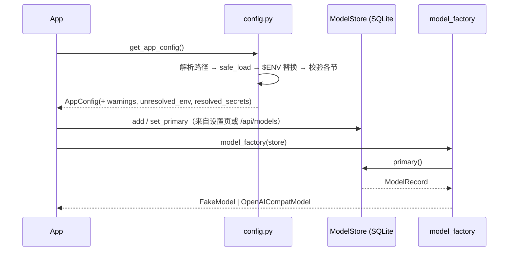

# 第 1 章　配置与模型 / Configuration and Models

> **EvoFlow 对照状态 / Alignment status**
> ✅ **已核对：** 配置文件格式、字段名、`$ENV` 规则、`use:` 路径、模型存放位置——来自 EvoFlow 公开仓库根目录的 `config.example.yaml`（796 行，已读全文）。
> 🟡 **自研：** 文件里没写明的默认值、SQLite 列结构、API 返回格式、默认数据目录。下文逐条标出。
>
> ::: warning 证据边界
> 本章的**配置事实**来自 `config.example.yaml` 全文（796 行）；但 `AppConfig` 的**实现代码逐行读过并对齐**（见「示例代码」与文末手把手），`ModelStore` 不复刻，凡是描述函数行为的段落都标了 🟡。
> :::
> ⬜ **未读：** 解析这些配置的 EvoFlow 源码（`config/app_config.py` 等）。所以「校验细节」是我们自己的设计，不代表 EvoFlow 的校验行为。

## 本章目标 / Goals
- 用 **YAML + `$ENV` 替换 + 类型化配置节** 描述应用配置，并在启动时 **fail fast**。
- 理解一个关键设计：**聊天模型不在 YAML 里，而在 SQLite**（`ModelStore`）。
- 建立 **credential boundary**：密钥只来自环境变量或模型库，且不会出现在 repr、日志、API 列表中。
- 通过 **model factory** 取得「主模型」；测试用 **FakeModel**。

## 1. 已核对的事实 / Verified facts
| # | 事实（来自 `config.example.yaml`） | 本章对应实现 |
|---|---|---|
| 1 | 默认读取工作目录下的 `config.yaml`；可用环境变量 `DEER_FLOW_CONFIG_PATH` 改路径（名字沿用自 DeerFlow） | `resolve_config_path`：参数 → `EVOFLOW_CONFIG_PATH` → 旧名 → `./config.yaml` |
| 2 | 任何字段值都可写 `$ENV_VAR`（如 `api_key: $OPENAI_API_KEY`） | `substitute_env`（整值引用；也支持 `${VAR}`） |
| 3 | `use:` 是 `"package.module:class_or_var"` 字符串（沙箱、工具、护栏 provider 都用它） | `resolve_variable` |
| 4 | `config_version`（上游示例为 11），schema 变化时递增；`make config-upgrade` 合并新字段 | 版本告警；升级命令不复刻 |
| 5 | **聊天模型和 `primary_model` 只存在 SQLite**（`evoflow.db` 的 `evoflow_models` / `evoflow_app_settings`）；YAML 里残留的 `models:` / `primary_model:` **启动时被忽略**；在 EvoPanel「设置 → 模型」或 Gateway `GET/POST/PUT/DELETE /api/models` 管理 | `ModelStore`、`parse_config` 的忽略告警 |
| 6 | 联网搜索偏好存在 DB 键 `web.search`；`config.yaml` 的 `web.backend` 对搜索无效 | `ModelStore.get/set_setting` |
| 7 | `token_usage.pricing`：键支持通配符、**最长匹配优先**；未配置的模型费用记 0（界面显示 —） | `TokenUsage.price_for / cost` |
| 8 | `summarization.trigger` 可写单个或列表，**任一满足即触发（OR）**；类型 `tokens / messages / fraction`；`threshold_ratio: 0.90`，`aggressive_ratio: 1.0`；`keep` 指定保留量 | `Summarization.should_summarize` |
| 9 | `checkpointer.type` ∈ memory / sqlite / postgres；桌面默认 sqlite，路径 `data/checkpoints/checkpoints.db`；memory 不会被清理 | `Checkpointer` |
| 10 | 应用库 `data/app/evoflow.db`；「每个数据库一个子目录」；根目录的旧版扁平文件会在 Gateway 启动时迁移 | `Storage`、`DataPaths` |
| 11 | `execution_security.profile` ∈ read-only / workspace / danger-full-access；`approval` ∈ untrusted / on-request / never；**会话档位覆盖全局值** | `ExecutionSecurity`（会话覆盖留给第 6 部分） |
| 12 | `guardrails`：`enabled`、`fail_closed`（默认 true）、`provider.use + config`；拒绝的调用返回一条错误 ToolMessage，让 Agent 自行调整 | `Guardrails`（行为留给第 6 部分） |
| 13 | `agent_orchestration.default` ∈ react / hybrid / local_scheduler，默认 hybrid | `AgentOrchestration` |
| 14 | `subagents.timeout_seconds` 默认 900，可按 agent 覆盖 | `Subagents.timeout_for` |
| 15 | `skills`：`container_path: /mnt/skills`、`repo_skills_dir: .evoflow/skills`、`extra_roots` | `Skills` |
| 16 | `tool_search.enabled`：MCP 工具只在 system prompt 里列名字，运行时用 `tool_search` 发现（延迟加载） | `ToolSearch`（行为留给第 9 部分） |
| 17 | `tool_results`：超大工具输出落盘，prompt 里只保留摘要 + 路径；`history_keep_full_tools: 3` | `ToolResults`（行为留给第 3 部分） |
| 18 | `data_retention`：日志 7 天；每个线程只保留 5 个 checkpoint；可 vacuum | `DataRetention` |
| 19 | 观测默认关闭（`observability.enabled: false`），开发者用 `EVOFLOW_OBSERVABILITY=1` | `Observability` |
| 20 | **部署形态：** LangGraph Server（`http://localhost:2024`）+ Gateway（`http://localhost:8001`）两个服务；IM 渠道通过它们访问 | 第 10 部分 |
| 21 | 注释里出现 `TokenUsageMiddleware`、已卸载的 `SessionIntentMiddleware`，以及「统一的 summarization 中间件」 | 佐证：运行时确实是 **middleware 链**（见模块地图） |

## 2. 取舍说明 / What we replicate, simplify, or skip
| 类别 | 内容 |
|---|---|
| **复刻（行为与上表一致）** | #1–#19 的加载、替换、校验与纯计算行为 |
| **只建类型、不实现行为** | sandbox、execution_security、guardrails、skills、tool_results、memory、observability、data_retention——后续章节再用 |
| **放进 `extra` 不校验** | `channels`、`code_index`、`web`、`title`、`working_memory`、`acp_agents`、`session_intent` 等（对应章节再建模） |
| **🟡 自研（未核对）** | 配置节里 **文件没写的默认值**；`evoflow_models` 的列；API 的返回格式（密钥掩码为 `***abcd`）；默认数据目录 `.evoflow` |
| **未复刻** | `make config-upgrade`；旧 YAML 一次性导入（`sync_models_from_yaml_to_db`）；Gateway HTTP 路由；「测试连接」 |

## 最小闭环 / Minimal closed loop
```python
cfg   = get_app_config()                                            # ① 读 YAML → 类型化（EvoFlow 同名字段）
paths = DataPaths.from_env()                                         #    相对路径落在 base_dir 下
store = ModelStore(paths.ensure_parent(cfg.storage.sqlite_path))     # ② 模型库（SQLite）
store.add("main", "openai_compatible", "gpt-x", "https://api.example.com/v1", os.environ["OPENAI_API_KEY"])
store.set_primary("main")
model = model_factory(store)                                         # ③ 取主模型；没有主模型会给出可读错误
```

## 调用逻辑 / Invocation logic


## 1.1 配置文件与加载 / File and loading
**核心概念**
- **整值 `$VAR`**：只有整个值是 `$NAME` 或 `${NAME}` 才替换；`"prefix-$NAME"` 不会替换。（🟡 上游示例只展示整值形式，是否支持内嵌未知。）
- **缺失的环境变量不致命**：字段变成 `None` → 使用默认值，并记入 `unresolved_env` 与 `warnings`。这与上游注释一致（飞书的 `push_secret`：环境变量未设置时「该行被忽略，Gateway 仍能启动」）。是否对 **所有** 字段都如此，🟡 未核对。
- **未知顶层键不拒绝**：放进 `extra`，保证向前兼容。

**业务规则**
1. 路径优先级：显式参数 > `EVOFLOW_CONFIG_PATH` > `DEER_FLOW_CONFIG_PATH` > `./config.yaml`。
2. 文件不存在、YAML 语法错误、顶层不是映射 → `ConfigError`，带文件路径或原因。
3. `config_version` 缺失/过旧/过新 → 告警，不阻止启动；类型不是整数 → 报错。
4. 空文件等于 `{}`，全部走默认值。

## 1.2 类型化配置节与行为 / Typed sections and behaviour
每个配置节是一个 `frozen dataclass`，字段名与上游示例一致。几个值得讲的 **行为**：

**① 定价通配符（#7）**
```python
pricing = {"glm-*": (0.6, 2.2), "glm-4-flash*": (0, 0)}
# "glm-4.5"        -> 命中 "glm-*"
# "glm-4-flash-x"  -> 两个都命中，取 **更长** 的 pattern -> 免费
# "other"          -> 未配置 -> 费用 0（界面显示 —）
```

**② 压缩触发（#8）**：`trigger` 是列表，**任一** 条件满足就触发（OR）：
`tokens >= value`、`messages >= value`、`tokens >= fraction × 模型最大输入`。`enabled: false` 时永不触发。

**③ 校验（🟡 我们的设计）**：枚举值（profile、approval、orchestration、checkpointer.type）、范围（ratio ∈ (0,1]，`aggressive_ratio ≥ threshold_ratio`）、`bool` 不能用 `1` 代替、`sqlite/postgres` 必须带 `connection_string`、启用 guardrails 必须有 provider、工具名不可重复。

## 1.3 模型存放在 SQLite / Models live in SQLite
**为什么不放 YAML（推断 🟡）：** 模型由界面管理、需要运行时增删改、带 API Key；放进数据库后可以热更新，也不必把密钥写进可能被提交的文本文件。（上游文件只说明「模型只在 SQLite」，没有说明原因。）

**API 对照（方法 ↔ 上游路由）**
| 方法 | 上游路由 | 说明 |
|---|---|---|
| `add` | `POST /api/models` | 校验 kind、`openai_compatible` 必须有 `base_url`、名称唯一 |
| `list` / `get` | `GET /api/models` | **列表里密钥只返回掩码** `***abcd`，另给 `has_api_key` |
| `update` | `PUT /api/models/{name}` | 只改传入的字段；不传 `api_key` 表示保持不变 |
| `delete` | `DELETE /api/models/{name}` | 删除主模型时同时清除 `primary_model` |
| `set_primary` / `primary` | 设置页「设为主模型」 | 停用的模型不能做主模型 |
| `get/set_setting` | `evoflow_app_settings` 键值 | 如 `web.search` |

> 表名 `evoflow_models` / `evoflow_app_settings` 与键名 `primary_model`、`web.search` 是 ✅；**列结构、返回字段是 🟡**。

## 1.4 凭证边界 / Credential boundary
1. **来源**：密钥来自环境变量（`$VAR`）或模型库，不写在 YAML 明文里。
2. **表示**：EvoFlow **没有 `ModelRecord` 这个类**，也没有统一的 `__repr__` 掩码；掩码是各出口自己做的。
3. **输出（按源码重写）**：真实存在的三处脱敏是——
   - `models/vendor_roundtrip.py:124` `_redact_secrets()`：模型配置回传时把敏感键替换成 `<redacted>`；
   - `admin/platform_handlers.py:3650` `_redact_channel_secrets()`：渠道配置下发前脱敏；
   - `plans/service.py:161-172`：`redact_key=True` 时把 `api_key` 抹掉。
   **不存在** `AppConfig.redactor()` 与 `RedactingFilter`——原文这两处是按想象写的，已删。EvoFlow 没有全局日志脱敏过滤器，所以「日志里带出密钥」是真实风险。
4. **本复刻现状**：`config/app_config.py` 里**目前没有**做任何密钥掩码（如实标注为缺口）；要补就在 `ModelConfig.__repr__` 与日志出口两处加。

**常见坑**：只在日志里脱敏，却把密钥带进异常消息或 URL → Agent 的 `error` 事件同样要过 `Redactor`（见第 2 章）。

## 1.5 模型工厂与 FakeModel / Factory and FakeModel
- 没有设置主模型 → `ConfigError("no primary model configured: add one in Settings -> Models ...")`，对应上游 README 的首次使用流程：**设置 → 模型 → 添加服务商与 API Key → 设为主模型**。
- `FakeModel` 用于离线测试，可脚本化「先调用工具，再给答案」，并记录收到的 messages。
- `OpenAICompatModel` **没有联网测试过**，也不是流式解析，只展示 adapter 形状。

## 1.6 `use:` 动态加载 / Dynamic loading
`resolve_variable("package.module:attr.sub")` 把字符串变成对象，沙箱 provider、工具、护栏 provider 都靠它。**安全提醒：** 它会 `import` 任意模块，等于执行配置里指定的代码，所以 **配置文件必须被当作可信输入**；不要把来自用户的字符串直接喂给它。

## 示例代码 / Sample code

### 我方实现：`config/app_config.py`（文件名、类名、字段名全部沿用 EvoFlow）

> **对照**：EvoFlow 是 `config/app_config.py`（1005 行）+ `config/model_config.py`（183 行，`ModelConfig` 在 `:78`）+ `config/checkpointer_config.py:10` + `config/storage_config.py:10`。
> 我们**不改名**：`AppConfig` / `ModelConfig` / `CheckpointerConfig` / `StorageConfig`、`get_app_config()` / `reload_app_config()` / `reset_app_config()` / `set_app_config()` / `resolve_config_path()` 全部照抄名字，只做减法：
>
> | 项 | EvoFlow | 我们 | 为什么 |
> |---|---|---|---|
> | `AppConfig` 字段分区 | 14 个（sandbox/web/skills/extensions/tool_search/observability/storage/data_retention/token_usage/tool_groups/checkpointer/models/primary_model/log_level） | 5 个（log_level / models / primary_model / checkpointer / storage） | 其余章节读到再补，不提前发明字段 |
> | `ModelConfig` 列 | 30 列（含 thinking/availability/plan_*） | 7 列（name/vendor/use/base_url/api_key/temperature/max_tokens） | 够第 1 章造出一个模型即可 |
> | 配置路径环境变量 | `EVOFLOW_CONFIG_PATH` | `MYAGENTFLOW_CONFIG_PATH` | 只换前缀，语义相同 |
> | 缺模型时的异常 | `NoChatModelConfiguredError`（`models/resolver.py:38`） | 同名异常，同样继承 `RuntimeError` | 上层 `except RuntimeError` 通用 |
> | 缓存策略 | 按文件 mtime 决定是否重读（`app_config.py:486` `_get_config_mtime`、`:494` `_load_and_cache_app_config`） | 同策略 | 改配置不必重启 |

```python
"""应用配置：EvoFlow `config/app_config.py` 的最小复刻。字段名一律不改。"""
from __future__ import annotations

import json
import os
import threading
from pathlib import Path
from typing import Any, Literal

from pydantic import BaseModel, ConfigDict, Field


class NoChatModelConfiguredError(RuntimeError):
    """对齐 EvoFlow `models/resolver.py:38` 的同名异常。"""


class ModelConfig(BaseModel):
    """一条模型配置。字段对齐 EvoFlow `config/model_config.py:78`。"""

    name: str = Field(default="gpt-4o-mini", description="模型名，作为唯一键")
    vendor: str = Field(default="openai", description="厂商；EvoFlow 用它区分 provider 族")
    use: str = Field(default="langchain_openai:ChatOpenAI", description="Python 类路径 module:Class")
    base_url: str | None = None
    api_key: str | None = None
    temperature: float = 0.0          # 本章目标是可复现，默认 0
    max_tokens: int | None = None
    model_config = ConfigDict(extra="allow")   # 未知字段不拒绝，便于以后补列


class CheckpointerConfig(BaseModel):
    """对齐 EvoFlow `config/checkpointer_config.py:10`：type + connection_string。"""

    type: Literal["memory", "sqlite"] = "memory"
    connection_string: str | None = None


class StorageConfig(BaseModel):
    """对齐 EvoFlow `config/storage_config.py:10`：单应用库。"""

    backend: Literal["sqlite"] = "sqlite"
    sqlite_path: str = "data/app/myagentflow.db"


class AppConfig(BaseModel):
    """配置根对象。字段顺序与 EvoFlow `AppConfig`（`app_config.py:94`）一致。"""

    log_level: str = "info"
    models: list[ModelConfig] = Field(default_factory=list)
    primary_model: str | None = None
    checkpointer: CheckpointerConfig = Field(default_factory=CheckpointerConfig)
    storage: StorageConfig = Field(default_factory=StorageConfig)
    model_config = ConfigDict(extra="allow")

    def get_model(self, name: str | None = None) -> ModelConfig:
        """按名字取模型；不传就取 primary_model。取不到抛 NoChatModelConfiguredError。

        为什么按名字回查：EvoFlow 的 primary_model 就是字符串名（`app_config.py:100`），
        不是一个模型对象——存引用会在热更新后指向旧对象。
        """
        target = (name or self.primary_model or "").strip()
        if not target:
            raise NoChatModelConfiguredError("未配置主模型：写 primary_model，或设 MYAF_MODEL_NAME")
        for m in self.models:
            if m.name == target:
                return m
        raise NoChatModelConfiguredError(f"primary_model={target!r} 在 models 里不存在")

    @classmethod
    def resolve_config_path(cls, config_path: str | None = None) -> Path:
        """路径优先级：显式参数 → MYAGENTFLOW_CONFIG_PATH → 当前目录 config.yaml。"""
        if config_path:
            return Path(config_path).expanduser()
        env_path = os.getenv("MYAGENTFLOW_CONFIG_PATH", "").strip()
        if env_path:
            return Path(env_path).expanduser()
        return Path.cwd() / "config.yaml"


# ---- 缓存：mtime 变了才重读（对齐 app_config.py:486 / :494）----
_config: AppConfig | None = None
_config_path: Path | None = None
_config_mtime: float | None = None
_lock = threading.RLock()


def _get_config_mtime(config_path: Path) -> float | None:
    try:
        return config_path.stat().st_mtime
    except OSError:
        return None      # 文件不存在不是错误：用默认值照跑


def _read_config_data(config_path: Path) -> dict[str, Any]:
    if not config_path.exists():
        return {}
    text = config_path.read_text(encoding="utf-8")
    if config_path.suffix.lower() == ".json":
        return json.loads(text)
    import yaml          # 可选依赖：没装就退化成「只有默认值」
    data = yaml.safe_load(text) or {}
    return data if isinstance(data, dict) else {}


def get_app_config() -> AppConfig:
    """取配置；文件 mtime 变了就重读，否则返回缓存对象。"""
    global _config, _config_path, _config_mtime
    with _lock:
        if _config is None or _config_path is None:
            return reload_app_config()
        if _get_config_mtime(_config_path) != _config_mtime:
            return reload_app_config(str(_config_path))
        return _config
```

（完整文件见 `backend/packages/harness/myagentflow/config/app_config.py`，还包含 `_models_from_env()`——没有 `config.yaml` 时从 `MYAF_MODEL_*` 兜底，以及 `reload_app_config()` / `reset_app_config()` / `set_app_config()`，函数名与 EvoFlow 一致。）

**验证**

```bash
cd /Users/main/my-agent-flow/backend
.venv/bin/python -m pytest tests/chapters/test_ch01_01_config.py -q
# 期望：5 passed（env 造模型 / 空字符串当没配 / 没模型抛 NoChatModelConfiguredError
#        / yaml 生效 / MYAGENTFLOW_CONFIG_PATH 覆盖路径）
```

### 不复刻：模型存 SQLite（EvoFlow `persistence/schema.py:1031`）

EvoFlow 把模型**存在 SQLite**，不是 yaml。下面是真实建表语句（摘前 12 列，完整 30 列见源码）：

```sql
CREATE TABLE IF NOT EXISTS "evoflow_models" (
    name TEXT PRIMARY KEY,
    vendor TEXT,
    display_name TEXT,
    description TEXT,
    use TEXT NOT NULL,
    model TEXT NOT NULL,
    base_url TEXT,
    api_key TEXT,
    request_timeout REAL,
    max_retries INTEGER,
    max_tokens INTEGER,
    temperature REAL,
    -- 其余列：use_responses_api / output_version / supports_thinking /
    -- supports_reasoning_effort / supports_vision / *_json / context_length /
    -- availability_status / unavailable_* / plan_type / plan_config / updated_at
);
```

配套链路（每条都能指到源码）：

| EvoFlow 位置 | 做什么 |
|---|---|
| `config/models_yaml.py:116` | `flatten_providers_dict()`：把 providers 结构摊平成模型条目 |
| `config/model_config.py:78` | `ModelConfig` 定义 + `resolve_model_max_output_tokens()` 等默认值推导 |
| `models/resolver.py:63` | `resolve_run_model()`：按 run/agent 选择用哪个模型 |
| `models/factory.py` | 真正构造 provider 客户端（含 thinking / reasoning 适配） |
| `persistence/schema.py:222` | `evoflow_app_settings`（key/value），主模型等偏好是这里的行 |

**本复刻不做这件事**：模型写在 `config.yaml` 的 `models:` 段，由 `config/app_config.py` 的 `AppConfig.get_model()` 取、`models/factory.py:build_chat_model()` 构造（第 1 章即已实现）。理由：学习目标是链路与状态管理，不是 30 列模型库的 CRUD；差异已列在文末「与 EvoFlow 对照」表里。

### 我方实现：`models/factory.py`

> **EvoFlow 对应**：`models/factory.py`（构造 provider）+ `models/resolver.py:63`（决定用哪个模型）。下面为我方实现，只保留单模型路径。
```python
def model_factory(store: ModelStore, name: str | None = None, fake_script: list | None = None) -> ChatModel:
    """Primary model unless a name is given. No model configured is a user-facing error, not a crash."""
    rec = store.get(name) if name else store.primary()
    if rec is None:
        raise ConfigError(f"unknown model {name!r}" if name else "no primary model configured: add one in Settings -> Models and set it as primary")
    if not rec.enabled:
        raise ConfigError(f"model {rec.name} is disabled")
    if rec.kind == "fake":
        return FakeModel(fake_script or [{"text": "ok"}])
    return OpenAICompatModel(rec.base_url, rec.api_key, rec.model)
```

### `config.yaml`（我方示例，字段严格照我方 `app_config.py`）

> EvoFlow 的 `config.example.yaml` 是 **796 行、几十个分区**；我们只保留第 1 章用到的 5 个键。没有的键不是「省略」，是**我们还没有对应实现**——读到哪章再加。EvoFlow 那边 `models` / `primary_model` 写在 yaml 里也会被忽略（原文注释：「Any ``models:`` / ``primary_model:`` keys left in config.yaml are ignored at startup」），模型真正的家是 SQLite；我们的简化版没有模型库，所以先从 yaml 读。

```yaml
# config.yaml —— 复制一份到 backend/ 下即可
log_level: info
primary_model: local

models:
  - name: local
    vendor: openai                 # 对应 EvoFlow ModelConfig.vendor
    use: langchain_openai:ChatOpenAI
    base_url: http://127.0.0.1:1234/v1
    api_key: $LOCAL_API_KEY        # 也支持直接写值；本复刻目前不做 $ENV 展开
    temperature: 0.0

checkpointer:
  type: sqlite                     # memory | sqlite
  connection_string: data/checkpoints.db

storage:
  backend: sqlite
  sqlite_path: data/app/myagentflow.db
```

**验证**：把上面存成 `backend/config.yaml`，然后

```bash
cd /Users/main/my-agent-flow/backend && .venv/bin/python -c "
from myagentflow.config.app_config import get_app_config
cfg = get_app_config()
print(cfg.primary_model, cfg.get_model().vendor, cfg.checkpointer.type, cfg.checkpointer.connection_string)
"
# 期望：local openai sqlite data/checkpoints.db
```

## 验收 / Acceptance（24 个新测试，全部离线）
| 检查项 | 测试 |
|---|---|
| 空配置走默认值；示例文件可加载且无告警 | `Defaults` |
| `$VAR` / `${VAR}`、嵌套、缺失容忍；路径优先级；加载错误；数据目录 | `EnvAndPaths` |
| 19 类非法配置被拒绝；版本告警；`models:` 被忽略并告警 | `Validation` |
| 定价最长匹配；压缩触发 OR；单个触发器；`use:` 解析 | `Behaviour` |
| 日志与配置密钥脱敏；`sk-` 兜底 | `Credentials` |
| 模型 CRUD、主模型、掩码、停用、持久化、`web.search` 设置 | `Models` |
| 无主模型给出可读错误；返回 Fake 或真实适配器；脚本透传 | `Factory` |

运行：`cd code && python3 -m unittest discover -s tests -v`（合计 35 个测试）。

## 待核对清单 / Still to verify against EvoFlow source
- [ ] `config/app_config.py`：真实的校验与默认值（尤其是示例里没写出的字段）
- [ ] 对缺失环境变量的统一处理方式
- [ ] `persistence/model_connections.py`、`config/models_yaml.py`：模型表的真实列、API 返回格式、密钥是否加密存储（`persistence/secret_store.py`）
- [ ] `models/factory.py`、`resolver.py`：模型解析（含按会话覆盖）与厂商适配（`patched_*`）
- [ ] 默认 `base_dir`（我们暂定 `.evoflow`；示例注释提到 `$EVOFLOW_HOME` 与 `backend/.evo-flow/`）
- [ ] Gateway `/api/models` 的请求与响应字段、「测试连接」流程

## 对后续章节的影响 / Impact on later chapters
| 配置节 | 用在 |
|---|---|
| `checkpointer`、`data_retention` | 第 2 部分（检查点与清理） |
| `tools`、`tool_search`、`tool_results`、`summarization`、`agent_orchestration` | 第 3 部分（工具、上下文、编排模式） |
| `memory` | 第 4 部分 |
| `sandbox`、`execution_security`、`guardrails`、`subagents` | 第 6 部分 |
| `skills`、`acp_agents` | 第 9 部分 |
| `token_usage`、`observability` | 第 11 部分 |

## 从零实现（手把手）
> 读完这章你能得到一个「启动时校验一次、处处可用」的配置对象，以及一个按 provider 造模型的工厂。
> 路径均相对 `backend/`，代码注释写「为什么」。

### Step 1　新建 `app_config.py`：文件名、类名、字段名照 EvoFlow

**文件**：`packages/harness/myagentflow/config/app_config.py（新建）`
**要写的逻辑**：四类一个函数，按下面的顺序写，每写完一块都能单独 import 验证。

**1) `ModelConfig`：一条模型。字段抄 EvoFlow 的 `model_config.py:78`**

```python
class ModelConfig(BaseModel):
    name: str = "gpt-4o-mini"
    vendor: str = "openai"          # 注意：EvoFlow 用 vendor，不叫 provider
    use: str = "langchain_openai:ChatOpenAI"
    base_url: str | None = None
    api_key: str | None = None
    temperature: float = 0.0
    max_tokens: int | None = None
    model_config = ConfigDict(extra="allow")   # 未知字段不拒绝
```

**2) `CheckpointerConfig` / `StorageConfig`：字段名同样不改**

```python
class CheckpointerConfig(BaseModel):
    type: Literal["memory", "sqlite"] = "memory"
    connection_string: str | None = None

class StorageConfig(BaseModel):
    backend: Literal["sqlite"] = "sqlite"
    sqlite_path: str = "data/app/myagentflow.db"
```

**3) `AppConfig`：字段顺序照 `app_config.py:94`，并加「按名取模型」**

```python
class AppConfig(BaseModel):
    log_level: str = "info"
    models: list[ModelConfig] = Field(default_factory=list)
    primary_model: str | None = None          # 字符串名，不是模型对象（与 EvoFlow 一致）
    checkpointer: CheckpointerConfig = Field(default_factory=CheckpointerConfig)
    storage: StorageConfig = Field(default_factory=StorageConfig)
    model_config = ConfigDict(extra="allow")

    def get_model(self, name: str | None = None) -> ModelConfig:
        target = (name or self.primary_model or "").strip()
        if not target:
            raise NoChatModelConfiguredError("未配置主模型")
        for m in self.models:
            if m.name == target:
                return m
        raise NoChatModelConfiguredError(f"primary_model={target!r} 在 models 里不存在")
```

**4) 加载函数：`resolve_config_path` + mtime 缓存 + `get_app_config`**

```python
def get_app_config() -> AppConfig:
    global _config, _config_path, _config_mtime
    with _lock:
        if _config is None or _config_path is None:
            return reload_app_config()
        if _get_config_mtime(_config_path) != _config_mtime:   # 文件变了才重读
            return reload_app_config(str(_config_path))
        return _config
```

**验证**

```bash
cd /Users/main/my-agent-flow/backend && .venv/bin/python -c "
from myagentflow.config.app_config import AppConfig, ModelConfig
cfg = AppConfig(primary_model='m', models=[ModelConfig(name='m', vendor='openai')])
print(cfg.get_model().vendor)       # openai
print(cfg.checkpointer.type)        # memory
"
```

### Step 2　新建 `factory.py`：按 `vendor` 造模型

**文件**：`packages/harness/myagentflow/models/factory.py（新建）`
**要写的逻辑**：惰性 import；`vendor == "openai"` 才造 `ChatOpenAI`；其他 vendor 明确报「未实现」，不静默退化。

```python
"""模型工厂：配置进、模型出。惰性 import：只跑测试的人不该被迫装 langchain-openai。"""
from __future__ import annotations

from typing import Any

from myagentflow.config.app_config import ModelConfig


def build_chat_model(cfg: ModelConfig) -> Any:
    if cfg.vendor == "openai":
        try:
            from langchain_openai import ChatOpenAI
        except ImportError as exc:
            raise RuntimeError("需要 langchain-openai。安装：uv add langchain-openai") from exc
        return ChatOpenAI(
            model=cfg.name,
            base_url=cfg.base_url,
            api_key=cfg.api_key,
            temperature=cfg.temperature,   # 配置里写多少就用多少，不在代码里硬编 0
        )
    raise RuntimeError(f"暂不支持的 vendor：{cfg.vendor}（已实现 openai）")
```

**验证**

```bash
cd /Users/main/my-agent-flow/backend && .venv/bin/python -c "
from myagentflow.config.app_config import ModelConfig
from myagentflow.models.factory import build_chat_model
try:
    build_chat_model(ModelConfig(vendor='anthropic'))
except RuntimeError as e:
    print(e)      # 暂不支持的 vendor：anthropic（已实现 openai）
"
```

### Step 3　写测试：5 个用例钉住真实行为

**文件**：`tests/chapters/test_ch01_01_config.py（新建）`
**要写的逻辑**：每个用例先把 cwd 挪到 `tmp_path`（否则会读到仓库里的真 `config.yaml`），再 `reset_app_config()` 清缓存。

```python
def test_no_model_raises(monkeypatch, tmp_path):
    from myagentflow.config.app_config import (
        NoChatModelConfiguredError, get_app_config, reset_app_config,
    )
    _isolate(monkeypatch, tmp_path)      # 删 env + chdir
    reset_app_config()
    with pytest.raises(NoChatModelConfiguredError):
        get_app_config().get_model()


def test_yaml_config_defines_models(monkeypatch, tmp_path):
    _isolate(monkeypatch, tmp_path)
    (tmp_path / "config.yaml").write_text(
        "primary_model: local\nmodels:\n  - name: local\n    base_url: http://127.0.0.1:1234/v1\n",
        encoding="utf-8",
    )
    reset_app_config()
    assert get_app_config().get_model().base_url == "http://127.0.0.1:1234/v1"
```

**验证**

```bash
cd /Users/main/my-agent-flow/backend && .venv/bin/python -m pytest tests/chapters/test_ch01_01_config.py -q
# 期望：5 passed
```

### 与 EvoFlow 对照

| 我们的做法 | EvoFlow | 为什么 |
|---|---|---|
| `frozen dataclass` 配置 | `config/app_config.py` 的 `get_app_config()` 单例 | 配置全局唯一，避免两处读到不同值 |
| 惰性 import 模型类 | `models/` 下按 provider 分文件 | 没配模型时不该被迫装全部 SDK |

### 知识点

- [agent-book · LangChain 课程](https://g0-000.github.io/agent-book/langchain/)：模型调用与配置注入
- 本章只用 `langchain_openai`，别的 provider 等后面章节再扩

### 验收

```bash
uv run pytest tests/chapters/test_ch01_01_config.py -q && uv run python -c "from myagentflow.config.app_config import get_app_config; print(get_app_config().get_model())"
```
