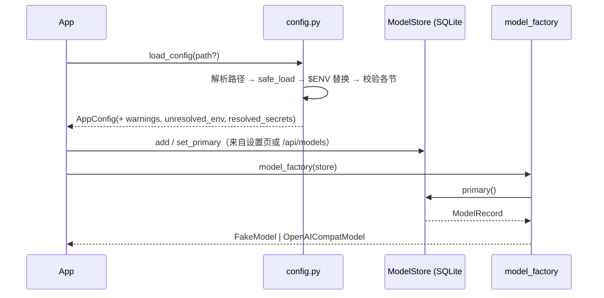

# 第 1 章　配置与模型 / Configuration and Models

> **EvoFlow 对照状态 / Alignment status**
> ✅ **已核对：** 配置文件格式、字段名、`$ENV` 规则、`use:` 路径、模型存放位置——来自 EvoFlow 公开仓库根目录的 `config.example.yaml`（796 行，已读全文）。
> 🟡 **自研：** 文件里没写明的默认值、SQLite 列结构、API 返回格式、默认数据目录。下文逐条标出。
>
> ::: warning 证据边界
> 本章的**配置事实**来自 `config.example.yaml` 全文（796 行）；但 `load_config` / `ModelStore` 的**实现代码尚未逐行读**，凡是描述函数行为的段落都标了 🟡。
> :::
> ⬜ **未读：** 解析这些配置的 EvoFlow 源码（`config/app_config.py` 等）。所以「校验细节」是我们自己的设计，不代表 EvoFlow 的校验行为。

## 本章目标 / Goals
- 用 **YAML + `$ENV` 替换 + 类型化配置节** 描述应用配置，并在启动时 **fail fast**。
- 理解一个关键设计：**聊天模型不在 YAML 里，而在 SQLite**（`ModelStore`）。
- 建立 **credential boundary**：密钥只来自环境变量或模型库，且不会出现在 repr、日志、API 列表中。
- 通过 **model factory** 取得「主模型」；测试用 **FakeModel**。

## 1. 已核对的事实 / Verified facts
| # | 事实（来自 `config.example.yaml`） | 本章对应实现 |
|---|---|---|
| 1 | 默认读取工作目录下的 `config.yaml`；可用环境变量 `DEER_FLOW_CONFIG_PATH` 改路径（名字沿用自 DeerFlow） | `resolve_config_path`：参数 → `EVOFLOW_CONFIG_PATH` → 旧名 → `./config.yaml` |
| 2 | 任何字段值都可写 `$ENV_VAR`（如 `api_key: $OPENAI_API_KEY`） | `substitute_env`（整值引用；也支持 `${VAR}`） |
| 3 | `use:` 是 `"package.module:class_or_var"` 字符串（沙箱、工具、护栏 provider 都用它） | `resolve_variable` |
| 4 | `config_version`（上游示例为 11），schema 变化时递增；`make config-upgrade` 合并新字段 | 版本告警；升级命令不复刻 |
| 5 | **聊天模型和 `primary_model` 只存在 SQLite**（`evoflow.db` 的 `evoflow_models` / `evoflow_app_settings`）；YAML 里残留的 `models:` / `primary_model:` **启动时被忽略**；在 EvoPanel「设置 → 模型」或 Gateway `GET/POST/PUT/DELETE /api/models` 管理 | `ModelStore`、`parse_config` 的忽略告警 |
| 6 | 联网搜索偏好存在 DB 键 `web.search`；`config.yaml` 的 `web.backend` 对搜索无效 | `ModelStore.get/set_setting` |
| 7 | `token_usage.pricing`：键支持通配符、**最长匹配优先**；未配置的模型费用记 0（界面显示 —） | `TokenUsage.price_for / cost` |
| 8 | `summarization.trigger` 可写单个或列表，**任一满足即触发（OR）**；类型 `tokens / messages / fraction`；`threshold_ratio: 0.90`，`aggressive_ratio: 1.0`；`keep` 指定保留量 | `Summarization.should_summarize` |
| 9 | `checkpointer.type` ∈ memory / sqlite / postgres；桌面默认 sqlite，路径 `data/checkpoints/checkpoints.db`；memory 不会被清理 | `Checkpointer` |
| 10 | 应用库 `data/app/evoflow.db`；「每个数据库一个子目录」；根目录的旧版扁平文件会在 Gateway 启动时迁移 | `Storage`、`DataPaths` |
| 11 | `execution_security.profile` ∈ read-only / workspace / danger-full-access；`approval` ∈ untrusted / on-request / never；**会话档位覆盖全局值** | `ExecutionSecurity`（会话覆盖留给第 6 部分） |
| 12 | `guardrails`：`enabled`、`fail_closed`（默认 true）、`provider.use + config`；拒绝的调用返回一条错误 ToolMessage，让 Agent 自行调整 | `Guardrails`（行为留给第 6 部分） |
| 13 | `agent_orchestration.default` ∈ react / hybrid / local_scheduler，默认 hybrid | `AgentOrchestration` |
| 14 | `subagents.timeout_seconds` 默认 900，可按 agent 覆盖 | `Subagents.timeout_for` |
| 15 | `skills`：`container_path: /mnt/skills`、`repo_skills_dir: .evoflow/skills`、`extra_roots` | `Skills` |
| 16 | `tool_search.enabled`：MCP 工具只在 system prompt 里列名字，运行时用 `tool_search` 发现（延迟加载） | `ToolSearch`（行为留给第 9 部分） |
| 17 | `tool_results`：超大工具输出落盘，prompt 里只保留摘要 + 路径；`history_keep_full_tools: 3` | `ToolResults`（行为留给第 3 部分） |
| 18 | `data_retention`：日志 7 天；每个线程只保留 5 个 checkpoint；可 vacuum | `DataRetention` |
| 19 | 观测默认关闭（`observability.enabled: false`），开发者用 `EVOFLOW_OBSERVABILITY=1` | `Observability` |
| 20 | **部署形态：** LangGraph Server（`http://localhost:2024`）+ Gateway（`http://localhost:8001`）两个服务；IM 渠道通过它们访问 | 第 10 部分 |
| 21 | 注释里出现 `TokenUsageMiddleware`、已卸载的 `SessionIntentMiddleware`，以及「统一的 summarization 中间件」 | 佐证：运行时确实是 **middleware 链**（见模块地图） |

## 2. 取舍说明 / What we replicate, simplify, or skip
| 类别 | 内容 |
|---|---|
| **复刻（行为与上表一致）** | #1–#19 的加载、替换、校验与纯计算行为 |
| **只建类型、不实现行为** | sandbox、execution_security、guardrails、skills、tool_results、memory、observability、data_retention——后续章节再用 |
| **放进 `extra` 不校验** | `channels`、`code_index`、`web`、`title`、`working_memory`、`acp_agents`、`session_intent` 等（对应章节再建模） |
| **🟡 自研（未核对）** | 配置节里 **文件没写的默认值**；`evoflow_models` 的列；API 的返回格式（密钥掩码为 `***abcd`）；默认数据目录 `.evoflow` |
| **未复刻** | `make config-upgrade`；旧 YAML 一次性导入（`sync_models_from_yaml_to_db`）；Gateway HTTP 路由；「测试连接」 |

## 最小闭环 / Minimal closed loop
```python
cfg   = load_config("config.yaml")                                   # ① 读 YAML → 替换 $ENV → 类型化 + 校验
paths = DataPaths.from_env()                                         #    相对路径落在 base_dir 下
store = ModelStore(paths.ensure_parent(cfg.storage.sqlite_path))     # ② 模型库（SQLite）
store.add("main", "openai_compatible", "gpt-x", "https://api.example.com/v1", os.environ["OPENAI_API_KEY"])
store.set_primary("main")
model = model_factory(store)                                         # ③ 取主模型；没有主模型会给出可读错误
```

## 调用逻辑 / Invocation logic


## 1.1 配置文件与加载 / File and loading
**核心概念**
- **整值 `$VAR`**：只有整个值是 `$NAME` 或 `${NAME}` 才替换；`"prefix-$NAME"` 不会替换。（🟡 上游示例只展示整值形式，是否支持内嵌未知。）
- **缺失的环境变量不致命**：字段变成 `None` → 使用默认值，并记入 `unresolved_env` 与 `warnings`。这与上游注释一致（飞书的 `push_secret`：环境变量未设置时「该行被忽略，Gateway 仍能启动」）。是否对 **所有** 字段都如此，🟡 未核对。
- **未知顶层键不拒绝**：放进 `extra`，保证向前兼容。

**业务规则**
1. 路径优先级：显式参数 > `EVOFLOW_CONFIG_PATH` > `DEER_FLOW_CONFIG_PATH` > `./config.yaml`。
2. 文件不存在、YAML 语法错误、顶层不是映射 → `ConfigError`，带文件路径或原因。
3. `config_version` 缺失/过旧/过新 → 告警，不阻止启动；类型不是整数 → 报错。
4. 空文件等于 `{}`，全部走默认值。

## 1.2 类型化配置节与行为 / Typed sections and behaviour
每个配置节是一个 `frozen dataclass`，字段名与上游示例一致。几个值得讲的 **行为**：

**① 定价通配符（#7）**
```python
pricing = {"glm-*": (0.6, 2.2), "glm-4-flash*": (0, 0)}
# "glm-4.5"        -> 命中 "glm-*"
# "glm-4-flash-x"  -> 两个都命中，取 **更长** 的 pattern -> 免费
# "other"          -> 未配置 -> 费用 0（界面显示 —）
```

**② 压缩触发（#8）**：`trigger` 是列表，**任一** 条件满足就触发（OR）：
`tokens >= value`、`messages >= value`、`tokens >= fraction × 模型最大输入`。`enabled: false` 时永不触发。

**③ 校验（🟡 我们的设计）**：枚举值（profile、approval、orchestration、checkpointer.type）、范围（ratio ∈ (0,1]，`aggressive_ratio ≥ threshold_ratio`）、`bool` 不能用 `1` 代替、`sqlite/postgres` 必须带 `connection_string`、启用 guardrails 必须有 provider、工具名不可重复。

## 1.3 模型存放在 SQLite / Models live in SQLite
**为什么不放 YAML（推断 🟡）：** 模型由界面管理、需要运行时增删改、带 API Key；放进数据库后可以热更新，也不必把密钥写进可能被提交的文本文件。（上游文件只说明「模型只在 SQLite」，没有说明原因。）

**API 对照（方法 ↔ 上游路由）**
| 方法 | 上游路由 | 说明 |
|---|---|---|
| `add` | `POST /api/models` | 校验 kind、`openai_compatible` 必须有 `base_url`、名称唯一 |
| `list` / `get` | `GET /api/models` | **列表里密钥只返回掩码** `***abcd`，另给 `has_api_key` |
| `update` | `PUT /api/models/{name}` | 只改传入的字段；不传 `api_key` 表示保持不变 |
| `delete` | `DELETE /api/models/{name}` | 删除主模型时同时清除 `primary_model` |
| `set_primary` / `primary` | 设置页「设为主模型」 | 停用的模型不能做主模型 |
| `get/set_setting` | `evoflow_app_settings` 键值 | 如 `web.search` |

> 表名 `evoflow_models` / `evoflow_app_settings` 与键名 `primary_model`、`web.search` 是 ✅；**列结构、返回字段是 🟡**。

## 1.4 凭证边界 / Credential boundary
1. **来源**：密钥来自环境变量（`$VAR`）或模型库，不写在 YAML 明文里。
2. **表示**：`ModelRecord.__repr__` 固定输出 `api_key='***'`；列表接口只给掩码。
3. **输出**：`AppConfig.redactor()` 汇总 **所有被 `$VAR` 替换进来的值**（保守地全部当作密钥）+ 可选的模型库密钥；`RedactingFilter` 在日志出口统一替换；再用正则兜底 `sk-...` 形态。

**常见坑**：只在日志里脱敏，却把密钥带进异常消息或 URL → Agent 的 `error` 事件同样要过 `Redactor`（见第 2 章）。

## 1.5 模型工厂与 FakeModel / Factory and FakeModel
- 没有设置主模型 → `ConfigError("no primary model configured: add one in Settings -> Models ...")`，对应上游 README 的首次使用流程：**设置 → 模型 → 添加服务商与 API Key → 设为主模型**。
- `FakeModel` 用于离线测试，可脚本化「先调用工具，再给答案」，并记录收到的 messages。
- `OpenAICompatModel` **没有联网测试过**，也不是流式解析，只展示 adapter 形状。

## 1.6 `use:` 动态加载 / Dynamic loading
`resolve_variable("package.module:attr.sub")` 把字符串变成对象，沙箱 provider、工具、护栏 provider 都靠它。**安全提醒：** 它会 `import` 任意模块，等于执行配置里指定的代码，所以 **配置文件必须被当作可信输入**；不要把来自用户的字符串直接喂给它。

## 示例代码 / Sample code
### `evoflow_min/config.py`
```python
"""Configuration (Chapter 1): YAML file + $ENV substitution + typed sections.

Design mirrors what EvoFlow's public config.example.yaml shows (verified):
  * config.yaml in the working directory; path overridable by an environment variable
  * any value may be written "$ENV_VAR"
  * chat models are NOT in YAML: they live in SQLite (see model_store.py)
  * "use: package.module:attr" strings are resolved to Python objects
Section field names and defaults below follow that file; where the real defaults are unknown we say so in the docs.
"""
from __future__ import annotations
import fnmatch, importlib, logging, os, re
from dataclasses import dataclass, field
from pathlib import Path
import yaml

CONFIG_VERSION = 1            # EvoFlow's own example file uses a larger number; ours is independent
CONFIG_ENV_VARS = ("EVOFLOW_CONFIG_PATH", "DEER_FLOW_CONFIG_PATH")   # second name = legacy name seen upstream

class ConfigError(ValueError):
    pass

# ---------------------------------------------------------------- small validators
def _sec(raw: dict, name: str) -> dict:
    v = raw.get(name)
    if v is None:
        return {}
    if not isinstance(v, dict):
        raise ConfigError(f"{name} must be a mapping")
    return v

def _val(sec: str, d: dict, key: str, default, types):
    v = d.get(key)
    if v is None:                                   # missing, or an unresolved $ENV -> default
        return default
    types = types if isinstance(types, tuple) else (types,)
    if isinstance(v, bool) and bool not in types:
        raise ConfigError(f"{sec}.{key} must be {_names(types)}")
    if not isinstance(v, types):
        raise ConfigError(f"{sec}.{key} must be {_names(types)}, got {type(v).__name__}")
    return v

def _names(types): return "/".join(t.__name__ for t in types)

def _choice(sec: str, key: str, v, allowed):
    if v not in allowed:
        raise ConfigError(f"{sec}.{key} must be one of {sorted(allowed)}, got {v!r}")
    return v

def _range(sec: str, key: str, v, lo, hi, lo_open=False):
    if (v < lo) or (lo_open and v == lo) or v > hi:
        raise ConfigError(f"{sec}.{key} out of range: {v}")
    return v

# ---------------------------------------------------------------- sections
@dataclass(frozen=True)
class Price:
    input_per_mtok: float
    output_per_mtok: float

@dataclass(frozen=True)
class TokenUsage:
    enabled: bool = True
    pricing: dict = field(default_factory=dict)      # wildcard pattern -> Price
    def price_for(self, model: str) -> Price | None:
        best = None
        for pat, price in self.pricing.items():      # longest matching pattern wins
            if fnmatch.fnmatchcase(model, pat) and (best is None or len(pat) > len(best[0])):
                best = (pat, price)
        return best[1] if best else None
    def cost(self, model: str, input_tokens: int, output_tokens: int) -> float:
        p = self.price_for(model)                    # unpriced models cost 0 (UI shows a dash)
        return 0.0 if p is None else (input_tokens * p.input_per_mtok + output_tokens * p.output_per_mtok) / 1_000_000

@dataclass(frozen=True)
class ToolConfig:
    name: str
    use: str
    options: dict = field(default_factory=dict)

@dataclass(frozen=True)
class ToolSearch:
    enabled: bool = True          # MCP tools are listed by name and loaded on demand

@dataclass(frozen=True)
class Sandbox:
    use: str | None = None
    options: dict = field(default_factory=dict)

PROFILES = {"read-only", "workspace", "danger-full-access"}
APPROVALS = {"untrusted", "on-request", "never"}

@dataclass(frozen=True)
class ExecutionSecurity:
    enabled: bool = False
    auto_enable_when_helpers_ready: bool = True
    profile: str = "workspace"
    approval: str = "on-request"
    windows_level: str = "restricted-token"
    allow_passthrough: bool = True

@dataclass(frozen=True)
class Guardrails:
    enabled: bool = False
    fail_closed: bool = True
    provider_use: str | None = None
    provider_config: dict = field(default_factory=dict)

@dataclass(frozen=True)
class Subagents:
    timeout_seconds: int = 900
    agents: dict = field(default_factory=dict)        # name -> timeout override
    def timeout_for(self, name: str) -> int:
        return self.agents.get(name, self.timeout_seconds)

@dataclass(frozen=True)
class Skills:
    path: str | None = None
    container_path: str = "/mnt/skills"
    extra_roots: tuple = ()
    repo_skills_dir: str = ".evoflow/skills"

@dataclass(frozen=True)
class Trigger:
    type: str          # tokens | messages | fraction
    value: float

@dataclass(frozen=True)
class Summarization:
    enabled: bool = True
    threshold_ratio: float = 0.90
    aggressive_ratio: float = 1.0
    protect_first_n: int = 3
    protect_tail_messages: int = 20
    protect_tail_tool_rounds: int = 3
    triggers: tuple = (Trigger("tokens", 15564),)
    keep: Trigger = Trigger("messages", 10)
    trim_tokens_to_summarize: int = 15564
    def should_summarize(self, tokens: int, messages: int, max_input_tokens: int | None = None) -> bool:
        if not self.enabled:
            return False
        for t in self.triggers:                       # OR logic: any trigger fires
            if t.type == "tokens" and tokens >= t.value: return True
            if t.type == "messages" and messages >= t.value: return True
            if t.type == "fraction" and max_input_tokens and tokens >= t.value * max_input_tokens: return True
        return False

@dataclass(frozen=True)
class ToolResults:
    enabled: bool = True
    threshold_chars: int = 12000
    medium_threshold_chars: int = 4000
    summary_max_chars: int = 1200
    history_keep_full_tools: int = 3
    max_age_hours: int = 24

@dataclass(frozen=True)
class Memory:
    enabled: bool = True
    storage_path: str = "memory.json"
    debounce_seconds: int = 30
    max_facts: int = 100
    fact_confidence_threshold: float = 0.7
    injection_enabled: bool = True
    max_injection_tokens: int = 2000
    external_provider: str = ""

@dataclass(frozen=True)
class Checkpointer:
    type: str = "memory"                # memory | sqlite | postgres
    connection_string: str | None = None

@dataclass(frozen=True)
class Storage:
    backend: str = "sqlite"
    sqlite_path: str = "data/app/evoflow.db"

@dataclass(frozen=True)
class Observability:
    enabled: bool = False
    file_mirror: bool = False
    sqlite_path: str = "data/observability/evoflow_observability.db"

@dataclass(frozen=True)
class DataRetention:
    enabled: bool = True
    interval_hours: int = 24
    logs_days: int = 7
    observability_days: int = 90
    task_stream_days: int = 90
    task_status_events_days: int = 90
    automation_runs_per_task: int = 50
    checkpoint_orphan_days: int = 90
    checkpoint_inactive_session_days: int = 30
    checkpoint_keep_per_thread: int = 5
    vacuum_sqlite: bool = True

@dataclass(frozen=True)
class AgentOrchestration:
    default: str = "hybrid"             # react | hybrid | local_scheduler

@dataclass(frozen=True)
class AppConfig:
    config_version: int = CONFIG_VERSION
    log_level: str = "info"
    token_usage: TokenUsage = TokenUsage()
    tools: tuple = ()
    tool_search: ToolSearch = ToolSearch()
    sandbox: Sandbox = Sandbox()
    execution_security: ExecutionSecurity = ExecutionSecurity()
    guardrails: Guardrails = Guardrails()
    subagents: Subagents = Subagents()
    skills: Skills = Skills()
    tool_results: ToolResults = ToolResults()
    summarization: Summarization = Summarization()
    memory: Memory = Memory()
    checkpointer: Checkpointer = Checkpointer()
    storage: Storage = Storage()
    observability: Observability = Observability()
    data_retention: DataRetention = DataRetention()
    agent_orchestration: AgentOrchestration = AgentOrchestration()
    extra: dict = field(default_factory=dict)          # sections not modeled yet (kept, not rejected)
    warnings: tuple = ()
    unresolved_env: tuple = ()
    resolved_secrets: tuple = ()
    def redactor(self, extra_secrets=()) -> "Redactor":
        return Redactor(list(self.resolved_secrets) + list(extra_secrets))

# ---------------------------------------------------------------- builders
def _trigger(sec: str, d) -> Trigger:
    if not isinstance(d, dict) or "type" not in d or "value" not in d:
        raise ConfigError(f"{sec} must be a mapping with type and value")
    t = _choice(sec, "type", d["type"], {"tokens", "messages", "fraction"})
    v = d["value"]
    if isinstance(v, bool) or not isinstance(v, (int, float)):
        raise ConfigError(f"{sec}.value must be a number")
    if t == "fraction": _range(sec, "value", v, 0, 1, lo_open=True)
    elif v <= 0 or int(v) != v: raise ConfigError(f"{sec}.value must be a positive integer")
    return Trigger(t, v)

def _build(raw: dict, warnings: list) -> dict:
    out: dict = {}
    out["log_level"] = _choice("log_level", "log_level", str(raw.get("log_level") or "info").lower(), {"debug", "info", "warning", "error"})
    tu = _sec(raw, "token_usage"); pricing = {}
    for pat, p in (_sec(tu, "pricing")).items():
        if not isinstance(p, dict): raise ConfigError(f"token_usage.pricing[{pat}] must be a mapping")
        i, o = p.get("input_per_mtok", 0), p.get("output_per_mtok", 0)
        if any(isinstance(x, bool) or not isinstance(x, (int, float)) or x < 0 for x in (i, o)):
            raise ConfigError(f"token_usage.pricing[{pat}] prices must be non-negative numbers")
        pricing[pat] = Price(float(i), float(o))
    out["token_usage"] = TokenUsage(_val("token_usage", tu, "enabled", True, bool), pricing)
    tools, seen = [], set()
    for t in raw.get("tools") or []:
        if not isinstance(t, dict) or not t.get("name") or not t.get("use"):
            raise ConfigError("each tools entry needs name and use")
        if t["name"] in seen: raise ConfigError(f"duplicate tool name: {t['name']}")
        seen.add(t["name"])
        tools.append(ToolConfig(t["name"], t["use"], {k: v for k, v in t.items() if k not in ("name", "use")}))
    out["tools"] = tuple(tools)
    out["tool_search"] = ToolSearch(_val("tool_search", _sec(raw, "tool_search"), "enabled", True, bool))
    sb = _sec(raw, "sandbox"); out["sandbox"] = Sandbox(sb.get("use"), {k: v for k, v in sb.items() if k != "use"})
    es = _sec(raw, "execution_security")
    out["execution_security"] = ExecutionSecurity(
        _val("execution_security", es, "enabled", False, bool),
        _val("execution_security", es, "auto_enable_when_helpers_ready", True, bool),
        _choice("execution_security", "profile", es.get("profile") or "workspace", PROFILES),
        _choice("execution_security", "approval", es.get("approval") or "on-request", APPROVALS),
        _val("execution_security", es, "windows_level", "restricted-token", str),
        _val("execution_security", es, "allow_passthrough", True, bool))
    g = _sec(raw, "guardrails"); prov = g.get("provider") or {}
    enabled = _val("guardrails", g, "enabled", False, bool)
    if enabled and not prov.get("use"):
        raise ConfigError("guardrails.enabled requires guardrails.provider.use")
    out["guardrails"] = Guardrails(enabled, _val("guardrails", g, "fail_closed", True, bool), prov.get("use"), prov.get("config") or {})
    sa = _sec(raw, "subagents"); per = {}
    for n, v in _sec(sa, "agents").items():
        t = (v or {}).get("timeout_seconds")
        if t is not None:
            if isinstance(t, bool) or not isinstance(t, int) or t <= 0: raise ConfigError(f"subagents.agents.{n}.timeout_seconds must be a positive integer")
            per[n] = t
    ts = _val("subagents", sa, "timeout_seconds", 900, int)
    if ts <= 0: raise ConfigError("subagents.timeout_seconds must be positive")
    out["subagents"] = Subagents(ts, per)
    sk = _sec(raw, "skills")
    out["skills"] = Skills(sk.get("path"), _val("skills", sk, "container_path", "/mnt/skills", str),
                           tuple(sk.get("extra_roots") or ()), _val("skills", sk, "repo_skills_dir", ".evoflow/skills", str))
    tr = _sec(raw, "tool_results"); D = ToolResults()
    out["tool_results"] = ToolResults(*(_val("tool_results", tr, f, getattr(D, f), (bool,) if f == "enabled" else (int,)) for f in
        ("enabled", "threshold_chars", "medium_threshold_chars", "summary_max_chars", "history_keep_full_tools", "max_age_hours")))
    sm = _sec(raw, "summarization"); S = Summarization()
    raw_tr = sm.get("trigger")
    triggers = S.triggers if raw_tr is None else tuple(_trigger("summarization.trigger", t) for t in (raw_tr if isinstance(raw_tr, list) else [raw_tr]))
    if not triggers: raise ConfigError("summarization.trigger needs at least one trigger")
    thr = _range("summarization", "threshold_ratio", float(_val("summarization", sm, "threshold_ratio", S.threshold_ratio, (int, float))), 0, 1, lo_open=True)
    agg = _range("summarization", "aggressive_ratio", float(_val("summarization", sm, "aggressive_ratio", S.aggressive_ratio, (int, float))), 0, 1, lo_open=True)
    if agg < thr: raise ConfigError("summarization.aggressive_ratio must be >= threshold_ratio")
    out["summarization"] = Summarization(
        _val("summarization", sm, "enabled", True, bool), thr, agg,
        _val("summarization", sm, "protect_first_n", S.protect_first_n, int),
        _val("summarization", sm, "protect_tail_messages", S.protect_tail_messages, int),
        _val("summarization", sm, "protect_tail_tool_rounds", S.protect_tail_tool_rounds, int),
        triggers, _trigger("summarization.keep", sm["keep"]) if sm.get("keep") else S.keep,
        _val("summarization", sm, "trim_tokens_to_summarize", S.trim_tokens_to_summarize, int))
    m = _sec(raw, "memory"); M = Memory()
    out["memory"] = Memory(_val("memory", m, "enabled", True, bool), _val("memory", m, "storage_path", M.storage_path, str),
        _val("memory", m, "debounce_seconds", M.debounce_seconds, int), _val("memory", m, "max_facts", M.max_facts, int),
        _range("memory", "fact_confidence_threshold", float(_val("memory", m, "fact_confidence_threshold", M.fact_confidence_threshold, (int, float))), 0, 1),
        _val("memory", m, "injection_enabled", True, bool), _val("memory", m, "max_injection_tokens", M.max_injection_tokens, int),
        _val("memory", m, "external_provider", "", str))
    cp = _sec(raw, "checkpointer"); ct = _choice("checkpointer", "type", cp.get("type") or "memory", {"memory", "sqlite", "postgres"})
    if ct != "memory" and not cp.get("connection_string"):
        raise ConfigError(f"checkpointer.connection_string is required for type {ct}")
    out["checkpointer"] = Checkpointer(ct, cp.get("connection_string"))
    st = _sec(raw, "storage")
    out["storage"] = Storage(_choice("storage", "backend", st.get("backend") or "sqlite", {"sqlite"}), _val("storage", st, "sqlite_path", Storage.sqlite_path, str))
    ob = _sec(raw, "observability")
    out["observability"] = Observability(_val("observability", ob, "enabled", False, bool), _val("observability", ob, "file_mirror", False, bool),
                                         _val("observability", ob, "sqlite_path", Observability.sqlite_path, str))
    dr = _sec(raw, "data_retention"); DR = DataRetention()
    vals = {f: _val("data_retention", dr, f, getattr(DR, f), bool if isinstance(getattr(DR, f), bool) else int) for f in DR.__dataclass_fields__}
    out["data_retention"] = DataRetention(**vals)
    ao = _sec(raw, "agent_orchestration")
    out["agent_orchestration"] = AgentOrchestration(_choice("agent_orchestration", "default", ao.get("default") or "hybrid", {"react", "hybrid", "local_scheduler"}))
    return out

MODELED = {"config_version", "log_level", "token_usage", "tools", "tool_search", "sandbox", "execution_security", "guardrails", "subagents",
           "skills", "tool_results", "summarization", "memory", "checkpointer", "storage", "observability", "data_retention", "agent_orchestration"}
IGNORED_MODEL_KEYS = ("models", "primary_model")        # upstream: ignored at startup, models live in SQLite

# ---------------------------------------------------------------- loading
_ENVREF = re.compile(r"^\$(?:\{([A-Za-z_]\w*)\}|([A-Za-z_]\w*))$")

def substitute_env(obj, env, unresolved: list, resolved: list):
    if isinstance(obj, dict): return {k: substitute_env(v, env, unresolved, resolved) for k, v in obj.items()}
    if isinstance(obj, list): return [substitute_env(v, env, unresolved, resolved) for v in obj]
    if isinstance(obj, str):
        m = _ENVREF.match(obj)
        if m:
            name = m.group(1) or m.group(2)
            if env.get(name) in (None, ""):
                unresolved.append(name); return None          # tolerated: the field falls back to its default
            resolved.append(env[name]); return env[name]
    return obj

def resolve_config_path(explicit=None, env=None, cwd=None) -> Path:
    env = os.environ if env is None else env
    if explicit: return Path(explicit)
    for var in CONFIG_ENV_VARS:
        if env.get(var): return Path(env[var])
    return Path(cwd or os.getcwd()) / "config.yaml"

def parse_config(raw, env=None) -> AppConfig:
    env = os.environ if env is None else env
    if raw is None: raw = {}
    if not isinstance(raw, dict): raise ConfigError("config must be a mapping at the top level")
    unresolved, resolved, warnings = [], [], []
    raw = substitute_env(raw, env, unresolved, resolved)
    ver = raw.get("config_version", 0)
    if isinstance(ver, bool) or not isinstance(ver, int): raise ConfigError("config_version must be an integer")
    if ver < CONFIG_VERSION: warnings.append(f"config_version {ver} is older than {CONFIG_VERSION}; merge new fields (config upgrade)")
    if ver > CONFIG_VERSION: warnings.append(f"config_version {ver} is newer than this build supports ({CONFIG_VERSION})")
    for k in IGNORED_MODEL_KEYS:
        if k in raw: warnings.append(f"'{k}' in config is ignored; manage models in the model store (Settings -> Models)")
    for name in sorted(set(unresolved)): warnings.append(f"environment variable {name} is not set")
    built = _build(raw, warnings)
    extra = {k: v for k, v in raw.items() if k not in MODELED and k not in IGNORED_MODEL_KEYS}
    return AppConfig(config_version=ver or CONFIG_VERSION, extra=extra, warnings=tuple(warnings),
                     unresolved_env=tuple(sorted(set(unresolved))), resolved_secrets=tuple(dict.fromkeys(resolved)), **{k: v for k, v in built.items()})

def load_config(path=None, env=None, cwd=None) -> AppConfig:
    p = resolve_config_path(path, env, cwd)
    try:
        text = p.read_text(encoding="utf-8")
    except FileNotFoundError:
        raise ConfigError(f"config file not found: {p}") from None
    try:
        raw = yaml.safe_load(text)
    except yaml.YAMLError as e:
        raise ConfigError(f"config file is not valid YAML: {e}") from None
    return parse_config(raw, env)

def resolve_variable(path: str):
    """'package.module:attr' -> the object. NOTE: imports arbitrary code, so the config file must be trusted."""
    if not isinstance(path, str) or ":" not in path:
        raise ConfigError("use path must look like 'package.module:attr'")
    mod, _, attr = path.partition(":")
    try: obj = importlib.import_module(mod)
    except ImportError as e: raise ConfigError(f"cannot import {mod!r}: {e}") from None
    for part in attr.split("."):
        try: obj = getattr(obj, part)
        except AttributeError: raise ConfigError(f"{mod!r} has no attribute {attr!r}") from None
    return obj

@dataclass(frozen=True)
class DataPaths:
    """Relative paths in config (data/app/evoflow.db ...) resolve under base_dir."""
    base_dir: Path
    @classmethod
    def from_env(cls, env=None, cwd=None):
        env = os.environ if env is None else env
        return cls(Path(env["EVOFLOW_HOME"]) if env.get("EVOFLOW_HOME") else Path(cwd or os.getcwd()) / ".evoflow")
    def resolve(self, p) -> Path | str:
        if str(p) == ":memory:": return ":memory:"
        q = Path(p).expanduser()
        return q if q.is_absolute() else self.base_dir / q
    def ensure_parent(self, p):
        r = self.resolve(p)
        if r != ":memory:": r.parent.mkdir(parents=True, exist_ok=True)
        return r

# ---------------------------------------------------------------- redaction (credential boundary)
_KEYLIKE = re.compile(r"\b(sk|key|tok)-[A-Za-z0-9_\-]{8,}\b")

class Redactor:
    def __init__(self, secrets=None):
        self._secrets = sorted({s for s in (secrets or []) if s}, key=len, reverse=True)
    def __call__(self, text: str) -> str:
        for s in self._secrets: text = text.replace(s, "***")
        return _KEYLIKE.sub("***", text)

class RedactingFilter(logging.Filter):
    def __init__(self, redactor: Redactor):
        super().__init__(); self.redactor = redactor
    def filter(self, record: logging.LogRecord) -> bool:
        record.msg = self.redactor(record.getMessage()); record.args = (); return True
```

### `evoflow_min/model_store.py`
```python
"""Models live in SQLite, not in config.yaml (Chapter 1).

Verified upstream facts: tables are named evoflow_models and evoflow_app_settings; the primary model and e.g. the
'web.search' preference are rows in evoflow_app_settings; the UI/Gateway API (GET/POST/PUT/DELETE /api/models) manages them.
Column layout below is OUR design (the real schema was not read)."""
from __future__ import annotations
import json, sqlite3, threading, time
from dataclasses import dataclass
from .config import ConfigError

KINDS = {"fake", "openai_compatible"}
PRIMARY_KEY = "primary_model"

@dataclass(frozen=True, repr=False)
class ModelRecord:
    name: str
    kind: str
    model: str
    base_url: str = ""
    api_key: str = ""
    enabled: bool = True
    def __repr__(self):
        return f"ModelRecord(name={self.name!r}, kind={self.kind!r}, model={self.model!r}, api_key='***')"

def mask(key: str) -> str:
    return "" if not key else ("***" + key[-4:] if len(key) > 8 else "***")

class ModelStore:
    def __init__(self, path=":memory:"):
        self._db = sqlite3.connect(str(path), check_same_thread=False)
        self._db.row_factory = sqlite3.Row
        self._lock = threading.Lock()
        with self._lock:
            self._db.executescript("""
            CREATE TABLE IF NOT EXISTS evoflow_models(name TEXT PRIMARY KEY, kind TEXT NOT NULL, model TEXT NOT NULL,
              base_url TEXT NOT NULL DEFAULT '', api_key TEXT NOT NULL DEFAULT '', enabled INTEGER NOT NULL DEFAULT 1, created_at REAL);
            CREATE TABLE IF NOT EXISTS evoflow_app_settings(key TEXT PRIMARY KEY, value TEXT NOT NULL);""")
    def _x(self, sql, args=()):
        with self._lock:
            cur = self._db.execute(sql, args); self._db.commit(); return cur
    @staticmethod
    def _validate(name, kind, base_url):
        if not name or not isinstance(name, str): raise ConfigError("model name is required")
        if kind not in KINDS: raise ConfigError(f"model {name}: unsupported kind {kind!r}")
        if kind == "openai_compatible" and not base_url: raise ConfigError(f"model {name}: base_url is required")
    @staticmethod
    def _rec(r) -> ModelRecord:
        return ModelRecord(r["name"], r["kind"], r["model"], r["base_url"], r["api_key"], bool(r["enabled"]))
    # --- POST /api/models
    def add(self, name, kind, model=None, base_url="", api_key="") -> ModelRecord:
        self._validate(name, kind, base_url)
        if self.get(name): raise ConfigError(f"model {name} already exists")
        self._x("INSERT INTO evoflow_models VALUES (?,?,?,?,?,1,?)", (name, kind, model or name, base_url, api_key, time.time()))
        return self.get(name)
    # --- GET /api/models(/name)
    def get(self, name) -> ModelRecord | None:
        r = self._x("SELECT * FROM evoflow_models WHERE name=?", (name,)).fetchone()
        return self._rec(r) if r else None
    def list(self) -> list[dict]:
        """API view: keys are masked and never returned in full."""
        primary = self.get_setting(PRIMARY_KEY)
        rows = self._x("SELECT * FROM evoflow_models ORDER BY created_at, name").fetchall()
        return [{"name": r["name"], "kind": r["kind"], "model": r["model"], "base_url": r["base_url"], "api_key": mask(r["api_key"]),
                 "has_api_key": bool(r["api_key"]), "enabled": bool(r["enabled"]), "primary": r["name"] == primary} for r in rows]
    # --- PUT /api/models/name   (only the fields you pass change; api_key omitted = keep)
    def update(self, name, **fields) -> ModelRecord:
        cur = self.get(name)
        if cur is None: raise ConfigError(f"unknown model {name!r}")
        allowed = {"kind", "model", "base_url", "api_key", "enabled"}
        bad = set(fields) - allowed
        if bad: raise ConfigError(f"cannot update fields: {sorted(bad)}")
        new = {**cur.__dict__, **fields}
        self._validate(name, new["kind"], new["base_url"])
        self._x("UPDATE evoflow_models SET kind=?, model=?, base_url=?, api_key=?, enabled=? WHERE name=?",
                (new["kind"], new["model"], new["base_url"], new["api_key"], int(bool(new["enabled"])), name))
        if not new["enabled"] and self.get_setting(PRIMARY_KEY) == name: self.clear_setting(PRIMARY_KEY)
        return self.get(name)
    # --- DELETE /api/models/name
    def delete(self, name) -> None:
        if self.get(name) is None: raise ConfigError(f"unknown model {name!r}")
        self._x("DELETE FROM evoflow_models WHERE name=?", (name,))
        if self.get_setting(PRIMARY_KEY) == name: self.clear_setting(PRIMARY_KEY)
    def set_primary(self, name) -> None:
        rec = self.get(name)
        if rec is None: raise ConfigError(f"unknown model {name!r}")
        if not rec.enabled: raise ConfigError(f"model {name} is disabled")
        self.set_setting(PRIMARY_KEY, name)
    def primary(self) -> ModelRecord | None:
        n = self.get_setting(PRIMARY_KEY)
        rec = self.get(n) if n else None
        return rec if rec and rec.enabled else None
    def secrets(self) -> list[str]:
        return [r["api_key"] for r in self._x("SELECT api_key FROM evoflow_models").fetchall() if r["api_key"]]
    # --- app settings (key -> JSON value), e.g. 'web.search'
    def get_setting(self, key, default=None):
        r = self._x("SELECT value FROM evoflow_app_settings WHERE key=?", (key,)).fetchone()
        return json.loads(r["value"]) if r else default
    def set_setting(self, key, value) -> None:
        self._x("INSERT INTO evoflow_app_settings VALUES (?,?) ON CONFLICT(key) DO UPDATE SET value=excluded.value", (key, json.dumps(value)))
    def clear_setting(self, key) -> None:
        self._x("DELETE FROM evoflow_app_settings WHERE key=?", (key,))
```

### `evoflow_min/models.py`（工厂部分）
```python
def model_factory(store: ModelStore, name: str | None = None, fake_script: list | None = None) -> ChatModel:
    """Primary model unless a name is given. No model configured is a user-facing error, not a crash."""
    rec = store.get(name) if name else store.primary()
    if rec is None:
        raise ConfigError(f"unknown model {name!r}" if name else "no primary model configured: add one in Settings -> Models and set it as primary")
    if not rec.enabled:
        raise ConfigError(f"model {rec.name} is disabled")
    if rec.kind == "fake":
        return FakeModel(fake_script or [{"text": "ok"}])
    return OpenAICompatModel(rec.base_url, rec.api_key, rec.model)
```

### `config.example.yaml`（我们自己的示例，结构参照上游）
```yaml
# evoflow_min example configuration (our own file, modeled on the sections EvoFlow's public example shows)
# Copy to config.yaml. Any value can be "$ENV_VAR". Chat models are NOT configured here (see model_store.py).
config_version: 1
log_level: info

token_usage:
  enabled: true
  pricing:                         # USD per million tokens; wildcard keys, longest match wins
    "glm-*": { input_per_mtok: 0.6, output_per_mtok: 2.2 }
    "glm-4-flash*": { input_per_mtok: 0.0, output_per_mtok: 0.0 }

tools:
  - name: calculator
    use: evoflow_min.tools:calculator_tool
  - name: web_fetch
    use: evoflow_min.tools:calculator_tool      # placeholder target; real tools arrive in later parts
    timeout: 10

tool_search:
  enabled: true

sandbox:
  use: collections:OrderedDict                  # stand-in for a provider class

execution_security:
  enabled: false
  profile: workspace                            # read-only | workspace | danger-full-access
  approval: on-request                          # untrusted | on-request | never

guardrails:
  enabled: true
  fail_closed: true
  provider:
    use: collections:OrderedDict
    config:
      denied_tools: ["bash", "write_file"]

subagents:
  timeout_seconds: 900
  agents:
    bash: { timeout_seconds: 300 }

summarization:
  enabled: true
  threshold_ratio: 0.90
  trigger:
    - { type: tokens, value: 15564 }
    - { type: messages, value: 50 }
  keep: { type: messages, value: 10 }

memory:
  enabled: true
  max_facts: 100
  fact_confidence_threshold: 0.7

checkpointer:
  type: sqlite
  connection_string: data/checkpoints/checkpoints.db

storage:
  backend: sqlite
  sqlite_path: data/app/evoflow.db

observability:
  enabled: false

secrets_demo:
  api_key: $DEMO_API_KEY                        # resolved from the environment; unset -> field falls back to default
```

## 验收 / Acceptance（24 个新测试，全部离线）
| 检查项 | 测试 |
|---|---|
| 空配置走默认值；示例文件可加载且无告警 | `Defaults` |
| `$VAR` / `${VAR}`、嵌套、缺失容忍；路径优先级；加载错误；数据目录 | `EnvAndPaths` |
| 19 类非法配置被拒绝；版本告警；`models:` 被忽略并告警 | `Validation` |
| 定价最长匹配；压缩触发 OR；单个触发器；`use:` 解析 | `Behaviour` |
| 日志与配置密钥脱敏；`sk-` 兜底 | `Credentials` |
| 模型 CRUD、主模型、掩码、停用、持久化、`web.search` 设置 | `Models` |
| 无主模型给出可读错误；返回 Fake 或真实适配器；脚本透传 | `Factory` |

运行：`cd code && python3 -m unittest discover -s tests -v`（合计 35 个测试）。

## 待核对清单 / Still to verify against EvoFlow source
- [ ] `config/app_config.py`：真实的校验与默认值（尤其是示例里没写出的字段）
- [ ] 对缺失环境变量的统一处理方式
- [ ] `persistence/model_connections.py`、`config/models_yaml.py`：模型表的真实列、API 返回格式、密钥是否加密存储（`persistence/secret_store.py`）
- [ ] `models/factory.py`、`resolver.py`：模型解析（含按会话覆盖）与厂商适配（`patched_*`）
- [ ] 默认 `base_dir`（我们暂定 `.evoflow`；示例注释提到 `$EVOFLOW_HOME` 与 `backend/.evo-flow/`）
- [ ] Gateway `/api/models` 的请求与响应字段、「测试连接」流程

## 对后续章节的影响 / Impact on later chapters
| 配置节 | 用在 |
|---|---|
| `checkpointer`、`data_retention` | 第 2 部分（检查点与清理） |
| `tools`、`tool_search`、`tool_results`、`summarization`、`agent_orchestration` | 第 3 部分（工具、上下文、编排模式） |
| `memory` | 第 4 部分 |
| `sandbox`、`execution_security`、`guardrails`、`subagents` | 第 6 部分 |
| `skills`、`acp_agents` | 第 9 部分 |
| `token_usage`、`observability` | 第 11 部分 |

## 从零实现（手把手）
> 读完这章你能得到一个「启动时校验一次、处处可用」的配置对象，以及一个按 provider 造模型的工厂。
> 路径均相对 `backend/`，代码注释写「为什么」。

### Step 1　新建 settings.py：把散落的环境变量收成一个不可变对象
**文件**：`packages/harness/myagentflow/config/settings.py（新建）`
**要写的逻辑**：读完 `MYAF_*` 系列环境变量，返回冻结的 dataclass；缺省值保证「什么都不配也能跑」。

**代码**

```python
"""配置层：把散落在各处的 os.getenv 收成一个不可变对象。

为什么不随用随读：配置要在启动时校验一次；跑起来后所有代码拿到的必须是同一份值。
"""
from __future__ import annotations

import os
from dataclasses import dataclass
from pathlib import Path


@dataclass(frozen=True)
class ModelConfig:
    provider: str = "openai"
    name: str = "gpt-4o-mini"
    base_url: str | None = None
    api_key: str | None = None


@dataclass(frozen=True)
class AppConfig:
    model: ModelConfig
    data_dir: Path
    checkpointer: str = "memory"


def load_config() -> AppConfig:
    """读环境变量。空字符串一律当「没配」，避免 base_url="" 这种坑。"""
    return AppConfig(
        model=ModelConfig(
            provider=os.getenv("MYAF_MODEL_PROVIDER", "openai").strip().lower(),
            name=os.getenv("MYAF_MODEL_NAME", "gpt-4o-mini"),
            base_url=os.getenv("MYAF_MODEL_BASE_URL") or None,
            api_key=os.getenv("MYAF_MODEL_API_KEY") or None,
        ),
        data_dir=Path(os.getenv("MYAF_DATA_DIR", ".myaf")).expanduser(),
        checkpointer=os.getenv("MYAF_CHECKPOINTER", "memory").strip().lower(),
    )
```

**验证**

```bash
uv run python -c "
from myagentflow.config.settings import load_config
print(load_config())
"
# 期望：AppConfig(model=ModelConfig(provider='openai', name='gpt-4o-mini', ...), data_dir=PosixPath('.myaf'), checkpointer='memory')
```

### Step 2　新建 factory.py：按 provider 造模型，缺包给安装命令
**文件**：`packages/harness/myagentflow/models/factory.py（新建）`
**要写的逻辑**：用惰性 import，让「没装 openai 包」不影响其他模块 import；错误信息里直接给 `uv add`。

**代码**

```python
"""模型工厂：配置进、模型出。

惰性 import 的理由：没配模型的人（只跑测试）不该被迫安装 langchain-openai。
"""
from __future__ import annotations

from typing import Any

from myagentflow.config.settings import ModelConfig


def build_chat_model(cfg: ModelConfig) -> Any:
    if cfg.provider == "openai":
        try:
            from langchain_openai import ChatOpenAI
        except ImportError as exc:
            raise RuntimeError("需要 langchain-openai。安装：uv add langchain-openai") from exc

        # temperature=0：本章的目标是「可复现」，先不谈创造性
        return ChatOpenAI(
            model=cfg.name,
            base_url=cfg.base_url,
            api_key=cfg.api_key,
            temperature=0,
        )

    raise RuntimeError(f"暂不支持的 provider：{cfg.provider}（已实现 openai）")
```

**验证**

```bash
uv run python -c "from myagentflow.models.factory import build_chat_model; print('import ok')"
# 期望：import ok（没装 langchain-openai 也不会在这一步炸）
```

### Step 3　写测试：钉住默认值与空字符串处理
**文件**：`tests/chapters/test_ch01_01_config.py（新建）`
**要写的逻辑**：三条断言：默认 provider、`base_url=` 被当成 None、data_dir 被 expanduser。

**代码**

```python
from __future__ import annotations


def test_defaults(monkeypatch):
    for k in ("MYAF_MODEL_PROVIDER", "MYAF_MODEL_NAME", "MYAF_MODEL_BASE_URL",
              "MYAF_MODEL_API_KEY", "MYAF_DATA_DIR", "MYAF_CHECKPOINTER"):
        monkeypatch.delenv(k, raising=False)

    from myagentflow.config.settings import load_config

    cfg = load_config()
    assert cfg.model.provider == "openai"
    assert cfg.model.name == "gpt-4o-mini"
    assert cfg.checkpointer == "memory"


def test_blank_base_url_is_none(monkeypatch):
    monkeypatch.setenv("MYAF_MODEL_BASE_URL", "")
    from myagentflow.config.settings import load_config

    assert load_config().model.base_url is None
```

**验证**

```bash
uv run pytest tests/chapters/test_ch01_01_config.py -v
# 期望：2 passed
```

### 与 EvoFlow 对照

| 我们的做法 | EvoFlow | 为什么 |
|---|---|---|
| `frozen dataclass` 配置 | `config/app_config.py` 的 `get_app_config()` 单例 | 配置全局唯一，避免两处读到不同值 |
| 惰性 import 模型类 | `models/` 下按 provider 分文件 | 没配模型时不该被迫装全部 SDK |

### 知识点

- [agent-book · LangChain 课程](https://g0-000.github.io/agent-book/langchain/)：模型调用与配置注入
- 本章只用 `langchain_openai`，别的 provider 等后面章节再扩

### 验收

```bash
uv run pytest tests/chapters/test_ch01_01_config.py -q && uv run python -c "from myagentflow.config.settings import load_config; print(load_config().model)"
```
