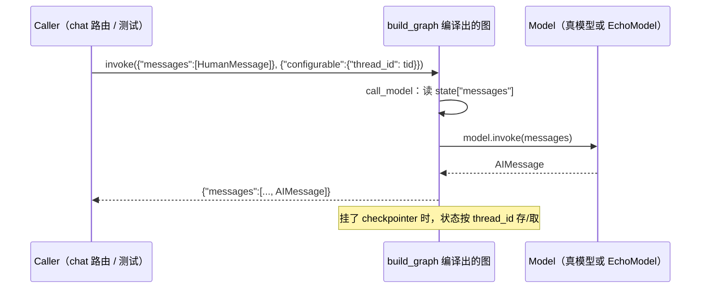

# 第 2 章　Agent 构造与单轮执行 / Agent Construction and Single-Turn Execution

> **EvoFlow 对照状态 / Alignment status：** 以 EvoFlow `lead_agent` 的 LangGraph/LangChain 装配为结构参照；本章只实现单轮调用的教学最小图，不代表上游内部节点结构。
>
> ::: warning 与 EvoFlow 真实实现的差异
> 本章**只造一张单节点图**：没有工具循环、没有中间件、没有 system prompt 注入。EvoFlow 也不是手写循环——它由 `create_agent(...)`（`agents/lead_agent/agent.py:1502`、`:1953`）把「模型节点 + 中间件链」编译成图，`after_model` 逆序执行、Clarification 固定链尾，详见 [03/03 Middleware 调用链](../03-工具深化与上下文控制/03-Middleware调用链与工具审计.md)。
> :::


## 本章目标 / Goals
- 造出第一张 LangGraph 图：`StateGraph(MessagesState)` + 单节点 + 两条边。
- 弄明白 `messages` 通道靠 reducer 追加，节点只返回新消息。
- 用假模型（不联网）验证单轮，再用 `InMemorySaver()` 验证「同 thread 累积历史」。

## 最小闭环 / Minimal closed loop
`build_graph(model) → invoke({"messages":[HumanMessage]}) → {"messages":[..., AIMessage]}`

一条消息进、一条回复出，没有工具、没有循环——这就是「单轮执行」。

## 调用逻辑 / Invocation logic


## 2.1 这一章实际造了什么 / What we actually build

**先纠正一个常见误解：EvoFlow 里没有 `Agent` 类。**

| EvoFlow 的做法 | 来源 |
|---|---|
| agent = **LangGraph 图 + 中间件链**，由 `create_agent(...)` 编译，不是自己 `new Agent()` | `agents/lead_agent/agent.py:1502`、`:1953` |
| 角色提示（system prompt）由中间件**每轮动态注入**，不写进历史消息 | `agents/middlewares/dynamic_system_prompt_middleware.py` |
| 模型调用是 LangChain 内部的 model 节点，外面套 `before_model` / `wrap_model_call` / `after_model` | `agents/lead_agent/agent.py:685-941`（装配） |

我们这一章也只造一个东西：

```text
build_graph(model, checkpointer=None)
    └─ StateGraph(MessagesState)
         └─ 单节点 call_model：把 state["messages"] 交给 model.invoke，回复塞回 messages
```

**刻意不做的**（后面章节各自负责）：
- 工具循环（未实现；1/04 只有注册表）
- system prompt 注入与中间件链（3.3）
- 事件流与 SSE（1.5、10/01）
- run 登记 / 取消（02/02）

## 2.2 一次单轮执行发生了什么 / What happens in one turn

```text
chat router → create_chat_model() → build_graph(model) → graph.invoke(
    {"messages": [HumanMessage(text)]},
    {"configurable": {"thread_id": tid}},
)
→ call_model 调 model.invoke(messages)
→ 返回 {"messages": [..., AIMessage]}
```

- **同步**：本章只有 `invoke`，没有 run_id、没有事件；HTTP 层怎么把它变成 SSE 见 1.5。
- **thread_id**：同一 `thread_id` + 挂 checkpointer 才会累积历史；不挂时每次都是新对话（见 Step 3 的测试）。
- **失败**：异常直接抛给调用方，本章不做脱敏。EvoFlow 侧也没有 `Redactor` 类，脱敏在 `models/credential_sanitize.py`（`sanitize_api_key` / `sanitize_base_url`）。

## 示例代码 / Sample code

### `backend/packages/harness/myagentflow/agents/lead_agent/graph.py`（全文，34 行）

```python
"""一、文件说明
    最小 Agent：一个节点 + 两条边。
    刻意不做工具循环：先把「单轮」跑通；后续若接工具循环，需要单列章节补 ToolNode。

二、目录结构
    packages/harness/myagentflow/agents/lead_agent/
    ├── __init__.py
    └── graph.py  ← 本文件

三、关键方法
    build_graph()  建单节点图：一次 invoke 调一次模型；可选挂 checkpointer 保留同线程历史。
"""
from __future__ import annotations

from typing import Any

from langgraph.graph import END, START, MessagesState, StateGraph


def build_graph(model: Any, checkpointer: Any = None):
    """建单节点图：一次 invoke 调一次模型；可选挂 checkpointer 保留同线程历史。"""
    graph = StateGraph(MessagesState)

    def call_model(state: MessagesState):
        # 唯一职责：把当前历史交给模型，把回复塞回 messages
        reply = model.invoke(state["messages"])
        return {"messages": [reply]}

    graph.add_node("call_model", call_model)
    graph.add_edge(START, "call_model")
    graph.add_edge("call_model", END)

    # checkpointer 允许 None：本章先不落盘，02/01 再注入
    return graph.compile(checkpointer=checkpointer)
```

三个设计点：

| 写法 | 为什么 |
|---|---|
| `MessagesState` | 它自带 `messages` 通道 + `add_messages` reducer，节点返回的 AIMessage 会被**追加**而不是覆盖（少了这句就会出现 `InvalidUpdateError`） |
| `checkpointer` 默认 `None` | 本章先证明「一条消息进、一条回复出」；持久化留给 02/01，不在这里耦合 |
| 节点只做 `model.invoke` | 把「调模型」和「图」分开：换模型（真模型/假模型）不影响图结构，测试才能不联网 |

### 调用方：`backend/app/gateway/routers/chat.py`（节选）

```python
async def chat(body: ChatIn) -> StreamingResponse:
    from myagentflow.agents.lead_agent.graph import build_graph
    from myagentflow.models.factory import create_chat_model
    from myagentflow.runtime.streaming import stream_graph

    graph = build_graph(create_chat_model())     # 模型由 1.1 的配置层解析

    async def gen():
        async for chunk in stream_graph(
            graph,
            {"messages": [HumanMessage(content=body.text)]},
            {"configurable": {"thread_id": body.thread_id}},
        ):
            yield chunk

    return StreamingResponse(gen(), media_type="text/event-stream")
```

> 注意：这条路由目前**没传 checkpointer**，所以同一 `thread_id` 也不会累积历史——接持久化是 02/01 的事。本章测试里显式传了 `InMemorySaver()`，验证的是「checkpointer 挂上就累积」这一点。

## 代码实现状态 / Code status

> 本章手把手三步均已落地；未做的能力列在表内，并标注归属章节。

| 内容 | 状态 | 证据 |
|---|---|---|
| `backend/packages/harness/myagentflow/agents/lead_agent/graph.py` 的 `build_graph(model, checkpointer=None)` | ✅ 已实现 | 全文见上；`uv run python -c "from ... import build_graph"` 通过 |
| `backend/tests/chapters/test_ch01_02_graph.py` 两个用例 | ✅ 已实现 | `uv run pytest ... -q` → **2 passed** |
| chat 路由调用图 | 🟡 半接 | `backend/app/gateway/routers/chat.py:23` 已 `build_graph(create_chat_model())`，但**未传 checkpointer**，同 thread 不累积；接持久化在 02/01 |
| 系统提示 / 角色 prompt | ❌ 本章不做 | EvoFlow 由 `agents/middlewares/dynamic_system_prompt_middleware.py` 每轮注入，我们在 3/03 复刻 |
| 工具循环 | ❌ 未实现 | 1/04 只有 `ToolRegistry`，没有工具节点；第 6、7 部分当前大纲也不含完整 ReAct 循环 |
| run 登记 / 事件流 / 取消 | ❌ 不做 | 1/05（事件）与 02/02（生命周期） |

## 业务规则 / Business rules
1. **一张图只做一次模型调用**：没有工具时，图跑完就结束，不存在「循环直到模型停」。
2. **history 由 `MessagesState` 通道维护**：节点只返回新消息，追加由 reducer 完成，不手工 `messages + [reply]`。
3. **checkpointer 可为空**：不传时图无状态，每次 `invoke` 各自独立；传了才按 `thread_id` 累积。
4. **异常不吞**：`model.invoke` 抛什么就传什么，本章不做错误分类/脱敏。

## 验收 / Acceptance
- [x] 单轮：一条消息进、`echo: 你好` 出（`test_single_turn`）
- [x] 同 `thread_id` 挂 `InMemorySaver()` 后，第二次 invoke 能看到 4 条消息（`test_same_thread_keeps_history`）

```bash
cd backend && uv run pytest tests/chapters/test_ch01_02_graph.py -q
# 期望：2 passed
```

## 对照 EvoFlow 核对清单
- [ ] EvoFlow 中「Agent 角色」的数据结构（岗位、提示词、工具集、模型绑定）
- [ ] run / task / thread 三个概念在 EvoFlow 里的边界
- [ ] 错误事件的字段与分类

## 常见坑

| 症状 | 原因 | 动作 |
|---|---|---|
| `ModuleNotFoundError: langgraph` | 依赖没装或不在 workspace 里 | `cd backend && uv sync`；确认 `pyproject.toml` 有 `langgraph` |
| 第二次 `invoke` 只有 2 条消息（没有累积） | 没传 `configurable.thread_id`，或压根没挂 checkpointer | 传 `{"configurable": {"thread_id": "t1"}}`，并 `build_graph(model, InMemorySaver())`（本仓库 `build_graph(model, checkpointer=None)`，checkpointer 是第二个位置参数） |
| `InvalidUpdateError: Expected dict, got AIMessage` | 图的状态里 `messages` 少了 `add_messages` reducer | 用 `Annotated[list, add_messages]` 声明 messages 通道 |

## 从零实现（手把手）
> 读完这章你能编译出第一张 LangGraph 图：输入一条消息，返回一条回复——没有工具、没有循环，只有一条边。
> 文件路径一律写仓库全路径（`backend/...`），代码注释写「为什么」。

### Step 1　新建 graph.py：一个节点、两条边
**文件**：`backend/packages/harness/myagentflow/agents/lead_agent/graph.py（新建）`
**要写的逻辑**：用 `MessagesState` 做状态；节点只负责把历史消息交给模型；checkpointer 允许为空（先不接持久化）。

**代码**

```python
"""一、文件说明
    最小 Agent：一个节点 + 两条边。
    刻意不做工具循环：先把「单轮」跑通；后续若接工具循环，需要单列章节补 ToolNode。

二、目录结构
    packages/harness/myagentflow/agents/lead_agent/
    ├── __init__.py
    └── graph.py  ← 本文件

三、关键方法
    build_graph()  建单节点图：一次 invoke 调一次模型；可选挂 checkpointer 保留同线程历史。
"""
from __future__ import annotations

from typing import Any

from langgraph.graph import END, START, MessagesState, StateGraph


def build_graph(model: Any, checkpointer: Any = None):
    """建单节点图：一次 invoke 调一次模型；可选挂 checkpointer 保留同线程历史。"""
    graph = StateGraph(MessagesState)

    def call_model(state: MessagesState):
        # 唯一职责：把当前历史交给模型，把回复塞回 messages
        reply = model.invoke(state["messages"])
        return {"messages": [reply]}

    graph.add_node("call_model", call_model)
    graph.add_edge(START, "call_model")
    graph.add_edge("call_model", END)

    # checkpointer 允许 None：本章先不落盘，02/01 再注入
    return graph.compile(checkpointer=checkpointer)
```

**验证**

```bash
uv run python -c "from myagentflow.agents.lead_agent.graph import build_graph; print('import ok')"
```

### Step 2　用假模型跑通一条消息
**文件**：`backend/tests/chapters/test_ch01_02_graph.py（新建）`
**要写的逻辑**：假模型只实现 `invoke`，这样测试不花 token、不依赖网络。

**代码**

```python
"""一、文件说明
    第 2 章图结构：单轮执行与同一 thread 的历史累积。

二、覆盖
    EchoModel                      假模型：不联网，只回显。
    test_single_turn()             一张「START → call_model → END」的图能把一条消息跑出回复。
    test_same_thread_keeps_history() 同一 thread 第二次调用能看到第一轮的两条消息。

三、运行
    uv run pytest tests/chapters/test_ch01_02_graph.py -q
"""

from __future__ import annotations

from langchain_core.messages import AIMessage, HumanMessage


class EchoModel:
    """假模型：不联网，只回显。测试里所有「模型」都该长这样。"""

    def invoke(self, messages, *_args, **_kwargs):
        return AIMessage(content="echo: " + messages[-1].content)


def test_single_turn():
    """一张「START → call_model → END」的图能把一条消息跑出回复。"""
    from myagentflow.agents.lead_agent.graph import build_graph

    graph = build_graph(EchoModel())
    out = graph.invoke({"messages": [HumanMessage(content="你好")]})
    assert out["messages"][-1].content == "echo: 你好"
```

**验证**

```bash
uv run pytest tests/chapters/test_ch01_02_graph.py -v
# 期望：1 passed
```

### Step 3　接上 checkpointer，验证「同 thread 能续上」
**文件**：`backend/tests/chapters/test_ch01_02_graph.py（追加用例）`
**要写的逻辑**：两次 invoke 用同一个 thread_id；第二次的历史里应包含第一轮的两条消息。

**代码**

```python
def test_same_thread_keeps_history():
    """同一 thread 第二次调用能看到第一轮的两条消息（4 条 = 两问两答）。"""
    from langgraph.checkpoint.memory import InMemorySaver
    from langchain_core.messages import HumanMessage

    from myagentflow.agents.lead_agent.graph import build_graph

    graph = build_graph(EchoModel(), InMemorySaver())
    cfg = {"configurable": {"thread_id": "t1"}}

    graph.invoke({"messages": [HumanMessage(content="一")]}, cfg)
    out = graph.invoke({"messages": [HumanMessage(content="二")]}, cfg)

    # 4 条 = 用户一、回复一、用户二、回复二；说明检查点真的在累积
    assert len(out["messages"]) == 4
```

**验证**

```bash
uv run pytest tests/chapters/test_ch01_02_graph.py -v
# 期望：2 passed
```

### 与 EvoFlow 对照

| 我们的做法 | EvoFlow | 为什么 |
|---|---|---|
| `StateGraph(MessagesState)` | **EvoFlow 不手写 StateGraph**：它调 `create_agent(...)`（`agents/lead_agent/agent.py:1502`、`:1953` 两处），图由 LangChain 内部编译 | 我们要看懂「图长什么样」，所以显式建一遍；EvoFlow 是「配中间件就给图」 |
| 单节点 `call_model` | **没有 `call_model` 这个节点**：模型调用是 LangChain 的 model 节点，前后由 `before_model` / `wrap_model_call` / `after_model` 中间件包裹 | 手写节点是为了看清 state 怎么进出；EvoFlow 把这些塞进中间件 |

### 知识点

- [agent-book · LangGraph 课程](https://g0-000.github.io/agent-book/langgraph/)：StateGraph / compile / checkpointer 三段
- 本章的 `thread_id` 语义在 02/01 展开

### 验收

```bash
uv run pytest tests/chapters/test_ch01_02_graph.py -q
```
