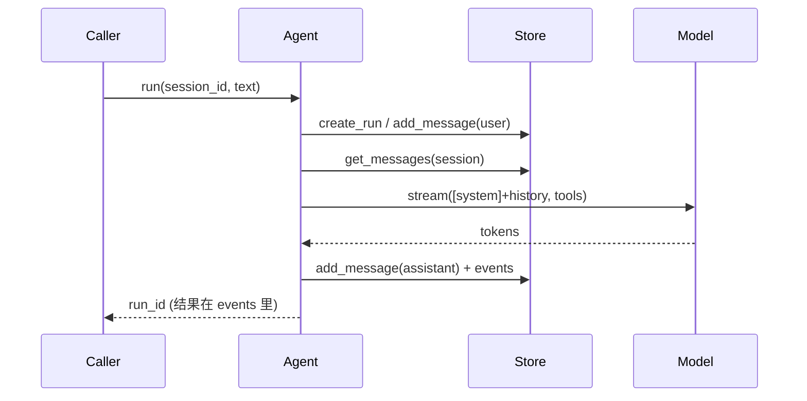

# 第 2 章　Agent 构造与单轮执行 / Agent Construction and Single-Turn Execution

> **EvoFlow 对照状态 / Alignment status：** 📄 **原文迁移**——内容是教材版自研实现，完整迁移、未与 EvoFlow 源码核对。
>
> ::: warning 与 EvoFlow 真实实现的差异
> 本章是**手写 agent loop**（调模型 → 执行工具 → 再调模型）。EvoFlow 里没有这个循环：它由 `lead_agent/agent.py`（2002 行）编译成 LangGraph 图，外层再套一条中间件链 `build_lead_runtime_middlewares(lazy_init=True)`；`after_model` 是**逆序**执行的，Clarification 固定链尾。差异详见 [03/03 Middleware 调用链](../03-工具深化与上下文控制/03-Middleware调用链与工具审计.md)。
> :::


## 本章目标 / Goals
- 一个 **Agent** = role prompt + model + tools + store。
- 一次 **run** 是一个可观察的执行单元：有 `run_id`、状态、事件序列。
- 同一个 Agent 实例可以被多个 session 复用，**不共享会话状态**。

## 最小闭环 / Minimal closed loop
`start_run(session) → execute() → 事件: run_start → token... → done`

没有工具调用时，循环第一轮就结束，这就是「单轮执行」。

## 调用逻辑 / Invocation logic


## 2.1 Agent 构造与角色提示 / Construction and role prompt
**核心概念**
- **role prompt**：system message，**每轮动态渲染、不入库**。这样改提示词不会污染历史。
- **slots**：`"You are {role}."` 这类变量槽，由 `render_prompt(**slots)` 填充。
- **max_steps**：防止模型与工具无限循环（第 4 章详述）。

## 2.2 单轮执行与结果返回 / Single-turn execution and result return
**为什么返回 run_id 而不是文本：** 结果以 **事件流** 交付（第 5 章），同步调用方可在 `done` 事件里读取最终文本；异步调用方通过 SSE 订阅。这样同步与流式共用同一条路径。

**错误处理 / Error handling：** 任何异常都被转成 `error` 事件，并把 run 状态置为 `failed`；错误消息会先经过 `Redactor`。

## 示例代码 / Sample code
### `evoflow_min/agent.py`
```python
"""Agent: role prompt + model + tools + store. One run = loop until the model stops. (Chapters 1.2 and 1.4)"""
from __future__ import annotations
from dataclasses import dataclass
from .config import Redactor
from .store import Store
from .tools import ToolRegistry

TERMINAL = ("done", "error")

class Agent:
    def __init__(self, model, registry: ToolRegistry, store: Store, role_prompt: str = "You are a helpful assistant.",
                 max_steps: int = 6, redactor: Redactor | None = None):
        self.model, self.registry, self.store = model, registry, store
        self.role_prompt, self.max_steps = role_prompt, max_steps
        self.redact = redactor or Redactor()

    def render_prompt(self, **slots) -> str:
        return self.role_prompt.format(**slots) if slots else self.role_prompt

    def start_run(self, session_id: str) -> str:
        if not self.store.session_exists(session_id):
            raise KeyError(f"unknown session: {session_id}")
        return self.store.create_run(session_id)

    def execute(self, session_id: str, run_id: str, user_text: str) -> None:
        emit = lambda t, d=None: self.store.append_event(run_id, t, d or {})
        try:
            emit("run_start", {"session_id": session_id})
            self.store.add_message(session_id, "user", user_text)
            total = {"input": 0, "output": 0}
            for _ in range(self.max_steps):
                messages = [{"role": "system", "content": self.render_prompt()}] + self.store.get_messages(session_id)
                text, calls = [], []
                for kind, payload in self.model.stream(messages, self.registry.specs()):
                    if kind == "token":
                        text.append(payload); emit("token", {"text": payload})
                    elif kind == "tool_call":
                        calls.append(payload)
                    elif kind == "done":
                        for k in total: total[k] += payload.get("usage", {}).get(k, 0)
                self.store.add_message(session_id, "assistant", "".join(text),
                                       tool_calls=[{"id": c.id, "name": c.name, "arguments": c.arguments} for c in calls] or None)
                if not calls:
                    self.store.set_run_status(run_id, "done")
                    emit("done", {"text": "".join(text), "usage": total}); return
                for c in calls:
                    emit("tool_start", {"id": c.id, "name": c.name, "arguments": c.arguments})
                    res = self.registry.call(c.name, c.arguments)
                    body = res.content if res.ok else f"ERROR: {res.error}"
                    self.store.add_message(session_id, "tool", body, tool_call_id=c.id, name=c.name)
                    emit("tool_end", {"id": c.id, "ok": res.ok, "truncated": res.truncated, "content": body})
            raise RuntimeError(f"max_steps ({self.max_steps}) reached")
        except Exception as e:
            self.store.set_run_status(run_id, "failed")
            emit("error", {"message": self.redact(f"{type(e).__name__}: {e}")})

    def run(self, session_id: str, user_text: str) -> str:
        rid = self.start_run(session_id)
        self.execute(session_id, rid, user_text)
        return rid
```

## 业务规则 / Business rules
1. 未知 `session_id` → `KeyError`（HTTP 层映射为 404）。
2. 用户消息先落库，再调用模型 —— 即使模型失败，用户输入也不丢。
3. 事件是 **追加写**，永不修改。
4. 终止事件只有 `done` 与 `error` 两种（`TERMINAL`）。

## 验收 / Acceptance
- [x] FakeModel 单轮返回预期结果（`Ch2Agent.test_single_turn`）
- [x] 同一 Agent 跨 session 无状态串扰（`test_role_prompt_slots_and_isolation`）

## 对照 EvoFlow 核对清单
- [ ] EvoFlow 中「Agent 角色」的数据结构（岗位、提示词、工具集、模型绑定）
- [ ] run / task / thread 三个概念在 EvoFlow 里的边界
- [ ] 错误事件的字段与分类

## 从零实现（手把手）
> 读完这章你能编译出第一张 LangGraph 图：输入一条消息，返回一条回复——没有工具、没有循环，只有一条边。
> 路径均相对 `backend/`，代码注释写「为什么」。

### Step 1　新建 graph.py：一个节点、两条边
**文件**：`packages/harness/myagentflow/agents/lead_agent/graph.py（新建）`
**要写的逻辑**：用 `MessagesState` 做状态；节点只负责把历史消息交给模型；checkpointer 允许为空（先不接持久化）。

**代码**

```python
"""最小 Agent：一个节点 + 两条边。

刻意不做工具循环：先把「单轮」跑通，后面每章只在这张图上加节点/加边。
"""
from __future__ import annotations

from typing import Any

from langgraph.graph import END, START, MessagesState, StateGraph


def build_graph(model: Any, checkpointer: Any = None):
    graph = StateGraph(MessagesState)

    def call_model(state: MessagesState):
        # 唯一职责：把当前历史交给模型，把回复塞回 messages
        reply = model.invoke(state["messages"])
        return {"messages": [reply]}

    graph.add_node("call_model", call_model)
    graph.add_edge(START, "call_model")
    graph.add_edge("call_model", END)

    # checkpointer 允许 None：本章先不落盘，02/01 再注入
    return graph.compile(checkpointer=checkpointer)
```

**验证**

```bash
uv run python -c "from myagentflow.agents.lead_agent.graph import build_graph; print('import ok')"
```

### Step 2　用假模型跑通一条消息
**文件**：`tests/chapters/test_ch01_02_graph.py（新建）`
**要写的逻辑**：假模型只实现 `invoke`，这样测试不花 token、不依赖网络。

**代码**

```python
from __future__ import annotations

from langchain_core.messages import AIMessage, HumanMessage


class EchoModel:
    """假模型：不联网，只回显。测试里所有「模型」都该长这样。"""

    def invoke(self, messages, *_args, **_kwargs):
        return AIMessage(content="echo: " + messages[-1].content)


def test_single_turn():
    from myagentflow.agents.lead_agent.graph import build_graph

    graph = build_graph(EchoModel())
    out = graph.invoke({"messages": [HumanMessage(content="你好")]})
    assert out["messages"][-1].content == "echo: 你好"
```

**验证**

```bash
uv run pytest tests/chapters/test_ch01_02_graph.py -v
# 期望：1 passed
```

### Step 3　接上 checkpointer，验证「同 thread 能续上」
**文件**：`tests/chapters/test_ch01_02_graph.py（追加用例）`
**要写的逻辑**：两次 invoke 用同一个 thread_id；第二次的历史里应包含第一轮的两条消息。

**代码**

```python
def test_same_thread_keeps_history():
    from langgraph.checkpoint.memory import InMemorySaver
    from langchain_core.messages import HumanMessage

    from myagentflow.agents.lead_agent.graph import build_graph

    graph = build_graph(EchoModel(), InMemorySaver())
    cfg = {"configurable": {"thread_id": "t1"}}

    graph.invoke({"messages": [HumanMessage(content="一")]}, cfg)
    out = graph.invoke({"messages": [HumanMessage(content="二")]}, cfg)

    # 4 条 = 用户一、回复一、用户二、回复二；说明检查点真的在累积
    assert len(out["messages"]) == 4
```

**验证**

```bash
uv run pytest tests/chapters/test_ch01_02_graph.py -v
# 期望：2 passed
```

### 与 EvoFlow 对照

| 我们的做法 | EvoFlow | 为什么 |
|---|---|---|
| `StateGraph(MessagesState)` | `lead_agent/agent.py` 的建图部分 | 消息列表就是最小状态 |
| 单节点 `call_model` | 同文件 `call_model` 节点 | 先复刻主干，再叠中间件 |

### 知识点

- [agent-book · LangGraph 课程](https://g0-000.github.io/agent-book/langgraph/)：StateGraph / compile / checkpointer 三段
- 本章的 `thread_id` 语义在 02/01 展开

### 验收

```bash
uv run pytest tests/chapters/test_ch01_02_graph.py -q
```
