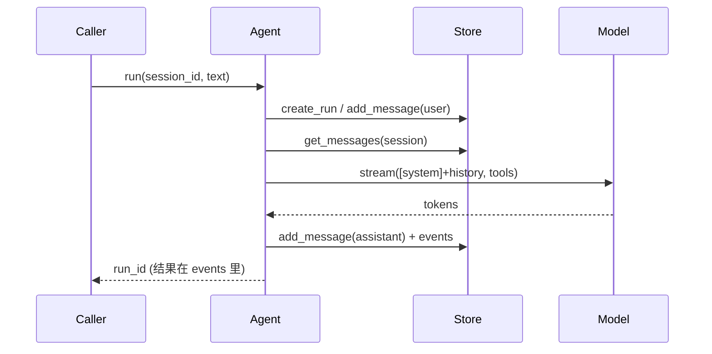

# 第 2 章　Agent 构造与单轮执行 / Agent Construction and Single-Turn Execution

> **EvoFlow 对照状态 / Alignment status：** 🟡 本章是按通用 Agent Runtime 设计实现的 **自研参考实现**，尚未与 EvoFlow 源码逐项核对。核对清单见本章末尾。

## 本章目标 / Goals
- 一个 **Agent** = role prompt + model + tools + store。
- 一次 **run** 是一个可观察的执行单元：有 `run_id`、状态、事件序列。
- 同一个 Agent 实例可以被多个 session 复用，**不共享会话状态**。

## 最小闭环 / Minimal closed loop
`start_run(session) → execute() → 事件: run_start → token... → done`

没有工具调用时，循环第一轮就结束，这就是「单轮执行」。

## 调用逻辑 / Invocation logic


## 2.1 Agent 构造与角色提示 / Construction and role prompt
**核心概念**
- **role prompt**：system message，**每轮动态渲染、不入库**。这样改提示词不会污染历史。
- **slots**：`"You are {role}."` 这类变量槽，由 `render_prompt(**slots)` 填充。
- **max_steps**：防止模型与工具无限循环（第 4 章详述）。

## 2.2 单轮执行与结果返回 / Single-turn execution and result return
**为什么返回 run_id 而不是文本：** 结果以 **事件流** 交付（第 5 章），同步调用方可在 `done` 事件里读取最终文本；异步调用方通过 SSE 订阅。这样同步与流式共用同一条路径。

**错误处理 / Error handling：** 任何异常都被转成 `error` 事件，并把 run 状态置为 `failed`；错误消息会先经过 `Redactor`。

## 示例代码 / Sample code
### `evoflow_min/agent.py`
```python
"""Agent: role prompt + model + tools + store. One run = loop until the model stops. (Chapters 1.2 and 1.4)"""
from __future__ import annotations
from dataclasses import dataclass
from .config import Redactor
from .store import Store
from .tools import ToolRegistry

TERMINAL = ("done", "error")

class Agent:
    def __init__(self, model, registry: ToolRegistry, store: Store, role_prompt: str = "You are a helpful assistant.",
                 max_steps: int = 6, redactor: Redactor | None = None):
        self.model, self.registry, self.store = model, registry, store
        self.role_prompt, self.max_steps = role_prompt, max_steps
        self.redact = redactor or Redactor()

    def render_prompt(self, **slots) -> str:
        return self.role_prompt.format(**slots) if slots else self.role_prompt

    def start_run(self, session_id: str) -> str:
        if not self.store.session_exists(session_id):
            raise KeyError(f"unknown session: {session_id}")
        return self.store.create_run(session_id)

    def execute(self, session_id: str, run_id: str, user_text: str) -> None:
        emit = lambda t, d=None: self.store.append_event(run_id, t, d or {})
        try:
            emit("run_start", {"session_id": session_id})
            self.store.add_message(session_id, "user", user_text)
            total = {"input": 0, "output": 0}
            for _ in range(self.max_steps):
                messages = [{"role": "system", "content": self.render_prompt()}] + self.store.get_messages(session_id)
                text, calls = [], []
                for kind, payload in self.model.stream(messages, self.registry.specs()):
                    if kind == "token":
                        text.append(payload); emit("token", {"text": payload})
                    elif kind == "tool_call":
                        calls.append(payload)
                    elif kind == "done":
                        for k in total: total[k] += payload.get("usage", {}).get(k, 0)
                self.store.add_message(session_id, "assistant", "".join(text),
                                       tool_calls=[{"id": c.id, "name": c.name, "arguments": c.arguments} for c in calls] or None)
                if not calls:
                    self.store.set_run_status(run_id, "done")
                    emit("done", {"text": "".join(text), "usage": total}); return
                for c in calls:
                    emit("tool_start", {"id": c.id, "name": c.name, "arguments": c.arguments})
                    res = self.registry.call(c.name, c.arguments)
                    body = res.content if res.ok else f"ERROR: {res.error}"
                    self.store.add_message(session_id, "tool", body, tool_call_id=c.id, name=c.name)
                    emit("tool_end", {"id": c.id, "ok": res.ok, "truncated": res.truncated, "content": body})
            raise RuntimeError(f"max_steps ({self.max_steps}) reached")
        except Exception as e:
            self.store.set_run_status(run_id, "failed")
            emit("error", {"message": self.redact(f"{type(e).__name__}: {e}")})

    def run(self, session_id: str, user_text: str) -> str:
        rid = self.start_run(session_id)
        self.execute(session_id, rid, user_text)
        return rid
```

## 业务规则 / Business rules
1. 未知 `session_id` → `KeyError`（HTTP 层映射为 404）。
2. 用户消息先落库，再调用模型 —— 即使模型失败，用户输入也不丢。
3. 事件是 **追加写**，永不修改。
4. 终止事件只有 `done` 与 `error` 两种（`TERMINAL`）。

## 验收 / Acceptance
- [x] FakeModel 单轮返回预期结果（`Ch2Agent.test_single_turn`）
- [x] 同一 Agent 跨 session 无状态串扰（`test_role_prompt_slots_and_isolation`）

## 对照 EvoFlow 核对清单
- [ ] EvoFlow 中「Agent 角色」的数据结构（岗位、提示词、工具集、模型绑定）
- [ ] run / task / thread 三个概念在 EvoFlow 里的边界
- [ ] 错误事件的字段与分类
