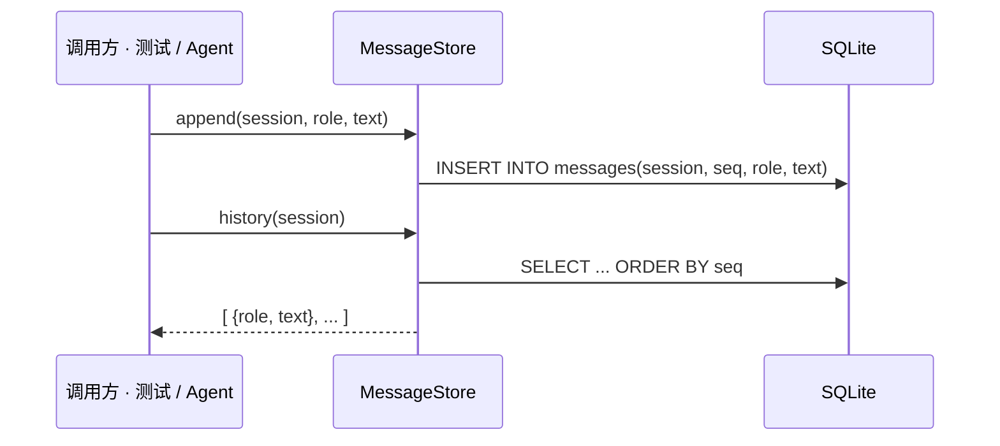

# 第 3 章　会话与消息存储 / Sessions and Message Storage

> **EvoFlow 对照状态 / Alignment status：** 📄 **原文迁移**——内容是教材版自研实现，完整迁移、未与 EvoFlow 源码核对。
>
> ::: warning 与 EvoFlow 真实实现的差异
> 本章把 `messages` 表当历史。EvoFlow 的事实源是 **`evoflow_chat_messages`**；检查点层故意**不存对话**——`omit_transcript.py` 在 put/aput 时摘掉 `messages` 与 `ui_messages`（`_TRANSCRIPT_CHANNELS`），唯一例外是存在未配对 tool_call。详见 [02/01 检查点与线程恢复](../02-持久化与运行生命周期/01-检查点与线程恢复.md)。
> :::


## 本章目标 / Goals
让对话在进程重启后仍能继续，并清楚区分三类数据：**messages（模型可见历史）**、**runs（执行记录）**、**events（过程日志）**。

## 最小闭环 / Minimal closed loop
`create_session → add_message(user) → ...→ 重启 → get_messages 仍然一致`

## 调用逻辑 / Invocation logic



- **入口**：`MessageStore(db_path)` 构造一次，`append()` 写、`history()` 读，两个方法共用同一条连接。
- **关键节点**：`append` 里必须按 `session` 自增 `seq`，否则并发写会乱序；`history` 只按 `seq` 排，不依赖时间戳。
- **出口**：返回纯 dict 列表，上层（graph、SSE 回放）直接消费，不暴露 sqlite Row。
- **最容易断的地方**：同一 session 用不同连接写，`seq` 撞车；解决方式是在写入语句里用 `MAX(seq)+1` 而不是在 Python 里算。

## 数据模型 / Data model
```text
sessions 1 ──< messages     # 模型看到的历史（user / assistant / tool）
sessions 1 ──< runs 1 ──< events   # 一次执行的过程日志，用于 UI 与恢复
```

| 表 / Table | 用途 / Purpose | 是否进入模型上下文 |
|---|---|---|
| `messages` | 对话历史，包含 assistant 的 `tool_calls` 与 `tool` 结果 | ✅ |
| `runs` | 状态：running / done / failed | ❌ |
| `events` | token、tool_start、tool_end、done、error | ❌ |

## 3.1 会话与业务消息存储 / Session and business messages
**核心概念**
- **模型消息**必须保持 provider 要求的顺序：assistant 的 `tool_calls` 之后必须紧跟对应 `tool_call_id` 的 `tool` 消息。
- **业务消息**（例如 UI 里的状态提示、审批卡片）不应混进模型历史；本阶段先用 `events` 承载，后续章节再扩展独立的业务消息表。

**业务规则**
1. `AUTOINCREMENT` 主键保证消息顺序稳定。
2. 工具参数与 tool_calls 以 JSON 存储，读取时还原为 dict。
3. SQLite 用一把进程内锁串行化写入（`check_same_thread=False` 的代价）。

## 示例代码 / Sample code
### `evoflow_min/store.py`
```python
"""SQLite persistence: sessions, messages, runs, event log. (Chapters 1.3 and 1.5)"""
from __future__ import annotations
import json, sqlite3, threading, time, uuid

SCHEMA = """
CREATE TABLE IF NOT EXISTS sessions(id TEXT PRIMARY KEY, title TEXT, created_at REAL);
CREATE TABLE IF NOT EXISTS messages(id INTEGER PRIMARY KEY AUTOINCREMENT, session_id TEXT, role TEXT,
  content TEXT, tool_calls TEXT, tool_call_id TEXT, name TEXT, created_at REAL);
CREATE TABLE IF NOT EXISTS runs(id TEXT PRIMARY KEY, session_id TEXT, status TEXT, created_at REAL);
CREATE TABLE IF NOT EXISTS events(id INTEGER PRIMARY KEY AUTOINCREMENT, run_id TEXT, type TEXT, data TEXT, created_at REAL);
CREATE INDEX IF NOT EXISTS idx_messages_session ON messages(session_id, id);
CREATE INDEX IF NOT EXISTS idx_events_run ON events(run_id, id);
"""

class Store:
    def __init__(self, path: str = ":memory:"):
        self._db = sqlite3.connect(path, check_same_thread=False)
        self._db.row_factory = sqlite3.Row
        self._lock = threading.Lock()
        with self._lock:
            self._db.executescript(SCHEMA)
    def _x(self, sql, args=()):
        with self._lock:
            cur = self._db.execute(sql, args); self._db.commit(); return cur
    def create_session(self, title: str = "") -> str:
        sid = uuid.uuid4().hex[:12]
        self._x("INSERT INTO sessions VALUES (?,?,?)", (sid, title, time.time())); return sid
    def session_exists(self, sid: str) -> bool:
        return self._x("SELECT 1 FROM sessions WHERE id=?", (sid,)).fetchone() is not None
    def add_message(self, sid, role, content, tool_calls=None, tool_call_id=None, name=None) -> int:
        cur = self._x("INSERT INTO messages(session_id,role,content,tool_calls,tool_call_id,name,created_at) VALUES (?,?,?,?,?,?,?)",
                      (sid, role, content, json.dumps(tool_calls) if tool_calls else None, tool_call_id, name, time.time()))
        return cur.lastrowid
    def get_messages(self, sid) -> list[dict]:
        rows = self._x("SELECT * FROM messages WHERE session_id=? ORDER BY id", (sid,)).fetchall()
        out = []
        for r in rows:
            m = {"role": r["role"], "content": r["content"]}
            if r["tool_calls"]: m["tool_calls"] = json.loads(r["tool_calls"])
            if r["tool_call_id"]: m["tool_call_id"] = r["tool_call_id"]
            if r["name"]: m["name"] = r["name"]
            out.append(m)
        return out
    def create_run(self, sid) -> str:
        rid = uuid.uuid4().hex[:12]
        self._x("INSERT INTO runs VALUES (?,?,?,?)", (rid, sid, "running", time.time())); return rid
    def set_run_status(self, rid, status): self._x("UPDATE runs SET status=? WHERE id=?", (status, rid))
    def run_status(self, rid) -> str | None:
        r = self._x("SELECT status FROM runs WHERE id=?", (rid,)).fetchone(); return r["status"] if r else None
    def append_event(self, rid, etype, data) -> int:
        return self._x("INSERT INTO events(run_id,type,data,created_at) VALUES (?,?,?,?)", (rid, etype, json.dumps(data), time.time())).lastrowid
    def events_after(self, rid, after_id: int = 0) -> list[dict]:
        rows = self._x("SELECT id,type,data FROM events WHERE run_id=? AND id>? ORDER BY id", (rid, after_id)).fetchall()
        return [{"id": r["id"], "type": r["type"], "data": json.loads(r["data"])} for r in rows]
```

## 常见坑 / Pitfalls
- 把 system prompt 存进 messages：以后改提示词会出现新旧混杂。
- 只存最终 assistant 文本、丢掉 tool 消息：重放历史时模型会「忘记」自己调用过工具。
- 多线程共享一个 sqlite 连接却不加锁。

## 验收 / Acceptance
- [x] 重启后对话继续（`Ch3Store.test_persist_across_restart`）
- [x] 消息顺序与角色保留：`user → assistant → tool → assistant`

## 扩展练习 / Extensions
1. 为 session 增加 `title` 自动生成。
2. 增加消息分页与按时间裁剪。
3. 引入 migration 版本表（为后续章节的新表做准备）。

## 对照 EvoFlow 核对清单
- [ ] EvoFlow 使用的存储（SQLite / PostgreSQL / 其他）与表结构
- [ ] 「会话」与「业务消息」的实际划分
- [ ] 分享、检查点（第 2 部分）如何关联会话

## 从零实现（手把手）
> 读完这章你有一个自己的消息表：能按 thread 追加、按顺序读回，不依赖 LangGraph 的检查点。
> 路径均相对 `backend/`，代码注释写「为什么」。

### Step 1　新建 messages.py：建表 + 两个方法
**文件**：`packages/harness/myagentflow/persistence/messages.py（新建）`
**要写的逻辑**：`append()` 用自增 seq 保证顺序；`history()` 按 seq 升序返回；WAL + busy_timeout 复用 02/01 的经验。

**代码**

```python
"""会话消息表：检查点恢复用，消息存档用它。

为什么不用检查点存消息：检查点会被频繁重写、还要被剥离 transcript（见 02/01），
消息需要一个只追加、可整段回放的存储。
"""
from __future__ import annotations

import sqlite3
import time
from pathlib import Path
from typing import Any

_SCHEMA = """
CREATE TABLE IF NOT EXISTS messages (
    thread_id TEXT NOT NULL,
    seq       INTEGER NOT NULL,
    role      TEXT NOT NULL,
    content   TEXT NOT NULL,
    created_at REAL NOT NULL,
    PRIMARY KEY (thread_id, seq)
);
"""


class MessageStore:
    def __init__(self, db_path: str | Path):
        path = str(db_path)
        Path(path).parent.mkdir(parents=True, exist_ok=True)
        self._conn = sqlite3.connect(path, check_same_thread=False)
        self._conn.execute("PRAGMA journal_mode=WAL")
        self._conn.execute("PRAGMA busy_timeout=5000")
        self._conn.executescript(_SCHEMA)

    def append(self, thread_id: str, role: str, content: str) -> int:
        """追加一条，返回它的 seq。seq 用子查询算，避免应用层自己维护计数器。"""
        row = self._conn.execute(
            "SELECT COALESCE(MAX(seq), 0) + 1 FROM messages WHERE thread_id = ?",
            (thread_id,),
        ).fetchone()
        seq = int(row[0])
        self._conn.execute(
            "INSERT INTO messages (thread_id, seq, role, content, created_at) VALUES (?, ?, ?, ?, ?)",
            (thread_id, seq, role, content, time.time()),
        )
        self._conn.commit()
        return seq

    def history(self, thread_id: str, limit: int = 100) -> list[dict[str, Any]]:
        rows = self._conn.execute(
            "SELECT seq, role, content FROM messages WHERE thread_id = ? ORDER BY seq ASC LIMIT ?",
            (thread_id, limit),
        ).fetchall()
        return [{"seq": r[0], "role": r[1], "content": r[2]} for r in rows]
```

**验证**

```bash
uv run python -c "
from myagentflow.persistence.messages import MessageStore
s = MessageStore('/tmp/myaf-msg.sqlite')
print(s.append('t1','user','你好'), s.append('t1','assistant','在'))
print(s.history('t1'))
"
```

### Step 2　写测试：顺序、隔离、上限
**文件**：`tests/chapters/test_ch01_03_messages.py（新建）`
**要写的逻辑**：两个 thread 互不串；seq 连续；limit 生效。

**代码**

```python
from __future__ import annotations


def test_append_and_history(tmp_path):
    from myagentflow.persistence.messages import MessageStore

    store = MessageStore(tmp_path / "m.sqlite")
    assert store.append("a", "user", "1") == 1
    assert store.append("a", "assistant", "2") == 2
    assert store.append("b", "user", "x") == 1        # 另一个线程从 1 开始

    assert [m["content"] for m in store.history("a")] == ["1", "2"]
    assert len(store.history("a", limit=1)) == 1
```

**验证**

```bash
uv run pytest tests/chapters/test_ch01_03_messages.py -v
# 期望：1 passed
```

### 与 EvoFlow 对照

| 我们的做法 | EvoFlow | 为什么 |
|---|---|---|
| `thread_id + seq` 复合主键 | `persistence/` 的消息表设计 | 顺序由数据库保证，应用层不维护游标 |
| 只追加、不回改 | EvoFlow 的 `evoflow_chat_messages` 只增不改 | 历史不可变才好做回放与审计 |

### 知识点

- [agent-book · 记忆章](https://g0-000.github.io/agent-book/agent-learning/chapter_memory/)：短期记忆的存储形态

### 验收

```bash
uv run pytest tests/chapters/test_ch01_03_messages.py -q
```
