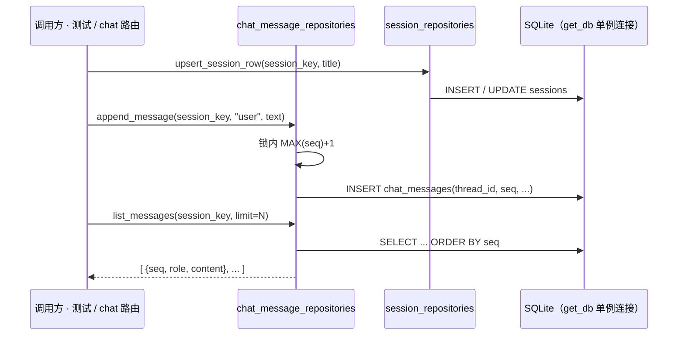

# 第 3 章　会话与消息存储 / Sessions and Message Storage

> **EvoFlow 对照状态 / Alignment status：** 文件与函数名对齐 `persistence/{db,chat_message_repositories,session_repositories}.py`；表结构做了简化（只留 `role/content` 与标题），事务语义**不宣称**等同上游。
>
> ::: warning 与 EvoFlow 真实实现的差异
> 本章把 `messages` 表当历史。EvoFlow 的事实源是 **`evoflow_chat_messages`**；检查点层故意**不存对话**——`omit_transcript.py` 在 put/aput 时摘掉 `messages` 与 `ui_messages`（`_TRANSCRIPT_CHANNELS`），唯一例外是存在未配对 tool_call。详见 [02/01 检查点与线程恢复](../02-持久化与运行生命周期/01-检查点与线程恢复.md)。
> :::


## 本章目标 / Goals
让对话在进程重启后仍能继续：`sessions`（目录）+ `chat_messages`（正文）两张表，读写走两个仓储文件。
`runs` / `events` 属于执行日志，1.5 再建，本章不碰。

## 最小闭环 / Minimal closed loop
`upsert_session_row(s) → append_message(s,"user","你好") → 关进程 → append_message(s,"assistant","在") → list_messages(s)` 两条都在、顺序不变

## 调用逻辑 / Invocation logic



- **入口**：`get_db()` 返回进程内唯一连接；仓储函数都接受可选的 `conn`，测试可传入自己的连接。
- **关键节点**：`append_message` 必须在 `db_connection_lock()` 里「算 seq + 插入」，否则两个线程会拿到同一个 `seq` 撞主键。
- **出口**：返回纯 dict 列表，上层（graph、SSE 回放）直接消费，不暴露 sqlite Row。
- **最容易断的地方**：在 Python 里维护 `seq` 计数器——进程重启就归零，正确做法是 `MAX(seq)+1`。
- **删会话的顺序**：先 `delete_messages_for_session`，再 `delete_sessions_by_thread_id`；反过来会留下孤儿消息。

## 数据模型 / Data model
```text
sessions 1 ──< chat_messages     # 模型看到的历史（user / assistant；tool 消息后续章节补）
```

| 表 / Table | 用途 / Purpose | 是否进入模型上下文 |
|---|---|---|
| `sessions` | 会话目录：标题、创建/更新时间 | ❌ |
| `chat_messages` | 对话正文，主键 `(thread_id, seq)` | ✅ |

`runs` / `events` 是执行日志，1.5 单独建表，不放进本章。

## 3.1 会话与业务消息存储 / Session and business messages
**核心概念**
- **模型消息**必须保持 provider 要求的顺序：assistant 的 `tool_calls` 之后必须紧跟对应 `tool_call_id` 的 `tool` 消息。
- **业务消息**（例如 UI 里的状态提示、审批卡片）不应混进模型历史；本阶段先用 `events` 承载，后续章节再扩展独立的业务消息表。

**业务规则**
1. 顺序靠 `(thread_id, seq)` 复合主键，**不用** `AUTOINCREMENT`——它只保证全局唯一，不能保证「每个会话从 1 开始连续」。
2. 消息只追加、不回改；需要修正就再插一条。`tool_calls` / `tool_call_id` 的 JSON 列等 1.4 用到工具时再加。
3. SQLite 用一把进程内 `RLock` 串行化写入（`check_same_thread=False` 的代价）。

## 示例代码 / Sample code

### 三个文件，对应 EvoFlow 的三个文件

| EvoFlow | 我们 | 职责 |
|---|---|---|
| `persistence/db.py`（共享连接 + 事务） | `persistence/db.py` | `get_db()` / `db_connection_lock()` / `reset_db()` |
| `persistence/session_repositories.py`（1718 行） | `persistence/session_repositories.py` | `upsert_session_row` / `get_session_row_for_ui` / `list_sessions_for_ui` / `delete_sessions_by_thread_id` |
| `persistence/chat_message_repositories.py`（2695 行） | `persistence/chat_message_repositories.py` | `append_message` / `list_messages` / `count_messages` / `delete_messages_for_session` |

> **本章不做合并**：会话、消息、连接三者各占一个文件，函数式 API，共用 `get_db()` 单例连接。任何把两个仓储塞进一个类或一个文件的写法都不符合本书体例（见 `00/04` 的文件级对照要求）。

### `persistence/db.py`（连接与锁）

```python
_lock = threading.RLock()
_conn: sqlite3.Connection | None = None
DB_PATH_ENV = "MYAF_DB_PATH"          # 测试指向临时库；生产走 storage.sqlite_path

def get_db() -> sqlite3.Connection:
    global _conn
    with _lock:
        if _conn is None:
            path = _resolve_db_path()
            path.parent.mkdir(parents=True, exist_ok=True)
            conn = sqlite3.connect(str(path), check_same_thread=False)
            conn.execute("PRAGMA journal_mode=WAL")      # 读写不互相阻塞
            conn.execute("PRAGMA busy_timeout=5000")     # 跨进程抢锁最多等 5s
            _ensure_schema(conn)                          # 延迟 import 两个仓储的 DDL
            _conn = conn
        return _conn
```

### `persistence/chat_message_repositories.py`（消息）

```python
CHAT_MESSAGES_SCHEMA = """
CREATE TABLE IF NOT EXISTS chat_messages (
    thread_id  TEXT NOT NULL,
    seq        INTEGER NOT NULL,
    role       TEXT NOT NULL,
    content    TEXT NOT NULL,
    created_at REAL NOT NULL,
    PRIMARY KEY (thread_id, seq)
);
CREATE INDEX IF NOT EXISTS idx_chat_messages_thread ON chat_messages(thread_id, seq);
"""

def append_message(thread_id, role, content, *, conn=None) -> int:
    db = conn or get_db()
    with db_connection_lock():                 # seq 计算与插入必须在同一把锁里
        seq = _next_seq(db, thread_id)
        db.execute("INSERT INTO chat_messages (...) VALUES (?,?,?,?,?)", (...))
        db.commit()
        return seq

def list_messages(thread_id, *, limit=None, conn=None) -> list[dict]:
    # limit 语义是「最近 N 条」：先按 seq 倒序取 N，再翻转回正序
```

`count_messages()` / `delete_messages_for_session()` 同名同义，删会话时先删消息再删会话行。

### `persistence/session_repositories.py`（会话）

```python
SESSIONS_SCHEMA = """
CREATE TABLE IF NOT EXISTS sessions (
    session_key TEXT PRIMARY KEY,
    title       TEXT NOT NULL DEFAULT '',
    created_at  REAL NOT NULL,
    updated_at  REAL NOT NULL
);
"""

def upsert_session_row(session_key, *, title=None, conn=None) -> None:
    """已存在就刷新 updated_at；标题只在传入非空时改，避免空标题覆盖已有标题。"""

def get_session_row_for_ui(session_key, *, conn=None) -> dict | None:
    """不存在返回 None，不抛异常——调用方据此决定要不要建会话。"""

def list_sessions_for_ui(limit=50, *, conn=None) -> list[dict]:
    """按 updated_at 倒序，limit 防止首页一次拉全库。"""

def delete_sessions_by_thread_id(thread_id, *, conn=None) -> int:
    """返回删除行数，0 表示本来没有。"""
```

## 常见坑 / Pitfalls
## 常见坑 / Pitfalls
- 把 system prompt 存进 messages：以后改提示词会出现新旧混杂。
- 只存最终 assistant 文本、丢掉 tool 消息：重放历史时模型会「忘记」自己调用过工具。
- 多线程共享一个 sqlite 连接却不加锁。

## 验收 / Acceptance
- [x] 同一会话 seq 连续、不同会话各自从 1 开始（`test_append_and_list`）
- [x] `limit=N` 返回最近 N 条且仍是正序（同上）
- [x] 删消息返回行数，重复删返回 0（`test_delete_messages_for_session`）
- [x] 会话 upsert 保留标题、列表倒序、删除生效（`test_session_row_lifecycle`）

## 扩展练习 / Extensions
1. 为 session 增加 `title` 自动生成。
2. 增加消息分页与按时间裁剪。
3. 引入 migration 版本表（为后续章节的新表做准备）。

## 对照 EvoFlow 核对清单
- [ ] EvoFlow 使用的存储（SQLite / PostgreSQL / 其他）与表结构
- [ ] 「会话」与「业务消息」的实际划分
- [ ] 分享、检查点（第 2 部分）如何关联会话

## 从零实现（手把手）
> 读完这章你会有两张表：`sessions`（目录）与 `chat_messages`（正文），共用 `get_db()` 连接。
> 路径均相对 `backend/`。

### Step 1　新建 `persistence/db.py`：共享连接 + 锁 + 建表

**文件**：`packages/harness/myagentflow/persistence/db.py（新建）`

**要写的逻辑**

1. `get_db()` 单例；第一次调用建目录、开 `WAL`、设 `busy_timeout`、建两张表。
2. 建表放 `_ensure_schema()` 里，用**函数内 import** 拿两个仓储的 DDL——否则 `db ← repositories → db` 循环导入。
3. `db_connection_lock()` 暴露一把 `RLock`：seq 计算与插入要在同一临界区里。
4. `reset_db()` 给测试换库用。

**代码**

```python
_lock = threading.RLock()
_conn: sqlite3.Connection | None = None
DB_PATH_ENV = "MYAF_DB_PATH"

def _resolve_db_path() -> Path:
    env_path = os.getenv(DB_PATH_ENV, "").strip()
    if env_path:
        return Path(env_path).expanduser()
    from myagentflow.config.app_config import get_app_config
    return Path(get_app_config().storage.sqlite_path).expanduser()

def get_db() -> sqlite3.Connection:
    global _conn
    with _lock:
        if _conn is None:
            path = _resolve_db_path()
            path.parent.mkdir(parents=True, exist_ok=True)
            conn = sqlite3.connect(str(path), check_same_thread=False)
            conn.execute("PRAGMA journal_mode=WAL")
            conn.execute("PRAGMA busy_timeout=5000")
            _ensure_schema(conn)
            _conn = conn
        return _conn
```

**验证**

```bash
uv run python -c "
import os; os.environ['MYAF_DB_PATH']='/tmp/myaf-app.sqlite'
from myagentflow.persistence.db import get_db
print(type(get_db()).__name__)
"
# 期望：Connection
```

### Step 2　新建 `persistence/session_repositories.py`：会话四个函数

**文件**：`packages/harness/myagentflow/persistence/session_repositories.py（新建）`

**要写的逻辑**

1. 表 `sessions(session_key PK, title, created_at, updated_at)`。
2. `upsert_session_row`：不存在就插入；存在就只刷 `updated_at`，标题为空时保留旧值。
3. `get_session_row_for_ui` 返回 dict 或 None；`list_sessions_for_ui` 按 `updated_at` 倒序；`delete_sessions_by_thread_id` 返回行数。

**代码**

```python
def upsert_session_row(session_key, *, title=None, conn=None) -> None:
    db = conn or get_db()
    now = time.time()
    with db_connection_lock():
        row = db.execute("SELECT title, created_at FROM sessions WHERE session_key = ?", (session_key,)).fetchone()
        if row is None:
            db.execute("INSERT INTO sessions (...) VALUES (?, ?, ?, ?)", (session_key, title or "", now, now))
        else:
            db.execute("UPDATE sessions SET title = ?, updated_at = ? WHERE session_key = ?",
                       (title if title else row[0], now, session_key))
        db.commit()
```

**验证**

```bash
uv run python -c "
from myagentflow.persistence.session_repositories import upsert_session_row, get_session_row_for_ui
upsert_session_row('s1', title='第一条')
print(get_session_row_for_ui('s1'))
"
```

### Step 3　新建 `persistence/chat_message_repositories.py`：追加 + 读回

**文件**：`packages/harness/myagentflow/persistence/chat_message_repositories.py（新建）`

**要写的逻辑**

1. 表 `chat_messages`，主键 `(thread_id, seq)`；`idx_chat_messages_thread` 支撑按会话顺序读。
2. `append_message`：在锁内 `MAX(seq)+1` 再插入，返回 seq。
3. `list_messages(limit=N)` 的语义是「最近 N 条」：倒序取再翻转。
4. `count_messages` / `delete_messages_for_session` 配套。

**代码**

```python
def append_message(thread_id, role, content, *, conn=None) -> int:
    db = conn or get_db()
    with db_connection_lock():
        seq = _next_seq(db, thread_id)
        db.execute(
            "INSERT INTO chat_messages (thread_id, seq, role, content, created_at) VALUES (?, ?, ?, ?, ?)",
            (thread_id, seq, role, content, time.time()),
        )
        db.commit()
        return seq

def list_messages(thread_id, *, limit=None, conn=None) -> list[dict]:
    if limit is None:
        rows = db.execute("... ORDER BY seq ASC", (thread_id,)).fetchall()
    else:
        rows = db.execute("... ORDER BY seq DESC LIMIT ?", (thread_id, limit)).fetchall()[::-1]
```

**验证**

```bash
uv run python -c "
from myagentflow.persistence.chat_message_repositories import append_message, list_messages
print(append_message('t1','user','你好'), append_message('t1','assistant','在'))
print([m['content'] for m in list_messages('t1')])
"
# 期望：1 2 ['你好', '在']
```

### Step 4　写测试：顺序、最近 N 条、会话生命周期

**文件**：`tests/chapters/test_ch01_03_messages.py（重写）`

**要写的逻辑**：每个用例先 `monkeypatch.setenv("MYAF_DB_PATH", ...)` + `reset_db()`，否则会连到仓库里的真实库、用例互相污染。

**代码**

```python
def test_append_and_list(monkeypatch, tmp_path):
    from myagentflow.persistence.chat_message_repositories import append_message, list_messages
    from myagentflow.persistence.session_repositories import upsert_session_row

    _fresh_db(monkeypatch, tmp_path)
    assert append_message("a", "user", "1") == 1
    assert append_message("a", "assistant", "2") == 2
    assert append_message("b", "user", "x") == 1          # 另一个会话从 1 开始
    assert [m["content"] for m in list_messages("a", limit=1)] == ["2"]
```

**验证**

```bash
uv run pytest tests/chapters/test_ch01_03_messages.py -q
# 期望：3 passed（append_and_list / delete_messages_for_session / session_row_lifecycle）
```

### 与 EvoFlow 对照

| EvoFlow | 我们 | 差异 |
|---|---|---|
| `persistence/db.py` 的 `get_db()` / `db_connection_lock()` | 同名同义 | 简化：无 schema 版本表、无 preflight |
| `session_repositories.py` 的 `upsert_session_row` / `get_session_row_for_ui` / `list_sessions_for_ui` / `delete_sessions_by_thread_id` | 同名同义 | 只保留标题与时间戳，模式/场景/工具授权未做 |
| `chat_message_repositories.py` 的 `append_message` / `list_messages` / `count_messages` / `delete_messages_for_session` | 同名同义 | 只存 `role/content`，`content_json`、token 统计、`run_id` 未做 |
| 多文件合并成一个聚合类 | **禁止** | 违反文件级映射：会话与消息必须各自成文件 |

### 知识点

- [agent-book · 记忆章](https://g0-000.github.io/agent-book/agent-learning/chapter_memory/)：短期记忆的存储形态

### 验收

```bash
uv run pytest tests/chapters/test_ch01_03_messages.py -q
```
