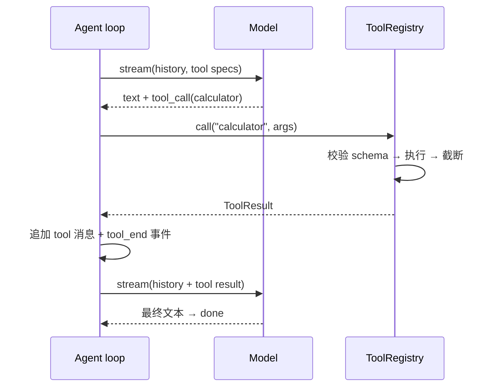

# 第 4 章　工具协议与首批工具 / Tool Protocol and First Tools

> **EvoFlow 对照状态 / Alignment status：** 📄 **原文迁移**——内容是教材版自研实现，完整迁移、未与 EvoFlow 源码核对。
>
> ::: warning 与 EvoFlow 真实实现的差异
> 本章自研 `tools.py` + JSON schema 注册。EvoFlow 的工具治理是**分层中间件**：`agents/middlewares/` 有 71 个条目、约 60 个类，其中 `tool_approval_middleware.py` 一个文件 1553 行（含 4 个类），审批、错误兜底、审计各自成层。详见 [03/03](../03-工具深化与上下文控制/03-Middleware调用链与工具审计.md)。
> :::


## 本章目标 / Goals
- 一个带 **schema** 与 **alias** 的工具注册表。
- 统一的 **结果信封 / result envelope**：`ok / content / truncated / error`。
- 一个安全的内置工具：**calculator（AST 白名单，绝不 `eval`）**。
- Agent 循环：`模型 → 工具 → 模型`，直到模型停止或达到 `max_steps`。

## 最小闭环 / Minimal closed loop
用户问 `12*(3+4)?` → 模型发出 `calculator` 调用 → 工具返回 `84` → 模型输出最终答案。

## 调用逻辑 / Invocation logic


## 4.1 工具目录、别名与 Schema / Catalog, aliases, and schema
**核心概念**
- **name vs alias**：模型可能用不同写法调用同一工具（如 `calc`）；注册时检查冲突，查找时先解析 alias。
- **schema**：同时服务于两件事 —— 告诉模型怎么传参、在执行前校验参数。
- **specs()**：只把 `name / description / parameters` 暴露给模型，不暴露 handler。

## 4.2 工具结果协议与截断 / Result protocol and truncation
**业务规则**
1. 工具失败 **不抛异常**，而是返回 `ok=false` 的 `ToolResult`，错误会作为 `tool` 消息回给模型，让它有机会自我修正。
2. 输出超过 `max_chars` 时截断，并附上被截断的字符数；`truncated=true` 同步体现在事件里。
3. 未知工具、缺参数、类型不符都走同一结果信封。

## 4.3 内置计算工具与安全求值 / Calculator and safe evaluation
`ast.parse` 后只放行：数字常量、`+ - * / // % **`、一元 `+ -`。额外限制：表达式长度 ≤ 200，指数绝对值 ≤ 100（防止 `2**1000000` 拖垮进程）。属性访问、函数调用、名称、`bool` 常量一律拒绝。

## 4.4 Agent 循环 / The agent loop
```python
for _ in range(self.max_steps):
                messages = [{"role": "system", "content": self.render_prompt()}] + self.store.get_messages(session_id)
                text, calls = [], []
                for kind, payload in self.model.stream(messages, self.registry.specs()):
                    if kind == "token":
                        text.append(payload); emit("token", {"text": payload})
                    elif kind == "tool_call":
                        calls.append(payload)
                    elif kind == "done":
                        for k in total: total[k] += payload.get("usage", {}).get(k, 0)
                self.store.add_message(session_id, "assistant", "".join(text),
                                       tool_calls=[{"id": c.id, "name": c.name, "arguments": c.arguments} for c in calls] or None)
                if not calls:
                    self.store.set_run_status(run_id, "done")
                    emit("done", {"text": "".join(text), "usage": total}); return
                for c in calls:
                    emit("tool_start", {"id": c.id, "name": c.name, "arguments": c.arguments})
                    res = self.registry.call(c.name, c.arguments)
                    body = res.content if res.ok else f"ERROR: {res.error}"
                    self.store.add_message(session_id, "tool", body, tool_call_id=c.id, name=c.name)
                    emit("tool_end", {"id": c.id, "ok": res.ok, "truncated": res.truncated, "content": body})
            raise RuntimeError(f"max_steps ({self.max_steps}) reached")
```

**关键设计**
- 每次迭代都 **重新读取** 存储里的历史，使「恢复」与「循环」共用同一份真相（第 2 部分的 checkpoint 会依赖这一点）。
- `max_steps` 触发时抛错，被外层捕获为 `error` 事件，run 状态为 `failed`。
- 模型一次可以发出多个 tool_call，这里按顺序执行；并行执行留作扩展。

## 示例代码 / Sample code
### `evoflow_min/tools.py`
```python
"""Tool registry, result envelope, truncation, safe calculator. (Chapter 1.4)"""
from __future__ import annotations
import ast, operator
from dataclasses import dataclass, field
from typing import Callable

@dataclass
class ToolResult:
    ok: bool
    content: str
    truncated: bool = False
    error: str | None = None

@dataclass
class Tool:
    name: str
    description: str
    schema: dict                     # JSON-schema-like: {"type":"object","properties":{...},"required":[...]}
    handler: Callable[..., str]
    aliases: tuple[str, ...] = ()

_TYPES = {"string": str, "integer": int, "number": (int, float), "boolean": bool, "object": dict, "array": list}

def validate_args(schema: dict, args: dict) -> str | None:
    if not isinstance(args, dict):
        return "arguments must be an object"
    for key in schema.get("required", []):
        if key not in args:
            return f"missing required argument: {key}"
    for key, spec in schema.get("properties", {}).items():
        if key in args:
            py = _TYPES.get(spec.get("type"))
            v = args[key]
            if py and (not isinstance(v, py) or (spec["type"] != "boolean" and isinstance(v, bool))):
                return f"argument {key} must be {spec['type']}"
    return None

class ToolRegistry:
    def __init__(self, max_chars: int = 2000):
        self._tools: dict[str, Tool] = {}
        self._alias: dict[str, str] = {}
        self.max_chars = max_chars
    def register(self, tool: Tool) -> None:
        for n in (tool.name, *tool.aliases):
            if n in self._tools or n in self._alias:
                raise ValueError(f"tool name already registered: {n}")
        self._tools[tool.name] = tool
        for a in tool.aliases:
            self._alias[a] = tool.name
    def get(self, name: str) -> Tool | None:
        return self._tools.get(self._alias.get(name, name))
    def specs(self) -> list[dict]:
        return [{"name": t.name, "description": t.description, "parameters": t.schema} for t in self._tools.values()]
    def call(self, name: str, args: dict) -> ToolResult:
        tool = self.get(name)
        if tool is None:
            return ToolResult(False, "", error=f"unknown tool: {name}")
        err = validate_args(tool.schema, args)
        if err:
            return ToolResult(False, "", error=err)
        try:
            out = str(tool.handler(**args))
        except Exception as e:                       # tool failures become data, not crashes
            return ToolResult(False, "", error=f"{type(e).__name__}: {e}")
        if len(out) > self.max_chars:
            return ToolResult(True, out[: self.max_chars] + f"\n...[truncated {len(out) - self.max_chars} chars]", truncated=True)
        return ToolResult(True, out)

# ---- safe calculator: AST allow-list, never eval() ---------------------------
_BIN = {ast.Add: operator.add, ast.Sub: operator.sub, ast.Mult: operator.mul,
        ast.Div: operator.truediv, ast.FloorDiv: operator.floordiv, ast.Mod: operator.mod, ast.Pow: operator.pow}
_UN = {ast.UAdd: operator.pos, ast.USub: operator.neg}

def safe_eval(expr: str):
    if len(expr) > 200:
        raise ValueError("expression too long")
    def ev(n):
        if isinstance(n, ast.Expression): return ev(n.body)
        if isinstance(n, ast.Constant) and isinstance(n.value, (int, float)) and not isinstance(n.value, bool): return n.value
        if isinstance(n, ast.BinOp) and type(n.op) in _BIN:
            a, b = ev(n.left), ev(n.right)
            if isinstance(n.op, ast.Pow) and abs(b) > 100:
                raise ValueError("exponent too large")
            return _BIN[type(n.op)](a, b)
        if isinstance(n, ast.UnaryOp) and type(n.op) in _UN: return _UN[type(n.op)](ev(n.operand))
        raise ValueError(f"unsupported syntax: {type(n).__name__}")
    return ev(ast.parse(expr, mode="eval"))

def calculator_tool() -> Tool:
    return Tool("calculator", "Evaluate an arithmetic expression.",
                {"type": "object", "properties": {"expression": {"type": "string"}}, "required": ["expression"]},
                lambda expression: safe_eval(expression), aliases=("calc",))
```

## 常见坑 / Pitfalls
- 用 `eval` 实现 calculator。
- 工具异常直接抛出导致整个 run 崩溃，模型没有机会重试。
- 工具输出不限长，把上下文窗口撑爆（第 3 部分的上下文预算会继续处理）。
- 把 handler 放进发给模型的 spec 里。

## 验收 / Acceptance
- [x] 模型请求的计算得到正确结果（`test_loop_with_tool`）
- [x] 超长输出带标记截断；别名可用；缺参被拒绝（`test_truncation_and_errors`）
- [x] 恶意表达式被拒绝（`test_calc_safety`）
- [x] 无限工具循环被 `max_steps` 终止（`test_max_steps_guard`）

## 后续扩展预告 / What builds on this
- 第 3 部分：文件/终端工具、中间件审计、上下文预算。
- 第 9 部分：MCP 工具映射进同一个注册表。可参考 Harbor404 笔记《MCP 中台 Tool 数量治理成熟架构方案》（[链接](https://harbor404.fushenlin.com/notes/mcp-tool-governance-architecture/)，仅看过标题，尚未阅读正文）。

## 对照 EvoFlow 核对清单
- [ ] 工具目录的 alias 与 schema 约定
- [ ] 工具结果协议与截断策略
- [ ] 内置工具清单与宿主边界

## 从零实现（手把手）
> 读完这章你有一个工具注册表：注册即有 schema，模型能看见，执行能落到函数。
> 路径均相对 `backend/`，代码注释写「为什么」。

### Step 1　新建 registry.py：ToolSpec + 注册表
**文件**：`packages/harness/myagentflow/tools/registry.py（新建）`
**要写的逻辑**：`ToolSpec` 冻结；`schemas()` 输出 OpenAI function calling 形状；`call()` 统一入口，未知工具给明确报错。

**代码**

```python
"""工具注册表：一个数据结构 + 三个方法。

为什么要 ToolSpec 而不是裸函数：模型要的是 name/description/JSON Schema，
执行要的是可调用对象，两者必须绑在一起，否则迟早对不上。
"""
from __future__ import annotations

from collections.abc import Callable
from dataclasses import dataclass
from typing import Any


@dataclass(frozen=True)
class ToolSpec:
    name: str
    description: str
    input_schema: dict[str, Any]
    fn: Callable[..., Any]


class ToolRegistry:
    def __init__(self) -> None:
        self._tools: dict[str, ToolSpec] = {}

    def register(self, spec: ToolSpec) -> None:
        if spec.name in self._tools:
            raise ValueError(f"工具重名：{spec.name}")
        self._tools[spec.name] = spec

    def schemas(self) -> list[dict[str, Any]]:
        """给模型看的形状。字段名照 OpenAI function calling，别自创。"""
        return [
            {
                "type": "function",
                "function": {
                    "name": s.name,
                    "description": s.description,
                    "parameters": s.input_schema,
                },
            }
            for s in self._tools.values()
        ]

    def call(self, name: str, args: dict[str, Any]) -> Any:
        spec = self._tools.get(name)
        if spec is None:
            raise KeyError(f"未注册的工具：{name}")
        return spec.fn(**args)
```

**验证**

```bash
uv run python -c "from myagentflow.tools.registry import ToolRegistry, ToolSpec; print('import ok')"
```

### Step 2　加第一个工具：echo
**文件**：`packages/harness/myagentflow/tools/builtins/echo.py（新建）`
**要写的逻辑**：把「函数 + schema」一起定义，注册时一行搞定。

**代码**

```python
"""第一个内置工具：echo。它的价值是「证明通路」，不是功能。"""
from __future__ import annotations

from myagentflow.tools.registry import ToolRegistry, ToolSpec


def _echo(text: str) -> str:
    return text


def register_echo(registry: ToolRegistry) -> None:
    registry.register(
        ToolSpec(
            name="echo",
            description="把输入原样返回，用于验证工具通路",
            input_schema={
                "type": "object",
                "properties": {"text": {"type": "string", "description": "要回显的文本"}},
                "required": ["text"],
            },
            fn=_echo,
        )
    )
```

**验证**

```bash
uv run python -c "
from myagentflow.tools.registry import ToolRegistry
from myagentflow.tools.builtins.echo import register_echo
r = ToolRegistry(); register_echo(r)
print(r.schemas()); print(r.call('echo', {'text': 'ok'}))
"
```

### Step 3　写测试：schema 形状 + 未知工具报错
**文件**：`tests/chapters/test_ch01_04_tools.py（新建）`
**要写的逻辑**：断言 `type == function`、必填字段、调用结果、重复注册报错。

**代码**

```python
from __future__ import annotations

import pytest


def test_schema_and_call():
    from myagentflow.tools.builtins.echo import register_echo
    from myagentflow.tools.registry import ToolRegistry

    r = ToolRegistry()
    register_echo(r)
    schema = r.schemas()[0]
    assert schema["type"] == "function"
    assert schema["function"]["name"] == "echo"
    assert schema["function"]["parameters"]["required"] == ["text"]
    assert r.call("echo", {"text": "hi"}) == "hi"


def test_unknown_tool():
    from myagentflow.tools.registry import ToolRegistry

    with pytest.raises(KeyError):
        ToolRegistry().call("nope", {})
```

**验证**

```bash
uv run pytest tests/chapters/test_ch01_04_tools.py -v
# 期望：2 passed
```

### 与 EvoFlow 对照

| 我们的做法 | EvoFlow | 为什么 |
|---|---|---|
| `name/description/input_schema` 三件套 | `tools/` 下的工具定义与 schema 生成 | 少一个模型就看不懂工具 |
| 未知工具直接抛错 | 工具分发处的显式分支 | 静默返回 None 会让模型一直重试 |

### 知识点

- [agent-book · LangGraph 课程](https://g0-000.github.io/agent-book/langgraph/)：tool calling 与 ToolNode
- [Harbor404](https://harbor404.fushenlin.com/)：工具调用失败的生产排查思路

### 验收

```bash
uv run pytest tests/chapters/test_ch01_04_tools.py -q
```
