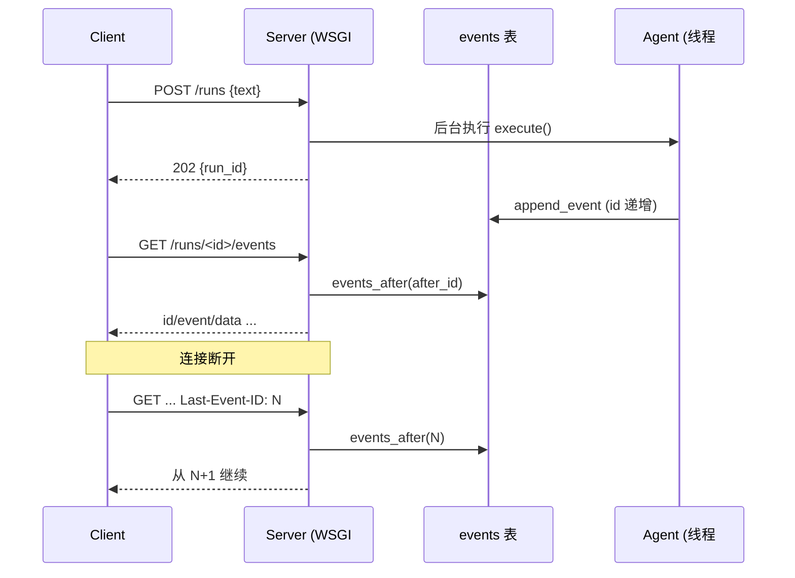

# 第 5 章　流式事件与断线恢复 / Streaming Events and SSE Recovery

> **EvoFlow 对照状态 / Alignment status：** 📄 **原文迁移**——内容是教材版自研实现，完整迁移、未与 EvoFlow 源码核对。
>
> ::: warning 与 EvoFlow 真实实现的差异
> 本章自己写 SSE 帧。EvoFlow 的链路是 **LangGraph streaming → AG-UI 事件 → v4 projection**，断线恢复依赖 run 状态与检查点，而不是重放自建日志。详见 [02/02 运行生命周期与取消](../02-持久化与运行生命周期/02-运行生命周期与取消.md)。
> :::


## 本章目标 / Goals
- 定义带 **单调递增 id** 的事件；事件先写入存储，再推给客户端。
- 用 **SSE（Server-Sent Events）** 流式输出。
- 支持 **`Last-Event-ID` 重放**：断线重连后既不丢事件也不重复。

## 最小闭环 / Minimal closed loop
`POST /sessions → POST /sessions/<id>/runs → GET /runs/<id>/events`（断线后带 `Last-Event-ID` 再 GET）

## 调用逻辑 / Invocation logic


## 5.1 流事件的生产 / Producing stream events
| 事件 type | 含义 | data 关键字段 |
|---|---|---|
| `run_start` | 执行开始 | `session_id` |
| `token` | 一段增量文本 | `text` |
| `tool_start` | 工具开始 | `id, name, arguments` |
| `tool_end` | 工具结束 | `id, ok, truncated, content` |
| `done` | 正常结束（终止事件） | `text, usage` |
| `error` | 失败结束（终止事件） | `message`（已脱敏） |

**为什么「先写库、再推送」：** 事件日志是唯一真相。推送只是读日志；连接断了不会丢数据，Agent 也不需要知道有没有客户端在听。

## 5.2 流式消费与 SSE 恢复 / Consuming streams and recovery
**协议细节**
- 每条消息格式：`id: <n>\nevent: <type>\ndata: <json>\n\n`。
- 浏览器 `EventSource` 重连时自动携带 `Last-Event-ID`；服务端据此调用 `events_after(run_id, after_id)`。
- 终止事件发出后关闭流；超时（`timeout`）也会关闭，客户端可重连。

**语义 / Delivery semantics**
- 服务端按 id 严格递增输出；客户端以「已处理的最大 id」作为游标，所以是 **至少一次发送 + 客户端按 id 去重 = 效果上恰好一次**。
- 这里的 id 同时是 **幂等键**：同一个 id 重复到达可以直接丢弃。

## 示例代码 / Sample code
### 我方实现：`runtime/streaming.py`

> **EvoFlow 对应**：`app_server/chat_bridge.py`（AG-UI 事件流 / SSE 推送）。下面为我方实现。
```python
"""WSGI app: create sessions, start runs, stream events over SSE with Last-Event-ID replay. (Chapter 1.5)"""
from __future__ import annotations
import json, re, threading, time
from .agent import Agent, TERMINAL
from .store import Store

def sse_format(ev: dict) -> bytes:
    return f"id: {ev['id']}\nevent: {ev['type']}\ndata: {json.dumps(ev['data'], ensure_ascii=False)}\n\n".encode()

def make_app(agent: Agent, store: Store, background: bool = True, poll: float = 0.01, timeout: float = 10.0):
    def respond(start, code, body: dict):
        data = json.dumps(body).encode()
        start(code, [("Content-Type", "application/json"), ("Content-Length", str(len(data)))]); return [data]
    def app(environ, start):
        method, path = environ["REQUEST_METHOD"], environ["PATH_INFO"]
        if method == "POST" and path == "/sessions":
            return respond(start, "201 Created", {"session_id": store.create_session()})
        m = re.fullmatch(r"/sessions/(\w+)/runs", path)
        if method == "POST" and m:
            sid = m.group(1)
            try:
                body = json.loads(environ["wsgi.input"].read(int(environ.get("CONTENT_LENGTH") or 0)) or b"{}")
                rid = agent.start_run(sid)
            except KeyError:
                return respond(start, "404 Not Found", {"error": "unknown session"})
            except json.JSONDecodeError:
                return respond(start, "400 Bad Request", {"error": "invalid JSON"})
            if not body.get("text"):
                return respond(start, "400 Bad Request", {"error": "text is required"})
            job = lambda: agent.execute(sid, rid, body["text"])
            threading.Thread(target=job, daemon=True).start() if background else job()
            return respond(start, "202 Accepted", {"run_id": rid})
        m = re.fullmatch(r"/runs/(\w+)/events", path)
        if method == "GET" and m:
            rid = m.group(1)
            if store.run_status(rid) is None:
                return respond(start, "404 Not Found", {"error": "unknown run"})
            last = environ.get("HTTP_LAST_EVENT_ID") or "0"
            after = int(last) if last.isdigit() else 0
            start("200 OK", [("Content-Type", "text/event-stream"), ("Cache-Control", "no-cache")])
            def gen():
                nonlocal after
                deadline = time.time() + timeout
                while time.time() < deadline:
                    for ev in store.events_after(rid, after):
                        after = ev["id"]; yield sse_format(ev)
                        if ev["type"] in TERMINAL: return
                    time.sleep(poll)
            return gen()
        return respond(start, "404 Not Found", {"error": "not found"})
    return app
```

### 演示脚本输出 / Demo output（`python demo.py`，真实运行结果）
```text
== full stream ==
id: 1  event: run_start   {"session_id": "..."}
id: 2  event: token       {"text": "Let "}
id: 3  event: token       {"text": "me "}
id: 4  event: token       {"text": "compute."}
id: 5  event: tool_start  {"id": "call_1_0", "name": "calculator", "arguments": {"expression": "12*(3+4)"}}
id: 6  event: tool_end    {"id": "call_1_0", "ok": true, "truncated": false, "content": "84"}
id: 7..10 event: token    "The " "answer " "is " "84"
id: 11 event: done        {"text": "The answer is 84", "usage": {...}}

== reconnect with Last-Event-ID: 5 ==
id: 6 ... id: 11   （从 6 开始，没有重复、没有遗漏）
```
> 为便于阅读，上面把每条事件压缩成了一行；真实输出遵循 SSE 多行格式。

## 常见坑 / Pitfalls
- 用内存队列而不是持久化日志：重启或断线就丢事件。
- 事件 id 不单调（例如用时间戳）：重放会乱序或重复。
- 流不会结束：忘记在终止事件后关闭；或没有超时。
- 轮询（本实现的 `poll`）在高并发下浪费资源 → 生产环境改用通知机制（条件变量、Redis Stream、数据库 LISTEN/NOTIFY）。

## 性能与延迟 / Performance notes
首个 token 的延迟、增量大小、批量写库的频率都会影响体验。可参考 Harbor404《LLM / Agent 推理链路延迟优化》（[链接](https://harbor404.fushenlin.com/notes/llm-agent-latency-optimization/)，仅看过标题）。

## 验收 / Acceptance
- [x] 客户端按顺序看到 token 与工具事件（`test_end_to_end_and_resume`）
- [x] 断线后重连，无丢失、无重复（同上，用 `ids[2]` 模拟断点）
- [x] 错误路径：未知 session → 404；缺 `text` → 400（`test_errors`）
- [x] SSE 格式与非 ASCII 内容（`test_sse_format`）

## 对照 EvoFlow 核对清单
- [ ] EvoFlow 的事件类型、字段与版本
- [ ] 它的恢复机制（SSE / WebSocket / 其他）与游标语义
- [ ] 事件日志的保留与清理策略

## 从零实现（手把手）
> 读完这章你能把图的执行过程变成 SSE 事件流，并且知道断线后靠什么恢复。
> 路径均相对 `backend/`，代码注释写「为什么」。

### Step 1　新建 events.py：一个事件类型 + 一个序列化
**文件**：`packages/harness/myagentflow/runtime/events.py（新建）`
**要写的逻辑**：事件只保留 `type` + `data`；`to_sse()` 输出标准 SSE 帧；断线恢复靠 `Last-Event-ID`，所以每条事件带 `seq`。

**代码**

```python
"""流式事件：统一形状 + SSE 序列化。

为什么事件要带 seq：前端断线重连时用 Last-Event-ID 续传，
没有 seq 就只能整段重放，用户会看到重复内容。
"""
from __future__ import annotations

import json
from dataclasses import dataclass, field
from itertools import count
from typing import Any


@dataclass
class StreamEvent:
    type: str                      # token | tool | done | error
    data: dict[str, Any] = field(default_factory=dict)
    seq: int = 0

    def to_sse(self) -> str:
        payload = json.dumps({**self.data, "seq": self.seq}, ensure_ascii=False)
        return f"id: {self.seq}\nevent: {self.type}\ndata: {payload}\n\n"


class EventStream:
    """把「生成事件」和「排 seq」分开，调用方只管产出业务数据。"""

    def __init__(self) -> None:
        self._counter = count(1)

    def emit(self, type_: str, **data: Any) -> StreamEvent:
        return StreamEvent(type=type_, data=data, seq=next(self._counter))
```

**验证**

```bash
uv run python -c "
from myagentflow.runtime.events import EventStream
s = EventStream(); e = s.emit('token', text='你')
print(repr(e.to_sse()))
"
```

### Step 2　把图事件映射成 StreamEvent
**文件**：`packages/harness/myagentflow/runtime/streaming.py（新建）`
**要写的逻辑**：只挑 `on_chat_model_stream` 与 `on_tool_end` 两类，其余忽略——事件太多会把前端淹没。

**代码**

```python
"""把 LangGraph 的 astream_events 收敛成我们自己的事件。"""
from __future__ import annotations

from collections.abc import AsyncIterator
from typing import Any

from myagentflow.runtime.events import EventStream


async def stream_graph(graph: Any, payload: dict, config: dict) -> AsyncIterator[str]:
    stream = EventStream()
    try:
        async for raw in graph.astream_events(payload, config=config, version="v2"):
            kind = raw.get("event")
            if kind == "on_chat_model_stream":
                chunk = raw["data"].get("chunk")
                text = getattr(chunk, "content", "") or ""
                if text:
                    yield stream.emit("token", text=text).to_sse()
            elif kind == "on_tool_end":
                yield stream.emit("tool", name=raw.get("name"), output=str(raw["data"].get("output"))[:500]).to_sse()
        yield stream.emit("done").to_sse()
    except Exception as exc:  # 流里抛异常会让前端「卡住」，必须显式发 error
        yield stream.emit("error", message=str(exc)).to_sse()
```

**验证**

```bash
uv run python -c "from myagentflow.runtime.streaming import stream_graph; print('import ok')"
```

### 与 EvoFlow 对照

| 我们的做法 | EvoFlow | 为什么 |
|---|---|---|
| `event/type/data` 三元组 | AG-UI 事件的最外层字段 | 前端按 type 分派，不看内容猜 |
| `Last-Event-ID` 续传 | Gateway 的 SSE 实现 | 没有 seq 就无法断点续传 |

### 知识点

- [agent-book · LangGraph 课程](https://g0-000.github.io/agent-book/langgraph/)：`astream_events`
- [Harbor404 · 推理链路延迟优化](https://harbor404.fushenlin.com/notes/llm-agent-latency-optimization/)：首字节延迟为什么要先发 token 再发结构化事件

### 验收

```bash
uv run python -c "from myagentflow.runtime.events import EventStream; print(EventStream().emit('done').to_sse())"
```
