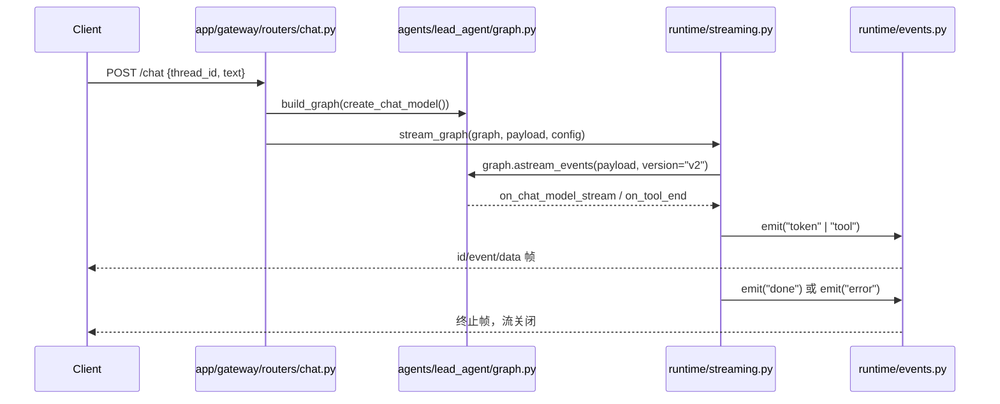

# 第 5 章　流式事件与断线恢复 / Streaming Events and SSE Recovery

## 本章目标 / Goals
- 把图的执行过程映射成 SSE 事件：`token` / `tool` / `done` / `error`。
- 每条事件带自增 `seq`，客户端可按 id 排序、去重。
- 出错时发 `error` 并结束流，不让前端一直等。

## 最小闭环 / Minimal closed loop
`POST /chat {thread_id, text}` → `text/event-stream`，逐条返回事件帧。
真实入口：`backend/app/gateway/routers/chat.py`。

## 调用逻辑 / Invocation logic


## 5.1 流事件的生产 / Producing stream events
| 事件 type | 含义 | data 关键字段 |
|---|---|---|
| `token` | 一段增量文本 | `text` |
| `tool` | 一次工具执行完成 | `name`、`output`（截断到 500 字符） |
| `done` | 正常结束（终止事件） | 无 |
| `error` | 失败结束（终止事件） | `message` |

`seq` 从 1 开始、每条加一，写在 SSE 的 `id:` 行，同时塞进 data，客户端无需解析文本行。

**只挑两类底层事件：** `on_chat_model_stream` 与 `on_tool_end`。`astream_events` 还会吐节点开始/结束等噪声，全转给前端只会淹没真正的增量。

## 5.2 流式消费 / Consuming the stream
- 帧格式：`id: <seq>\nevent: <type>\ndata: <json>\n\n`。
- 客户端按到达顺序消费；`token` 拼文本，`tool` 记一条执行记录。
- 收到 `done` 或 `error` 即流结束；连接断开时 `StreamingResponse` 会取消生成器，无需手工清理。

**本章不做服务端重放：** 断线重连等于开一条新流。真正的「按 Last-Event-ID 续传」需要 run 状态 + 事件表，见第 02 部分。

## 常见坑 / Pitfalls
- 异常不收敛成 `error`：生成器抛出后连接悬空，前端一直转圈。
- 忘记发 `done`：客户端无法判断正常结束。
- 每个 token 都写库：写放大严重；本章只推不存。
- 把 SSE 当双向通道：它只能服务端→客户端，发消息要另开 POST。

## 性能与延迟 / Performance notes
首 token 延迟取决于模型首包；`token` 逐段转发，不要攒完整回复再发。工具输出只带截断后的 500 字符，避免大结果把流撑爆。

## 验收 / Acceptance
- [x] `tests/chapters/test_ch01_06_e2e.py::test_end_to_end`：SSE 首帧从 `id: 1` 开始，终止帧可解析。
- [x] `tests/chapters/test_ch13_01_e2e.py::test_full_chain`：`EventStream().emit("done").to_sse()` 形状正确。
- [x] `backend/packages/harness/myagentflow/runtime/streaming.py` 的异常分支收敛成 `error` 事件（读代码确认，无联网测试）。

## 对照 EvoFlow 核对清单
- [ ] EvoFlow 的 AG-UI 事件类型与字段命名
- [ ] v4 projection 如何把 LangGraph 事件映射成前端协议
- [ ] 断线恢复依赖的 run 状态与检查点细节

## 从零实现（手把手）
> 读完这章你能把图的执行过程变成 SSE 事件流，并且知道断线后靠什么恢复。
> 文件路径一律写仓库全路径（`backend/...`），代码注释写「为什么」。

### Step 1　新建 events.py：一个事件类型 + 一个序列化
**文件**：`backend/packages/harness/myagentflow/runtime/events.py（新建）`
**要写的逻辑**：事件只保留 `type` + `data`；`to_sse()` 输出标准 SSE 帧；断线恢复靠 `Last-Event-ID`，所以每条事件带 `seq`。

**代码**

```python
"""流式事件：统一形状 + SSE 序列化。

为什么事件要带 seq：前端断线重连时用 Last-Event-ID 续传，
没有 seq 就只能整段重放，用户会看到重复内容。
"""
from __future__ import annotations

import json
from dataclasses import dataclass, field
from itertools import count
from typing import Any


@dataclass
class StreamEvent:
    type: str                      # token | tool | done | error
    data: dict[str, Any] = field(default_factory=dict)
    seq: int = 0

    def to_sse(self) -> str:
        payload = json.dumps({**self.data, "seq": self.seq}, ensure_ascii=False)
        return f"id: {self.seq}\nevent: {self.type}\ndata: {payload}\n\n"


class EventStream:
    """把「生成事件」和「排 seq」分开，调用方只管产出业务数据。"""

    def __init__(self) -> None:
        self._counter = count(1)

    def emit(self, type_: str, **data: Any) -> StreamEvent:
        return StreamEvent(type=type_, data=data, seq=next(self._counter))
```

**验证**

```bash
uv run python -c "
from myagentflow.runtime.events import EventStream
s = EventStream(); e = s.emit('token', text='你')
print(repr(e.to_sse()))
"
```

### Step 2　把图事件映射成 StreamEvent
**文件**：`backend/packages/harness/myagentflow/runtime/streaming.py（新建）`
**要写的逻辑**：只挑 `on_chat_model_stream` 与 `on_tool_end` 两类，其余忽略——事件太多会把前端淹没。

**代码**

```python
"""把 LangGraph 的 astream_events 收敛成我们自己的事件。"""
from __future__ import annotations

from collections.abc import AsyncIterator
from typing import Any

from myagentflow.runtime.events import EventStream


async def stream_graph(graph: Any, payload: dict, config: dict) -> AsyncIterator[str]:
    stream = EventStream()
    try:
        async for raw in graph.astream_events(payload, config=config, version="v2"):
            kind = raw.get("event")
            if kind == "on_chat_model_stream":
                chunk = raw["data"].get("chunk")
                text = getattr(chunk, "content", "") or ""
                if text:
                    yield stream.emit("token", text=text).to_sse()
            elif kind == "on_tool_end":
                yield stream.emit("tool", name=raw.get("name"), output=str(raw["data"].get("output"))[:500]).to_sse()
        yield stream.emit("done").to_sse()
    except Exception as exc:  # 流里抛异常会让前端「卡住」，必须显式发 error
        yield stream.emit("error", message=str(exc)).to_sse()
```

**验证**

```bash
uv run python -c "from myagentflow.runtime.streaming import stream_graph; print('import ok')"
```

### 与 EvoFlow 对照

| 我们的做法 | EvoFlow | 为什么 |
|---|---|---|
| `event/type/data` 三元组 | AG-UI 事件的最外层字段 | 前端按 type 分派，不看内容猜 |
| `Last-Event-ID` 续传 | Gateway 的 SSE 实现 | 没有 seq 就无法断点续传 |

### 知识点

- [agent-book · LangGraph 课程](https://g0-000.github.io/agent-book/langgraph/)：`astream_events`
- [Harbor404 · 推理链路延迟优化](https://harbor404.fushenlin.com/notes/llm-agent-latency-optimization/)：首字节延迟为什么要先发 token 再发结构化事件

### 验收

```bash
uv run python -c "from myagentflow.runtime.events import EventStream; print(EventStream().emit('done').to_sse())"
```
